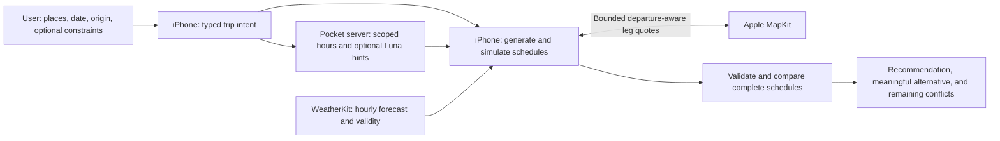

# Hybrid v3: schedule-first itinerary planning

Date: 2026-11-17. Status: research recommendation for a prototype. This note builds on the [hours-optional design](pocket-hours-optional-luna-ordering.md) and uses the current Pocket checkout as the implementation baseline. No app changes, trip provider calls, new model runs, or device tests were made for this research.

## Recommendation

Use **Hybrid v3** as the working name for an engine that computes several complete schedules and uses Luna to interpret the experience. The iPhone owns the schedule and evaluates each displayed route through its final endpoint. The Pocket server supplies scoped facts and optional semantic advice. Luna proposes typed activity, duration, and preference hints. The first prototype uses at most one semantic call and can return a provisional answer if the call fails. Consider a second call to rank close, validated choices only as a separate experiment.

Model this as a single route with mandatory stops, time windows, visit durations, and travel costs that depend on departure time. Tourist orienteering research also optimizes which places to include. Travelant already has the user's selected places and must retain each exactly once. Reuse the scheduling ideas while preserving that invariant. [Exact and anytime time-dependent TSP with time windows, Fontaine et al.](https://doi.org/10.1016/j.ejor.2023.06.001) · [Time-Dependent Orienteering with Time Windows, Verbeeck et al.](https://backoffice.biblio.ugent.be/download/4189023/4189024) · [Stochastic time-dependent extension](https://doi.org/10.1016/j.ejor.2016.05.031)

## Gaps in the current selected-place Pocket flow

| Current behavior | v3 proposal |
| --- | --- |
| The first Pocket job sets the window to tomorrow, the review clock defaults to 08:00, and the order request sends a date without the selected clock time. | Accept the date and a distinct time intent before creating the first job. [Job creation](../../packages/C67Backend/Sources/Data/Planning/PocketPlanningRepository.swift#L104) · [Review clock](../../packages/C67Backend/Sources/Domain/Planning/PlanningExperience.swift#L108) · [Order payload](../../packages/C67Backend/Sources/Data/Planning/PocketOrdering.swift#L99) |
| Both Hybrid modes draw from a small coordinate-based menu. Its secondary order uses a reversal heuristic. Neither option is generated with date-specific visit windows or road ETA. | Seed from different objectives, including endpoints and urgent time windows, then compare full schedules. [Candidate generator](../../server/pocket/src/ordering.py#L79) |
| The device tries individual adjacent swaps for some Hybrid Weather trips with known regular-hours conflicts. The timeline omits actual waiting and a final leg in this path. Display fallbacks use six minutes of travel and 30 minutes of dwell. | Propagate waiting, calculate the final leg, and expose unknown values before making timing claims. [Hours and route path](../../packages/C67Backend/Sources/Data/Planning/PocketPlanningRepository.swift#L705) · [Display estimates](../../packages/C67Backend/Sources/Domain/Planning/PlanningExperience.swift#L105) |
| The server explicitly sets activity exposure and candidate arrivals to unknown. Its Apple forecast adapter currently forwards precipitation and clouds without apparent temperature or UV. | Evaluate weather where activity segments and forecast hours overlap, with explicit coverage and freshness. [Forecast adapter](../../server/pocket/src/ordering.py#L155) · [Weather assessment](../../server/pocket/src/ordering.py#L250) |
| Only a user-selected main spot can be labelled main. Editing departure recalculates driving estimates without reassessing candidates and dated context. | Keep suggested focus separate from a user pin. Recompute data affected by a time/date edit, preview a revised order, and honor any manual order lock. [Main role](../../server/pocket/src/ordering.py#L360) · [Departure update](../../packages/C67Backend/Sources/Data/Planning/PocketPlanningRepository.swift#L654) |

The maintained [PocketEngine scheduler](../../packages/PocketEngine/Sources/PocketEngine/Itinerary.swift#L94) and the [archived time-aware planner](../../research/poc-journey/apps/c67-trip-integration/Packages/TripIntegration/Sources/TripIntegration/VendorRouting/NativeTripTimeAwarePlanner.swift) already contain building blocks for waiting, departure-aware quotes, return legs and bounded search. Reuse selected functions and fixtures. Prior catalog requirements, same-day restrictions and stop caps belong to their own flows. [Return-leg implementation](../../packages/PocketEngine/Sources/PocketEngine/Itinerary.swift#L337) · [Wait-slot calculation](../../packages/PocketEngine/Sources/PocketEngine/Itinerary.swift#L506)

## Proposed data flow



1. **Ask only for durable intent.** Take the selected places, date, and starting point. Offer a visible and editable return-to-origin default. Distinguish fixed departure, fixed first-visit start, and flexible window. Honor a deadline, booking, first-stop lock or manual order when supplied. Keep weather preference and wait tolerance distinct from confirmed opening times. Set “Let Travelant decide” as the suggested initial option. Ask what the user plans to do at a stop only when the answer may change the recommendation.
2. **Retrieve facts with scope.** Identify each branch by place ID. Record activity or subarea when applicable, zone, date scope, source, and freshness. A date-specific record can constrain its exact activity. Weekly hours can establish a regular-hours fit or conflict, with special-date changes still possible. The category hint for a cinema (10:00–02:00 next day) can seed search. It cannot confirm access or a showtime. Separate reported closure, absent hours, source error, scope mismatch, and missing forecast. If the outcome depends on such a gap, surface it at the affected stop. [MapKit Place IDs](https://developer.apple.com/documentation/mapkit/identifying-unique-locations-with-place-ids) · [Hours provider](../../server/pocket/src/hours.py) · [OpeningHoursSpecification and date ranges](https://schema.org/OpeningHoursSpecification) · [Special hours override](https://schema.org/specialOpeningHoursSpecification)
3. **Use Luna for semantic work.** In parallel with fact retrieval when possible, have Luna propose a typed activity, duration range, and soft preference or focus with a rationale. A campus could be a library visit or an outdoor walk. Validate supported IDs, values and provenance. If confidence does not support selecting one activity, keep ambiguity or ask one targeted question. Schedule times and measurable reasons are rendered from the evaluator. Test optional Luna reranking separately on candidates that already respect the same constraints. Prior constraint-based travel research supports this division of work, but its benchmark scores do not measure Luna or C67 quality. [Constraint-based travel planning, NAACL 2025](https://aclanthology.org/2025.naacl-long.176/) · [TravelPlanner, ICML 2024](https://proceedings.mlr.press/v235/xie24j.html)
4. **Explain the decision.** Show a recommended schedule with driving, waiting, visits and estimated trip finish. Offer an alternative only if its trade-off matters. Show the smallest useful change for a conflict, such as a later first visit or later return deadline. Report “no suitable schedule found within the search budget” when applicable. Reserve any infeasibility claim for demonstrated contradictions. Keep all selected places visible, including unresolved ones.

## Schedule evaluator and search

For each candidate order and proposed departure, evaluate the following chain:

```text
arrival[i]    = departure[i-1] + travel(from[i-1], to[i], departure[i-1], mode)
visitStart[i] = eligible slot at or after arrival[i]
wait[i]       = visitStart[i] - arrival[i]
departure[i]  = visitStart[i] + visitDuration[i]
tripFinish    = departure[last] + travel(last, endpoint, departure[last], mode)
elapsed       = tripFinish - tripDeparture
```

Evaluate the full visit duration inside an applicable interval and check last entry, booking and permitted wait separately. Try a later interval when an earlier one cannot fit. Use the new departure after the visit to quote the following leg. For a fixed first-visit start, test a bounded set of departures that can reach the requested time. Unknown ETA leaves the downstream clock tentative or unresolved. Unknown hours allow provisional timing with availability unverified. Test split sessions, overnight hours and date override across midnight in the venue's timezone. A regular-hours match remains qualified even when the schedule passes the arithmetic. [MapKit departure date](https://developer.apple.com/documentation/mapkit/mkdirections/request/departuredate) · [MapKit expected travel time](https://developer.apple.com/documentation/mapkit/mkdirections/etaresponse/expectedtraveltime)

A forward simulation establishes what happens for its chosen order, dwell, slots and start time. Earliest eligible start can seed the search. Later slots can reduce a downstream wait or better match weather and preferences. Do not prune a later departure solely because an earlier one reached the same node when the objective, wait limit or provider ETA breaks that dominance assumption. [Vidal et al., timing problems](https://w1.cirrelt.ca/~vidalt/papers/Timing-Problems-Final.pdf) · [Dean, FIFO assumptions](https://people.csail.mit.edu/bdean/tdsp.pdf)

Use an input-order seed, an endpoint-aware geographic seed and an early-closing or booking-first seed. Use insertion or segment relocation to explore moves outside one adjacent swap. For a small frozen replay, exhaustive search provides a reference for a defined set of departures, durations and slots. There are 120 orders for five unrestricted stops before considering different slots. In the app, use a cheap preliminary score to nominate a shortlist. It can miss a good candidate. Validate the promising candidates intended for presentation with MapKit. Start with a complete baseline and expand selectively for known conflicts, tight margins or meaningful alternatives, subject to measured request and time budgets. Scope temporary reuse by direction, travel mode and departure. Do not allow a coarse time bucket to certify a materially different departure. [MapKit request behavior and throttling](https://developer.apple.com/documentation/mapkit/mkdirections) · [Historical Jakarta replay and request counts](../../research/poc-journey/apps/native-routing-lab/docs/verification/jakarta-unit-tests-2026-11-03/REPORT.md)

First apply exact membership, user locks and applicable confirmed restrictions. Record verified conflicts separately from incomplete evidence. For comparable candidates, compare preference fit, elapsed time, waiting and weather exposure. Consider uncertainty in suggested visit ranges when results hinge on a few minutes. An unknown duration or unquoted leg cannot win merely by being treated as zero. Keep candidate weights and escalation thresholds as hypotheses until evaluated on held-out cases.

**Keep ETA on iPhone initially.** Native MapKit ETA and full-route geometry have different documented time semantics. Apple Maps Server ETA can batch one origin to several destinations, while the time of each later leg still depends on visits, waits and the prior leg. Treat the server batch endpoint as an optional spike. Check its scheduled-time contract and verify live Jakarta future-ETA behavior before crediting a time-of-day advantage. A route with five stops and a return has six legs, and later departures depend on earlier results. Independent data retrieval can overlap, but the full timed leg chain cannot be issued in parallel at its final times from the outset. Apple documents restrictions on Maps/Weather retention. Use transient, limited processing, synthetic fixtures for durable replay, and check authorization before storing provider data or passing it to a model. Verify provenance of the independent hours source before expanding coverage. [Native ETA time](https://developer.apple.com/documentation/mapkit/mkdirections/etaresponse/expectedtraveltime) · [Full-route travel time](https://developer.apple.com/documentation/mapkit/mkroute/expectedtraveltime) · [Apple Server ETA contract](https://developer.apple.com/documentation/applemapsserverapi/-v1-etas) · [Apple server batching example](https://developer.apple.com/videos/play/wwdc2022/10006/?time=286) · [Apple developer agreement, Attachments 6 and 8](https://developer.apple.com/support/terms/apple-developer-program-license-agreement/)

## Weather and activity exposure

A category is a description of the place and may be absent. Use a selected activity or a source about that specific area to establish exposure. Represent portions as `indoor`, `outdoor`, `covered_outdoor`, or `unknown`. Where an activity is mixed but its segments are unknown, keep that uncertainty instead of assigning a default outdoor fraction. Treat walking and queues as separate segments when evidence supports it. [MapKit POI category](https://developer.apple.com/documentation/mapkit/mkmapitem/pointofinterestcategory)

Intersect each known exposed segment with the forecast intervals. Measure the minutes of overlap for which the signal exists:

| Signal | Proposed candidate metric | Interpretation |
| --- | --- | --- |
| Heat | Sum outdoor minutes × the positive difference between apparent temperature and a comfort preference. | A ranking signal. The threshold needs calibration and apparent temperature alone does not describe radiant heat or shade. [WeatherKit hourly fields](https://developer.apple.com/documentation/weatherkitrestapi/hourweatherconditions) · [Bröde et al., UTCI operational procedure](https://doi.org/10.1007/s00484-011-0454-1) |
| UV | Report the forecast UV peak and exposed time in selected UV bands. | An exposure indicator, with shade and personal sensitivity unresolved. Avoid interpreting it as a dose. [WHO UV index](https://www.who.int/news-room/questions-and-answers/item/radiation-the-ultraviolet-%28uv%29-index) |
| Rain | Sum exposed minutes weighted by hourly precipitation chance. Include intensity/type separately when available. | An ordering signal, without interpreting it as the chance of getting wet during the whole visit. |

Apple's REST contract reports temperature and UV at the start of each hour. Applying those values across an overlapping segment approximates hourly exposure. Keep forecast coverage, origin, freshness and attribution attached. Suppress the weather comparison when missing forecast or unknown exposure could alter the result. If one schedule is cooler and another less rainy, show that trade-off. [WeatherKit hourly conditions](https://developer.apple.com/documentation/weatherkitrestapi/hourweatherconditions) · [Weather metadata](https://developer.apple.com/documentation/weatherkit/weathermetadata) · [Apple attribution](https://developer.apple.com/weatherkit/)

## Worked illustration: Jakarta trip

The five selections are from the user's example. All timings, durations and forecast descriptions in this section are synthetic. Treat 10:00 as first visit, with a mock 09:40 departure, an illustrative 15-minute allowed wait, and an illustrative 18:00 deadline. The fixture allows the first visit at 10:00.

| Result | K1 | K2 |
| --- | --- | --- |
| Start | Bundaran HI 09:40 → Monas 09:55 → wait 5 min → visit 10:00–10:50 | Same |
| Visits | Grand Indonesia 11:05–12:05 → Habitat Park 12:25–13:10 → Echigoya 13:25–14:10 → UI 15:00–16:00 | Grand Indonesia 11:05–12:05 → Echigoya 12:30–13:15 → UI 14:05–15:05 → Habitat Park 16:05–16:50 |
| Final leg | UI → Bundaran HI in 65 min. Finish 17:05. | Habitat Park → Bundaran HI in 20 min. Finish 17:10. |
| Heat consideration | Habitat overlaps 45 minutes with a hotter fixture period. | Habitat is later and cooler in the fixture. UI moves earlier and its activity setting remains unknown. |

K2 trades five minutes of projected trip time for a cooler Habitat visit in the fixture. It establishes no weather advantage for the whole trip while UI's setting is unknown. If the user confirms an outdoor campus walk, rerun the comparison. If a scoped source places Habitat's last entry before 16:05, K2 has a known conflict and cannot be presented as an equally eligible alternative.

## Prior evidence and evaluation plan

- **Hours and weather experiments.** In the missing-hours lab, the Hybrid arms chose the same candidate in all six fixtures. Luna could choose a route outside their menu. In the weather lab a model cited temperature in choosing an order despite the activity exposure being unknown. The category-hours lab shows a 10:00 mall hint leading to a visit that conflicts with the synthetic hidden opening of 13:00. These are live model runs over synthetic facts and constrained menus. They motivate candidate breadth and stronger handling of evidence, with production quality still unmeasured. [Missing-hours lab](../../../poc/hours-missing-comparison-20261116/REPORT.md) · [Weather lab](../../../poc/hybrid-weather-comparison/REPORT.md) · [Category-hours lab](../../../poc/category-hours-comparison-20261116/REPORT.md)
- **Route search cost.** Historical Jakarta replay found equal baseline and hybrid itineraries at 257.78 minutes, with 30 versus 88 replay adapter requests respectively. A separate historical integration run with three stops measured about 26.6 seconds of routing in a 29.7-second run. Neither observation estimates current Pocket or v3 latency. They justify measuring the marginal benefit of extra quotes before increasing a request budget. [Replay report](../../research/poc-journey/apps/native-routing-lab/docs/verification/jakarta-unit-tests-2026-11-03/REPORT.md) · [Trip Integration overview](../../../CBL.md#0h-variabel-planner-opsi-pengembangan-dan-dependensi--6-november-2026)
- **Separate product comparison from component comparison.** Compare current Luna, Hybrid lama, Hybrid baru and proposed v3 under the same requested intent and provider availability. Log what each path actually receives and uses. Then fix the data, candidate pool and evaluator and compare formula-only, formula plus one Luna semantic call and optional Luna reranking. Add separate weather-off and broader-search ablations. Use frozen input snapshots, repeated model runs, version and effort recorded, shuffled input/method order and recorded cold/warm conditions. Changing a model and the engine together prevents attribution.
- **Test at three levels.** Use synthetic replay with a separate schedule validator and exact reference on a small frozen grid. Measure shortlist recall of feasible schedules and objective gap from the reference on that grid. Include hard closure, missing/expired/split/overnight hours, last entry, wait propagation, departure versus first-visit start, return deadline, missing ETA, throttle, larger selections, date changes, unknown or mixed exposure, ambiguous purpose, and impossible requirements. Probe provider capability on representative Apple-native Jakarta legs and selected weather coverage in a later authorized live run. Finally collect randomized blinded preference, ties and reasons, and measure latency on a physical iPhone. Keep direct measurements and user ratings distinct.
- **Promotion gate.** Preserve all selected places and locks, represent missing evidence faithfully, and pass the date/time, wait and endpoint cases. Show material improvement on held-out cases in avoidable conflicts and user judgments, within an agreed latency tolerance. Measure time to useful provisional result and final result, p50/p90 where sample size permits, failure rate, provider-stage time, ETA attempts/throttles, Luna calls, and user corrections. Treat the acceptable wait policy, latency tolerance and ranking preferences as decisions to calibrate before the experiment. Adopt **Hybrid v3** as the user-facing method name after implementation and validation.

## Proposed sequence

1. Build a separate replay harness around typed trip intent and deterministic schedule evaluation, reusing tested wait and return arithmetic where compatible. Compare against exact small cases.
2. In a prototype, connect scoped hours, departure-aware Apple ETA and actionable conflict output. Check user edits, stale data and partial provider failures before expanding the method to weather.
3. Trial activity-level weather and the single semantic call. Compare their incremental value, then consider wider search or model reranking only where it materially improves measured recommendations.
