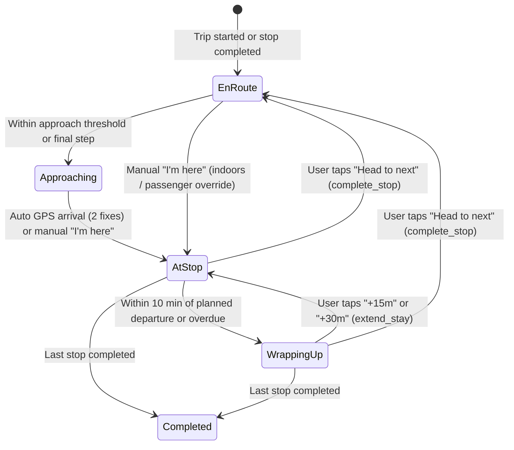

# Masterplan: Active Trip Glance-Nav and Trip Conductor (Option B)

Status: Proposed (Masterplan ready for Phase 1 implementation)
Owner: Giovan
Reviewers: C6 iOS / Design team (`apps/ios`)
Branch: `gi/active-trip-glance-nav` (branched from `a438d69`, matching the `dev` `25caef0` tree)

## 1. Outcome

When a traveller taps **Go Trip** or **Continue trip**, Travelant shifts from planning mode into a calm, **stop-centric trip conductor** with **lightweight in-app glance-navigation (Option B)** and a **one-tap handoff to Apple Maps** for any leg.

Rather than competing with Apple Maps as a turn-by-turn clone or rendering a uniform blue template filled with hedged AI prose, the active trip experience:

1. Separates **moving between stops** (glanceable, low-reading-load cue + live step progress + Maps escape hatch) from **being at a stop** (visit pacing, curated context, native Apple place info, extend stay, and next-leg preview).
2. Feels distinctly **Travelant** by reusing the calm `AppColor.surface` / `AppColor.canvas` / `AppColor.brand` hierarchy from `ItineraryListView` and `TripHomeRow`, paired with a muted map that highlights only the trip's numbered stops and routes.
3. Eliminates the "AI-generated template" feel **strictly on the iOS client**, without modifying `server/pocket`, Luna prompts, or `contracts/api/openapi.json`.

## 2. Confirmed product decisions and boundaries

Locked by user direction on 15 November 2026:

- **Selected ambition level — Option B (Glance-Nav + Trip Conductor):** Track route-step progress and off-route deviation in-app, provide state-driven conductor cards across a leg and stop, and offer a seamless handoff to Apple Maps for full turn-by-turn / voice guidance.
- **Usage context — Driver and passenger:** The same flow may be glanced at by a mounted driver or used interactively by a passenger. Moving states must stay readable in under one second with zero paragraphs; stationary/stop states expose richer stop details and itinerary controls. Handing off any active leg to Apple Maps must always be one tap away.
- **Server / Luna contract — Out of scope:** Do **not** alter `server/pocket/`, `contracts/api/openapi.json`, Luna schemas, or replace Luna. All de-AI-ification and presentation filtering happens deterministically in `apps/ios` using existing `PersonalPlanningTrip`, `PlanProposal`, `PlanningExperiencePlan`, `MapKit`, and `CoreLocation` data.
- **Platform compatibility:** Retain `iOS 18.0` deployment target, `Swift 6.0` strict concurrency, and Xcode 16.4 CI compatibility (`#if compiler(>=6.2)` / `@available(iOS 26.0, *)` guards for Liquid Glass, matching [TripGlassCapsule.swift](../../apps/ios/Shared/DesignSystem/TripGlassCapsule.swift)).
- **Architecture boundaries:** Keep SwiftUI Views decoupled from `MapKit`/`CoreLocation` service calls (`Features/Planning/Platform/` or `Features/ActiveTrip/Platform/`), keep `@MainActor @Observable` presentation state clean, and preserve `C67Domain` / `C67Data` boundaries and explicit `trip.synthetic` / `isDesignPreview` labels.

## 3. Baseline audit of current code (`a438d69`)

Inspection of the current active-trip path reveals six concrete gaps that create both the "weak Apple Maps clone" impression and the "AI-generated content" feel:

| Area | Observed code in `a438d69` | Concrete gap / UX impact |
| --- | --- | --- |
| Primary screen layout | [TripProgressContent.swift](../../apps/ios/Features/ActiveTrip/View/TripProgressContent.swift) | Copies Apple Maps' floating top turn banner and bottom panel, but paints both with a full `brandGradient` slab (`43%–62%` height) regardless of driving vs. arrived state. |
| Turn / step guidance | [TripProgressContent.swift](../../apps/ios/Features/ActiveTrip/View/TripProgressContent.swift#L130-L135), [PlanningPlaces.swift](../../apps/ios/Features/Planning/Platform/PlanningPlaces.swift#L142-L157) | Dumps every non-empty `MKRoute.Step.instructions` in a scrollable list. `TripNavigation` only recalculates `MKDirections` every `250 m`; no active step tracking, no distance-to-step-end, and no off-route detection. |
| Broken Apple Maps handoff | [TripProgressView.swift](../../apps/ios/Features/ActiveTrip/View/TripProgressView.swift#L13-L15), [PlanningPlaces.swift](../../apps/ios/Features/Planning/Platform/PlanningPlaces.swift#L76-L82) | `openDirections` merely calls `navigation.start(to: next.location)` instead of `PlanningDirections.open(next, mode:)`. Apple Maps cannot be launched from `TripProgressContent` at all. |
| Missing manual arrival fallback | [TripProgressContent.swift](../../apps/ios/Features/ActiveTrip/View/TripProgressContent.swift#L54-L160), [PocketEngineUITests.swift](../../apps/ios/Tests/UI/PocketEngineUITests.swift#L115) | Removing `"confirmTripArrival"` when GPS arrival was added broke existing UI tests (`PocketEngineUITests`, `TripCreationUITests`) and left indoor / GPS-denied users without a fallback on the main screen. |
| Fragmented controls | [SavedTripView.swift](../../apps/ios/Features/SavedTrip/View/SavedTripView.swift#L19-L29), [PlanningRootView.swift](../../apps/ios/Features/Planning/View/PlanningRootView.swift#L408-L458) | `Stay 30 minutes longer`, `Open directions in Maps`, and manual `I'm here` live in an unstyled `Form` (`ActivePlanningTripView`) behind `...`, displaying outdated copy (`"Arrival is your manual confirmation, not verified GPS presence."`). |
| Transport mode & AI microcopy | [PlanningPlaces.swift](../../apps/ios/Features/Planning/Platform/PlanningPlaces.swift#L104-L150), [TripProgressContent.swift](../../apps/ios/Features/ActiveTrip/View/TripProgressContent.swift#L88-L143) | `TripNavigation` hardcodes `.automobile` even for `.walking` mock/legacy trips. Main screen exposes system boilerplate (`"Stop X of Y · suggested experience order"`, `"Driving route · X min estimated"`, `"Suggested visit · X–Y min"`, `"Arrival is detected using your current location..."`, repeated `≈`) with zero real place imagery or relevance filtering. |

**Contract constraint observed:** `PlanningEventKind` in [PlanningModels.swift](../../packages/C67Backend/Sources/Domain/Planning/PlanningModels.swift#L32-L37) and [openapi.json](../../contracts/api/openapi.json#L5326-L5331) defines exactly four events: `start`, `arrive`, `complete_stop`, `extend_stay`. All Phase 1–4 conductor states must operate cleanly on top of those four persisted events so `scripts/check_contracts.py`, `server/planning`, and `server/supabase` remain untouched.

## 4. Target UX architecture: 5-state Stop-Centric Conductor

Travelant transitions automatically (with manual override always available) across five clear states derived from `PersonalPlanningTrip` + live `TripNavigationState`:

### State-by-state surface specification

#### 1. `enRoute` (`status == .active`, `currentStopID == nil`, `!isApproaching`)

Designed for **< 1 second glanceability** while mounted in a car or held by a passenger:

- **Top chrome:**
  - **Journey Progress Rail:** Compact capsule showing numbered nodes (`1 — 2 — 3`) with filled checkmarks for completed stops, highlighted ring for the current target, and subtle dots for remaining stops. Trailing compact icons for **Trip details** (`info.circle`) and **Pause** (`pause.fill`).
  - **Glance Cue Strip:** Single active `MKRoute.Step` below the rail — coarse directional SF Symbol (`44 pt` visual anchor), monospaced distance to end of step (e.g., `250 m`), and clean single-line road/action cue (`"Right onto Jl. Kemang Raya"`). No step list, no paragraphs.
- **Map canvas:**
  - `.mapStyle(.standard(elevation: .flat, emphasis: .muted, pointsOfInterest: .excludingAll, showsTraffic: false))` — removes Apple POI clutter so Travelant stops dominate.
  - Active leg polyline rendered in `AppColor.brand` (`#356AE6`) with subtle white casing for legibility; remaining future legs from `plan.stops` rendered as thin dashed lines (`StrokeStyle(lineWidth: 2.5, dash: [6, 6])`).
  - Numbered circular stop markers (`1`, `2`, `3`) matching [ItineraryListView.swift](../../apps/ios/Features/Itinerary/View/ItineraryListView.swift).
  - Camera defaults to heading-following (`MapCameraPosition.userLocation(followsHeading: true, fallback: .automatic)`), with a floating `TripGlassCapsule` toggle on the trailing edge to switch between **Follow me** and **Leg overview**.
- **Bottom compact sheet (`AppColor.surface`, ~24% height):**
  - Header: `STOP 2 OF 4` micro-label + stop name (`Headline` / `Title 3`) + known POI category label (if available).
  - Live metric row (`.monospacedDigit()`): `12 min · 3.4 km left` (or honest `"Estimating route…"` / offline straight-line fallback when `MKDirections` is unavailable, with retry).
  - Action row: Prominent capsule **`Open in Maps`** (`AppColor.brand` fill, calls `PlanningDirections.open`) + secondary capsule **`I'm here`** (`confirmTripArrival`, `AppColor.tertiaryFill` fill) so drivers/passengers indoors never get stuck.

#### 2. `approaching` (`status == .active`, `currentStopID == nil`, `isApproaching`)

Triggered locally when distance to `nextStop` is `<= 300 m` (driving) or `<= 120 m` (walking), or on the final route step within `350 m`:

- Top glance strip simplifies to **`Arriving · 180 m`** with destination icon.
- Map eases camera to frame both user location and the destination pin.
- Bottom card (`AppColor.surface`, ~32% height) introduces the destination visually:
  - Visual preview (`56–64 pt` rounded square): Apple `LookAroundPreview` when a `MKLookAroundScene` resolves for the pin, otherwise a clean `MKMapSnapshotter` mini-map tile with numbered pin (never a stock/AI image or blank gray box).
  - Address snippet (if resolved via `MKMapItem`) + subtle `"Confirming arrival…"` status while GPS samples settle.
  - Prominent **`I'm here`** primary capsule (`confirmTripArrival`) + discreet **`Maps`** icon button.

#### 3. `atStop` (`status == .active`, `currentStopID == stop.id`, `!isWrappingUp`)

Designed for **stationary / passenger use** — this is where Travelant shines and Apple Maps has nothing to offer:

- Map remains calm in the top ~32% of the screen centered on the current stop and next-leg preview; top Progress Rail stays visible.
- Bottom Conductor Sheet (`AppColor.surface`, ~52% height, scrollable cleanly at `accessibilityXXXL`):
  - **Stop identity header:** Visual thumbnail (`LookAround` / snapshot), stop name, POI category tag (when known), and native **`Place info`** capsule button opening iOS 18 `.mapItemDetailSheet(item:)` when `MKMapItem` resolves (gives real photos, verified hours, phone, website without cluttering our UI).
  - **Visit pacing bar:** Clean factual timing derived from `currentArrivedAt` and `stop.departureAt` — e.g., `"Arrived 10:15 · Target leave 11:00"` + progress bar + monospaced `"34 min left"` (or `"Open visit"` when `visitSeconds == 0` in untimed experience plans with unknown duration).
  - **Distilled Context Cues (max 2 chips, suppression-first — see Section 5):**
    - Weather chip only if actionable rain risk exists.
    - Light chip only if a calculated golden-hour window overlaps the stop/next leg.
    - Single-line activity note from `experiencePlan.stop(id)?.activity.suggestion` (rendered **only** in `atStop`, never while driving).
  - **Visit adjustments & Up Next:**
    - Quick-extend pills: **`+15 min`** and **`+30 min`** (both call `PlanningEventKind.extendStay`).
    - Next-leg preview card (`AppColor.secondaryBackground`): **`Next · <Upcoming Stop Name>`** + estimated leg drive (`14 min drive`, or `"Final stop of this trip"`).
    - Primary Capsule CTA: **`Head to <Upcoming Stop Name>`** (or **`Finish trip`** on last stop), calling `PlanningEventKind.completeStop`.

#### 4. `wrappingUp` (`status == .active`, `currentStopID == stop.id`, `isWrappingUp`)

Triggered locally when `departureAt != nil` and `Date.now >= departureAt - 600` (last 10 minutes of visit or past target leave time):

- Visit pacing bar shifts to a calm warm/brand emphasis: `"Leave around 11:00"` (or `"12 min past planned leave"` — factual, never scolding).
- Elevates two quick choices side-by-side at the bottom: **`Stay +15m`** vs. **`Head to <Next Stop>`**, plus a subtle **`& open Maps`** option if departing immediately by car.

#### 5. `completed` (`status == .completed`)

- Clean summary canvas (`AppColor.canvas` + `AppColor.surface` stop list) using `TripCompletedContent` enhanced with numbered/category stop markers, total stops visited, and a single **`Done`** primary capsule returning to Home / Saved Trip.

## 5. Client-side rules to eliminate the "AI-generated" feel

Without changing any server schema or Luna prompt, the presentation layer applies four deterministic curation rules:

### 5.1 Purge robotic & hedged microcopy on the primary surface

| Current string in `TripProgressContent` / `ActivePlanningTripView` | Replacement on primary active-trip canvas |
| --- | --- |
| `"Stop 1 of 3 · suggested experience order"` | `"STOP 1 OF 3"` (plus category badge only when known) |
| `"Driving route · 12 min estimated"` | `"12 min · 3.4 km"` (with `"Est."` shown once in **Trip details**) |
| `"Suggested visit · 45–90 min"` / `"Default visit · 30 min"` | `"Arrived 10:15 · Leave around 11:00"` (or `"Open visit"` when unscheduled) |
| `"Arrival is detected using your current location while this screen is open."` | Removed from primary card; moved into **Trip details** sheet |
| `"≈ 6 min"` repeated on multiple cards | Clean `"12 min"`; fallback `6 min` default explicitly flagged only if `roadDistanceMeters == nil` (`"~6 min (est.)"`) |
| Full-bleed `brandGradient` panel covering 55% of screen | `AppColor.surface` sheets on `AppColor.canvas`, reserving `AppColor.brand` for active route, current progress node, and primary CTAs |

### 5.2 Suppression-over-saturation formatter (`ActiveStopContextFormatter`)

A pure Swift helper in `Features/ActiveTrip/Presenter/ActiveStopContextFormatter.swift` filters `PlanningExperiencePlan` stop metadata so every stop looks intentionally tailored rather than uniformly padded:

- **Weather chip rule:** Inspect `experiencePlan.weatherSources` for `stop.id` across `[visitStart, departureAt]`. Emit a chip **only** when `max(precipitationChance) >= 0.40` (or `precipitationAmountMM >= 0.5`). Format with exact clock & percent: e.g., `"65% rain chance around 15:00"`. If dry/unavailable, emit **nothing** on the primary card.
- **Solar / light chip rule:** Inspect `experiencePlan.solarWindows` for `stop.id` (or matching `light.windowRef`). Emit a chip **only** when the window overlaps `[visitStart - 900, departureAt + 1800]`. Format with concrete 24-hour times in `trip.input.timeZone`: e.g., `"Golden hour 17:12–17:40"`.
- **Activity cue rule:** Show `experiencePlan.stop(id)?.activity.suggestion` **only** in `atStop` (never `enRoute` or `approaching`). Trim redundant leading boilerplate (`"Suggested activity:"`, `"Enjoy "`, `"Take time to "`), normalize sentence case, and cap visible card lines to 2 lines (full `reason`, `tradeoffs`, `uncertainties`, and `weatherSources` provenance remain accessible in **Trip details**).

### 5.3 Consolidated "Trip details" sheet

Tapping `(i)` in the top Progress Rail opens a native sheet containing:
- Trip mode & route disclaimer (`"Driving routes and ETAs come from Apple Maps while this screen is open. Arrival auto-confirms within ~100 m when GPS accuracy is sufficient."` + `trip.synthetic` badge when applicable).
- Weather / solar source attribution (`PlanningEvidence` links & Apple Weather mark when present).
- Full stop order & ability to tap any upcoming stop to open its native Apple Maps place card or launch Maps directly.
- Legacy timed-planning `"Recalculate remaining trip"` bridge when `trip.plan.experiencePlan == nil` (preserving `ActivePlanningTripView` capability without forcing users into a developer `Form`).

### 5.4 Real Apple place visuals (`ActivePlaceContextLoader`)

An actor / `@MainActor` cached loader resolves an `MKMapItem` per stop on demand (narrow `MKLocalSearch` centered within 250 m of `stop.location` matching `stop.name`, cached in memory per `stop.id`):
- Enables native **`.mapItemDetailSheet(item:)`** (iOS 18.0+) for real Apple Maps photos, hours, website, and phone.
- Queries `MKLookAroundSceneRequest(mapItem:)` once per approaching/current stop; falls back cleanly to a calm `MKMapSnapshotter` mini-map thumbnail with the numbered marker if Look Around coverage is absent (no fake placeholders).

## 6. Glance-Nav geometry & Core Location engine

`MKRoute.Step` provides `instructions`, `notice`, `polyline`, `distance`, and `transportType`, **without** structured maneuver enum types. Rather than fragile maneuver heuristics, we split geometry logic into a pure, unit-testable engine (`RouteProgressTracker` + `ManeuverCue`) separate from `CLLocationManager` side effects (`TripNavigation`):

### 6.1 Pure geometry & step tracking (`RouteProgressTracker`)

- **Input:** `currentLocation: CLLocation` (plus `horizontalAccuracy`), `routeSteps: [RouteStepSnapshot]`, `fullPolyline: [MKMapPoint]`, `destination: CLLocation`, `mode: PlanningMode`, and prior `RouteTrackingState`.
- **Projection:** Compute shortest perpendicular distance (in meters) from `MKMapPoint(currentLocation.coordinate)` to segments of the active step polyline and full route polyline.
- **Monotonic step advancement:**
  - Advance from `step[i]` to `step[i + 1]` when:
    1. Distance from current position to `step[i]`'s final vertex is `<= 35 m` and `i + 1 < steps.count`, OR
    2. Distance to `step[i + 1]` polyline is `< 25 m` while distance to `step[i]` polyline is `> 40 m`.
  - Compute `remainingStepDistanceMeters` = distance from projected point along `step[i]`'s remaining vertices to step end.
  - Compute `remainingRouteDistanceMeters` and proportional `remainingTravelSeconds` across `[i ..< steps.count]` so live ETA updates smoothly between `MKDirections` calls.
- **Off-route detection:**
  - Require `horizontalAccuracy >= 0 && horizontalAccuracy <= 30`.
  - Flag off-route candidate when minimum distance to `fullPolyline` exceeds `65 m` (`.automobile`) or `40 m` (`.walking`) for **2 consecutive fresh samples** (`timestamp > lastSampleDate`).
  - Gate recalculation in `TripNavigation` with a **15-second cooldown** (`30 s` after `MKError.loadingThrottled`), keeping the prior `MKRoute` visible with a subtle `"Updating route…"` status until the new route arrives.
- **Approach & Arrival thresholds:**
  - `isApproaching`: `distanceToDestination <= 300 m` (`.automobile`) or `<= 120 m` (`.walking`), OR (`currentStepIndex == steps.count - 1` and `remainingStepDistanceMeters <= 350 m`).
  - `arrivalReady`: Keep `TripNavigation.isArrivalSample` (`horizontalAccuracy <= 50 m`, `age < 20 s`, `distance + accuracy <= 100 m` for 2 distinct samples). Always permit manual `"I'm here"` (`confirmTripArrival`) immediately regardless of GPS accuracy or permission status.

### 6.2 Honest coarse maneuver parser (`ManeuverCue`)

- Maps known English and Indonesian `MKRoute.Step.instructions` prefixes/keywords to standard SF Symbols (`arrow.turn.up.left`, `arrow.turn.up.right`, `arrow.uturn.backward`, `arrow.trianglehead.clockwise` for roundabouts, `arrow.merge`, `flag.checkered` for final step, defaulting cleanly to `arrow.up`).
- Extracts a concise single-line action/street label without truncating mid-word; if `instructions` is empty, displays `"Continue toward <stop.name>"`.

### 6.3 Transport mode, pause, and Apple Maps return lifecycle

- **Transport mode:** Respect `trip.input.mode` when `trip.plan.experiencePlan == nil` (`.walking` -> `.walking` / `.fitness`), while using `.automobile` / `.automotiveNavigation` when `trip.input.mode == .automobile` or `trip.plan.experiencePlan != nil` (matching `calculateExperienceRoute`).
- **Pause behavior:** Tapping **Pause** in the top rail calls `navigation.stop()`, saves no destructive mutation (`trip.status` remains `.active`), and dismisses back to `SavedTripView` / `TripHomeContentView`, where `TripHomeRow` surfaces an `"In progress · Stop X of Y"` pill for one-tap resume.
- **Apple Maps return sync:** Observe `scenePhase` in `TripProgressView`. When returning from Apple Maps (`scenePhase == .active`) while `trip.status == .active && trip.currentStopID == nil`, immediately trigger a location sample / route freshness check (`age > 30 s`) so arrival or remaining progress reflects the user's new position immediately.

## 7. Phased implementation plan

| Phase | Scope & files | Key deliverables | Verification gate |
| --- | --- | --- | --- |
| **Phase 1: Core tracking, bug fixes & formatter** | `Features/Planning/Platform/PlanningPlaces.swift`, `Features/ActiveTrip/Presenter/` (new pure models), `Features/ActiveTrip/View/TripProgressView.swift`, `TripProgressContent.swift`, `Tests/Unit/`, `Tests/UI/` | Pure `RouteProgressTracker`, `ManeuverCue`, `ActiveTripPhase`, `ActiveStopContextFormatter`; refactor `TripNavigation` to use tracker + cooldown/off-route + transport mode; wire `openDirections` -> `PlanningDirections.open`; restore accessible `confirmTripArrival` fallback so UI tests pass again. | Swift Testing unit tests for step advance, off-route hysteresis, approaching, maneuver parsing, and suppression formatter; `PocketEngineUITests` & `TripCreationUITests` mock arrival flow green. |
| **Phase 2: Calm map & Glance-Nav (`enRoute` / `approaching` / `Pause`)** | `Features/ActiveTrip/View/`, `Features/ActiveTrip/Preview/`, `Features/Home/View/TripHomeRow.swift`, `App/C67App.swift` | Journey Progress Rail, Glance Cue Strip, muted `MapStyle` with numbered pins + active/dashed polylines + `TripGlassCapsule` camera toggle, compact `AppColor.surface` bottom card, `Pause` flow, `"In progress"` Home badge, **Trip details** sheet, updated `#Preview`s + launch args. | `HiFiPreviewUITests` Light/Dark/`accessibilityXXXL`/iPad reading width (`<= 640 pt`); visual screenshot inspection across `enRoute` and `approaching`. |
| **Phase 3: Stop Conductor (`atStop` / `wrappingUp`) & Apple Place Context** | `Features/ActiveTrip/Platform/ActivePlaceContextLoader.swift`, `Features/ActiveTrip/View/`, `Features/SavedTrip/View/SavedTripView.swift`, `Features/Planning/View/PlanningRootView.swift` | `MKLocalSearch` + `MKLookAroundSceneRequest` + `MKMapSnapshotter` preview helper; `.mapItemDetailSheet(item:)` trigger; visit pacing bar (`Arrived HH:mm · Leave around HH:mm`); `+15m`/`+30m` extend pills; `wrappingUp` state; `Up Next` card; clean reconciliation with `ActivePlanningTripView`. | Mock + fixture UI walkthrough covering `enRoute -> approaching -> atStop -> extendStay -> wrappingUp -> completeStop -> completed`; verify iOS 18 SDK guards. |
| **Phase 4: Simulated drive QA & release readiness checks** | `Tests/UI/`, `docs/testing/verification.md`, task record | Automated `XCUIDevice.shared.location` multi-coordinate drive tests in `C67UITests` covering step progression, off-route recalculation (stubbed/mocked + live opt-in), Apple Maps launch availability, GPS arrival, and completion; full `verify_local.sh ios-full`. | `verify_local.sh ios-full`, `swift_format.py --check`, `git diff --check`, and documented physical-device drive checklist. |
| **Phase 5: Live Activity & Dynamic Island (`ActivityKit`) — Separate PR** | `apps/ios/project.yml`, new `TravelantWidgets` Widget Extension target, `Info.plist` (`NSSupportsLiveActivities`), `Features/ActiveTrip/` | Lock-screen & Dynamic Island conductor status (`Stop 2 of 4 · Name · ETA/Visit countdown`) so Travelant remains glanceable when switching to Apple Maps or locking the phone. | Requires XcodeGen regeneration, new extension bundle ID (`io.pibeebee.c67.starter.widgets`), and team `DP5XP7C2AM` provisioning profile update before TestFlight upload. |

## 8. Scope boundaries, deferred decisions, and risks

### Explicit exclusions / deferred items

1. **Skip stop / End trip early:** `PlanningEventKind` currently supports only `start`, `arrive`, `complete_stop`, and `extend_stay`. Adding `skip_stop` or `end_early` touches `C67Domain`, `PlanningDTO`, `contracts/api/openapi.json`, `server/planning`, and SQL RPCs. **Decision:** Keep Phase 1–4 focused on **Pause** (stopping active GPS/nav and preserving `.active` state) and completing stops; evaluate `skip_stop` / `end_early` in a separate cross-layer task if field tests show users need it.
2. **Active replanning for `experiencePlan` trips:** `PocketPlanningRepository.requestPlan(.replan)` currently builds a timed itinerary on the legacy solver path when `reasonableOrdering != true`. Do **not** trigger legacy timed replanning silently from `TripProgressView` for Pocket experience trips.
3. **Background GPS & spoken voice prompts:** `Info.plist` only declares `NSLocationWhenInUseUsageDescription` (verified in [SplashAndLocationPermissionTests.swift](../../apps/ios/Tests/Unit/SplashAndLocationPermissionTests.swift#L48-L52)) with no `UIBackgroundModes: location`. When users want background audio turn-by-turn, they tap **Open in Maps** by design.

### Technical & product risks

- **Apple Maps throttling (`MKError.loadingThrottled`):** Mitigated by 15 s off-route cooldown, 30 s throttle backoff, and keeping the previous valid polyline on screen rather than clearing directions.
- **Jakarta Look Around coverage gaps:** Many interior cafes/alleys lack Look Around coverage; `ActivePlaceContextLoader` treats `MKLookAroundScene == nil` as normal and uses `MKMapSnapshotter` without error banners.
- **CI vs. local Xcode versions:** `.github/workflows/ci.yml` compiles `ios-smoke` on Xcode 16.4 while local work uses Xcode 27.2. All new `MapKit` / `SwiftUI` modifiers must be verified against iOS 18 SDK availability (`#if compiler(>=6.2)` where referencing iOS 26 APIs).
- **Physical GPS vs. Simulator:** Simulator `XCUIDevice.shared.location` proves state-machine transitions and UI layout, not real-world multipath drift in Jakarta traffic or battery/thermal impact. Physical-device field verification remains a mandatory gate before TestFlight beta release.

## 9. Verification plan

After each implementation phase (run from the `C67-processing-hifi` root):

- Layout & whitespace: `python3 scripts/swift_format.py --check` and `git diff --check`
- Contracts & server regression check (must stay untouched/passing): `.venv/bin/python scripts/check_contracts.py` and `swift test --package-path packages/C67Backend`
- Generic Simulator compilation: `xcodebuild -project apps/ios/C67.xcodeproj -scheme C67 -destination 'generic/platform=iOS Simulator' -derivedDataPath /tmp/c67-build CODE_SIGNING_ALLOWED=NO build`
- Unit & UI suite (mock mode): `bash scripts/verify_local.sh ios-smoke` and targeted `xcodebuild test` runs for `HiFiPreviewUITests`, `PocketEngineUITests`, `TripCreationUITests`, and `C67AppTests` on `python3 scripts/simulator_destination.py` (`CODE_SIGNING_ALLOWED=YES CODE_SIGN_IDENTITY=- C67_DATA_MODE=mock`).
- Update [verification.md](../testing/verification.md) with exact commands, simulator OS/device, and explicit limits (mock vs. simulated GPS vs. live physical device) once implementation phases execute.
