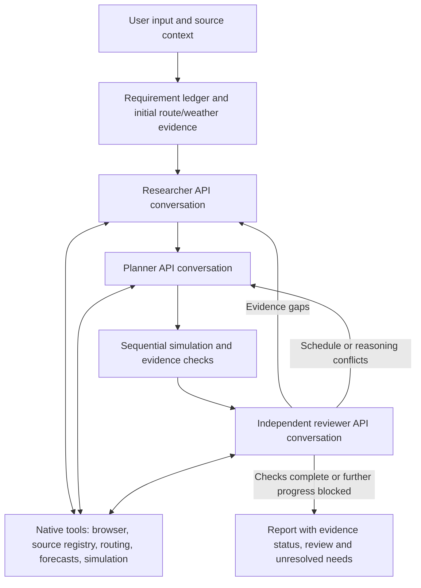

# Evidence-driven trip planner (workflow v3)

Status 2 November 2026: **implemented and compiler-checked only**. The user requested no execution of this change. No PoC run, browser launch, live Google/OpenRouter call, fixture/demo, or automated test has been performed for v3. Earlier successful/failed itinerary runs belong to the checkpointed v2/legacy implementation.

## Local Git checkpoints

This folder now owns a local Git repository, separate from the parent research workspace. `main` holds the pre-implementation snapshot **737db49**. Changes are on **gi/evidence-driven-workflow**. No remote was added and nothing was pushed. `.env`, `node_modules`, and `results` remain ignored; `.env.example` contains placeholders/configuration only.

Use `git show 737db49` or `git diff main...gi/evidence-driven-workflow` to inspect the change without deleting local files.

## Scope

The working input is still the existing **untimed, one-day Japan experiment**: destinations/activities, explicit trip date, Asia/Tokyo, rail/walking, and the same start/return station. All original activities, optional activities and directed station pairs are preserved. The wider product contract (places plus expected time per place, with other trip constraints optional) remains a separate requirement; this command does not claim to implement all product input variants.

`plan:research` and `plan:quality` now run v3. `plan:research:v2` preserves the previous browser/simulation command; `plan:untimed` preserves the original untimed experiment. Old snapshot/reuse commands belong to v2, not v3.

## Flow



The backend executes all tools. OpenRouter receives native function definitions and returns `tool_calls`; each result is sent back with the matching `tool_call_id`. Tool definitions are sent on every turn. The provider/model must support this interface. There is no silent fallback to another model or fabricated response if it does not.

### Researcher

The ledger tracks identity, opening hours, seasonal-event identity/period, transit evidence, and forecast availability. Every requirement has a stable ID, relevance/criticality, evidence IDs and status. Known user selections remain user input; file-based context is not relabeled as newly verified browser research.

The researcher must either register relevant source claims or explicitly disposition every unresolved critical requirement, citing known input or attempted evidence. A terminal response cannot hide outstanding browser actions: terminal submission must be the sole call in its batch. If a batch mixes a terminal and other tools, the backend executes the other tools and rejects only the premature terminal submission.

### Planner

The planner receives the ledger, available provider estimates, original constraints, source claims, previous simulation and independent-review feedback. It can search/read/query/simulate a candidate before submitting its complete itinerary. Row-level evidence IDs identify sources or make an unsupported assumption explicit through an empty array. All IDs are checked by code; their presence alone does not prove semantic truth.

### Reviewer

The reviewer receives a fresh API conversation with the user input, source ledger, proposal and computed simulation. It does not receive the planner's private reasoning. It can request more evidence through the same controlled tools.

The review must cover every ledger requirement exactly once, with `supported`, `contradicted` or `unknown`. A supported verdict must cite evidence belonging to a provided/supported requirement; it cannot promote a missing/conditional/unavailable fact. Contradictions require citations. Findings identify the source row or requirement and request research, replanning, user information, or no further action.

The backend rechecks the simulation at review submission. A changed simulation requires inspection before a review is accepted. The final report also records whether the review still matches the current evidence, forecasts, routes, source snapshots and simulation. A stale review cannot release the result.

**Separate conversation does not guarantee an independent judgment.** All three roles may use the same base model. Role-specific model configuration is available; code/evidence checks and explicit unknowns remain necessary even with a reviewer.

## Source applicability

A quote must occur in a successfully read saved page. Extracted numeric values must also occur in the quote, with supported Japanese/ISO numeric normalization. Quotes can be up to 8,000 characters in v3.

- An explicit date range can cover the trip without literally mentioning its date. A seasonal event outside its quoted range remains a conflict.
- Specific-date rules require that date in the quote.
- Daily/weekday/weekend categories must be grounded in wording in the quote; weekdays are checked against the trip calendar. Holiday/special-operation applicability remains conditional when not established.
- General hours are kept as conditional operating constraints. They are not upgraded to a guarantee about date-specific closures.
- Conflicting sourced windows are retained and surfaced rather than silently replacing the earlier context.
- Mapping generic “illumination” to a named event is a system interpretation until the event identity is established.
- A generic operator travel duration is a planning hint, not evidence of a particular train service on the proposed departure date/time.

Source claims still rely on model interpretation of a passage and activity identity. Matching text/values does not establish that all semantics are correct; that is one purpose of independent review. Complex split/overnight opening windows, holiday calendars, PDFs and image timetables are not automatically resolved by this version.

## Tools and browsing

| Tool                   | Role                                                                |
| ---------------------- | ------------------------------------------------------------------- |
| `inspect_requirements` | Read current gaps, dispositions, and unknown transfer floors        |
| `search_web`           | Discover links on configured official domains                       |
| `read_page`            | Read page text/chunks or explicitly retry a failed page             |
| `register_claim`       | Validate and register a scoped source quotation                     |
| `query_route`          | Query a directed walking or requested rail pair at a proposed time  |
| `get_forecast`         | Read forecasts, or refresh eligible forecasts at most twice per run |
| `inspect_simulation`   | Recompute the current proposal after evidence changes               |
| `simulate_candidate`   | Planner-only preview without committing unknown transfer floors     |
| `finish_research`      | Submit complete disposition of unresolved critical research needs   |
| `submit_proposal`      | Submit a structurally valid full itinerary for simulation/review    |
| `submit_review`        | Submit a code-validated semantic review                             |

Read failures can be retried explicitly, up to three navigation attempts per URL. A failed cached result is no longer an unavoidable permanent answer. When a selected `main`/`article` region is empty, the reader falls back to body text. HTTP and extraction status remain separate; HTTP 200 does not mean a usable source was obtained. Larger saved text can be read in offset chunks, with truncation metadata. Search results remain discovery, not factual evidence.

Configured allowlists, public-DNS checks, HTTPS/GET-only requests, isolated context, download/service-worker/websocket blocking and browser budgets remain. These restrictions have not been runtime-audited for v3 and do not constitute a proven general sandbox. Search engine layout/consent restrictions may still make search unavailable; no bypass is implemented.

## Simulation safeguards

- Routes are re-evaluated at the departure after preceding visits/waits, with source opening waits and date/closing conflicts propagated.
- Walking/transit buffers are explicit system assumptions. Movement owns its minimum buffer. A following `transfer_buffer` wait is credited against that buffer instead of adding it again. Queue/personal waits are separate and remain subject to semantic review.
- Unknown transfer allocations are locked from the first committed simulation. A later planner cannot reduce them to force a return deadline without a new provider estimate. A preview uses a copy of those locks. No route still means unknown, not a nonexistent train or zero minutes.
- A wait labeled “opening/event start” after all supplied opening times at that location is flagged; a real queue should be identified as a queue.
- No user destination is removed and no visit duration is silently shortened by code to hide infeasibility. All durations in this untimed input are AI proposals; actual user-provided durations need their own input contract before that variant is supported.

Locks are conservative provisional allocations, not proof that the first AI duration is correct. Even if all dates fit, unsupported transport and venue information remains unresolved.

## Completion and stopping

Completion is determined by evidence and review, with resource guards as a backstop:

- `ready_for_review`: the implemented critical requirements/checks are satisfied, no actionable review conflict remains, and the review matches current evidence. This is not confirmed travel feasibility.
- `needs_information`: relevant evidence remains missing/conditional or requires user confirmation.
- `conflicts`: computed or reviewed contradictions remain unresolved.
- `review_incomplete`: no complete current review, or evidence changed after review.
- `no_valid_proposal` / `incomplete`: model protocol, provider, resource guard or other failure prevented completion.

The workflow stops on quality checks, explicit evidence blockers, unchanged evidence/schedule, or guards. It does not declare success merely because the model says “done” or three attempts have elapsed. `verifiedTravelFeasibility` remains false. Unknown future weather is deferred rather than researched indefinitely.

## Configuration

Base credentials and the explicitly selected `OPENROUTER_MODEL` remain required. The actual `.env` was not rewritten during implementation. New example settings:

| Variable                                                 | Default / meaning                                                                  |
| -------------------------------------------------------- | ---------------------------------------------------------------------------------- |
| `OPENROUTER_RESEARCHER_MODEL`                            | Base model when empty                                                              |
| `OPENROUTER_PLANNER_MODEL`                               | Base model when empty                                                              |
| `OPENROUTER_REVIEWER_MODEL`                              | Base model when empty                                                              |
| `OPENROUTER_<ROLE>_MAX_TOKENS`                           | At least 32,768 by default; configurable 1,024–131,072 subject to provider/context |
| `OPENROUTER_<ROLE>_TIMEOUT_MS`                           | At least 300,000 ms by default; configurable up to 600,000                         |
| `POC_AGENT_MAX_TURNS`                                    | 24 per role conversation                                                           |
| `POC_QUALITY_MAX_CYCLES`                                 | 8 research/planning/review cycles as a termination guard                           |
| `POC_MAX_MODEL_CALLS`                                    | 48 shared across roles                                                             |
| `POC_MAX_RUN_TOKENS`                                     | 1,000,000 aggregate by default; explicit configuration can change it               |
| `OPENROUTER_CONTEXT_LIMIT`                               | Per-request input + reasoning + final output cap, at most 1,000,000                |
| `POC_MAX_ROUTE_REQUESTS`                                 | 150 across collection and simulation                                               |
| `POC_WALK_BUFFER_MINUTES` / `POC_TRANSIT_BUFFER_MINUTES` | 5 / 10                                                                             |

The conservative preflight token estimate is retained, actual usage is recorded, and missing usage keeps its reservation. The transport timeout now follows the role timeout rather than an earlier fixed 180-second outer signal. Provider limits still apply. Increasing completion space is not a correctness check.

Reasoning blocks required by the provider may be carried unchanged in ephemeral API history. They are stripped from persisted conversation transcripts; only final public text, tool requests/results and token metadata are saved. A reviewer starts with a separate history. Persisted transcripts are audit artifacts, not a promised resumable provider session.

## Running later (not executed for this change)

```sh
npm run plan:research -- \
  --input examples/funabashi-enoshima-2026-12-05-untimed.json \
  --context examples/funabashi-enoshima-place-context.json \
  --research examples/funabashi-enoshima-research.json \
  --out results/japan-quality-new
```

Use a new output directory. Playwright and its matching Chromium binary must be available. No new library or browser install was performed as part of this implementation. New `--reuse` semantics are not implemented in v3; use `plan:research:v2` for existing v2 snapshot comparisons rather than silently importing old assumptions into the new ledger.

Artifacts: `run.json`, `user-input.json`, `original-context.json`, `initial-evidence.json`, `evidence.json`, `progress.json`, `conversations/<role>-<cycle>.json`, `cycles/<cycle>.json`, `failure.json` when relevant, `report.json` and `report.md`. Writes are local and checkpointed; credentials/internal reasoning are not written to these artifacts.

## Verification performed

Only `npm run check` (`tsc --noEmit`) and static review/formatting were performed. Tests and all runtime execution were deliberately omitted. Compilation does not establish native-tool compatibility, browser extraction success, model quality, or real itinerary feasibility. Those remain for a separately authorized run.

Primary API references: [OpenRouter tool calling](https://openrouter.ai/docs/guides/features/tool-calling), [reasoning preservation](https://openrouter.ai/docs/guides/best-practices/reasoning-tokens), [Playwright BrowserContext](https://playwright.dev/docs/api/class-browsercontext).
