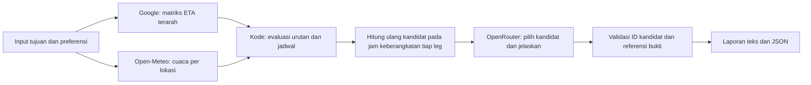

# C67 — PoC CLI perencanaan itinerary dengan AI

**Tahap aktif: workflow bukti dan reviewer (v3).** `plan:research` / `plan:quality` sekarang menjalankan native tool calling dengan peran researcher, planner dan reviewer terpisah. Kebutuhan bukti dilacak; sumber berlaku berdasarkan periode/hari; planner/reviewer dapat meminta browser/routing/simulasi; alokasi transit unknown tidak boleh dipangkas untuk memaksa jadwal muat. [Panduan v3](EVIDENCE_WORKFLOW.md).

**Batas verifikasi perubahan v3:** hanya kompilasi TypeScript (`tsc --noEmit`). Tidak menjalankan PoC, browser, API, fixture, atau tes. Hasil live versi terdahulu di bawah tidak membuktikan v3 sudah bekerja pada runtime.

Git lokal folder PoC dibuat sebelum implementasi, dengan checkpoint awal `737db49` di `main`; pekerjaan v3 berada di branch `gi/evidence-driven-workflow`. `.env`, `results/`, dan dependency tidak dilacak Git.


Eksperimen terpisah dari aplikasi C67: **tujuan pilihan pengguna → data rute/cuaca → kandidat jadwal → pilihan dan penjelasan AI → laporan**. Tidak menggunakan UI, framework Apple, Supabase, atau deployment. Tidak mengubah repository aplikasi yang sedang dikerjakan di chat lain.

**Arsip pengembangan v2, kini melalui `plan:research:v2`:** AI dapat mengarahkan headless Chromium untuk mencari/membaca sumber resmi; rute dan cuaca dikumpulkan sebelum proposal; simulasi mempropagasikan waktu dan buffer; konflik dikirim otomatis kembali ke AI dalam putaran terbatas. Kode tahap ini **hanya diperiksa kompilasinya**, tanpa menjalankan tes, browser, Google/OpenRouter, atau menghasilkan itinerary baru. Hasil live terdahulu di bawah tetap bukti versi sebelumnya. Lihat [alur dan konfigurasi baru](RESEARCH_PIPELINE.md).

**Status:** implementasi CLI tersedia. Hasil fixture membuktikan alur lokal dan perhitungan; kualitas AI dan kelayakan perjalanan nyata belum dibuktikan. `live` dan `fixture-ai` wajib memanggil OpenRouter; kegagalan AI menghentikan run, tanpa berpindah diam-diam ke simulasi.

## Mulai dari demonstrasi lokal

Kebutuhan runtime: **Node.js 24 atau lebih baru**. Jalur fixture/CLI lama tetap tidak memerlukan dependency runtime. Jalur `plan:research` menggunakan library Playwright dan binary Chromium yang dipasang terpisah; lihat panduan tahap baru. Demo fixture di bawah tidak menjalankan browser.

```sh
cd '<LOCAL_HOME>/Documents/ChatGPT/C6 - Pisang Besar Balaraja/poc/ai-trip-planner'
npm run demo
```

Perintah tersebut menggunakan matriks A/B/C/D ilustrasi pengguna dan cuaca sintetis, **tanpa memanggil AI atau API eksternal**. Tujuannya memeriksa bentuk input/output sebelum akun disiapkan. Setiap laporan menampilkan `mode` dan `ai.called`.

Contoh fixture menghasilkan `B → D → C`: waktu perjalanan 75 menit, kunjungan C 17:00–17:45 WIB, sebelum sunset sintetis 18:00. Pembanding jarak/waktu tempuh saja menghasilkan `D → C → B`, 48 menit perjalanan, tetapi C dikunjungi saat peluang hujan sintetis tinggi dan di luar preferensi waktu. Ini konsekuensi bobot eksperimen, bukan rekomendasi perjalanan nyata.

## Konfigurasi layanan nyata

```sh
cp .env.example .env
```

Isi `.env` melalui editor lokal:

```dotenv
GOOGLE_MAPS_API_KEY=isi_di_lokal
OPENROUTER_API_KEY=isi_di_lokal
OPENROUTER_MODEL=id_model_yang_dipilih
OPENROUTER_MAX_TOKENS=2500
OPENROUTER_REASONING=auto
OPENROUTER_TIMEOUT_MS=
```

- Google: siapkan project Google Cloud, aktifkan billing serta **Routes API**, lalu buat API key untuk layanan tersebut. [Setup dan billing](https://developers.google.com/maps/documentation/routes/usage-and-billing).
- OpenRouter: buat API key dan pilih **ID model eksplisit** dengan endpoint yang mendukung `structured_outputs`. Request menggunakan `response_format: json_schema` dan `provider.require_parameters: true`. Tidak ada model default atau perpindahan model yang dipilih aplikasi secara diam-diam. Simpan ID model aktual dari laporan ketika membandingkan run. [Structured outputs](https://openrouter.ai/docs/guides/features/structured-outputs), [Chat Completions API](https://openrouter.ai/docs/api/api-reference/chat/create-a-chat-completion).
- Open-Meteo: endpoint terbuka digunakan untuk evaluasi/prototyping nonkomersial sesuai batas penggunaannya; tidak memerlukan API key. [Dokumentasi](https://open-meteo.com/en/docs), [ketentuan akses](https://open-meteo.com/en/pricing).

Smoke test 2 November 2026 berhasil memakai `OPENROUTER_MODEL=nvidia/nemotron-3.5-super-vl:free` dan `OPENROUTER_REASONING=off`. Pada model ini, konfigurasi reasoning default menghabiskan seluruh budget 2.500 token sebelum jawaban akhir; `off` mengirim `reasoning.enabled=false`. `auto` tetap membiarkan default model untuk eksperimen lain. Budget completion mencakup reasoning dan jawaban akhir, bukan panjang jawaban terlihat saja. Pengaturan ini dicatat dalam laporan. [Reasoning tokens](https://openrouter.ai/docs/guides/best-practices/reasoning-tokens).

Untuk reasoning aktif dengan ruang keluaran lebih besar, gunakan `OPENROUTER_REASONING=on`, `OPENROUTER_MAX_TOKENS=16384` dan `OPENROUTER_TIMEOUT_MS=180000`. `on` mengirim `reasoning.enabled=true`. Batas aplikasi untuk completion adalah 256–32.768 token; ini berbeda dari kapasitas konteks input model (katalog Nemotron yang diperiksa melaporkan 1.000.000 token input/context dan maksimum 131.072 completion). Memperbesar `max_tokens` tidak menambahkan fakta atau sumber baru ke prompt.

```sh
npm run config -- --mode live
```

Pemeriksaan ini hanya menunjukkan `set`/`missing`; tidak mengungkap nilai kunci atau memanggil provider. Exit code `2` berarti konfigurasi belum lengkap. Kelengkapan variabel belum membuktikan kredensial valid.

`.env`, `node_modules`, dan `results` diabaikan Git. Jangan memasukkan kunci ke input atau membagikannya melalui chat. Laporan menyimpan koordinat dan konteks perjalanan yang dimasukkan.

## Tiga mode eksperimen

| Mode | Rute/cuaca | AI | Tujuan |
|---|---|---|---|
| `fixture` | Sintetis | Tidak dipanggil | Memeriksa plumbing, perhitungan dan bentuk laporan |
| `fixture-ai` | Sintetis | OpenRouter nyata | Membandingkan penjelasan/pilihan model dengan data tetap |
| `live` (default) | Google Routes dan Open-Meteo | OpenRouter nyata | Menguji pipeline dengan data provider sebenarnya |

```sh
# AI nyata, tanpa membutuhkan Google key; tetap memakai data ilustrasi.
npm run plan -- --mode fixture-ai --input examples/johan.json --out results/ai-01

# Semua provider nyata. Ganti titik contoh dengan destinasi yang ingin diuji.
npm run plan -- --mode live --input examples/johan.json --out results/live-01

# Kunci tanggal agar eksperimen data sintetis dapat diulang.
npm run demo -- --date 2026-11-03 --out results/fixture-01
```

`--out` membuat `report.json` dan `report.md`. Gunakan direktori baru untuk setiap run; file yang sudah ada tidak ditimpa. Tanpa `--out`, laporan hanya dicetak ke terminal. Exit code `1` menunjukkan input/provider/output tidak dapat diproses. Itinerary yang seluruh kandidatnya tidak layak tetap menghasilkan laporan dengan `feasible: false`, bukan error teknis atau penghapusan tempat.

## Input dan batas asumsi penyusun urutan

**Pembaruan kebutuhan pengguna, 2 November 2026:** rencana awal mempunyai komponen wajib **tempat dan waktu tiap tempat yang diharapkan**. Waktu berangkat, tanggal, batas pulang, preferensi, dan konteks lainnya bersifat opsional pada konsep produk. Persyaratan teknis CLI lama di bawah belum mewakili seluruh kontrak produk ini. Percobaan Jepang tanpa jam adalah pengecualian yang diminta secara eksplisit untuk melihat usulan sistem ketika waktu per tempat tidak diberikan.

Lihat [examples/johan.json](examples/johan.json). **Nama lokasi, koordinat contoh, durasi, karakter tempat dan jam buka adalah bahan ilustrasi yang perlu diganti/diverifikasi.** Koordinat live dapat menghasilkan rute nyata ke titik tersebut, tetapi tidak membuktikan kafe/tempat dengan karakter yang dituliskan memang ada di sana.

- 1–5 destinasi, satu hari, zona waktu **Asia/Jakarta (WIB)**.
- `date`: `YYYY-MM-DD` atau `tomorrow`; `--date` dapat menggantikannya. `tomorrow` mengikuti kalender Jakarta.
- `startTime`, `finishTime`: `HH:mm`. Batas selesai berarti **akhir kunjungan terakhir**, tanpa perjalanan pulang.
- `mode`: `DRIVE` atau `WALK`. Satu moda untuk seluruh trip; transit, motor dan kombinasi moda belum dicakup.
- `durationMinutes`: durasi kunjungan pilihan pengguna; tidak dipangkas oleh AI.
- `exposure`: `indoor`, `outdoor`, atau `mixed`; asumsi untuk pembobotan cuaca.
- `openingHours`: opsional, satu rentang pada tanggal trip. Jadwal menunggu sampai buka dan menandai pelanggaran bila kunjungan melewati jam tutup. Data berasal dari input, bukan jam operasional yang diverifikasi online.
- `preferredWindow`: opsional. `{ "kind": "clock", "startTime": "17:00", "endTime": "18:00" }`, atau `{ "kind": "sunset", "minutesBefore": 60 }`. Ini preferensi lunak; tidak otomatis membatalkan destinasi. Menjelang sunset tidak menjamin golden hour atau visibilitas.
- `context` dan `preferences`: diberikan ke AI sebagai konteks. Pencarian tempat, browser/web research dan rekomendasi destinasi tambahan belum diimplementasikan pada PoC ini.

`live` membutuhkan jam keberangkatan di masa depan. Cuaca menggunakan horizon yang tersedia pada provider; data yang tidak tersedia tetap `unknown`, tidak diganti dengan ramalan karangan.

## Bagaimana engine bekerja



1. Validasi input serta snapshot progress. Tujuan yang telah dikunjungi dipisahkan, tetap dicatat.
2. Ambil matriks **terarah**: `A → B` tidak diasumsikan sama dengan `B → A`. `DRIVE` meminta `TRAFFIC_AWARE`; `WALK` tidak menggunakan parameter traffic khusus kendaraan.
3. Ambil prakiraan per jam serta sunrise/sunset untuk setiap destinasi tersisa. Cuaca dinilai pada **waktu kunjungan yang dihitung**, bukan hanya pada jam mulai trip.
4. Evaluasi seluruh permutasi (maksimal 120), masing-masing dengan strategi langsung dan strategi menunggu jendela preferensi (maksimal 240 evaluasi). Jam buka selalu diperhitungkan.
5. Pilih tiga jadwal kontekstual yang berbeda, ditambah pembanding urutan input dan pembanding waktu perjalanan terpendek. Untuk maksimal lima kandidat tersebut, ambil ETA ulang **setiap leg pada waktu keberangkatan leg itu**, termasuk durasi kunjungan sebelumnya. Ini pencarian terbatas, bukan bukti optimum global untuk traffic yang berubah terhadap waktu.
6. OpenRouter melihat kandidat yang sudah dihitung. Bila ada kandidat layak, AI hanya boleh memilih kandidat layak. Jika seluruhnya tidak layak, AI tetap harus menjelaskan konflik. Model tidak dapat mengganti destinasi, mengarang ETA/cuaca, atau menulis ulang timeline terstruktur.
7. Validasi kandidat terpilih, satu alasan per tempat dan ID bukti yang disebutkan. **Validasi referensi bukan pemeriksaan otomatis kebenaran seluruh prosa AI.** Penjelasan tetap memerlukan review manusia.

Waktu yang dikirim ke model kini sudah berupa timestamp WIB `+07:00`, termasuk batas selesai dan waktu tiap kunjungan. Model tidak diminta mengonversi angka epoch. Perubahan ini dibuat setelah smoke test menemukan kesalahan jam pada narasi, meskipun tabel jadwal dari kode benar. Review berikutnya masih menemukan kesalahan angka durasi pada prosa; konektivitas dan JSON yang lolos belum berarti kualitas penjelasan sudah lulus.

Skor awal yang transparan, **masih asumsi eksperimen**:

```text
travel_minutes
+ 0.25 × wait_minutes
+ 3 × missed_preferred_overlap_minutes
+ 2 × rain_exposure_proxy_minutes
```

Kelayakan jam buka/batas selesai didahulukan dari skor. Preferensi waktu mengharapkan overlap maksimal 30 menit (atau sepanjang kunjungan/jendela jika lebih pendek). Rain exposure proxy adalah jumlah `menit kunjungan × probabilitas hujan × bobot exposure` (`outdoor=1`, `mixed=0.5`, `indoor=0`). **Ini bukan prediksi durasi hujan.** Cuaca saat perjalanan dan menunggu belum ikut dinilai. Data cuaca parsial membuat skor menjadi lower bound; AI dan pengguna diperingatkan.

Mengapa masih memakai AI jika jadwal dihitung kode? Kode menjaga aritmetika dan batasan yang bisa diperiksa; AI membantu memilih tradeoff berdasarkan preferensi berbahasa alami serta menjelaskannya. Pembanding tanpa AI tetap disediakan agar manfaat tambahan AI bisa dinilai, bukan diasumsikan.

## Perhitungan ulang saat Johan lebih lama di D

```sh
# Johan baru mengunjungi D dan siap meninggalkannya pukul 17:20.
# B dan C tetap harus dijadwalkan; contoh fixture tidak muat sebelum 19:00.
npm run demo -- --visited D --from D --ready-at 17:20 --out results/delay-conflict

# Jika B juga sudah dikunjungi, hanya C yang tersisa.
npm run demo -- --visited B,D --from D --ready-at 17:20 --out results/delay-remaining
```

Untuk AI nyata, gunakan argumen yang sama pada `npm run plan -- --mode fixture-ai ...` atau `--mode live`. `--visited` mencakup kunjungan saat ini yang akan berakhir di `--ready-at`. Ini snapshot manual, bukan GPS tracking atau pencatatan event otomatis. File trip asli tidak dimutasi, dan tempat tersisa tidak dihapus saat tidak muat. Pengguna meninjau laporan baru sebelum mengubah rencana.

## Batas pemanggilan dan kegagalan

- Maksimal satu matriks `(N+1) × N`, yaitu 30 elemen untuk lima destinasi. Google menagih matriks berdasarkan elemen; satu request bukan satu elemen.
- Maksimal 25 request rute individual untuk lima kandidat × lima leg, dikurangi cache dalam satu run. Satu request Open-Meteo per destinasi, maksimal tiga bersamaan.
- Satu request AI per run; `OPENROUTER_MAX_TOKENS` membatasi completion. Tidak ada retry otomatis berbayar. Latensi, jumlah HTTP call, model dan usage provider dicatat.
- Timeout Google/cuaca tetap 30 detik per HTTP request. AI memakai `OPENROUTER_TIMEOUT_MS` (1.000–180.000 ms); default reasoning `on` adalah 180 detik, mode lain 30 detik. Budget jaringan setiap run tiga menit, sehingga waktu yang dipakai mengambil data mengurangi sisa budget AI pada run live. Respons dibatasi 2 MiB. Kunci dan body error provider tidak dicetak.
- Error routing/AI menggagalkan run. Error cuaca menghasilkan status tidak tersedia dan peringatan, bukan nilai nol atau cuaca cerah. Fallback routing yang dilaporkan Google disertakan pada bukti/peringatan.

## Verifikasi dan evaluasi

### Usulan Jepang dari daftar tanpa jam

Bagian ini mendokumentasikan eksperimen versi sebelumnya. Perintah `plan:untimed`/`plan:untimed:legacy` dipertahankan untuk pembanding; pengembangan browser, evidence awal dan perbaikan otomatis dijalankan melalui `plan:research`. Snapshot lama tidak diubah menjadi bukti tahap baru.

Percobaan terpisah untuk **5 Desember 2026**, satu hari, berangkat dan kembali ke **JR Funabashi Station**. File input pengguna menghapus seluruh jam dan durasi baseline. Empat belas aktivitas dipertahankan, ditambah coastal walk serta enam perpindahan kereta dari daftar semula; dua baris apartment diganti dengan batas stasiun yang diminta. Jam operasional/acara berada di file konteks sumber terpisah, bukan jam pilihan pengguna.

```sh
npm run plan:untimed -- \
  --input examples/funabashi-enoshima-2026-12-05-untimed.json \
  --context examples/funabashi-enoshima-place-context.json \
  --out results/japan-untimed-01
```

Alur: ambil sepuluh estimasi walking terarah tanpa jam keberangkatan → AI nyata mengusulkan seluruh timeline → validasi cakupan aktivitas, kesinambungan lokasi, slot kunjungan/perpindahan terpisah, dan pulang pada tanggal yang sama → periksa rute pada jam usulan serta jam operasional bersumber → simpan laporan dengan konflik/ketidakpastian. **Semua jam keluaran dan alokasi kereta yang belum terverifikasi merupakan usulan AI.** Pengecekan tiap rute belum mempropagasikan keterlambatan atau memperbaiki jadwal otomatis. Tidak ada klaim optimum global atau perjalanan pasti layak.

Tanggal tersebut di luar horizon forecast saat eksperimen 2 November; cuaca dan jam sunset tetap unknown, tanpa memanggil forecast untuk tanggal yang diketahui berada di luar cakupan. Sumber acara ditinjau ulang: Shonan no Hoseki merupakan interpretasi sistem atas aktivitas illumination yang belum menyebut nama acara. Tidak semua toko/fasilitas mengikuti jam penyalaan acara.

`user-input.json`, `collected.json`, `proposal.json`, `report.json`, dan `report.md` disimpan di direktori hasil baru. Jika AI gagal, snapshot pengumpulan tetap tersedia. Ulangi AI dengan `--reuse PATH/collected.json --out NEW_DIR`. `--repair PATH/proposal.json` menyertakan draf AI terdahulu untuk diperbaiki; jam di draf itu tetap berasal dari AI, bukan baseline pengguna. `--input FILE` dapat memperbarui kebutuhan transportasi saat reuse dengan tanggal dan stasiun awal/akhir yang sama. Untuk memeriksa ulang proposal yang sudah lolos struktur tanpa memanggil AI lagi, tambahkan `--proposal PATH/proposal.json`. Opsi terakhir tetap memeriksa ulang semua rute pada jadwal tersimpan. Tidak ada retry AI otomatis.

### Audit baseline Jepang yang sudah mempunyai jam

Kasus pengguna [Funabashi–Kamakura–Enoshima](examples/funabashi-enoshima-2026-11-05.json) memakai **5 November 2026**, **Asia/Tokyo / JST**, 24 baris baseline, kereta dan jalan kaki. Mode audit ini terpisah dari penjadwal permutasi 1–5 tujuan; tidak memangkas daftar menjadi lima atau mengubah rute kereta menjadi driving.

```sh
npm run audit:itinerary -- --input examples/funabashi-enoshima-2026-11-05.json --out results/japan-run-01
```

Konfigurasi eksperimen:

```dotenv
OPENROUTER_MODEL=nvidia/nemotron-3.5-super-vl:free
OPENROUTER_REASONING=on
OPENROUTER_MAX_TOKENS=16384
OPENROUTER_TIMEOUT_MS=180000
OPENROUTER_CONTEXT_LIMIT=1000000
```

Plafon konteks mencakup **input + completion**, dan completion sudah mencakup reasoning + jawaban akhir (reasoning tidak dihitung dua kali). Preflight menggunakan estimasi konservatif byte UTF-8 + 8.192 cadangan overhead, bukan tokenizer model yang persis. Request yang melampaui estimasi budget ditolak sebelum panggilan; usage aktual diperiksa sesudah respons. Batas aktual model/provider tetap berlaku dan tidak dapat diperbesar melalui konfigurasi ini. Eksperimen tidak mengisi prompt sampai 1M hanya untuk menghabiskan kapasitas.

Snapshot `collected.json` ditulis **sebelum** AI dipanggil. Jika limit AI habis atau koneksi terputus setelah pengumpulan data, jalankan ulang dari snapshot tanpa request Google/cuaca tambahan:

```sh
npm run audit:itinerary -- --reuse results/japan-run-01/collected.json --out results/japan-ai-retry-01
```

`--collect-only` menjalankan pengumpulan tanpa AI. Setiap run menggunakan direktori baru. Snapshot mempertahankan tanggal, waktu pengambilan, semua baris pengguna, hasil API yang kosong, dan lokasi yang belum diketahui.

Audit melakukan pemeriksaan minimum waktu perpindahan pada jam baseline masing-masing dan menampilkan sisa slot aktivitas/perjalanan. Keterlambatan belum dipropagasikan dan belum ada optimasi ulang seluruh hari. Titik apartment/restoran yang tidak diberikan tetap unknown; return ke stasiun tidak membuktikan sudah tiba di apartment. Forecast memakai empat titik regional, bukan pengukuran mikro di tiap objek. Fakta venue/acara berasal dari riset resmi bertanggal yang tersimpan dalam input; runner tidak otomatis menjelajah web untuk memperbaruinya.

Smoke test nyata 2 November 2026: 24 baris dipertahankan, tujuh rute walking ditemukan, enam query transit tanpa rute, lima leg belum dihitung karena lokasi tidak spesifik, dan empat forecast tersedia. AI selesai dalam sekitar 54 detik; input 25.044 token, reasoning 6.555, jawaban akhir 2.841, total 34.440. Lulus struktur/referensi tidak berarti prosa atau kelayakan perjalanan penuh sudah lulus: review menemukan sisa slot aktivitas kadang ditempatkan AI pada lokasi berikutnya. Lihat catatan hasil Jepang untuk bukti dan batasnya.

Perbandingan reasoning dapat dijalankan pada kandidat yang sudah tersimpan:

```sh
npm run compare:reasoning -- --source results/super-vl-live/report.json --out results/perbandingan-01
```

Perintah ini membuat **dua panggilan AI nyata**: off dengan 2.500 token dan on dengan 16.384 token. Tidak mengambil Google/cuaca ulang. Hash prompt dan JSON Schema harus identik; jawaban akhir, penggunaan token, caching, waktu respons, status validasi dan fakta jadwal disimpan dalam `comparison.json`/`comparison.md`. Teks reasoning internal tidak disimpan. Gunakan direktori baru setiap kali. `--off-tokens` dan `--on-tokens` dapat mengganti batas untuk eksperimen berikutnya.

Ini perbandingan dua konfigurasi dengan satu sampel masing-masing: reasoning dan budget berubah bersama. Kualitas prosa tetap perlu diperiksa terhadap tabel kode; satu respons lebih panjang atau lebih lambat tidak membuktikan rekomendasi lebih benar.

Dependency pengembangan hanya diperlukan untuk typecheck/format:

```sh
npm ci --ignore-scripts
npm run check
npm run format:check
npm test
```

Pemeriksaan otomatis mencakup perubahan urutan karena cuaca/jendela waktu, matriks asimetris, jam buka/tutup, ETA setelah kunjungan, keterlambatan, tujuan terjaga, data hilang, serta penolakan kandidat/sumber AI yang tidak dikenal. Adapter Google/OpenRouter diuji menggunakan HTTP tiruan. Tidak ada tes iOS/Simulator pada pekerjaan ini.

Untuk membuktikan kualitas PoC, jalankan mode AI pada skenario berikut dan isi [lembar evaluasi](EVALUATION.md). Jangan menyimpulkan kualitas rekomendasi hanya dari test yang lulus atau JSON yang valid.

1. Trip biasa dari 3 tujuan yang sudah dipilih.
2. Tujuan luar ruang dengan perubahan peluang hujan per jam.
3. Preferensi menjelang sunset yang bersaing dengan waktu tempuh.
4. Johan memperpanjang kunjungan; sebagian tempat sudah selesai.
5. Daftar tujuan tidak muat dalam rentang waktu atau melewati jam tutup.

Sumber implementasi: [Google matrix](https://developers.google.com/maps/documentation/routes/reference/rest/v2/TopLevel/computeRouteMatrix), [Google route](https://developers.google.com/maps/documentation/routes/reference/rest/v2/TopLevel/computeRoutes), [Open-Meteo](https://open-meteo.com/en/docs), [OpenRouter](https://openrouter.ai/docs/api/api-reference/chat/create-a-chat-completion).
