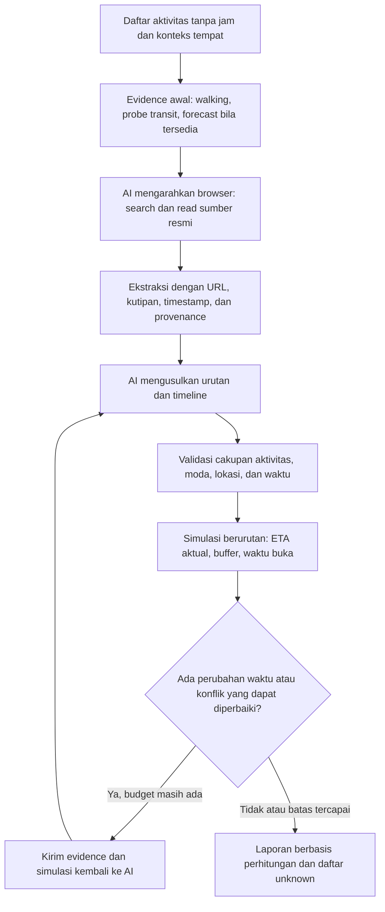

# Pipeline v2: riset browser, simulasi, dan perbaikan otomatis

Dokumen ini merupakan arsip alur v2. Jalankan dengan `plan:research:v2`. Command `plan:research` kini memakai [workflow v3](EVIDENCE_WORKFLOW.md); dukungan snapshot `--reuse` di bawah hanya untuk v2.

Status 2 November 2026: **kode tersedia dan diperiksa dengan `tsc --noEmit` saja**. Sesuai instruksi pengguna, tidak menjalankan tes, browser, pencarian, Google/OpenRouter, atau eksperimen itinerary pada perubahan ini. Hasil runtime dan kualitas rekomendasi tahap ini belum diverifikasi. Hasil November/Desember sebelumnya tetap berasal dari pipeline lama.

## Alur yang diimplementasikan



Input masih mengikuti eksperimen **daftar tanpa jam, satu hari, Asia/Tokyo, stasiun awal dan akhir sama**. Kontrak produk yang menyebut tempat + waktu tiap tempat yang diharapkan tetap tercatat di README; seluruh dukungan kontrak produk itu belum diterapkan oleh command ini.

1. Validasi input dan konteks, termasuk identitas aktivitas serta titik rute. Tempat makan yang belum dipilih tetap unknown.
2. Ambil estimasi walking terarah dan keenam pasangan transit yang diminta. Probe transit awal menggunakan **12:00 JST sebagai asumsi sampling sistem**, bukan waktu pengguna atau jadwal kereta. Hasil final diambil kembali pada waktu keberangkatan hasil simulasi. Tidak menggunakan driving sebagai pengganti kereta.
3. Ambil forecast regional untuk tanggal trip jika berada dalam horizon. Di luar horizon, error, atau data tidak lengkap, nilainya tetap unknown. Tidak mengambil prakiraan tanggal lain dan menganggapnya milik tanggal trip. Sunrise/sunset hanya disediakan jika ada pada evidence; ketiadaannya tidak berarti astronomi tidak bisa dihitung jauh hari.
4. Jalankan headless Chromium dalam konteks baru. Baca halaman awal, lakukan pencarian yang dikonfigurasi, lalu berikan teks halaman dan hasil pencarian kepada model. Model dapat meminta `search` dan `read` tambahan melalui keputusan JSON terstruktur; runner mengeksekusi permintaan tersebut, lalu memberi hasilnya pada putaran berikutnya.
5. Ekstrak informasi operasional/periode acara, catatan tempat dan durasi transit umum dengan kutipan yang benar-benar terdapat pada teks tersimpan. Angka tanggal/jam/durasi juga diperiksa keberadaannya di kutipan. **Quote-grounded tidak sama dengan seluruh makna sudah terbukti benar.**
6. Berikan input, sumber, hasil browser, rute, status forecast dan kebijakan buffer kepada AI. Semua jam/durasi kunjungan tetap usulan untuk ditinjau.
7. Validasi keluaran: setiap aktivitas tepat sekali termasuk yang opsional, coastal walk tetap WALK, setiap pasangan transit tetap TRANSIT, tidak ada teleportasi/overlap, dan draf kembali pada tanggal trip.
8. Simulasikan baris satu per satu. Periksa rute pada waktu setelah aktivitas/wait/perpindahan sebelumnya; tambah buffer minimum untuk rute yang punya estimasi. Tunggu sampai buka jika diperlukan; jangan memangkas durasi kunjungan atau menghapus tujuan diam-diam. Jika melewati jam tutup/tanggal, catat konflik, termasuk timestamp hari berikutnya dalam simulasi.
9. Kirim hasil simulasi dan alasan konflik ke AI untuk repair otomatis, maksimal tiga proposal secara default. Berhenti jika stabil, hanya kekurangan data, tidak ada perbaikan jadwal, atau budget habis. Memilih hasil terbaik yang tersedia tidak mengubah status konflik menjadi valid.
10. Tabel laporan memakai **waktu dan keterangan yang dihitung kode**. Narasi mentah AI berada di artefak per putaran, sehingga narasi seperti “menunggu penyalaan” tidak otomatis menjadi keterangan faktual tabel.

## Menyiapkan runtime nanti

Kebutuhan: Node 24+, variabel Google/OpenRouter yang sudah digunakan sebelumnya, dan Chromium sesuai versi Playwright pada lockfile.

```sh
npm ci --ignore-scripts
npm run browser:install
```

Library dipatok ke Playwright **1.64.1**. Instalasi library pada pekerjaan ini memakai `--ignore-scripts`; binary browser belum dipasang atau dijalankan untuk validasi pekerjaan ini. Instalasi binary di atas merupakan langkah runtime untuk nanti, bukan tes otomatis.

Tidak ada API key pencarian baru. Pencarian memakai halaman Bing melalui browser dan menyaring hasil ke domain resmi yang dikonfigurasi. Jika hasil diblokir, membutuhkan consent/CAPTCHA, atau selector berubah, pencarian dicatat unavailable. Sistem tidak melakukan bypass. Sumber PDF, tabel grafis, dan interaksi kompleks belum didukung oleh pembaca HTML/teks ini.

```sh
npm run plan:research:v2 -- \
  --input examples/funabashi-enoshima-2026-12-05-untimed.json \
  --context examples/funabashi-enoshima-place-context.json \
  --research examples/funabashi-enoshima-research.json \
  --out results/japan-researched-new
```

`--research` opsional jika konfigurasi `research` ada dalam file konteks. Tanpa keduanya, domain dan halaman awal diturunkan dari URL sumber pada konteks. Gunakan direktori output baru; hasil lama tidak ditimpa. `plan:untimed` dan `plan:untimed:legacy` masih menjalankan pembanding sebelumnya.

## Evidence dan batas kepercayaan

| Data                                                     | Pemakaian                                                                                      |
| -------------------------------------------------------- | ---------------------------------------------------------------------------------------------- |
| Daftar, tanggal, awal/akhir, aktivitas dan moda pengguna | Batas input yang harus dipertahankan                                                           |
| Konteks sumber awal                                      | Batas yang diberikan kepada sistem; tidak otomatis dianggap baru diverifikasi browser          |
| Halaman browser                                          | URL final, waktu ambil, judul, teks terbatas, hash, tautan, status                             |
| Hasil pencarian                                          | Discovery saja; tidak cukup untuk mengesahkan klaim                                            |
| Ekstraksi browser                                        | Kutipan, source ID, applicability tanggal, angka yang cocok; semantik tetap dapat keliru       |
| Ekstraksi jam/periode dengan tanggal trip eksplisit      | Dapat ditambahkan sebagai constraint; konflik dengan sumber lain tetap diperiksa               |
| Jam umum/bersyarat yang diekstrak                        | Konteks AI, tidak diam-diam menggantikan constraint yang diberikan                             |
| Durasi operator umum                                     | Konteks perencanaan, bukan bukti jadwal kereta bertanggal atau pengganti hasil API yang kosong |
| Google Routes                                            | Estimasi rute terarah; transit diperiksa kembali pada keberangkatan yang sudah dipropagasikan  |
| Buffer 5 menit walking / 10 menit transit                | Asumsi sistem yang bisa dikonfigurasi, bukan jaminan dari provider                             |
| Forecast                                                 | Sampel regional pada jam kunjungan; probabilitas, bukan kepastian hujan/durasi hujan           |

Browser hanya menerima HTTPS pada allowlist domain, memeriksa alamat DNS publik, membatasi redirect, menolak request selain GET, tidak memakai sesi/cookie akun pengguna, memblokir download, service worker dan websocket, serta membatasi halaman/pencarian/teks/waktu aktif. Domain allowlist ditentukan konfigurasi, bukan dipilih bebas dari teks halaman. Pembatasan ini bukan klaim sandbox/SSRF yang sudah diuji; tetap perlu review runtime sebelum memakai lingkungan sensitif.

Lokasi masih berasal dari input/konteks. Browser tidak diam-diam memilih restoran, menggeser koordinat atau mengganti destinasi. Data yang tidak lengkap dapat berakhir sebagai `needs_information` alih-alih memaksa itinerary terlihat pasti.

## Budget dan penghentian

Variabel opsional pada `.env.example`:

| Variabel                       |   Default |
| ------------------------------ | --------: |
| `POC_WALK_BUFFER_MINUTES`      |         5 |
| `POC_TRANSIT_BUFFER_MINUTES`   |        10 |
| `POC_MAX_PLAN_ATTEMPTS`        |         3 |
| `POC_MAX_ROUTE_REQUESTS`       |        90 |
| `POC_MAX_MODEL_CALLS`          |         8 |
| `POC_MAX_RUN_TOKENS`           | 1.000.000 |
| `POC_EVIDENCE_MAX_AGE_MINUTES` |        60 |

Budget request Google mencakup pengumpulan awal dan seluruh simulasi dalam run yang sama. Cache walking tidak menyamakan arah; cache transit menyertakan waktu keberangkatan. Kondisi `no_route` tetap unknown, tidak menjadi nol menit. Batas request dapat menghasilkan `budget_exhausted` yang terlihat pada laporan.

Plafon konteks `OPENROUTER_CONTEXT_LIMIT` tetap **input + completion per request**. Completion mencakup reasoning. `POC_MAX_RUN_TOKENS` menambahkan batas agregat seluruh panggilan AI pada run. Preflight masih berupa estimasi konservatif byte UTF-8 + overhead; penggunaan aktual dipakai jika tersedia. Jika usage hilang atau request gagal, reservasi konservatif tetap dihitung. Tidak menyimpan reasoning internal.

Default riset: 10 halaman, 4 pencarian, 3 putaran AI riset, maksimal 16.000 karakter per halaman dan 150 detik kerja browser aktif. Waktu menunggu respons model tidak menghabiskan budget navigasi aktif; sesi browser tetap mempunyai watchdog keseluruhan. Ada timeout terpisah per panggilan provider/model. Tidak ada loop tanpa batas.

## Artefak dan reuse

- `user-input.json`, `original-context.json`: input dan konteks asal.
- `initial-evidence.json`: hasil pengumpulan rute dan forecast sebelum proposal.
- `research.json`: halaman/hasil pencarian, kutipan diterima/ditolak dan permintaan tool model.
- `collected.json`: snapshot versi 2 sebelum proposal, dengan hash input/konteks.
- `attempt-N/decision-input.json`: bahan yang diterima model pada setiap proposal/repair.
- `attempt-N/ai.json`: jawaban akhir AI dan metadata, tanpa reasoning internal.
- `attempt-N/simulation.json`: waktu terpropagasi, buffer, perubahan dan konflik.
- `attempts.json`, `route-evidence.json`, `report.json`, `report.md`: riwayat dan hasil terbaik yang tersedia.
- `progress.json` / `failure.json`: fase pekerjaan dan kegagalan; tidak ada fallback ke data simulasi.

```sh
npm run plan:research:v2 -- \
  --reuse results/japan-researched-new/collected.json \
  --out results/japan-researched-retry
```

Reuse menerima snapshot v2 yang masih segar, mempertahankan input/konteks, dan tidak melakukan riset browser ulang. Rute pada waktu baru masih dapat diminta ketika simulasi membutuhkan. Snapshot lama tetap memakai command legacy. Mengganti tanggal/destinasi/config atau melewati batas umur evidence memerlukan pengumpulan baru.

`ready_for_review` hanya berarti pemeriksaan yang diimplementasikan tidak menemukan konflik/unknown; **bukan konfirmasi kelayakan perjalanan nyata**. `verifiedTravelFeasibility` selalu false pada tahap ini. `conflicts`, `needs_information`, dan `no_valid_proposal` mempertahankan penyebabnya dalam laporan. Antrean, crowd, ketepatan tempat, penutupan khusus dan semantik ekstraksi belum otomatis terverifikasi penuh.

## Pemeriksaan yang diizinkan pada pekerjaan ini

```sh
npm run check
```

Perintah menjalankan `tsc --noEmit`. Tidak menjalankan `npm test`, browser, fixture/demo, live provider, atau Simulator. Belum ada klaim bahwa implementasi browser, loop model dan kualitas itinerary sudah lolos runtime.

Referensi implementasi: [Playwright BrowserType](https://playwright.dev/docs/api/class-browsertype), [BrowserContext](https://playwright.dev/docs/api/class-browsercontext), [instalasi browser](https://playwright.dev/docs/browsers), [OpenRouter structured outputs](https://openrouter.ai/docs/guides/features/structured-outputs), [Google transit routes](https://developers.google.com/maps/documentation/routes/transit-route), [Open-Meteo](https://open-meteo.com/en/docs).
