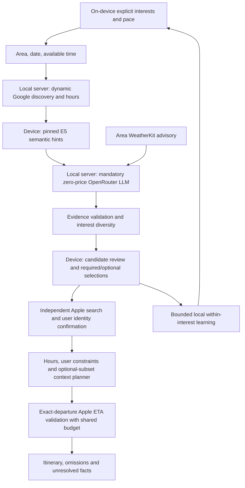

# Personal recommendation PoC — implementation and evidence

8 November 2026, Asia/Jakarta. Isolated Mac server and iOS Simulator; no deployment or integrated-app changes. This report supersedes development claims only for the new personal flow. [Prospective protocol and amendments](PERSONAL_RECOMMENDATION_PROTOCOL_2026-11-08.md); [previous routing campaign](DYNAMIC_CONTEXT_SIMULATOR_RESULTS_2026-11-08.md).

## Delivered flow

The default C67 Context Lab screen now asks for interests/pace once, reuses the local profile, then asks for area/date/time before discovering places. Google supplies dynamic candidates and date-specific hours. Actual pinned E5 runs in the Simulator to supply relative semantic hints. A mandatory free OpenRouter LLM ranks only supplied candidate IDs with structured evidence; code rejects unsupported claims and applies rounds across explicit interests for diversity. The user inspects and selects required/optional places, independently confirms matching Apple venues, reviews constraints and requests an ETA-validated itinerary.

Open/save/select events refine bounded facets inside explicit interests. Shown events are recorded on actual card appearance. Skip/remove events are retained without assuming dislike. Interests/pace/facet signals persist after relaunch; explicit category edits remove incompatible facet signals. This is a transparent experimental policy, not model retraining or validated preference learning.

The existing context planner is reused. Optional-subset search preserves required visits, shares one exact-departure ETA memo/budget across subsets, and discloses optional omissions and search truncation. Its experimental objective compares contextual penalties, optional count, then finish time. Automobile, return to origin, Jakarta, six selections, 12 subsets and 64 combined ETA calls remain pilot bounds.

## Architecture

The LLM judges candidate ranking, not route feasibility or opening-time arithmetic. E5 remains on the device; it does not become an LLM and is not replaced by OpenRouter. If E5 is unavailable its helper signal is labelled missing, while LLM success remains mandatory. If the LLM fails there is a visible error and explicit retry, never a silent category-only recommendation.

## Identity defects found and corrected

Visual review invalidated two development itineraries even though their numerical checks passed:

- Google Museum Sejarah Nasional inside Monas matched Apple Jakarta History Museum/Fatahillah about 4.7 km away.
- Google TOMORO COFFEE Stasiun Gambir matched Apple Kompormie Gambir about 41 m away.

Those itineraries are quarantined development artifacts, excluded from final E2E evidence. Both server and UI now require finite 0–500 m separation and distinctive name support after removing generic/address tokens. The UI allows an alternate Apple query. This conservative lexical guard can reject legitimate aliases and cannot establish entrance/accessibility correctness. The independent auditor additionally checks distinctive shared venue tokens; actual names/addresses are retained in the derived plan audit. Fixed venue choices in a UI scenario are operator test inputs, not a catalogue in the engine.

## Measurement interpretation

Recommendation timing starts at submit and ends at actual first-card appearance. Acquisition, E5, LLM and client apply times are also retained; initial E5 loading and passage reuse are observable. Each explicit retry is a separate attempt. Invalid-input controls are separate from provider availability. Preparation and human selection time are excluded from itinerary timing, just as in the previous routing campaign.

A short recommendation latency does not establish a short itinerary latency, and a constraint-valid itinerary does not establish preference accuracy. The new mandatory LLM flow cannot be compared directly with the old 8–28 second route-only observations: they time different phases and use different venue/constraint inputs. No p95 or production SLA is claimed from this small adaptive development sample.

## Final benchmark

Primary observations: v6 controlled recommendation runs (two balanced, two unknown-hours) and v7 live runs (three distinct successful recommendation UUIDs), followed by one live three-place itinerary. The campaign label changes and all earlier attempts are preserved in the protocol; this is adaptive development verification, not a blinded benchmark.

| Stage/input | Successful / attempts | Median to selectable list | Observed range | Notes |
|---|---:|---:|---:|---|
| Synthetic balanced places; real E5 + LLM | 2 / 2 | 3.181 s | 3.084–3.279 s | Includes first E5 load; no live place acquisition |
| Synthetic unknown-hours places; real E5 + LLM | 2 / 2 | 1.867 s | 1.719–2.014 s | Unknown-hours reasons remain conditional |
| Live Gambir discovery; real E5 + LLM | 3 / 3 | 8.523 s | 5.655–11.459 s | Six candidates, three explicit interests represented each time |
| Live itinerary, 1 required + 2 optional | 1 / 1 | 41.347 s computation | Single observation | Three visits retained; 35 actual ETA calls; bounded search |

All seven primary recommendation lists appeared within 20 seconds and reported $0 LLM cost. Live stage medians were acquisition 2.126 s, E5 0.039 s and LLM 4.631 s. These medians do not add up to an individual observed total; first-load and cached E5 work differ. The 41.347 s route computation starts after selection/preparation and includes the same HTTP/provider path used by the UI. It is not a demonstrated route-speed improvement.

Final operator trip: Tuesday 10 November, 09:00–19:00, coffee/culture/outdoors profile, balanced pace. Loko Cafe is required; the museum and park are optional. This scenario did **not** enable an afternoon park preference, and is not a new evaluation of Giovan's earlier “taman sore” brief.

| Visit | Scheduled WIB | Google → independently confirmed Apple | Pin difference |
|---|---|---|---:|
| Museum Nasional Indonesia | 09:15–10:15 | National Museum | 55.1 m |
| Loko Cafe Gambir | 10:30–11:30 | Loko Cafe | 5.3 m |
| Taman Pandang Istana | 11:45–12:45 | Taman Pandang Istana | 4.9 m |

Origin/return: Hotel Indonesia Kempinski Jakarta → Apple Hotel Indonesia Kempinski - Jakarta, 96.2 m. Full 60-minute dwell was preserved, total waiting 23.067 minutes stayed below 30, and return stayed within the deadline. Exact leg departures, opening-session containment and elapsed decomposition passed the independent audit. `searchTruncated=true`: this is a valid candidate under modeled constraints, not an optimum or proof that every optional combination was exhausted.

Across the saved development + final recommendation dataset there are 42 provider attempts: 41 successful and one explicit OpenRouter HTTP 502. Six invalid-context controls are separate. These adaptive attempts span changing harness/validators and are **not** a production availability estimate. Earlier CLI provider probes are separate and observed 400/429. `recommendations.csv` includes all 48 exported observations; none of the failed/interrupted runs is silently converted into a successful repetition.

The independent personal auditor rejected six deliberately corrupted recommendations and five corrupted itineraries. Six HTTP controls rejected anonymous access (401), malformed JSON, a forged session, a missing live LLM proof, a 4,720 m museum mismatch, and a 41 m different-business mismatch (400). Both identity rejections occurred before any additional routing-provider calls. They reproduced the exact two defects discovered by visual review.

## Verification and remaining gaps

The full Swift package regression executed 96 tests: 95 passed and one opt-in live test was skipped, including 18 recommendation/learning/optional-plan/identity controls. Simulator UI evidence, independent JSON audit and HTTP rejection controls are recorded with the campaign artifacts below. Counts are summed once per package test product (Recommendation 18, PlannerLab 35 including one skipped, PlaceContext 25, DynamicTrip 5, ContextPilot 13), avoiding duplicate parent-suite log lines. The three personal UI cases passed across v6 (profile persistence and invalid context) and v7 (live recommendations through itinerary). The legacy GBK discovery/confirmation test also passed. The legacy weather/hours UI campaign reran 54 observations (18 scenarios × 3); its independent oracle passed all arithmetic checks and rejected six deliberate corruptions. Tests added during development are regression controls rather than untouched holdout cases.

No fresh human assessment was supplied while the user was away. Therefore recommendation acceptance, learned-facet benefit, LLM quality uplift over a non-LLM ranking, long-term learning and field travel accuracy remain unproven. Area weather is advisory; venue exposure is unknown until declared. Last entry, ticket inventory, public sentiment/ideal visit time, queues, mobility/access requirements, live incidents and identity aliases still need additional evidence. Unknown hours stay conditional and cannot be fabricated into a mandatory complete timetable.

Free model availability is variable: development probes observed HTTP 400/429 and Nemotron HTTP 502. Successful responses report zero LLM cost with zero-price routing enforced; this does not mean Google/Apple usage is free or that failed requests supplied complete billing telemetry. All development attempts are retained separately, including interrupted UI runs and harness fixes. No paid fallback is configured.

## Reproduction

Follow [ContextHarness README](../ContextHarness/README.md). Server credentials live in ignored `.env.local`; the original CLI key file was preserved. The debug bundle contains a local connection bearer and must not be distributed. Restarting the local server rotates that bearer, requiring a client rebuild.

Run `PersonalRecommendationUITests` with the authenticated local server active. UI tests use a separate synthetic profile store and never reset the normal profile. Export from the current Simulator container with `scripts/export-personal-observations.py`; audit with `scripts/audit-personal-recommendation.py`. Run `scripts/check-personal-http.py` while the latest prepared identities are fresh. All these scripts run from the lab directory. Existing legacy tests use `--context-legacy`.

Artifacts: `artifacts/personal-recommendation-2026-11-08/`. Raw xcresult and build logs are local development material. Derived observations retain source IDs and technical evidence; the new normal path does not download or retain a raw review corpus.

## Handoff state

The final provider process used 84 recommendation Google calls, 22 recommendation Apple HTTP calls and 15 LLM calls, plus 11 context Google calls, 43 context Apple HTTP calls and 35 ETA cells. These are per-process counters, not the entire multi-restart development total; earlier process counters are archived separately. The server was restarted after evidence export to restore the bounded interactive demo budget, and the local client connection resource rebuilt. Prepared proof/identity sessions from the benchmark are therefore expired; start a fresh recommendation when trying the app.

At the final limit check (about 19:07 WIB), the Codex 5-hour allowance had 17% remaining and weekly allowance 87% remaining. This is a session snapshot, not a future guarantee. The experiment stops at the verified PoC rather than spending the remaining allowance on additional scope.

Key evidence files: `independent-audit.json`, `http-negative-controls.json`, `recommendations.csv`, `personal-plan-latest.json`, `legacy-regression/controlled-independent-audit.json`, `source-sha256.json`, and the final xcresult screenshots. Provider facts and model availability may change; the timings describe this run only.
