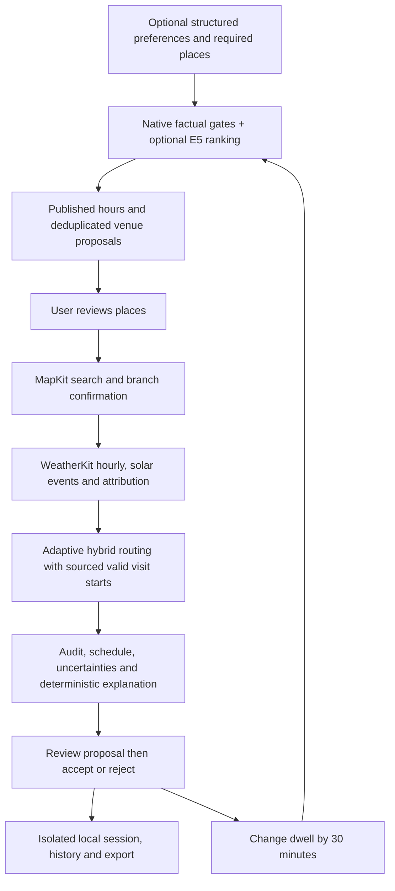

# C67 Trip Integration — Priority 3

Separate iPhone PoC, **v0.1 build 3**, minimum iOS 26. After Giovan confirmed WeatherKit activation, the signed build, **35 package tests, 2 Simulator UI tests and 7 scripted iPhone live cases passed**. Previous Foundation Lab and routing apps remain separate. See the [verification report](docs/VERIFICATION_REPORT_2026-11-05.md) for measurements, fixed failures and untested scope.

Open `C67TripIntegration.xcodeproj`, scheme **C67TripIntegration**.

| Signing item | Value |
| --- | --- |
| Bundle ID / explicit App ID | `giovanchristoffel.c67-trip-integration` |
| Development Team | `DP5XP7C2AM` |
| WeatherKit entitlement | `com.apple.developer.weatherkit = true` |

Register this App ID under the team, enable **WeatherKit in both App Services and App Capabilities**, and ensure Xcode's provisioning profile includes the entitlement. This is a native Swift WeatherKit client; it does not need a REST JWT key. See [Apple's account setup instructions](https://developer.apple.com/help/account/services/weatherkit/).

## Purpose and falsifiable hypothesis

Can the previously separate components produce a consistent, reviewable, source-linked day trip without a team-operated AI backend? Success requires every selected place, full visit duration, sourced entry/session rule, actual departure-time ETA, return deadline and weather interval to agree. Successful compilation or a synthetic replay is insufficient evidence of this hypothesis.



## Included behavior

- One Jakarta day in WIB, 1–6 unique venues, no main destination, equal priority for all user selections. Start and return at Bundaran HI. Automobile/on-demand car ETA only; no motorcycle or transit claim.
- Preferences are optional. Unknown preferences remain unknown; the empty profile produces a **general**, non-personalized recommendation. Must/avoid uses facts for the same area; unknown/conflict cannot satisfy a hard condition. Free English direction requires structured confirmation. The UI groups optional controls to keep the default path short.
- Shared `PreferenceQuality` performs factual screening and optional multilingual E5 inference. It falls back to category ranking when embeddings fail. No generative Foundation Models dependency is necessary for this integrated path; the original FM experiments are retained in Foundation Lab.
- A frozen catalog combines P1/P2 venue IDs. Library hours for Baca Di Tebet and Erasmus Huis are added from their official publications. All source URLs, original check dates and imported fixture provenance remain visible. Some recommendation candidates intentionally lack hours and cannot enter a verified schedule. Venue-wide library hours are **not** borrowed by the Baca Di Tebet café card.
- One MapKit query for the origin plus each selected venue, at most 7 searches per attempt, at most 10 raw results per search. No automatic query expansion. Deduplicate results and apply the existing Jakarta polygon. Only name/branch matches can be chosen; ambiguous valid matches require confirmation. A different library branch cannot inherit Cikini facts.
- WeatherKit is primary even for Jakarta. Open-Meteo is explicit opt-in and errors remain attached. Diagnosis always bypasses cache and disables fallback. Group radius is at most 3 km from a representative, not pairwise identity or exact microclimate. Cache requires matching coverage, provider policy, age <15 minutes and provider expiration. Authorization failure skips subsequent primary-only groups within that operation.
- Weather includes hourly rain/temperature and available sunrise/sunset. Apple data is published only with attribution. Missing or partial data stays unknown. Every visit's rain summary covers its complete actual interval, including hourly boundaries.
- The existing adaptive hybrid/`elapsed_v2` implementation is copied into this package. The pure routing core is unchanged. A P3 adapter enforces **all** P1 valid-start ranges during every final candidate evaluation, including session breaks, last entry and entry pauses. Final candidates still use actual per-leg provider ETA; approximate screening values never become ETA evidence. Request budget is 512; no wall-time or global optimality claim.
- Visiting-time goals produce source-linked advice. The route retains its elapsed-time objective and existing weather alternative policy (up to 15 extra minutes). The UI states that the route may not achieve every preferred visit window. This is not a joint global optimizer for every preference/time goal.
- A +30-minute action creates a new draft retaining all selected IDs. Recompute route, deadline, full-stay rules and weather summaries. Old accepted data remains until a feasible proposal is explicitly accepted. This is **pre-trip draft revision**, not an active-trip tracker or a claim that an observed delay has occurred.
- Input changes cancel operations and invalidate their epoch; outdated UI results are ignored. Provider cancellation is cooperative. MapKit search cancellation timer: 35 seconds; ETA timeout inherited: 25 seconds; weather group operation: 45 seconds. A provider ignoring cancellation can delay completion; these are not hard process deadlines. No automatic retry loop.
- Storage: `Application Support/C67TripIntegration-v1`. Atomic checksum envelope, prior-session backup, corrupt-file preservation, immutable run-ID history, proposal/base-version guard. UI restores the latest accepted/proposed plan; historical runs remain JSON artifacts. No writes to old planner storage. Replay uses temporary isolated storage/logs.
- Acceptance also checks that current input, selected places and confirmed pins still match the proposal; a proposal older than15m or whose departure has passed requires recalculation. Accepted historical plans remain available with their original dates.
- Exports: `experiment.json`, `REPORT.md`, compatible `native-report.json`, and `provider-log.jsonl`. The experiment includes preference inputs, raw route output, sources, timing runs, weather metadata/errors and stage metrics. `weather_groups` counts grouped fetch operations, not internal hourly/daily/attribution API calls.

## Source layout

| Path | Responsibility |
| --- | --- |
| `App/` | SwiftUI input, review, results, diagnosis, accept/reject and export |
| `Packages/TripIntegration/Sources/TripIntegration/` | Contracts, catalog adapter, pipeline, provider policies, audit, persistence |
| `.../VendorRouting/` | Isolated copies of existing routing components |
| `.../Resources/` | Source-linked, dated Jakarta catalogs |
| `Packages/TripIntegration/Tests/` | 35 executed package tests, including live-derived Cikini regressions |
| `UITests/` | 2 executed Simulator replay tests with screenshot evidence |
| `docs/TEST_MATRIX.md` | Cases, expected behavior, evidence type and acceptance criteria |
| `docs/IMPLEMENTATION_STATUS.md` | Exact handoff state and remaining verification |
| `docs/VENDOR.md` | Reuse boundaries and modifications |

The app uses sibling local packages in `../c67-foundation-lab/Packages`. Their existing ONNX Runtime 1.24.2 and swift-transformers 1.4.0 pins and local E5 model assets are retained. Xcode may need to resolve these dependencies after the testing gate opens. Missing assets should produce the existing category fallback; successful E5 inference still needs device evidence.

## Reproducing verification

Giovan confirmed WeatherKit activation and authorized execution; see `docs/WEATHERKIT_CONFIRMATION.md`. The script flag is an accidental-execution guard, not a new permission request. Keep this boundary for any different App ID/account.

Project generation only (no compilation or provider calls):

```sh
xcodegen generate
```

The post-generation Python hook writes the nested WeatherKit capability dictionary into this generated project. It performs no build or provider operation; the entitlement alone does not activate the Apple portal service.

For this already-authorized App ID, in this app directory:

```sh
export C67_P3_WEATHERKIT_CONFIRMED=YES
./scripts/verify-after-confirmation.sh build
./scripts/verify-after-confirmation.sh unit
P3_SIMULATOR_DESTINATION='platform=iOS Simulator,id=0F32DA7F-20C4-481E-8A0E-01FB5F153CBE' ./scripts/verify-after-confirmation.sh ui
```

Choose an actually installed Simulator when running the UI command. The final build is installed on Evaluation iPhone17 / iOS27.0.1. Start with the separate WeatherKit diagnosis, export its real result, then execute the live matrix. A Simulator replay cannot count as live WeatherKit, MapKit or iPhone embedding evidence.

Debug-only launch argument `--p3-replay` selects an authored fixture clock (`2026-11-05T07:00:00Z`), synthetic coordinates, fixed 20-minute legs and authored hourly weather. It makes no live place-search, ETA, forecast or E5-inference request; the system Map may still load base-map tiles. Date and provenance are not relabeled as current, and replay cannot run the WeatherKit diagnosis. This replay passed on the iPhone18Pro / iOS27.2 Simulator.

Debug-only `--p3-live-eval` opens the isolated real-provider evaluation screen used on iPhone. It writes `Documents/P3LiveEval` and uses separate evaluation session/log storage. The normal app does not run it automatically. `p3-mapkit-probe` is a Mac executable for six explicit live name/branch lookups; its results do not count as WeatherKit or iPhone evidence.

```sh
swift run --package-path Packages/TripIntegration p3-mapkit-probe artifacts/mac-mapkit-probe.json
```

## Interpreting verification

Pass only if all critical invariants in the matrix hold in deterministic fault cases **and** real signed-device flows. Report category/E5 outcomes, actual search/ETA/group counts, times, failures, corrections and pending claims separately. User relevance and reduced contribution still require observed use with participants; this technical PoC cannot establish them by itself.

## Shared engine for Journey Showcase — 9 November 2026

The sibling [Journey Showcase](../c67-journey-showcase/README.md) uses this package's combined city/Blok M catalog, confirmed custom origins, target-area constraints and direct/one-transfer TJ planning. Its attributed runtime feed contains 199 routes and 544 patterns. The diagnostic App/UITests in this folder retain current main; adding the shared engine does not add the Showcase controls to that older UI.

Run `bash poc-journey/scripts/verify.sh packages` and `bash poc-journey/scripts/verify.sh transjakarta` from the repository root for deterministic package and TJ checks. The [prior improvement report](docs/transjakarta/IMPROVEMENTS-REPORT-2026-11-06.md) and [capability protocol](docs/transjakarta/CAPABILITY-TESTS.md) retain their historical dates and boundaries. See the [PR repair task](../../docs/tasks/pr12-journey-fixes-2026-11-09.md) for current scope and verification.
