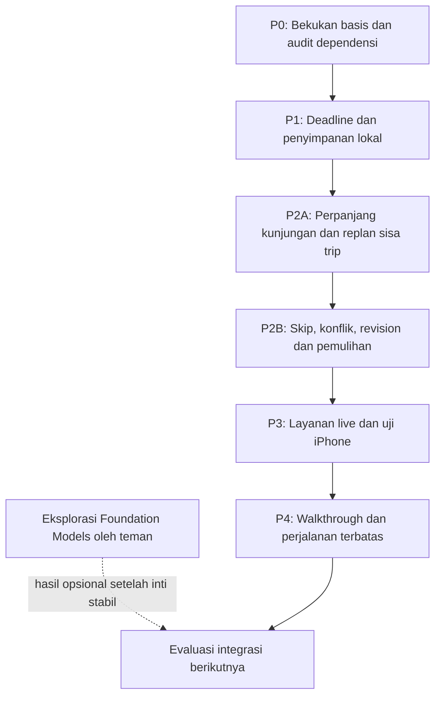

# Masterplan PoC — itinerary native dan penyesuaian perjalanan

**Tanggal:** 3 November 2026, Asia/Jakarta (WIB).  
**Status:** spesifikasi rangkaian implementasi dan evaluasi; P0–P2B mempunyai hasil lokal/manual; P3 layanan live/iPhone dan P4 pengguna masih rencana.  
**Pemilik eksperimen:** Giovan. Eksplorasi Foundation Models ditangani teman Giovan pada jalur terpisah.  
**Basis:** routing hybrid adaptif yang telah diuji secara lokal pada 3 November 2026.

**Pembaruan pelaksanaan 3 November:** P0 dan fondasi P1 untuk planned draft/accepted itinerary selesai secara lokal. Deadline, save/restore, failure/retry dan jalur peluncuran native telah diuji; lihat [laporan P0–P1](../../../../apps/native-routing-lab/docs/verification/NATIVE_LOCAL_P0_P1_2026-11-03.md). Bagian di bawah tetap menjadi spesifikasi rangkaian penuh; pada checkpoint tersebut P2 masih rencana. Status terbaru ada pada pembaruan berikut.

**Pembaruan pelaksanaan 4 November:** P2A/P2B selesai pada lingkup lokal/manual: lifecycle, extend, skip, deadline, proposal dan konsistensi tersimpan. G2A lulus alur +30 di Simulator; invariant G2 yang berlaku lulus pada domain/storage/replay. 59 XCTest lokal + 26 Jakarta dan 144 run replay lulus. Pembatasan eksperimen: satu hari, satu moda walking atau automobile on-demand; private car/transit aktif ditolak. Stress rapid-tap UI, provider live, aksesibilitas dan iPhone fisik tetap P3. [Laporan P2 beserta pemetaan matriks](../../../../apps/native-routing-lab/docs/verification/NATIVE_TRIP_REPLANNING_P2_2026-11-04.md). Urutan tahap berikutnya tetap P3→P4; Foundation Models paralel.

**Penajaman prioritas Jakarta, 4 November:** tahap live berikutnya mendahulukan validasi tempat dan routing mobil/motor di Jakarta, memakai Open-Meteo untuk cuaca. Audit WeatherKit dan optimasi latency ditunda. [Rincian lingkup dan kriteria J-01…J-06](jakarta-routing-places-scope-2026-11-04.md) mencatat perbedaan target mobil/motor dan dukungan provider saat ini. Kasus provider/perangkat yang ditunda tetap belum dijalankan; tidak diubah menjadi Passed.

**Hasil build 9 Jakarta, 4 November:** profil/batas pin dan pemilihan tempat diperbaiki; routing mobil serta replan/end-only terbukti pada provider aktual melalui harness macOS,77+26 XCTest lulus. Layar awal dan build Simulator terverifikasi; kegagalan kontrol UI membatasi walkthrough interaktif pada sesi ini. Motor/geometry live/iPhone/pengguna tetap mempunyai bukti yang belum dilengkapi. [Laporan build 9](../../../../apps/native-routing-lab/docs/verification/JAKARTA_ROUTING_FIX_2026-11-04.md). Ini kemajuan P3, bukan kelulusan seluruh gerbang provider/perangkat.

**Eksperimen Weather Lab build 10, 4 November:** audit WeatherKit dilanjutkan pada layar terpisah agar planner Jakarta tidak berubah. Diagnosis satu titik, kelompok radius 3 km, cache/expiry, deadline provider, pemutus autentikasi, cancellation dan cadangan sudah diimplementasikan. 100 XCTest lokal (23 Weather Lab) +26 Jakarta lulus; UI/provider aktual Simulator menunjukkan fallback lengkap untuk empat kelompok dan reuse cache tanpa request baru. WeatherKit masih gagal pada layanan autentikasi Simulator, sehingga autentikasi iPhone/konfigurasi akun dan manfaat pengelompokan di lapangan tetap belum terbukti. Jalur cuaca planner Jakarta tetap Open-Meteo langsung; ini eksperimen pendukung P3, bukan kelulusan seluruh gerbang P3/P4. [Laporan build 10](../../../../apps/native-routing-lab/docs/verification/WEATHER_LAB_2026-11-04.md).

Dokumen pendamping: [matriks pengujian](native-trip-replanning-test-matrix-2026-11-03.md) dan [template laporan](native-trip-replanning-report-template.md). Konteks produk: [CBL](../../../source-records/CBL.md) dan [rencana validasi produk 29 Oktober](../product/ai-trip-planning-validation-plan-2026-10-29.md).

## 1. Keputusan yang ingin dihasilkan

PoC ini menjawab: **dapatkah seseorang menyusun dan menyesuaikan perjalanan satu hari dengan aplikasi yang fungsi intinya tetap berjalan ketika backend tim dan AI tidak tersedia?**

Manfaat yang ingin diuji adalah kemampuan mengambil keputusan selama perjalanan: mengetahui dampak keterlambatan, mempertahankan tujuan penting, dan memilih penyesuaian yang masuk akal. Menghasilkan rute atau berhasil melakukan build merupakan bukti teknis pendukung.

Hasil akhirnya harus memungkinkan keputusan berikut:

- **Lanjut:** alur inti mandiri, penyesuaian konsisten, layanan cukup andal, dan pengguna menunjukkan manfaat dalam tugas nyata.
- **Revisi:** logika benar tetapi data, waktu tunggu, penjelasan, atau interaksi masih menghalangi penggunaan.
- **Persempit:** fokus pada penyusunan jadwal sebelum berangkat apabila penyesuaian aktif belum membantu atau terlalu sulit dipelihara.
- **Investigasi kembali:** kebutuhan pengguna atau mutu data tempat belum cukup mendukung konsep yang diuji.

## 2. Landasan dan batas bukti saat ini

| Hal | Status per 3 November | Implikasi untuk pekerjaan ini |
| --- | --- | --- |
| Hybrid adaptif native | Sudah diimplementasikan; diuji dengan adapter replay | Dipakai sebagai fondasi; tidak mengulang kompetisi algoritma |
| Regresi routing | 26 XCTest + 34 pemeriksaan lokal lulus pada laporan sebelumnya | Pertahankan sebagai regresi; hasil historis tidak menggantikan tes perubahan baru |
| Benchmark adaptif | 45 kasus, 405 run; 132 pasangan layak mempunyai durasi sama dengan hybrid penuh | Bukti pada suite terpilih, belum jaminan semua perjalanan |
| Efisiensi request | Jakarta empat tujuan 88 → 30; seluruh suite turun 2,42% | Ukur kembali ketika layanan dan cuaca benar-benar aktif |
| Batas selesai native | `NativeTripDraft.endOfDay` masih menjadi batas waktu | Batas pulang yang ditentukan pengguna adalah pekerjaan baru |
| Penyimpanan native | Draft dapat diimpor; state utama berada di memori; log tersimpan lokal | Log persisten belum membuktikan draft, hasil, dan trip aktif dapat dipulihkan |
| Hasil perhitungan | `NativeTripReport`/candidate belum merupakan kontrak penyimpanan `Codable` | Perlu snapshot rencana tersimpan yang terpisah dari objek layanan/peta |
| Perjalanan aktif | Belum ada state aktual kunjungan, revision, proposal/apply pada fitur native ini | Menjadi fokus implementasi |
| Pembatalan dan hasil lama | Sudah ada generation token untuk operasi saat ini | Perlu diperluas hingga proposal, revision, penyimpanan, dan proses apply |
| ETA/peta | Integrasi live pernah diuji pada versi terdahulu | Ulangi untuk alur baru; tes terbaru adaptif bukan tes layanan live |
| Cuaca | WeatherKit → Open-Meteo tersedia; pemeriksaan adapter lokal pernah lulus | Autentikasi, fallback, waktu tunggu dan cakupan live masih perlu dibuktikan |
| Implementasi repo C67 lain | Ada kerangka planning/replanning backend dengan tes sintetis | Dapat dipelajari semantiknya; bukan bukti replanning native sudah berjalan |
| Nilai pengguna | Belum dibuktikan oleh benchmark routing | Memerlukan walkthrough dan perjalanan terbatas |

Sumber basis: [laporan adaptif](../../../../apps/native-routing-lab/docs/verification/ADAPTIVE_ROUTING_REPORT_2026-11-03.md), [model native](../../../../apps/native-routing-lab/poc-c67/Features/NativePlanner/NativeTripModels.swift), [state UI native](../../../../apps/native-routing-lab/poc-c67/Features/NativePlanner/NativeTripModel.swift), [evaluator](../../../../apps/native-routing-lab/poc-c67/Features/NativePlanner/NativeTripEngine.swift), [cuaca](../../../../apps/native-routing-lab/docs/NATIVE_WEATHER_FALLBACK.md), dan [status C67 terpisah](../../../missing-evidence.md#missing-04014d2894df).

Kode adaptif basis masih berupa working tree pada branch `gi/itinerary-time-aware`, dengan base commit `712f036`. Manifest source harus merekam file aktual; hash commit saja tidak mewakili semua perubahan yang diuji.

## 3. Arah yang dipakai dan asumsi yang perlu diuji

**Diberikan oleh diskusi:** routing dikunci pada hybrid adaptif; fungsi inti tidak bergantung pada backend AI; Foundation Models dieksplorasi teman; UI PoC dibuat minimal; perubahan diterapkan atas keputusan pengguna.

**Pilihan kerja dalam masterplan ini:** satu hari, satu zona waktu destinasi, satu trip aktif, satu sampai enam tujuan untuk uji penerimaan awal, jam operasional manual, serta pemicu replanning manual. Mesin lama tetap diuji untuk rentang input yang sebelumnya didukung; lingkup eksperimen awal tidak otomatis mengubah batas 1–20 tujuan pada engine.

**Perlu validasi:** kebutuhan pengguna awal, mutu koordinat/jam operasional, waktu tunggu layanan, kejelasan alasan perubahan, manfaat dibanding cara pengguna sekarang, dan beban pemeliharaan layanan eksternal.

Definisi kemandirian:

| Kondisi | Target kemampuan |
| --- | --- |
| Backend tim/OpenRouter tidak tersedia; internet tersedia | Membuat, menyimpan, menjalankan, dan menyesuaikan trip melalui kode native serta provider langsung |
| Model lokal tidak tersedia | Seluruh alur inti tetap dapat dipakai dengan formulir/tombol dan penjelasan template |
| Internet tidak tersedia | Rencana tersimpan dan fakta kunjungan tetap dapat dibaca/dicatat; ETA baru tidak diklaim tersedia |
| App ditutup lalu dibuka kembali | State terakhir yang berhasil disimpan dipulihkan; request lama tidak diteruskan secara otomatis |

PoC ini tidak menjanjikan routing baru sepenuhnya offline. Kemandirian dari server tim tetap mempunyai dependensi pada OS, distribusi aplikasi, MapKit dan provider cuaca. Catat biaya/kelayakan layanan tersebut agar persoalan keberlanjutan tidak hanya berpindah tempat.

## 4. Hipotesis dan keterlacakan

| ID | Dasar/ketidakpastian | Kebutuhan | Eksperimen | Bukti untuk keputusan |
| --- | --- | --- | --- | --- |
| H-01 | Tim ingin mengurangi risiko backend berhenti | Alur inti tidak membutuhkan server tim | Akses server tim diblokir; model tidak digunakan | Trip berhasil disimpan, dibuka ulang, dan disesuaikan; tidak ada request wajib ke server tim |
| H-02 | Durasi aktual dapat berbeda dari rencana | Hitung ulang sisa trip tanpa mengubah sejarah | Kunjungan kedua diperpanjang 30 menit | Fakta selesai identik; jadwal sisa konsisten; batas selesai diperiksa |
| H-03 | Perubahan dapat membuat tujuan tidak muat | Konflik dan pilihan tetap di bawah kendali pengguna | Jam tutup/deadline ketat; skip eksplisit | Konflik terlihat; tidak ada tujuan hilang diam-diam; proposal hanya diterapkan jika valid |
| H-04 | ETA/cuaca dan jaringan dapat gagal | Pertahankan rencana dan tunjukkan data yang belum diketahui | Timeout, offline, forecast hilang, pembatalan | Tidak ada angka rekaan; state lama tetap tersimpan; retry terbatas |
| H-05 | Manfaat replanning bagi pengguna belum diketahui | Pengguna memahami dampak dan mampu memilih | Walkthrough berpasangan dan perjalanan nyata terbatas | Tugas selesai, koreksi/bantuan tercatat, pilihan pengguna dan alasannya diamati |

H-01 sampai H-04 adalah hipotesis teknis/perilaku sistem. H-05 membutuhkan orang yang relevan; kelulusan tes otomatis tidak membuktikannya.

## 5. Lingkup yang dibangun

### Wajib pada rangkaian PoC

- Input tujuan, waktu mulai, **batas tiba di titik akhir**, zona waktu, durasi kunjungan, moda, serta jam operasional yang diketahui.
- Titik akhir dapat sama dengan titik awal atau berbeda; label UI menjelaskan bahwa deadline mencakup perjalanan ke titik akhir.
- Penyimpanan lokal draft, rencana yang diterima, kunjungan aktual, dan proposal yang sedang ditinjau.
- Memulai trip; mencatat tiba/mulai kunjungan/selesai secara manual; memperpanjang kunjungan; melewati tujuan dengan tindakan eksplisit.
- Replanning dari tempat yang sedang dikunjungi atau lokasi awal yang dikonfirmasi; usulan sisa trip, perbandingan, terapkan atau abaikan.
- Perubahan batas selesai oleh pengguna; konflik jam operasional/deadline; pemulihan setelah app dibuka ulang.
- Log terstruktur dan ekspor hasil eksperimen dengan data seperlunya.

### Batas untuk menjaga eksperimen tetap kecil

- Tahap pertama menggunakan satu moda yang dipilih: berjalan kaki **atau** taksi/ride-hailing. Waktu menunggu taksi/parkir belum menjadi fakta jika datanya tidak tersedia.
- Mobil pribadi dan transit yang sudah ada tetap mempunyai tes regresi; pemakaian untuk trip aktif baru dibuka jika keadaan kendaraan dan cakupan provider telah dipastikan. Tidak mengubah pilihan pengguna menjadi moda lain secara diam-diam.
- Jam buka/tutup manual diberi tanggal, zona waktu, dan catatan sumber. Unknown tidak berarti buka 24 jam. Jam terpisah dalam satu hari dan jam lintas tengah malam belum dimodelkan.
- Paparan indoor/outdoor/unknown memakai field yang sudah ada. Preferensi bebas, katalog selera, dan rekomendasi tempat baru tidak menjadi syarat kelulusan.
- Golden hour tidak menjadi hard constraint; evaluasi kesempatan cahaya yang memerlukan data tambahan ditunda.

### Ditunda

AI/OpenRouter, integrasi Foundation Models, browser pencari tempat otomatis, login wajib untuk fungsi inti, sinkronisasi cloud, multi-device, multi-day, navigasi belokan demi belokan, pemicu otomatis/background, geofence, optimasi park-and-walk, pemesanan kendaraan, undo umum, serta penyatuan album/jurnal/backend C67.

Pencatatan manual kedatangan adalah laporan pengguna, bukan verifikasi kehadiran GPS. Penambahan tujuan saat trip aktif juga ditunda; evaluasi awal berfokus pada tujuan yang sudah dipilih.

## 6. Urutan, dependensi, dan gerbang kelulusan



| Tahap | Fokus | Gerbang keluar |
| --- | --- | --- |
| P0 | Basis yang dapat ditelusuri, keputusan waktu, audit server | G0: sumber/konfigurasi tercatat dan lingkup uji jelas |
| P1 | Alur lokal, deadline nyata, simpan/pulihkan | G1: lifecycle lokal dan kegagalan simpan lulus |
| P2A | Satu alur replanning utama | G2A: skenario +30 menit lulus dari data hingga UI |
| P2B | Konsistensi perubahan dan kondisi sulit | G2: seluruh invariant kritis lulus; proposal aman diterapkan |
| P3 | Integrasi nyata dan kinerja | G3: alur iPhone/live dapat dipakai untuk sesi pengguna |
| P4 | Manfaat bagi pengguna | G4: ada keputusan lanjut/revisi/persempit berbasis observasi |

Pengujian dilakukan pada setiap tahap. P3 menambah bukti layanan nyata; bukan awal seluruh pengujian. Temuan yang menggugurkan asumsi boleh mengembalikan pekerjaan ke tahap sebelumnya.

## 7. P0 — bekukan basis dan audit kemandirian

**Pertanyaan:** apa yang benar-benar sudah tersedia dan apa yang masih mengharuskan server tim?

Pekerjaan:

1. Catat branch, base commit, dirty files, hash source, versi Xcode/Swift, OS host, target build, dan perangkat yang tersedia. Pertahankan hasil lama; gunakan direktori hasil baru.
2. Jalankan pemeriksaan regresi yang relevan ketika implementasi dimulai. Simpan baseline waktu/request pada fixture empat tujuan dan satu fixture sintetis dengan deadline ketat.
3. Periksa jalur masuk app, konfigurasi, penyimpanan, pencarian, ETA, cuaca, ekspor dan ketergantungan auth. Server C67/CLI lama tidak menjadi prasyarat fitur native ini.
4. Buat mode uji yang menolak akses ke host server tim/OpenRouter tetapi tetap mengizinkan provider langsung. Jangan mematikan server bersama hanya untuk membuktikan kemandirian.
5. Tetapkan semantik waktu dan tindakan pada bagian 9 sebelum menulis replanner. Catat keputusan sebagai keputusan eksperimen, bukan hasil pengguna.

**Artefak:** inventaris dependensi, manifest basis, daftar celah, hasil regresi awal, dan daftar perangkat.  
**G0:** tidak ada ketergantungan server yang tidak diketahui pada alur inti; pengecualian yang ditemukan menjadi task P1. Belum perlu membuktikan seluruh alur baru pada P0.

## 8. P1 — deadline eksplisit dan penyimpanan lokal

**Pertanyaan:** apakah rencana dapat menjadi perjalanan yang tersimpan dan dapat dipercaya ketika app dibuka ulang?

Pekerjaan:

- Tambah deadline absolut, misalnya `finishBy`, dengan zona waktu trip yang jelas. Untuk draft lama tanpa deadline, pertahankan batas akhir hari yang terlihat sampai pengguna memilih batas eksplisit; jangan memberi kesan deadline lama sudah ada.
- Pertahankan endpoint awal secara eksplisit. Terapkan deadline yang sama pada validasi input, evaluator, bridge/snapshot, optimizer, pemilihan hasil, UI dan laporan. Hindari engine tetap memilih kandidat berdasarkan akhir hari sementara UI memeriksa batas pulang lain.
- Buat penyimpanan versioned untuk draft dan snapshot rencana. Pisahkan rencana diterima dari hasil kandidat sementara.
- Simpan perubahan melalui satu jalur serial. Data validasi, event minimal, receipt tindakan dan revision ditulis dalam satu snapshot atomik sebelum UI menyatakan berhasil.
- Setelah simpan gagal, tampilkan kegagalan dan pertahankan state tersimpan sebelumnya; retry menggunakan identitas tindakan yang sama.
- Pulihkan state saat launch; hentikan pekerjaan lama. Tangani file rusak/versi lebih baru dengan pesan dan salinan terakhir yang valid jika ada; jangan mengganti diam-diam dengan trip kosong.
- Sediakan buka rencana terakhir dan mulai trip baru secara eksplisit. Membuat trip baru ketika ada trip aktif tidak boleh menimpa trip tersebut tanpa pilihan pengguna.

Pilihan implementasi awal: snapshot JSON `Codable` di Application Support dengan penulisan atomik dan satu salinan valid sebelumnya. Ini cukup untuk satu trip aktif; keputusan dapat berubah jika kebutuhan transaksi atau ukuran data membuktikan perlunya storage lain. Log debugging bukan penyimpanan utama perjalanan.

**Artefak:** kontrak data v1, aturan kompatibilitas, storage lokal, UI deadline/simpan/buka, dan tes kegagalan simpan.  
**G1:** seluruh kasus P1 kritis pada matriks lulus; rencana dapat dibuka ulang dengan backend diblokir; hasil simpan gagal tidak tampak sudah diterapkan.

## 9. Semantik perjalanan yang harus konsisten

### Waktu dan keadaan aktual

- Simpan timestamp absolut; format menurut zona waktu trip. Perubahan zona perangkat tidak mengubah waktu kunjungan atau tanggal layanan.
- `serviceDate` dan batas satu hari mengacu pada tanggal trip asal. Perubahan melampaui hari itu menghasilkan konflik, bukan pemindahan otomatis ke besok.
- Deadline berarti **sudah tiba di titik akhir**. Kunjungan terakhir tetap harus selesai sebelum perjalanan ke endpoint.
- Fakta aktual: waktu tiba, waktu mulai kunjungan, waktu selesai/berangkat, dan skip yang dikonfirmasi pengguna. Rencana masa depan tetap estimasi.
- `arrived` dan `visiting` dibedakan jika pengguna tiba sebelum tempat buka. Waktu mulai kunjungan di masa depan tidak disimpan sebagai fakta aktual.
- Jika pengguna melaporkan fakta di luar jam operasional yang diketahui, simpan sebagai laporan pengguna dengan konflik; jangan mengubah kejadian aktual agar cocok dengan jadwal.
- Clock disuntikkan untuk tes. Simulasi memakai label jelas; perubahan jam perangkat yang mundur ditangani sebagai ketidakkonsistenan yang perlu diperiksa, bukan durasi negatif.

### Arti perubahan durasi

Tombol **Tambah 30 menit** berarti menambah 30 menit dari waktu keluar saat ini, atau dari sekarang jika waktu keluar tersebut sudah lewat:

`usulanKeluar = max(waktuSekarang, estimasiKeluarSaatIni) + 30 menit`

Sebelum menyimpan, tampilkan waktu keluar baru. Alternatif input **Keluar pukul …** harus lebih besar atau sama dengan sekarang dan konsisten dengan waktu mulai kunjungan. Lama yang sudah dijalani tidak dipotong oleh optimizer. Untuk stop yang baru `arrived`, gunakan perubahan waktu tunggu/keluar yang sesuai; jangan mengaku kunjungan sudah dimulai.

### Rencana diterima, fakta, dan proposal

- Fakta dan pilihan terbaru membentuk revision baru ketika tindakan berhasil disimpan.
- Perubahan durasi/skip/deadline yang sudah dikonfirmasi tetap tercatat meskipun perhitungan gagal. Rencana diterima sebelumnya tetap tersedia dengan label perlu dihitung ulang.
- Proposal dihitung dari `baseRevision`, snapshot lokasi/waktu, dan request ID. Pembuatan proposal tidak mengganti rencana diterima.
- Terapkan hanya jika revision dan input masih sama, kandidat lengkap, serta memenuhi hard constraint yang diketahui. Data operasional yang belum diketahui tetap diberi status bersyarat.
- Waktu berjalan juga dapat membuat proposal kedaluwarsa. Sebelum apply, bandingkan waktu aktual dengan asumsi keberangkatan; usulan awal memakai toleransi maksimum 60 detik, kemudian hitung ulang bila melewatinya. Ini parameter eksperimen, bukan jaminan validitas ETA selama satu menit.
- Tolak hasil yang selesai setelah input berubah, app dibuka ulang, atau request dibatalkan. `Task.cancel()` saja tidak cukup; periksa request ID/revision saat menerima dan menerapkan hasil.
- Abaikan proposal mempertahankan rencana diterima dan fakta terbaru; jika fakta berubah, label perlu dihitung ulang tetap ada.
- Terapkan dua kali dengan action ID yang sama mengembalikan hasil yang sama; tidak menggandakan revision/event. Action ID yang dipakai dengan payload berbeda ditolak.

### Tujuan dan konflik

Semua tujuan pending tetap wajib, kecuali pengguna secara eksplisit mengonfirmasi skip. Skip mempunyai event, alasan opsional, dan status tersendiri. Saran untuk skip pada proposal konflik tidak otomatis menjadi fakta skip.

Kandidat tidak layak dapat ditampilkan untuk menjelaskan benturan; tombol Terapkan dinonaktifkan sampai input diubah dan dihitung ulang. Sistem boleh menawarkan pilihan memperpanjang deadline, mempersingkat sisa singgah, atau melewati tujuan. Sistem tidak menerapkan pilihan tersebut sendiri.

## 10. P2A — replanning pertama dari tempat yang sedang dikunjungi

**Skenario utama:** empat tujuan; tujuan pertama selesai; pengguna sedang mengunjungi tujuan kedua dan ingin menambah 30 menit.

Langkah implementasi:

1. Tambahkan mulai trip, tiba/mulai kunjungan, dan selesai manual. Simpan fakta dengan timestamp dan revision.
2. Terima perubahan durasi, tunjukkan waktu keluar baru, dan simpan pilihan pengguna.
3. Buat input perhitungan sisa perjalanan sesuai aturan di bawah.
4. Validasi ulang urutan sisa yang sedang diterima sebagai kandidat baseline, lalu jalankan hybrid adaptif untuk alternatif.
5. Audit hasil terhadap snapshot yang sama; rangkai fakta masa lalu dan estimasi masa depan tanpa mencampur metriknya.
6. Tampilkan sebelum/sesudah serta sumber perubahan; pengguna menerapkan atau mengabaikan proposal.
7. Simpan hasil apply atomik. Buka ulang app dan pastikan state sama.

### Proyeksi ke engine routing yang sudah ada

- **Prefix tetap:** seluruh kunjungan selesai dan ruas aktual yang sudah tercatat. Tidak dioptimasi ulang dan tidak diisi dari ETA baru.
- **Kunjungan saat ini:** lokasinya menjadi asal sisa trip; waktu keluar yang disetujui menjadi waktu keberangkatan. Kunjungan ini tidak dimasukkan lagi sebagai tujuan pending.
- **Sisa:** hanya tujuan pending yang belum di-skip. Optimizer boleh mengubah urutannya.
- **Endpoint:** tetap endpoint trip asal. Saat asal perhitungan dipindah ke tempat sekarang, jangan memakai `returnsToOrigin` yang akan mengembalikan perjalanan ke tempat sekarang. Proyeksikan endpoint asal secara eksplisit.
- **Deadline:** tetap timestamp akhir yang telah dipilih pengguna, tidak dihitung ulang sebagai jatah durasi baru.
- **Tidak ada tujuan pending:** jalankan evaluasi ruas ke endpoint, atau selesai jika sudah berada di endpoint. Model lama membutuhkan minimal satu stop, sehingga kasus ini membutuhkan jalur khusus tanpa membuat destinasi palsu.
- **Baseline:** masukkan urutan sisa rencana diterima yang sudah diperbarui waktunya. Baseline geografis yang ada belum otomatis menjaga urutan rencana pengguna.
- **Pemilihan:** prioritaskan kelengkapan, kelayakan, lalu elapsed sisa. Jika nilai sama, pertahankan urutan yang sedang diterima untuk mengurangi perubahan tanpa manfaat. Kandidat baseline yang valid tetap dipertahankan.
- **Cuaca:** sebagai alternatif sesuai toleransi tambahan waktu yang terlihat; tidak boleh mengalahkan hard constraint. Data unknown dipisahkan dari kondisi cerah.

Bandingkan baseline dan alternatif pada titik awal/waktu/konteks yang sama. Selisih terhadap jadwal lama yang belum diperbarui hanya menjelaskan dampak keterlambatan; itu tidak membuktikan optimizer menghasilkan penghematan.

Untuk metrik sisa dari waktu sekarang, tambahkan waktu hingga keluar dari tempat saat ini pada elapsed hasil engine yang dimulai saat keluar: `sisaDariSekarang = (usulanKeluar - asOf) + elapsedSetelahKeluar`. Jangan menjumlahkan durasi kunjungan sekarang dua kali. Durasi trip aktual dihitung dari waktu mulai aktual jika diketahui; rincian masa lalu yang tidak dicatat tetap unknown dan tidak direkonstruksi sebagai fakta dari ETA.

**Artefak:** state aktif, projection/replanner, comparison, apply, log, fixture +30 menit, dan UI minimal.  
**G2A:** alur utama lulus dari engine hingga restore UI; tujuan selesai identik; tujuan saat ini tidak dikunjungi dua kali; endpoint/deadline benar; proposal tidak berlaku otomatis.

## 11. P2B — kondisi sulit, skip, dan perubahan beruntun

Tambahkan secara bertahap:

- Terlambat berangkat dari titik awal; belum ada kunjungan yang selesai.
- Skip tujuan pending melalui konfirmasi; satu-satunya tujuan pending di-skip.
- Memajukan atau memundurkan deadline secara eksplisit.
- Tiba sebelum buka, keluar melewati tutup, dan tidak ada jadwal yang muat.
- Request lambat A disusul perubahan/request B; A selesai belakangan.
- Pembatalan, background/foreground, penutupan app, simpan gagal dan retry apply.
- Jam operasional berubah tanggal/zona, ETA hilang, dan hasil cuaca sebagian.

Untuk tahap ini replanning dimulai dari lokasi awal atau tempat yang dikonfirmasi sedang dikunjungi. Replanning ketika benar-benar berada di tengah perjalanan menjadi eksperimen tambahan setelah state inti stabil: pengguna harus memilih pin atau mengonfirmasi lokasi foreground yang segar. Tidak menyimpulkan lokasi sekarang dari stop berikutnya.

**G2:** seluruh invariant dan kasus kritis P2 lulus, termasuk kegagalan simpan dan request beruntun. Bila pengujian hanya host macOS lulus, tandai UI/iPhone belum diuji dan jangan mengeklaim G3.

## 12. Data dan state minimum

Nama di bawah merupakan rancangan, bukan deklarasi yang sudah ada di repository.

| Komponen | Isi minimum | Batas tanggung jawab |
| --- | --- | --- |
| `TripSession` | schemaVersion, tripID, revision, status, serviceDate, timeZoneID, draft, endpoint, finishBy, acceptedPlanID | Agregat tersimpan; satu trip aktif |
| `VisitState` | stable stopID, pending/arrived/visiting/completed/skipped, actualArrivedAt, actualVisitStartedAt, actualDepartedAt, plannedLeaveAt | Fakta pengguna dipisahkan dari estimasi |
| `AcceptedPlanSnapshot` | planID, revision asal, urutan, jadwal, konflik/unknown, timestamp generasi, metadata sumber | Snapshot yang bisa dibaca ulang; bukan objek MapKit/WeatherKit hidup |
| `ReplanRequest` | requestID, baseRevision, snapshotID/hash, asOf, anchor, alasan perubahan, batas request/pencarian | Satu konteks evaluasi yang dapat ditelusuri |
| `ReplanProposal` | proposalID, requestID, baseRevision, baseline, alternatif, delta, applyEligibility | Belum menjadi rencana diterima |
| `ActionReceipt` | actionID, jenis, hash payload, revision hasil | Idempotensi perintah yang sudah berhasil tersimpan |
| `LocalTripRepository` | read/validate/commit/restore | Satu jalur tulis; kegagalan tidak disembunyikan |

State trip: `draft → planned → active → completed`. Status kebutuhan perhitungan/proposal disimpan terpisah: `current`, `needsReplan`, `calculating`, `proposalReady`, `failed`. Kegagalan request tidak mengubah trip aktif menjadi selesai atau menghapus rencana.

Selama aktif, maksimal satu kunjungan berstatus arrived/visiting. Urutan kejadian dan timestamp diperiksa. Corrections atas fakta lama memerlukan tindakan tersendiri; kemampuan koreksi sejarah umum ditunda dan tidak dilakukan oleh optimizer.

## 13. Pembagian kode dan integrasi

Repository implementasi: `<LOCAL_HOME>/Programming/software/ios/poc-c67`. Path `<LOCAL_HOME>/Programming/ios/poc-c67` yang pernah muncul di konteks bukan lokasi checkout aktual pada audit ini.

| Area | Pekerjaan yang diperkirakan |
| --- | --- |
| `NativeTripModels.swift` | Kontrak deadline kompatibel dan penyesuaian input; jangan menjadikan snapshot trip aktif sebagai field UI sementara |
| `NativeTripEngine.swift` | Deadline eksplisit, evaluasi remaining/end-only, invariant waktu |
| `NativeTripRoutingBridge.swift` / `NativeTripTimeAwarePlanner.swift` | Deadline konsisten, baseline urutan diterima, budget serta validasi kandidat |
| `NativeTripModel.swift` | Menghubungkan UI dengan session/repository/replanner; pertahankan pembatalan dan token hasil |
| File domain baru yang kecil | State kunjungan, projection sisa, snapshot tersimpan, receipt dan validasi apply |
| Repository lokal baru | Atomic save/restore, schema version, backup valid terakhir, injected save failure |
| Views baru yang terfokus | Trip aktif, perubahan durasi/deadline, review proposal; gunakan peta/log yang sudah ada |
| `NativeTripAppleServices.swift` dan weather/map helpers | Adapter tetap; tambah pengukuran, pembatalan dan deadline operasi sesuai temuan live |
| `checks/` / target tests | Fixtures trip aktif, oracle ETA, storage failure, out-of-order responses, end-only dan regresi lama |

Nama file akhir mengikuti konvensi repository saat implementasi. Tidak membutuhkan server baru atau pemindahan seluruh arsitektur. Minimum target proyek saat audit adalah iOS 18.0, Swift language mode 5.0; fondasi ini tetap dipertahankan. Catat Xcode/SDK aktual setiap run dan bedakan build compatibility dari runtime yang benar-benar diuji.

## 14. UI minimum yang diperlukan

| Permukaan | Isi/tindakan |
| --- | --- |
| Rencana | Input yang ada + deadline, simpan/buka, hitung, pilih rencana |
| Trip aktif | Sekarang di mana, status kunjungan, waktu keluar, estimasi tiba endpoint, daftar selesai/sisa; Tiba, Mulai, Selesai, Ubah durasi, Lewati |
| Review perubahan | Jadwal sebelum/sesudah, delta selesai/perjalanan/menunggu, perubahan urutan, konflik, data unknown; Terapkan/Abaikan |
| Peta dan log | Gunakan yang ada; geometri gagal tidak menghapus jadwal yang sudah valid |

Loading menampilkan tahap dan Batalkan; error menjaga input/rencana; proposal stale meminta hitung ulang. Jangan tampilkan request ID, revision, hash, atau istilah internal storage pada alur pengguna. Detail tersebut berada di log eksperimen.

Gunakan tombol/form native, label status selain warna, dukungan Dynamic Type, dan label VoiceOver pada tindakan utama. Uji manual alur utama dengan ukuran teks aksesibilitas dan VoiceOver sebelum sesi pengguna; ini pemeriksaan terarah, bukan klaim audit aksesibilitas penuh.

## 15. P3 — layanan nyata, waktu tunggu, dan perangkat

**Pertanyaan:** apakah hasil yang benar secara numerik cukup tersedia dan cepat dipakai di iPhone?

### Desain uji

- Minimal tiga brief lokal: 2, 4, dan 6 tujuan dalam satu kawasan; satu moda utama per brief. Koordinat dan jam operasional diperiksa sebelum run.
- Lakukan setidaknya lima pengulangan per brief untuk rencana awal dan satu revisi, dengan waktu pengambilan dicatat. Ini mengukur kinerja/availability; trafik dapat berubah antar-run.
- Pisahkan cold start/cache dan pengulangan yang memakai cache. Urutan arm pembanding dibalik; perbandingan mutu algoritma tetap memakai replay beku.
- Sertakan WeatherKit sukses, fallback yang dipicu secara terkontrol, dua provider gagal, lokasi ditolak, jaringan terputus, throttling/timeout dan pembatalan.
- Tandai fault injection sebagai simulasi. Respons sukses dari Open-Meteo nyata saja tidak membuktikan kegagalan WeatherKit live telah terjadi.
- Uji sekurangnya satu iPhone fisik; catat model/OS/signing/provider configuration. Simulator tidak membuktikan GPS, perilaku jaringan perangkat atau pemulihan setelah force-quit pada iPhone.

ETA MapKit merupakan perkiraan yang mempertimbangkan trafik; waktu aktual dapat berbeda. Ukur selisihnya saat perjalanan, tanpa menjadikan ETA provider sebagai waktu perjalanan yang sudah terjadi. [Apple: expectedTravelTime](https://developer.apple.com/documentation/mapkit/mkdirections/etaresponse/expectedtraveltime).

### Metrik dan anggaran

| Metrik | Cara mencatat / target awal eksperimen |
| --- | --- |
| Waktu sampai feedback pertama | Target ≤1 detik setelah tindakan; bukan waktu hasil final |
| Waktu rencana awal dan revisi | Median dan p90 per ukuran/mode/cache; p90 sampel kecil hanya deskriptif |
| Sasaran kegunaan empat tujuan/satu moda | Awal p90 ≤60 detik; revisi p90 ≤45 detik. Sasaran usulan, belum hasil dan belum toleransi pengguna tervalidasi |
| Batas operasi | Usulan 90 detik total; hentikan pekerjaan dan pertahankan state ketika habis. Timeout provider tidak boleh menjadikan operasi tanpa batas |
| Request | ETA, geometri peta, pencarian dan masing-masing provider cuaca dihitung terpisah serta ditotal |
| Pencarian terkendali | Preset pembanding 96 request ETA, 12.000 evaluasi, 3 detik CPU sesuai benchmark; jangan mengeklaim ini semua default aplikasi |
| Data | Provider, retrievedAt, valid time, status unknown/stale, alasan fallback |
| Keandalan | Sukses/gagal/incomplete/cancelled dicatat untuk semua run; tidak hanya menghitung run sukses |
| Keberlanjutan | Tidak ada request LLM wajib; inventaris kebutuhan developer membership, signing, entitlement, atribusi, kuota, dan pemeliharaan provider |

Jika target latensi gagal, ukur komponen dominan sebelum mengubahnya: pengambilan cuaca, ETA, retry, geometri, atau CPU. Periksa peluang menampilkan baseline tervalidasi lebih awal dan mengambil geometri setelah jadwal tersedia. Jangan menurunkan kualitas atau menyembunyikan unknown untuk mengejar angka. Perubahan target setelah pilot harus dijelaskan pada laporan dan diukur ulang.

### Data tempat, lokasi dan fallback

- Informasi tempat manual diverifikasi untuk tanggal uji; simpan sumber dan waktu pemeriksaan. Fixture Jakarta lama hanya mengetahui sebagian jam operasional, sehingga perlu dilengkapi atau tetap dilabeli bersyarat.
- Jika GPS dipakai, mintalah izin ketika pengguna memilih lokasi sekarang. Awali dengan When in Use dan sediakan pin manual ketika izin ditolak. [Apple: authorization](https://developer.apple.com/documentation/corelocation/requesting-authorization-to-use-location-services).
- Tanpa prakiraan, routing waktu tetap dapat menghasilkan rencana bersyarat; tidak menyatakan paparan hujan nol.
- Tanpa ETA ruas yang diperlukan, tampilkan rencana lama dan keterbatasan; jangan menerapkan jadwal baru yang menganggap ETA unknown sebagai nol.
- WeatherKit tetap utama, Open-Meteo cadangan sesuai implementasi. Endpoint gratis Open-Meteo dibatasi untuk penggunaan nonkomersial dan memerlukan atribusi; distribusi komersial memerlukan evaluasi paket yang sesuai. [Syarat Open-Meteo](https://open-meteo.com/en/terms).

**G3:** tidak ada kegagalan kritis invariant/state; alur utama live/iPhone, restore, cancellation dan fallback terdokumentasi; target waktu ditinjau dengan hasil nyata. Jika WeatherKit tidak dapat diuji, tulis cakupan Open-Meteo-only dan jangan mengeklaim seluruh rantai provider siap.

## 16. P4 — walkthrough dan perjalanan terbatas

**Peserta:** usulan awal 5–8 orang yang mempunyai perjalanan satu hari dan daftar tujuan sendiri. Cerita Johan membantu membuat skenario; bukan pengganti bukti kebutuhan peserta.

### Walkthrough berpasangan

1. Tanyakan perjalanan terbaru dan amati cara peserta menyusun rencana sekarang.
2. Gunakan brief yang sama untuk cara biasa peserta dan PoC: tujuan, waktu, moda, durasi, jam operasional dan data yang tersedia setara.
3. Balik urutan penggunaan antar peserta untuk mengurangi efek latihan. Catat pengalaman memakai alat pembanding.
4. Berikan perubahan yang sama: kunjungan bertambah 30 menit atau batas selesai dimajukan.
5. Amati tindakan dan bantuan moderator; setelah tugas, tanyakan alasan pilihan dan informasi yang kurang.

Pembanding utama adalah cara peserta sekarang, misalnya Maps + catatan/perhitungan manual. AI umum dapat menjadi pembanding tambahan bila memang dipakai peserta; tidak menjadi syarat pelaksanaan.

### Sasaran awal keputusan

- Sekurangnya 80% peserta menyelesaikan tugas inti tanpa moderator mengambil alih. Laporkan juga jumlah orang, misalnya 4/5; satu bantuan kecil tetap dicatat.
- Sekurangnya 80% dapat menjelaskan dampak perubahan terhadap waktu selesai dan tujuan yang bentrok.
- Waktu dan jumlah koreksi dibandingkan berpasangan; tampilkan seluruh hasil, bukan hanya rata-rata.
- Catat kapan peserta memilih mempertahankan urutan sendiri. Menolak proposal tidak otomatis berarti gagal; alasannya dapat mengungkap prioritas yang belum dimodelkan.
- Tidak ada kehilangan data, perubahan tanpa persetujuan, atau penerapan jadwal dengan konflik yang disembunyikan.

Angka 80% adalah usulan gerbang iterasi kecil, bukan standar industri atau bukti statistik. Kesukaan terhadap UI dicatat terpisah dari manfaat jadwal.

### Perjalanan nyata

Setelah walkthrough, usulkan 2–3 perjalanan terbatas, sekitar 3–4 tujuan pada kawasan yang dapat dijangkau, dengan satu perubahan alami atau skenario ringan yang disepakati. Catat ETA versus waktu aktual, durasi kunjungan, akses tempat, revisi yang diterapkan/ditolak, dan kebutuhan membuka alat lain. Pengguna tidak perlu memegang atau mengoperasikan aplikasi ketika mengemudi.

Gunakan ID peserta; jelaskan data yang dicatat dan pilihan berhenti. Koordinat/alamat pribadi tidak masuk laporan publik. Usulan retensi bukti peserta: sampai keputusan iterasi, maksimum 30 hari setelah sesi terakhir kecuali disepakati lain; simpan ringkasan anonim dan data sintetis lebih lama.

**G4:** laporan membedakan perilaku, pendapat, dan interpretasi; menjelaskan manfaat yang teramati, kegagalan serta keputusan berikutnya. Hasil kecil ini tidak menjadi klaim adopsi luas, retensi atau product-market fit.

## 17. Rencana pengujian dan bukti

Gunakan [matriks pendamping](native-trip-replanning-test-matrix-2026-11-03.md). Tingkat bukti dipisahkan:

1. **Unit/domain:** clock, projection, arithmetic, constraint, receipt dan revision dengan data deterministik.
2. **Storage:** write/read lintas proses, simpan gagal, backup/rusak, kompatibilitas dan pemulihan transaksi.
3. **Pipeline/replay:** source engine yang sama, oracle ETA yang sama, semua kandidat lengkap diaudit melalui penghitung terpisah.
4. **UI Simulator:** alur manual, before/after, apply/abaikan, background/restore, status dan ukuran teks.
5. **Layanan/iPhone:** provider, lokasi foreground opsional, jaringan, restore dan waktu tunggu nyata.
6. **Pengguna/lapangan:** tugas, pengambilan keputusan dan kondisi perjalanan aktual.

Untuk regresi numerik, gunakan suite lama ditambah fixture perubahan. Tambahkan himpunan uji yang dibekukan sebelum penyesuaian kebijakan berikutnya. Pisahkan kasus pengembangan, kasus terarah untuk bug, dan kasus tambahan yang belum dipakai menyetel kebijakan. Semua kegagalan tetap disimpan.

Run merekam manifest source/config, input, clock/asOf, accepted plan awal, fakta/event, proposal, hasil apply, audit, metrik dan log. Untuk fixture sintetis, periksa waktu hingga toleransi satu detik dan himpunan tujuan secara tepat. Untuk data live, audit aritmetika memakai ETA yang direkam pada run tersebut, bukan ETA baru dari waktu lain.

Perintah yang **sudah ada** dan relevan ketika source berubah:

```sh
./scripts/test-native-trip-jakarta.sh /tmp/c67-replanning-jakarta-UNIQUE
./scripts/check-native-trip-routing.sh
./scripts/check-native-trip-pipeline.sh
./scripts/check-native-trip-input.sh
./scripts/check-native-trip-logs.sh
./scripts/check-native-trip-weather.sh
```

Jalankan dari checkout PoC aktual dengan direktori output baru. Tambah pemeriksaan map/search hanya ketika perubahan menyentuh area tersebut; benchmark penuh diulang bila objective/projection/budget/perilaku routing berubah. Runner untuk trip aktif/storage belum ada dan menjadi hasil P1/P2. Build serta UI/device tests dicatat terpisah.

Struktur bukti yang diusulkan di repo PoC:

```text
docs/verification/native-trip-replanning-YYYY-MM-DD/
  P0-baseline/manifest.json
  P1-local/{REPORT.md, cases.json, test.log}
  P2-replay/{REPORT.md, manifest.json, runs.jsonl, audit.json}
  P3-live/{REPORT.md, device.json, metrics.csv, failures.jsonl}
  P4-users/{REPORT.md, anonymized-observations.csv}
```

Ini struktur rencana; direktori hasil baru belum dibuat oleh masterplan. Gunakan [template laporan](native-trip-replanning-report-template.md) untuk status Passed/Failed/Blocked/Not run/Inconclusive beserta batas klaim.

## 18. Instrumentasi dan perlindungan state

Event minimum yang diusulkan: `trip.saved`, `trip.restored`, `trip.save_failed`, `trip.started`, `visit.arrived`, `visit.started`, `visit.completed`, `visit.extended`, `visit.skipped`, `trip.deadline_changed`, `replan.started`, `replan.completed`, `replan.failed`, `replan.cancelled`, `replan.stale_discarded`, `proposal.applied`, `proposal.rejected`.

Field minimum: run/request/action ID, revision sebelum/sesudah, elapsed monotonic untuk kinerja, waktu konteks trip, reason code, request/provider counts, cache status, konflik/unknown, delta jadwal, serta sumber data. Log receipt disimpan hanya setelah commit berhasil; log sukses tidak mendahului simpan.

Log native sekarang dapat berisi snapshot input rinci. Sebelum sesi peserta, siapkan ekspor ringkas yang menyamarkan nama/alamat/koordinat pribadi. Debug lengkap untuk data sintetis boleh disimpan lokal. Jangan menyertakan token, key, akun, atau jejak lokasi peserta yang tidak diperlukan pada source control/laporan bersama.

## 19. Backlog implementasi dan perkiraan usaha

Status pelaksanaan: **T-00 sampai T-02 selesai untuk lingkup P0–P1 planned draft/accepted itinerary** pada laporan yang ditautkan di atas. T-03 dan seterusnya belum dikerjakan. Perlindungan trip aktif/proposal pada matriks tetap menunggu P2; jangan menganggap seluruh G2/P3/P4 lulus dari hasil P1.

| ID | Task | Dependensi | Selesai bila |
| --- | --- | --- | --- |
| T-00 | Manifest basis dan audit host/server | — | G0 tercapai |
| T-01 | Deadline dan endpoint konsisten lintas evaluator/optimizer | T-00 | Deadline ketat dan compatibility draft lama lulus |
| T-02 | Session/snapshot/repository lokal | T-01 | Save/restore/failure/backup lulus |
| T-03 | Lifecycle kunjungan manual dan clock | T-02 | Transisi/timestamp/history lulus |
| T-04 | Projection sisa + baseline urutan diterima | T-03 | Prefix, current stop, endpoint dan end-only lulus |
| T-05 | Proposal, delta, apply/abaikan dan receipt | T-04 | G2A tercapai |
| T-06 | Skip, deadline change, infeasible dan perubahan beruntun | T-05 | Domain/pipeline G2 lulus |
| T-07 | UI minimal, restore, aksesibilitas terarah | T-05; selesai setelah T-06 | Alur UI utama G2 lulus |
| T-08 | Live instrumentation, budget operasi, fallback/iPhone | T-06, T-07 | G3 tercapai |
| T-09 | Walkthrough, perjalanan dan analisis | T-08 | G4 tercapai |
| T-10 | Evaluasi hasil Foundation Models | Bukti teman + inti stabil | Keputusan tambah/tunda berdasarkan manfaat; tidak menghalangi T-00…T-09 |

Estimasi perencanaan untuk satu pengembang yang mengenal kode: P0 0,5–1 hari kerja; P1 2–3; P2A/P2B 4–6; P3 2–4; P4 2–3 ditambah waktu rekrutmen/jadwal peserta. Total sekitar **11–17 hari kerja aktif**, dengan ketidakpastian terbesar pada storage/lifecycle dan layanan perangkat. Ini perkiraan awal, bukan jadwal yang telah disepakati; perbarui setelah P0/P1.

Checkpoint disarankan: sesudah G0, G1, G2A, G2 dan G3. Setiap checkpoint berisi perubahan yang dapat ditinjau, hasil pemeriksaan relevan dan laporan singkat. Commit/push/deployment mengikuti lingkup implementasi yang kemudian diminta; masterplan ini tidak melakukannya.

## 20. Risiko dan respons yang memengaruhi keputusan

| Risiko | Sinyal | Respons eksperimen |
| --- | --- | --- |
| Jam operasional/koordinat salah | Jadwal numerik benar tetapi tempat tidak sesuai/tutup | Periksa input, simpan sumber, tandai bersyarat; tambah kasus identitas tempat |
| Deadline hanya berubah di UI | Optimizer memilih hasil yang melanggar batas pengguna | Satu kontrak deadline lintas evaluator/bridge/UI; audit independen |
| Endpoint berpindah ke lokasi sekarang | Replan kembali ke tempat saat ini | Fixture return-to-original-origin dan endpoint berbeda wajib |
| Perubahan aktual hilang saat request gagal | Pengguna harus memasukkan ulang kunjungan | Commit fakta dahulu; rencana lama berlabel perlu diperbarui |
| Apply lama atau ganda | Jadwal pengguna tertimpa hasil salah | Request/revision/asOf validation dan receipt atomik |
| Private car berpindah sendiri | Sisa trip memakai mobil yang tidak berada di lokasi | Batasi moda eksperimen dan modelkan posisi kendaraan sebelum memperluas |
| Operasi terlalu lambat | ETA/cuaca mendominasi waktu tunggu | Ukur per komponen, budget total, baseline awal dan geometri terpisah |
| Penyimpanan gagal/rusak | UI sukses tetapi reload berbeda | Atomic commit, injected failure, backup valid, recovery terlihat |
| Rencana benar tetapi tidak membantu | Peserta tetap menghitung ulang atau menolak tanpa memahami | Kembali ke prioritas/flow dan kebutuhan; jangan menambah AI sebagai penjelasan otomatis |

## 21. Batas integrasi Foundation Models

Eksplorasi teman tidak menjadi dependensi gerbang P0–P4. Bila hasilnya siap, integrasi dapat menggunakan kontrak kecil:

- Masukan: ringkasan state yang diperlukan, pilihan tindakan yang diizinkan, dan/atau dua kandidat yang sudah dievaluasi.
- Keluaran: usulan perintah terstruktur atau penjelasan; bukan write langsung ke storage.
- Pengguna mengonfirmasi tindakan. Validasi deadline, tujuan, revision, aritmetika dan commit tetap milik aplikasi native.
- Model tidak tersedia/timeout/bahasa tidak didukung tetap menyediakan form/tombol dan penjelasan template.
- Integrasi baru dinilai dengan tugas yang sama melawan alur tanpa model; ukur koreksi, waktu dan pemahaman, bukan hanya kelancaran teks.

## 22. Langkah implementasi pertama setelah masterplan

Mulai T-00 → T-01 → T-02. Setelah deadline dan penyimpanan teruji, bangun satu fixture empat tujuan dengan tujuan pertama selesai, tujuan kedua sedang dikunjungi, serta perubahan +30 menit. Selesaikan seluruh alur sampai proposal diterapkan dan app dibuka ulang sebelum memperluas ke skip, cuaca dan GPS.

**Definisi selesai rangkaian PoC:** tersedia alur native yang tetap berguna tanpa backend AI, bukti numerik/state dan perangkat yang dapat ditelusuri, hasil evaluasi pengguna terbatas, serta keputusan lingkup berikutnya dengan batas klaim yang jelas. Kelayakan distribusi produk dan kebutuhan pasar tetap mempunyai evaluasi lanjutan.
