# Rancangan implementasi POC `poc-c67`

15 Oktober 2026 · Draft v0.1 · Act / technical feasibility prototype.

**Catatan historis:** dokumen ini adalah rancangan v0.1 sebelum implementasi. Implementasi sekarang tersedia; lihat [panduan uji](../../../../apps/native-routing-lab/README.md) dan [hasil verifikasi](../../../../apps/native-routing-lab/docs/verification/VERIFICATION.md). Target eksperimen di bawah tetap usulan, bukan hasil pengukuran GPS atau keputusan fitur final tim.

## 1. Keputusan yang hendak dibantu

POC menjawab: **dapatkah lokasi dari iPhone peserta sampai ke iPhone tour leader dengan umur dan kualitas data yang terlihat, termasuk ketika peserta mengunci layar, sambil mempertahankan pemeriksaan peserta secara manual?**

Ada tiga hipotesis yang diuji terpisah:

| ID | Hipotesis | Bukti yang diperlukan | Keputusan setelah uji |
|---|---|---|---|
| H1 — Pengiriman | Lokasi perangkat peserta dapat dibaca di perangkat TL melalui API publik Apple dan akses yang disetujui peserta | Dua iPhone, akun iCloud berbeda, pengukuran → upload → fetch → tampilan TL | Pakai atau revisi kanal pengiriman |
| H2 — Background | Sesi berbagi yang dimulai peserta dapat memberikan pembaruan yang cukup berguna saat peserta berjalan dengan layar terkunci | Uji perangkat tanpa debugger; ukur umur data, gap, error dan perubahan baterai | Adopsi background dengan batas terukur, batasi foreground, atau tunda tracking |
| H3 — Pemisahan status | Data lokasi yang dekat, jauh, tidak akurat, atau kedaluwarsa tidak mengubah pemeriksaan peserta; TL masih dapat menyelesaikan alur lokal | Fixture status dan skenario offline/reset sesi | Pertahankan atau perbaiki model status dan fallback |

H1–H2 adalah bukti teknis. H3 menguji konsistensi alur; manfaat terhadap waktu kerja TL masih membutuhkan uji pengguna terpisah. POC ini tidak membuktikan bahwa produk unik, mencegah orang hilang, atau pasti diterima App Store.

Dasar lokal: [hipotesis pengelolaan rombongan](../../../missing-evidence.md#missing-d4659e1d2db7), [Feature Specification](../product/tour-leader-feature-specification-2026-10-15.md), [Acceptance Criteria](../product/tour-leader-acceptance-criteria-2026-10-15.md), dan [kajian GPS Apple](../product/tour-leader-apple-feasibility-gps-2026-10-15.md).

Spesifikasi produk sebelumnya mengusulkan MVP satu perangkat TL, tanpa aplikasi wajib bagi peserta. Mode peserta dalam POC ini merupakan **eksperimen tambahan untuk tracking**, bukan perubahan otomatis terhadap scope MVP tersebut.

## 2. Hasil inspeksi dan asumsi

**Diketahui dari inspeksi saat ini:**

- Repository: `<LOCAL_HOME>/Programming/ios/poc-c67`; working tree bersih sebelum rancangan dibuat.
- Satu app target SwiftUI; `ContentView.swift` masih menampilkan “Hello, world!” dan `poc_c67App.swift` merupakan entry point sederhana.
- Xcode terpasang: 27.0, build 27A266a. Deployment target proyek: iOS 27.0. Swift language setting: 5.0; default actor isolation: MainActor.
- Belum ditemukan entitlements, konfigurasi lokasi, implementasi persistence/CloudKit, dependency pihak ketiga, atau target pengujian dalam proyek yang diinspeksi.

**Asumsi rancangan:** satu engineer; satu TL dan satu peserta dengan iPhone fisik; internet tersedia untuk uji pengiriman; peserta uji adalah anggota tim yang bersedia. Satu build mempunyai pilihan peran, sehingga tidak perlu dua aplikasi.

**Perlu dikonfirmasi sebelum implementasi:** model/OS perangkat, akses signing team dengan CloudKit, akun iCloud uji yang berbeda, serta ketersediaan akun ketiga untuk uji akses tidak berwenang. Jangan menganggap team membership/container sudah aktif hanya karena proyek dapat dibuka di Xcode.

**Usulan OS minimum: iOS 18.0**, jika cocok dengan perangkat tim, agar dapat memakai `CLServiceSession`. Target 27.0 yang ada saat ini belum diubah. Jika semua perangkat memang memakai iOS 27, target dapat dipertahankan untuk spike; hasilnya hanya berlaku pada konfigurasi yang diuji. Dukungan OS lebih lama menjadi keputusan berikutnya, bukan alasan membuat dua implementasi lokasi sejak awal. Apple mencatat `CLServiceSession` tersedia mulai iOS 18 dan `CLLocationUpdate` mulai iOS 17. [CLServiceSession](https://developer.apple.com/documentation/corelocation/clservicesession-pt7n), [CLLocationUpdate](https://developer.apple.com/documentation/corelocation/cllocationupdate).

## 3. Scope minimum

**Harus dibuat saat implementasi nanti:**

1. Pilihan peran TL/peserta dan satu run POC.
2. Sensor lokasi diri: izin, koordinat terakhir, waktu pengukuran, reported horizontal accuracy, diagnostik, serta Start/Stop berbagi.
3. Pengiriman lokasi peserta melalui CloudKit Sharing ke TL yang diundang.
4. Dashboard TL: empat peserta fixture, lokasi peserta uji, meeting point tetap, umur data dan kualitas posisi.
5. Dua sesi pemeriksaan berurutan: tandai diperiksa, batalkan dengan alasan, tidak ikut dengan alasan/pengaturan, satu kasus follow-up aktif per peserta, review dan tutup.
6. Penyimpanan lokal untuk status pemeriksaan/event; mode pesawat dan relaunch tidak menghapus data committed.
7. Diagnostik terukur dan ringkasan hasil pengujian.

Empat peserta fixture: P01 Ayu sebagai peserta berperangkat nyata; P02 Budi; P03 Ayu untuk menguji nama sama/peserta tanpa aplikasi; P04 Citra untuk skenario tidak ikut. Status pemeriksaan keempatnya adalah data uji. Koordinat sintetis untuk pengujian logika hanya boleh muncul pada mode berlabel **Simulasi**, terpisah dari run perangkat nyata.

**Ditunda:** CRUD trip lengkap, impor CSV, kontak/panggilan, koreksi setelah sesi ditutup, multi-TL, participant self-check-in, versioned meeting-point acknowledgement, QR/camera, pesan/voice broadcast, AI, Watch, Live Activities, geofence OS, proximity UWB/Bluetooth, Android, serta distribusi TestFlight/App Store. Tidak perlu UI polesan atau semua 30 AC produk untuk menjawab tiga hipotesis ini.

POC awal membuktikan satu peserta nyata. Fixture 40 peserta dapat membantu memeriksa daftar dan hitungan, tetapi **tidak membuktikan pengiriman serentak dari 40 iPhone**.

## 4. Arsitektur yang diusulkan

```mermaid
flowchart LR
    P["iPhone peserta: Start / Stop"] --> L["Core Location: sampel + waktu + akurasi"]
    L --> G["Periksa consent, expiry, urutan, umur sampel"]
    G --> C["CloudKit: record privat peserta + CKShare"]
    C --> F["iPhone TL: fetch saat dashboard aktif"]
    F --> M["MapKit + umur data + kualitas"]
    T["Tindakan eksplisit TL"] --> S["Status pemeriksaan + event lokal"]
    S --> R["Ringkasan dan review sesi"]
    M -. "Informasi untuk TL" .-> T
```



Tidak ada jalur otomatis dari koordinat ke status Diperiksa TL.

| Komponen | Pilihan dan alasan |
|---|---|
| UI dan state | SwiftUI + Observation; satu app, dua peran |
| Akuisisi posisi | `CLLocationUpdate.liveUpdates`, `CLServiceSession(.whenInUse)`, dan `CLBackgroundActivitySession` untuk eksperimen background |
| Tampilan peta | MapKit; tetap sediakan daftar teks jika peta belum memuat |
| Kanal antarperangkat | CloudKit langsung + CKShare; tidak membuat server sendiri |
| Persistence pemeriksaan | SwiftData lokal dengan sinkronisasi CloudKit otomatis dinonaktifkan; status TL tidak dikirim ke peserta |
| Diagnostik | Event metadata lokal, timestamp/sequence, error dan pengamatan baterai; ekspor manual bila diperlukan |

CloudKit adalah layanan penyimpanan/pertukaran data Apple. Ia tetap memerlukan jaringan, akun dan konfigurasi akses. Rancangan ini belum membuat container atau resource online. SwiftData digunakan untuk alur manual; CloudKit langsung digunakan untuk lokasi, sehingga kepemilikan dan izin sharing dapat diuji secara eksplisit.

Kanal lokal seperti Multipeer Connectivity bisa menjawab eksperimen komunikasi jarak dekat, tetapi tidak membuktikan bahwa peserta yang sudah jauh tetap bisa mengirim lokasi. Untuk pertanyaan POC sekarang, kanal internet lebih sesuai. Bila CloudKit terhalang provisioning atau terlalu lambat, catat kegagalan pada kanal tersebut; jangan mengganti demo menjadi simulasi dan menyebut H1/H2 lulus.

## 5. Alur dan akses CloudKit

Gunakan **share terpisah milik setiap peserta**, bukan satu share grup dengan izin tulis bagi semua orang. Dalam istilah CloudKit, peserta tur menjadi owner dan TL menjadi invited share participant.

1. TL membuat run lokal; peserta memasukkan `runID` dan ID peserta uji yang disepakati. ID ini dipakai untuk pencocokan, bukan sebagai password atau otorisasi.
2. Peserta membuat root record `LocationShare` pada custom zone di private database; awalnya tanpa koordinat.
3. Peserta mengundang akun TL melalui UI sharing sistem. Tetapkan `publicPermission = none`, akses TL read-only, dan batasi UI ke undangan privat/read-only.
4. App TL menangani share acceptance, lalu peserta dan TL meninjau binding ke baris P01. Binding memakai record ID + zone/owner + runID, tidak berdasarkan nama saja. UUID run yang tidak cocok ditolak.
5. Setelah pairing selesai dan penerima/durasi terlihat, peserta memilih **Mulai berbagi**. Satu child record `LatestLocation` diperbarui, bukan membuat jejak perjalanan tanpa batas.
6. TL membaca data dari shared database. Saat dashboard foreground, fetch terjadwal secara terbatas; saat app kembali aktif, fetch ulang dan hitung umur data sebelum menampilkan status.
7. Peserta dapat Stop dan mencabut share. TL tidak mempunyai izin mengubah lokasi atau memulai sharing di perangkat peserta.

Apple mendukung private-record sharing, undangan dan izin melalui CKShare/UICloudSharingController; setiap share participant membutuhkan akun iCloud aktif. Hak read-write pada share dapat memodifikasi record di dalamnya, sehingga rancangan ini memilih read-only untuk TL. [CKShare](https://developer.apple.com/documentation/cloudkit/ckshare), [UICloudSharingController](https://developer.apple.com/documentation/uikit/uicloudsharingcontroller).

Gunakan wrapper UIKit hanya untuk UI sharing dan bridge lifecycle/acceptance yang diperlukan SwiftUI. Verifikasi callback penerimaan share pada konfigurasi scene proyek sebelum membuat UI lain. Jangan menganggap penambahan tombol Share sudah menyelesaikan acceptance. [Contoh sharing resmi Apple](https://developer.apple.com/documentation/cloudkit/sharing-cloudkit-data-with-other-icloud-users).

## 6. Model data dan kepemilikan state

| Data | Field penting | Pemilik / penyimpanan |
|---|---|---|
| `POCRun` | UUID, mode real/simulasi, perangkat/OS, mulai/akhir, parameter uji | Lokal tiap perangkat |
| `AttendanceSession` | UUID, runID, state, snapshot peserta, closure summary | Lokal TL |
| `SessionParticipant` | participantID, nama/nomor snapshot, expected/excluded, alasan/pengaturan, verification time/source | Lokal TL |
| `FollowUp` + `AuditEvent` | session/participant/action ID, status, waktu, perubahan, alasan/hasil | Lokal TL |
| `LocationShare` | runID, sharingEpoch UUID, label uji, expiresAt, sharing state | Private peserta, dishare ke TL |
| `LatestLocation` | epoch, sequence, koordinat, measuredAt, horizontalAccuracy, accuracy authorization | Child record peserta; TL read-only |
| `LocationBinding` | participant lokal ↔ root/share/zone/owner/run yang diterima | Lokal TL |
| `ReceivedSample` | lokasi, measuredAt, receivedAt, quality/freshness hasil turunan | Cache memori TL; dibersihkan saat run berakhir |

`POCRun`, sesi berbagi dan sesi pemeriksaan adalah konsep berbeda. Menutup pemeriksaan pertama tidak otomatis menutup run atau membuat peserta diperiksa pada pemeriksaan kedua.

State UI dikelola di MainActor. `LocationService` memiliki task lokasi dan session object; `CloudLocationChannel` menserialisasi upload/fetch; `SessionStore` mengurus transaksi lokal; `POCDiagnostics` mencatat metadata. Hindari pekerjaan blocking di main thread dan perhatikan setting default MainActor proyek saat membuat komponen concurrency. Tidak perlu layer repository/use-case generik atau framework tambahan.

Perubahan pemeriksaan dan audit event disimpan dalam satu commit lokal. UI sukses setelah commit, rollback/reload jika gagal, dan action ID yang sama tidak menambah count/event dua kali. Setelah sesi ditutup, POC hanya menampilkan snapshot read-only; fitur revisi lengkap ditunda.

## 7. Perilaku lokasi yang wajib terlihat

### Izin dan background

Minta When In Use hanya setelah peserta memilih Start dan memahami sharing. TL tidak perlu memberikan izin lokasi untuk melihat peserta atau memeriksa roster; meeting point dapat diinput manual. Jangan meminta Always pada versi pertama.

Untuk spike background, nanti aktifkan Location updates dan buat/pertahankan session object saat foreground sesuai dokumentasi. Invalidate/cancel saat Stop. Uji dalam keadaan layar terkunci dan app di-background **tanpa debugger**; hasil saat Xcode menempel hanya dipakai untuk diagnosis. API session dan background mode memberi jalur yang didukung, bukan SLA frekuensi update. [Background location](https://developer.apple.com/documentation/corelocation/handling-location-updates-in-the-background).

Tidak menambahkan loop timer untuk mempertahankan proses hidup, BGTask sebagai pengganti continuous GPS, silent push keep-alive, atau capability yang tidak dipakai. Dashboard TL pada POC hanya ditargetkan memperbarui data ketika foreground. Notifikasi ketika TL juga background adalah eksperimen lain.

### Umur data, urutan dan kualitas

- Simpan `measuredAt` dari lokasi, bukan waktu upload. `receivedAt` adalah waktu TL menerima. Mengambil ulang record yang sama tidak meremajakan koordinat.
- Sequence meningkat di dalam epoch; abaikan data duplikat/lebih lama dan run/epoch yang tidak lagi aktif. Satu upload in-flight per peserta; coalesce ke sampel terbaru, tanpa backlog rute offline.
- Sampel tanpa koordinat valid atau reported accuracy negatif tidak menjadi posisi baru. Reduced accuracy/akurasi buruk diberi label; tidak diam-diam meminta presisi penuh.
- Label yang berbeda: **Belum ada data**, **Lokasi terakhir — usia …**, **Kedaluwarsa**, **Presisi terbatas**, **Sharing dihentikan — sudah diterima**, atau **Sesi berbagi berakhir**. Lebih dari satu kondisi dapat ditampilkan.
- Gap update tidak membuktikan peserta offline, hilang, atau sengaja berhenti. Bila Stop belum sampai ke TL, TL hanya mengetahui umur posisi terakhir.
- Waktu masa depan atau clock skew yang terdeteksi diberi status waktu tidak dapat dinilai, bukan usia negatif/Fresh. Aktifkan automatic date/time pada perangkat uji dan catat keterbatasan perbandingan jam antarperangkat.

### Kedekatan ke meeting point

POC memakai jarak terhadap **pin tetap** dan reported accuracy untuk indikator diagnostik, bukan region monitoring OS. Tampilkan jarak perkiraan dan lingkaran ketidakpastian. Heuristik dapat membandingkan jarak `d`, radius meeting point `r`, dan reported accuracy `a`: `d+a ≤ r` indikasi dekat; `d−a > r` indikasi jauh; selebihnya tidak pasti. Jangan memakai heuristik ketika data stale, reduced, atau tidak valid. Nilai `a` bukan batas kesalahan yang dijamin, sehingga hasil tetap sebuah indikasi.

Tidak mengubah attendance, menandai “hilang”, atau mengklaim peserta berada di kabin bus berdasarkan indikator ini. Geofence background sesungguhnya belum diuji. [horizontalAccuracy](https://developer.apple.com/documentation/corelocation/cllocation/horizontalaccuracy).

### Stop, expiry dan gangguan jaringan

Durasi sharing awal usulan 30 menit; kontrol debug dapat mempersingkat untuk uji expiry. Pada Stop/expiry yang diproses, hentikan acquisition session, cegah upload baru, kosongkan pending samples dan ubah epoch lokal. Retry wajib memeriksa consent/run/epoch/expiry lagi. Setelah force-quit/relaunch, jangan diam-diam membuka sesi sharing baru; peserta harus Start ulang.

Stop lokal segera berlaku di app peserta. **Pencabutan akses cloud memerlukan keberhasilan operasi jaringan.** Jika offline, tampilkan “Pengiriman dihentikan di perangkat ini; pencabutan akses cloud belum dikonfirmasi”. TL mungkin masih dapat membaca record terakhir; operasi yang sudah in-flight juga perlu direkonsiliasi. Tidak menjanjikan penghapusan atau revocation seketika saat perangkat tidak tersambung.

`expiresAt` adalah batas aplikasi untuk menolak data/melanjutkan upload, bukan fitur TTL server CloudKit atau bukti record sudah dihapus. Saat online kembali, prioritaskan stop/revoke/cleanup dan jangan mengunggah sampel lama. Akhir run di TL menonaktifkan binding dan menghapus cache TL; itu tidak membuktikan sesi sensor pada perangkat peserta yang sedang offline langsung berhenti. Auto-end pada seluruh perangkat memerlukan control channel tambahan jika nanti dibutuhkan produk.

## 8. Layar minimum dan user flow

| Surface | Isi minimum |
|---|---|
| Mode / Run setup | TL/peserta, real/simulasi, runID, perangkat/OS dan parameter |
| Peserta / Location Lab | Pairing, nama penerima, durasi, Start/Stop, izin, koordinat terakhir, upload status/error |
| TL / Active Session | E/V/U/X/O, empat peserta, umur/kualitas lokasi, pin/peta, search pembeda nama |
| Participant detail / Review | Pemeriksaan, pembatalan, tidak ikut, follow-up, daftar unresolved, tutup normal/dengan catatan |
| Run Diagnostics | Timeline sensor/upload/fetch, gap, error, metadata ekspor, hasil yang masih belum diuji |

**Alur peserta:** pilih peran → input runID → buat undangan privat TL → pairing dikonfirmasi → baca penerima/durasi → Start → prompt izin → berjalan/lock → Stop → lihat status penghentian lokal dan cloud.

**Alur TL:** buat run dan sesi pertama → terima/bind share P01 → lihat posisi/umur/kualitas → periksa nama secara eksplisit → catat tidak ikut/follow-up → review → tutup → mulai sesi kedua dengan semua pemeriksaan dan follow-up baru.

Jika tidak ada iCloud/internet/izin, layar menjelaskan bagian lokasi yang tidak tersedia; alur pemeriksaan fixture tetap dapat dipakai. Jangan menampilkan posisi sintetis sebagai pengganti diam-diam.

## 9. Parameter eksperimen awal

Angka berikut dipilih untuk membuat eksperimen dapat diulang. **Bukan kemampuan yang dijamin Apple dan belum kebutuhan TL tervalidasi.** Catat sebelum run; bila diubah, gunakan run baru.

| Parameter | Usulan awal |
|---|---|
| Peserta nyata | 1, lalu 2–3 jika perangkat tersedia |
| Coalescing upload | Maksimum satu operasi per 20 detik bila ada sampel valid baru; immediate first sample |
| Fetch TL | Setiap 15 detik hanya ketika dashboard foreground; satu fetch in-flight + refresh manual |
| Freshness UI | Lebih dari 60 detik sejak pengukuran → Kedaluwarsa; threshold tercantum di diagnostik |
| Durasi uji | Foreground berjalan 10 menit; peserta locked/background berjalan 20 menit; stationary dicatat terpisah |
| Gate H1 diagnostik | Setelah warm-up 60 detik, minimal 10 sequence berbeda diterima selama 10 menit; ≥90% observasi TL per 30 detik berumur ≤60 detik |
| Gate H2 diagnostik | Setelah warm-up yang sama, ≥90% observasi TL per 30 detik berumur ≤90 detik; gap penerimaan terpanjang ≤180 detik selama 20 menit berjalan |

Gate H2 yang lebih longgar tidak mengubah label Kedaluwarsa 60 detik. Semua observasi dihitung, termasuk error dan periode tanpa data; hasil dengan jumlah sampel terlalu sedikit disebut inconclusive. Ulangi H1/H2 minimal dua run per konfigurasi sebelum keputusan sementara. Kondisi stationary dapat membuat sampel baru lebih jarang; jangan mengirim timestamp baru atas koordinat lama agar angka terlihat lulus.

CloudKit dapat melakukan rate limiting. Hormati retry-after dan lakukan backoff; catat volume/error serta umur data ketika itu terjadi. Nilai interval tidak boleh dijadikan kontrak realtime atau diekstrapolasi ke 40 perangkat. [CloudKit rate limiting](https://developer.apple.com/documentation/cloudkit/ckerror/code/requestratelimited).

## 10. Tahapan implementasi nanti

Estimasi awal **4–6 hari kerja satu engineer**, dengan perangkat/signing siap. Ini timebox perencanaan; kendala akun, provisioning atau share acceptance dapat mengubahnya.

| Tahap | Pekerjaan | Gate sebelum lanjut |
|---|---|---|
| A — Preflight + sensor, ½ hari | Konfirmasi perangkat/OS/team; sepakati target OS; Location Lab foreground dan deny/reduced | Sampel fisik, timestamp, akurasi dan deny state terlihat; manual mode tidak bergantung izin |
| B — Kanal dua perangkat, 1–1½ hari | CloudKit development container, root/child share privat read-only, acceptance, binding, fetch foreground | H1 dicoba dengan dua akun; TL tidak dapat menulis record peserta |
| C — Background dan kegagalan, 1–1½ hari | Session lifecycle, coalescing, freshness, Stop/expiry, offline/retry/out-of-order | Run tanpa debugger; data stale terlihat; sampel lama tidak terunggah setelah consent berakhir |
| D — Alur TL lokal, 1 hari | Fixture, expected/verified/follow-up, transaksi/event, reset sesi, review/closure | Tidak ada GPS yang mengubah verifikasi; relaunch dan failed save benar |
| E — Uji dan laporan, 1 hari | Dua run/configuration, akses share, hasil/baterai, keterbatasan, video singkat dengan data uji | Keputusan per H1/H2/H3 + bukti dan kegagalan yang belum selesai |

Kerjakan risiko sensor/kanal sebelum CRUD dan polish. Jika B gagal karena akses akun/container, timebox diagnosis dan laporkan blocker konfigurasi; lanjutkan pekerjaan lokal yang independen. Tidak menambah server pihak ketiga sebagai keputusan otomatis.

Struktur file yang diusulkan saat implementasi, **belum dibuat**:

```text
poc-c67/
  poc_c67App.swift              # entry point dan lifecycle bridge
  ContentView.swift             # pilihan peran / run
  Features/
    ParticipantLabView.swift
    LeaderSessionView.swift
    ParticipantDetailView.swift
    RunDiagnosticsView.swift
  Core/
    DomainModels.swift
    LocationService.swift
    CloudLocationChannel.swift
    CloudSharingBridge.swift
    SessionStore.swift
    POCDiagnostics.swift
poc-c67Tests/                   # logika kritis + injected failures
```

Info.plist saat ini dihasilkan Xcode. Pada implementasi, konfigurasikan purpose string lokasi yang akurat, `CKSharingSupported`, iCloud/CloudKit entitlement dan Background Modes → Location updates melalui mekanisme proyek yang sesuai. Tidak perlu kamera/mikrofon/kontak/push notification untuk scope awal. Container dan signing diperiksa/dibuat pada tahap implementasi, bukan dalam tugas rancangan ini.

## 11. Acceptance criteria POC

Seluruh kriteria berikut **Belum diuji**. Kriteria POC mengambil subset F03–F08 dan calon GPS01–08; tidak menggantikan atau menyatakan seluruh AC produk sudah tercakup.

| ID | Hasil yang harus dibuktikan |
|---|---|
| P01 | Dua iPhone/dua akun berbagi data nyata; TL melihat perubahan sequence P01, measuredAt, receivedAt dan kualitas; gate H1 dilaporkan |
| P02 | Akun TL read-only tidak bisa mengubah record peserta. Akun ketiga yang tidak diundang tidak bisa menerima/membaca share; mismatch run tidak bisa dibind. Jika akun ketiga belum tersedia, bagian itu tetap Belum diuji |
| P03 | Participant Start membutuhkan aksi dan penerima/durasi jelas. Deny/revoke/reduced tidak memblokir pemeriksaan TL dan tidak diperlakukan sebagai full accuracy |
| P04 | Background/lock perangkat diuji tanpa debugger; gate H2, error dan gap dilaporkan termasuk run yang gagal |
| P05 | Fetch ulang record sama tidak memperbarui measuredAt. Melewati threshold mengubah label menjadi Kedaluwarsa meski tidak ada respons jaringan baru; saat TL resume, hitung ulang sebelum menampilkan freshness |
| P06 | Sequence lama/duplikat, epoch/run salah, akurasi invalid, timestamp masa depan dan data simulasi tidak menimpa sampel nyata yang valid |
| P07 | Stop/expiry mencegah upload baru dan retry backlog; hasil operasi in-flight dan cloud revocation ditampilkan jujur. Revocation offline ditandai pending, bukan sukses |
| P08 | Saat koneksi putus, daftar/manual tetap bekerja. Sesudah reconnect, sampel lama yang tidak lagi diotorisasi tidak diunggah; posisi baru memerlukan sharing aktif |
| P09 | Posisi dekat/jauh/reduced/stale tidak mengubah Diperiksa TL atau menutup follow-up. Peserta tanpa aplikasi dapat diperiksa dengan alur sama |
| P10 | Nama sama tetap memiliki ID/nomor berbeda; tap pemeriksaan berulang hanya satu verifikasi. Pembatalan memerlukan alasan. Selalu N=E+X dan E=V+U |
| P11 | Tidak ikut memerlukan alasan/pengaturan; kembali ikut memerlukan pemeriksaan baru. Satu follow-up aktif per peserta; selesai follow-up dan verifikasi tetap independen |
| P12 | Tutup normal hanya bila E>0, U=0, O=0. Selain itu wajib Tutup dengan catatan dan alasan; tidak mengubah unresolved menjadi selesai |
| P13 | Sesi kedua tidak mewarisi verifikasi, pengecualian atau kasus sesi pertama. Riwayat pertama read-only; koordinat yang masih tersedia tidak membuat sesi kedua lengkap |
| P14 | State + event committed bertahan setelah relaunch; injected save failure tidak menghasilkan count/event/closure parsial atau sukses palsu; retry tidak menggandakan aksi |
| P15 | Kontrol inti dapat dipakai dengan VoiceOver/Dynamic Type; status terbaca tanpa bergantung warna atau peta |

Unit/integration test hanya untuk risiko nyata: hitungan/state, reset sesi, idempotensi, transaction failure, freshness/clock/sequence, dan guard consent/retry. Sensor, CloudKit sharing, lifecycle dan battery diuji di perangkat; Simulator cukup untuk fixture/logika, bukan bukti GPS/background lapangan.

## 12. Matriks pengujian perangkat

| Skenario | Yang diamati / dicatat |
|---|---|
| Dua perangkat foreground, outdoor berjalan | Sensor→upload→receive, sequence, umur data, latency perkiraan, gate H1 |
| Peserta locked / app lain foreground | Gate H2, gap, penanda aktivitas lokasi sistem; TL tetap foreground |
| TL juga locked lalu dibuka | Tidak menjanjikan fetch background; resume tidak menampilkan cache sebagai baru |
| Stationary, indoor dan area gedung | Umur/akurasi/gap aktual; tidak memaksa fresh tanpa sampel baru |
| Reduced accuracy, deny, revoke, Location Services off | Diagnostik yang sesuai, tidak auto hadir, fallback manual |
| Peserta airplane mode lalu reconnect | Posisi terakhir menua; tidak replay rute; consent diperiksa ulang |
| TL airplane mode lalu reconnect | Daftar lokal bekerja; cache menua; fetch/review ulang saat aktif |
| Stop online dan Stop offline | Acquisition lokal, pending/in-flight upload, revocation ack/pending, cache TL |
| Expiry, participant force-quit, system termination bila teramati, reboot | Masing-masing kasus dicatat terpisah; tidak ada jaminan restart; tidak membuka sharing baru tanpa Start |
| CloudKit/account error dan rate limit terinjeksi | Backoff, error/last success, tidak ada loading/sukses palsu |
| Akun tidak diundang / akses TL read-only | Server menolak read/write yang tidak diizinkan; bukan hanya tombol disembunyikan |
| Pergantian sesi + failed save/retry | Tidak ada stale verification, duplikasi atau commit parsial |

Catat model/OS, build, mode izin, Precise toggle, jaringan, Low Power Mode, lingkungan, debugger attached/tidak, durasi dan parameter setiap run. Jangan menyamakan force-quit, system termination dan layar terkunci. System termination yang tidak bisa direproduksi tetap dinyatakan belum diuji.

Untuk baterai, bandingkan run tracking 30 menit dengan baseline tanpa tracking pada perangkat/rute/pengaturan serupa dan beberapa pengulangan. Battery percentage awal/akhir dan Instruments saat diagnosis merupakan indikasi awal, bukan angka konsumsi harian yang tervalidasi. Run dengan Instruments/debugger dipisahkan dari bukti lifecycle tanpa debugger.

## 13. Data uji dan laporan hasil

Gunakan label peserta uji dan persetujuan anggota tim. Cloud hanya menyimpan metadata sharing dan posisi terakhir; tidak ada paspor, data kesehatan, kontak produksi atau jejak rute lengkap. Log diagnostik default menyimpan metadata/error, bukan koordinat atau email akun. Ekspor lokasi/screenshot yang memperlihatkan lokasi memerlukan tindakan eksplisit tester dan dibersihkan setelah evaluasi.

Setelah run: hentikan sharing, cabut share/hapus root dan child record melalui akun owner, hapus cache/binding TL dan catat ack cleanup. Cleanup yang gagal/offline tetap pending; tidak mengklaim salinan screenshot/ekspor sudah terhapus. Gunakan environment development bersama untuk uji Xcode; kedua perangkat harus menunjuk container/environment yang sama. Jika kelak memakai TestFlight, verifikasi schema production terlebih dahulu. [Deployment schema CloudKit](https://developer.apple.com/documentation/cloudkit/deploying-an-icloud-container-s-schema).

Laporan hasil nanti berisi satu baris per run: perangkat/OS/parameter, jumlah sampel unik, latency/umur data p50/p95, gap terpanjang, persentase observasi memenuhi gate, error/retry, hasil stop/revoke, perubahan baterai, status P01–P15, keterbatasan dan keputusan. Jangan membuat angka hasil dummy tanpa label Simulasi.

## 14. Aturan keputusan

- **H1 dan H2 lulus pada konfigurasi uji:** tracking sesi pendek layak dilanjutkan untuk konfigurasi itu; uji lebih banyak perangkat, lingkungan dan batas adopsi iCloud sebelum scope produk dibekukan.
- **H1 lulus, H2 gagal:** foreground sharing terbukti; background belum memenuhi target. Perbaiki spike atau rancang produk dengan posisi terakhir/manual; jangan menjanjikan continuous tracking.
- **H1 gagal:** pisahkan sensor, provisioning, izin share, jaringan dan latency. Satu kanal gagal tidak membuktikan semua solusi Apple mustahil.
- **H3 gagal:** hentikan klaim readiness dan perbaiki status/fallback sebelum uji dengan TL. Peta yang bergerak tidak menutupi kesalahan pemeriksaan.
- **Teknis lulus, manfaat TL belum jelas:** kembali ke usability/value test. Bandingkan terhadap daftar peserta + komunikasi + lokasi yang biasa mereka gunakan; ukur waktu identifikasi unresolved dan salah status.

Klaim yang boleh dihasilkan adalah “prototipe mengirim lokasi dan menjaga status pemeriksaan pada perangkat serta skenario X yang diuji”. Klaim “masterpiece”, aman untuk operasi tur, handal di semua iPhone, atau lolos App Review tetap belum didukung.
