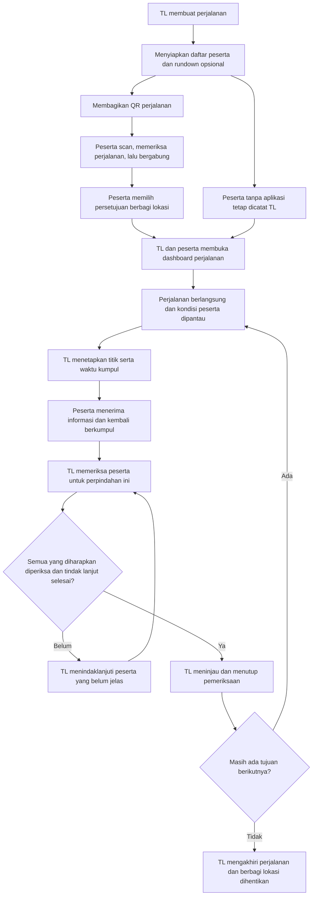
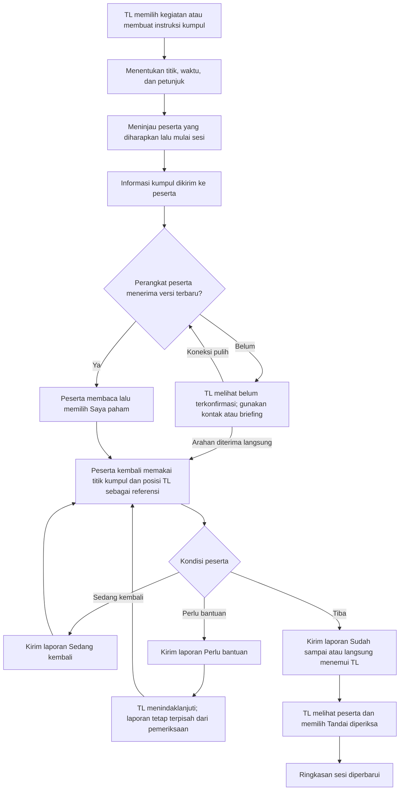
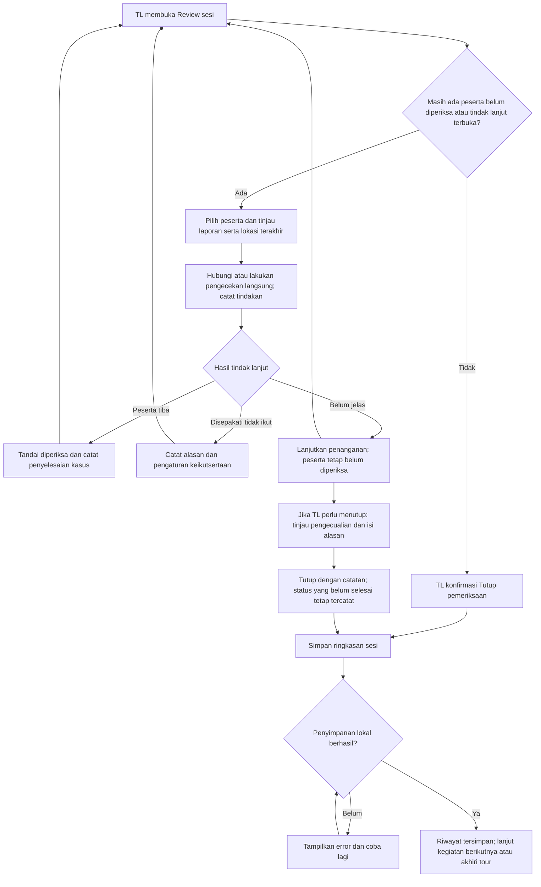

# User Flow — Koordinasi Rombongan Tour

17 Oktober 2026 · Draft desain solusi untuk review tim.

Versi penulisan ulang setelah perbandingan dengan flowchart tim: [Alur penggunaan dengan bahasa sederhana](tour-leader-user-flow-bahasa-sederhana-2026-10-17.md). Dokumen di bawah dipertahankan sebagai riwayat rancangan awal.

Tujuan: membantu tour leader (TL) menjaga koordinasi rombongan, mengetahui siapa yang sudah berkumpul dan siapa yang perlu ditindaklanjuti, terutama sebelum berpindah tempat.

Dokumen ini menggambarkan pengalaman produk yang dituju, terlepas dari kemampuan PoC saat ini. Alur belum diuji dengan pengguna. Dokumen [user flow 15 Oktober](tour-leader-user-flow-2026-10-15.md) tetap menjadi riwayat usulan MVP TL saja; dokumen ini memperluas pengalaman menjadi TL dan peserta, bukan pernyataan bahwa spesifikasi atau acceptance criteria lama otomatis sudah berubah.

## 1. Dasar dan keputusan desain

**Diberikan dalam pembahasan:** TL sebagai pengguna utama; bergabung melalui QR; peta interaktif; TL melihat peserta yang berbagi lokasi; peserta melihat posisi TL dan dirinya; titik kumpul awal kosong; persetujuan peserta melalui dialog kontekstual; rundown berisi kegiatan dengan waktu/lokasi.

**Usulan untuk alur ini:** pemeriksaan per perpindahan, konfirmasi informasi, laporan keadaan, tindak lanjut, pencatatan peserta tanpa aplikasi, dan penutupan dengan catatan. Kemudahan penggunaan serta manfaatnya masih perlu diuji.

**Asumsi:** satu TL mengelola satu rombongan aktif. Peserta yang memakai aplikasi dapat bergabung sebelum perjalanan. Rundown bersifat opsional; TL bisa langsung membuat titik kumpul dan sesi pemeriksaan. Sinkronisasi lokal merupakan jalur yang dapat dirancang, bukan kemampuan offline yang sudah dijamin.

## 2. Alur keseluruhan

Penutupan dengan kondisi belum selesai adalah cabang terpisah pada bagian 6. Penutupan pemeriksaan tidak memberi perintah kendaraan berangkat; keputusan lapangan tetap pada TL.

## 3. Sebelum perjalanan — buat rombongan dan bergabung

| Langkah | Tour leader | Peserta | Hasil yang terlihat |
|---|---|---|---|
| 1 | Buat perjalanan: nama dan tanggal; tambah peserta dengan nama/nomor pembeda | — | Dashboard perjalanan; titik kumpul masih kosong |
| 2 | Tambah kegiatan/waktu/lokasi bila diperlukan, atau lewati | — | Rundown tersimpan; lokasi kegiatan belum otomatis menjadi titik kumpul |
| 3 | Tampilkan atau bagikan QR undangan | Scan QR | Pratinjau nama perjalanan, TL, dan tanggal |
| 4 | — | Periksa perjalanan, isi nama/nomor peserta sekali, lalu pilih **Gabung** | Identitas dicocokkan dengan daftar perjalanan; entri ambigu ditinjau TL, bukan digandakan diam-diam |
| 5 | Melihat peserta yang sudah terhubung | Melihat dialog tujuan berbagi lokasi, penerima, dan cara menghentikannya | Pilihan **Bagikan lokasi** atau **Lanjut tanpa berbagi lokasi** |
| 6 | Dapat memilih membagikan lokasinya agar terlihat peserta | Bila setuju, lanjut ke permintaan izin sistem yang diperlukan | Dashboard menjelaskan fitur lokasi yang tersedia atau belum tersedia |
| 7 | Memastikan seluruh daftar tetap tercakup, termasuk peserta tanpa aplikasi | Membuka dashboard perjalanan | Bergabung selesai; status pemeriksaan fisik belum berubah |

QR mempercepat masuk ke perjalanan yang benar. Scan QR tidak otomatis berarti hadir di titik kumpul, menyetujui pelacakan, atau masuk hitungan sudah diperiksa.

Jika peserta sudah tergabung, scan ulang membuka perjalanan yang sama. QR tidak valid/kedaluwarsa menampilkan alasan dan pilihan scan ulang atau meminta undangan baru. Jika proses join belum selesai karena koneksi, tampilkan **Belum terhubung**, pertahankan input untuk dicoba ulang, dan jangan menampilkan keberhasilan palsu.

Peserta yang tidak memakai aplikasi dicatat dan diperiksa oleh TL. Mereka tetap masuk jumlah peserta yang diharapkan. Penjelasan titik kumpul dan komunikasi dilakukan melalui briefing atau kanal yang digunakan rombongan.

## 4. Saat perjalanan — melihat posisi dan kondisi

**TL:** Dashboard → peta/daftar peserta → pilih peserta → lihat identitas, lokasi terakhir beserta waktunya, laporan terakhir, dan pemeriksaan sesi aktif → lakukan tindak lanjut bila perlu.

Peta dapat digeser, diperbesar, difokuskan kembali ke rombongan, dan pin dapat dipilih. Posisi TL sendiri terlihat ketika tersedia. Peserta tanpa lokasi tetap terlihat dalam daftar, sehingga jumlah pin tidak dianggap jumlah anggota rombongan.

**Peserta:** Dashboard → lihat kegiatan/titik kumpul yang aktif → buka peta → lihat dirinya, TL, dan titik kumpul → buka detail atau panduan arah yang tersedia. Peserta tidak melihat lokasi peserta lain dalam rancangan ini.

Jika titik kumpul belum ditetapkan, tampilkan **TL belum menentukan titik kumpul**. Lokasi TL dapat menjadi referensi bila dibagikan, tetapi tidak diam-diam menjadi titik kumpul. Jika lokasi TL belum tersedia, informasi titik kumpul yang telah diterima tetap dapat dibuka.

**Cabang laporan peserta:** pilih **Sedang kembali**, **Sudah sampai**, atau **Perlu bantuan** → kirim → tampilkan status pengiriman → TL membuka laporan dan menindaklanjuti. Laporan **Sudah sampai** adalah konfirmasi diri, belum pemeriksaan TL.

Indikasi peserta menjauh, bila fitur tersebut dipilih, masuk ke alur **Perlu diperiksa**. TL meninjau umur/akurasi data dan konteks sebelum bertindak; indikasi ini tidak otomatis melabeli peserta hilang. Mekanisme serta ambangnya masih perlu diuji.

## 5. Berkumpul kembali — dua sisi dalam satu sesi

Alur praktis TL: **Atur kumpul → pilih peserta yang diharapkan → Mulai pemeriksaan → buka daftar Belum diperiksa → periksa orangnya → tandai satu per satu → Review**.

Alur praktis peserta: **Buka informasi kumpul → Saya paham → lihat titik/petunjuk → kembali → temui TL**. Laporan keadaan adalah shortcut opsional, bukan formulir yang wajib diisi sebelum diperiksa.

Peserta tanpa aplikasi atau tanpa koneksi dapat menerima arahan langsung dan menemui TL. Pengecekan fisik tidak harus menunggu konfirmasi digital.

Aturan sesi:

- Setiap perpindahan memakai pemeriksaan baru. Centang sesi sebelumnya tidak dibawa sebagai kehadiran sesi berikutnya.
- Peserta yang tidak ikut kegiatan ini tetap tercatat dengan alasan/pengaturan yang ditetapkan TL. Tidak dikeluarkan hanya karena offline, tidak punya aplikasi, atau tidak merespons.
- Jika titik/waktu kumpul berubah, TL meninjau perubahan sebelum menerbitkan versi baru. Konfirmasi informasi versi lama tidak dianggap konfirmasi versi baru. Pemeriksaan di titik lama perlu ditinjau jika titik pemeriksaan berpindah.
- Countdown atau batas waktu yang lewat tidak mengubah status seseorang menjadi hilang dan tidak menutup pemeriksaan otomatis.
- TL dapat membatalkan salah centang melalui aksi koreksi yang jelas. Menekan aksi pemeriksaan dua kali tidak menggandakan hitungan.

## 6. Tindak lanjut dan keputusan sebelum berpindah

Ringkasan normal hanya tersedia ketika semua peserta yang diharapkan sudah diperiksa dan tidak ada tindak lanjut terbuka. TL meninjau nama serta alasan peserta yang tidak ikut sebelum menutup.

Menutup dengan catatan tidak mencentang peserta atau menyelesaikan kasus secara otomatis. Kasus yang belum selesai tetap ditandai pada perjalanan dan dapat ditindaklanjuti melalui catatan lanjutan yang merujuk sesi asal. Riwayat penutupan awal tetap dapat dibaca.

Tindakan membuka telepon/pesan tidak membuktikan peserta berhasil dihubungi. Hasilnya dicatat oleh TL. Peserta yang telah diperiksa masih dapat memiliki kebutuhan bantuan; pemeriksaan dan penyelesaian tindak lanjut adalah dua hal terpisah.

## 7. Kondisi koneksi, izin, dan interupsi

| Kondisi | Pengalaman peserta | Pengalaman TL / pemulihan |
|---|---|---|
| Tidak menyetujui lokasi atau menolak izin | Tetap dapat membuka informasi yang tersedia dan melapor saat ada jalur komunikasi; ditawarkan pengaturan bila ingin mengaktifkan lokasi | Peserta tetap ada di daftar; **Lokasi tidak dibagikan** |
| Tidak ada internet, jalur lokal tersedia dan berhasil terhubung | Kirim/terima data melalui jalur yang tersedia; tampilkan hasil pengiriman yang benar | Pembaruan diterapkan setelah diterima; tidak diasumsikan semua peserta ikut terhubung |
| Semua jalur komunikasi terputus | Buka informasi terakhir yang tersimpan; laporan baru berlabel **Tersimpan di perangkat, belum terkirim** | Tampilkan lokasi/laporan terakhir beserta waktu; lakukan pemeriksaan manual atau komunikasi langsung |
| Pesan sudah diterima layanan tetapi belum diketahui diterima perangkat TL/peserta | Status tetap **Menunggu konfirmasi penerimaan** | Jangan tampilkan sudah dibaca/dipahami atau sudah ditangani |
| Koneksi pulih | Kirim ulang laporan tertunda; terima versi informasi terbaru | Terapkan pembaruan tanpa menggandakan laporan; perlihatkan waktu kejadian lama dan waktu penerimaan |
| Peta/rute tidak dapat dimuat | Buka nama tempat, landmark, waktu, dan instruksi yang telah tersimpan | Tidak menjanjikan basemap atau rute offline; gunakan briefing/petunjuk yang tersedia |
| Aplikasi di latar belakang, perangkat mati, atau baterai habis | Pembaruan mungkin berhenti | Lokasi menjadi data terakhir; status pemeriksaan tidak berubah otomatis |
| Peserta memilih **Hentikan berbagi lokasi** | Lokasi berhenti dibagikan; peserta tetap anggota dan masih dapat melihat informasi perjalanan yang tersedia | Lokasi lama diberi waktu dan status, bukan ditampilkan sebagai posisi terkini |
| Peserta memilih **Keluar dari perjalanan** | Aksi berbeda dari menghentikan lokasi; konfirmasi dan hentikan akses pada perangkat | Tidak menghapus peserta dari daftar yang diharapkan diam-diam; TL meninjau keikutsertaannya. Jika belum tersampaikan, perubahan lokal berlabel tertunda |

Contoh salinan status: **Lokasi terakhir 09.12**, **Informasi kumpul belum dikonfirmasi**, **Laporan belum terkirim**, dan **Diperiksa TL pada 09.20**. Status memakai teks/ikon, tidak hanya warna.

## 8. Akhir perjalanan

TL → **Akhiri perjalanan** → tinjau peserta/kasus yang belum selesai → konfirmasi → simpan ringkasan → tutup sesi berbagi dan akses perjalanan menurut kebijakan produk.

Peserta → menerima informasi perjalanan berakhir → melihat ringkasan yang relevan → berbagi lokasi untuk perjalanan tersebut dihentikan pada perangkat.

Jika perangkat peserta sedang offline, penerimaan akhir perjalanan tidak dianggap seketika. Rancangan perlu masa berlaku sesi berbagi agar izin tidak berjalan tanpa batas saat pesan akhir belum diterima. Detail retensi data dan masa berlaku ini perlu diputuskan sebelum implementasi.

Mengakhiri perjalanan berbeda dari menghapus data. Riwayat mengikuti kebijakan penyimpanan yang ditetapkan; tidak dihapus sebagai efek samping tombol selesai.

## 9. Layar yang dibutuhkan

| Layar | Pengguna | Tugas utama |
|---|---|---|
| Daftar perjalanan / Buat perjalanan | TL | Membuat atau membuka perjalanan |
| Daftar peserta | TL | Menyiapkan identitas; mencakup pengguna aplikasi dan peserta manual |
| Undang / Scan / Pratinjau perjalanan | TL / peserta | Bergabung ke perjalanan yang benar |
| Dialog berbagi lokasi | TL / peserta | Memahami dan memilih izin berbagi |
| Dashboard perjalanan | Keduanya, dengan isi sesuai role | Melihat kegiatan aktif, titik kumpul, dan status terbaru |
| Peta dan detail | Keduanya, dengan batas visibilitas sesuai role | Memilih pin, melihat waktu lokasi, membuka petunjuk |
| Rundown dan Atur kumpul | TL mengedit; peserta membaca | Menetapkan kegiatan serta instruksi aktif |
| Laporan keadaan | Peserta | Memberi tahu sedang kembali, sudah sampai, atau perlu bantuan |
| Pemeriksaan dan Tindak lanjut | TL | Memeriksa per peserta dan menangani kasus |
| Review dan Riwayat | TL | Menutup pemeriksaan dan meninjau catatan |

Nama layar adalah pembagian tugas untuk wireframe; belum menetapkan tab atau struktur navigasi final.

## 10. Hal yang perlu diuji pada user flow ini

1. Apakah scan dan konfirmasi identitas cukup mudah sebelum tour, termasuk jika undangan bermasalah?
2. Apakah TL dan peserta dapat membedakan **lokasi**, **informasi diterima**, **Saya paham**, **laporan sudah sampai**, dan **diperiksa TL**?
3. Apakah pemeriksaan per perpindahan mengurangi ketidakjelasan atau justru menambah pekerjaan dibanding praktik TL sekarang?
4. Apakah titik kumpul yang berubah dan laporan tertunda dipahami dengan benar tanpa memakai informasi lama sebagai informasi terkini?
5. Apakah peserta tanpa aplikasi, peserta yang menolak lokasi, dan perangkat yang mati tetap tercakup dalam pemeriksaan?

Usulan skenario uji: perpindahan normal; dua nama sama; titik kumpul berubah; satu peserta perlu bantuan; satu peserta tanpa aplikasi; laporan tertunda saat koneksi putus; dan salah centang TL. Catat keberhasilan tugas, salah pemahaman status, waktu pemeriksaan, serta usaha setup. Belum ada hasil uji untuk alur ini.

## Rujukan internal

- [Konteks masalah dan kandidat fitur](../../../missing-evidence.md#missing-d4659e1d2db7).
- [Arah challenge dan shared locations](../../../missing-evidence.md#missing-e81438a151ea).
- [Spesifikasi historis MVP TL saja](tour-leader-feature-specification-2026-10-15.md).
- [User flow historis MVP TL saja](tour-leader-user-flow-2026-10-15.md).

Rujukan diperiksa kembali untuk penyusunan dokumen ini. Perluasan alur adalah usulan desain; bukan findings baru atau bukti bahwa solusi mencegah peserta terpisah.
