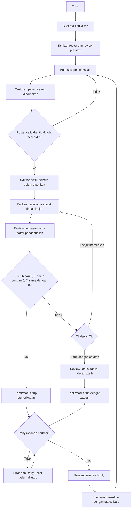
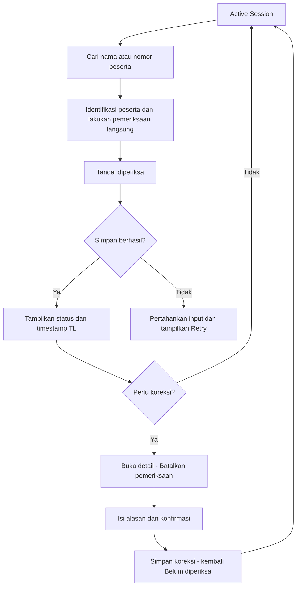

# User Flow — Tour Leader Group Management

Versi 0.1 · 15 Oktober 2026 · Usulan MVP satu TL/satu iPhone; peserta tidak wajib memakai aplikasi.

Rujukan: [Feature Specification](tour-leader-feature-specification-2026-10-15.md) · [Acceptance Criteria](tour-leader-acceptance-criteria-2026-10-15.md). Status dan perhitungan mengikuti spesifikasi. Diagram adalah rancangan, bukan alur yang sudah diuji.

## 1. Alur utama

E = peserta diharapkan; U = belum diperiksa; O = follow-up terbuka/sedang ditangani. Penutupan adalah pencatatan pemeriksaan, bukan perintah atau izin kendaraan berangkat.

### Happy path — contoh sintetis

1. TL membuat trip dan memasukkan 40 peserta melalui paste roster.
2. Preview memperlihatkan 40 entri dan dua nama sama dengan nomor pembeda; TL mengonfirmasi.
3. TL membuat sesi “Naik bus dari museum”. Dua peserta tidak ikut berdasarkan pengaturan yang dicatat TL; E = 38, X = 2.
4. Saat sesi diaktifkan, V = 0, U = 38. TL memeriksa peserta satu per satu.
5. Ketika V = 38, U = 0 dan O = 0, TL membuka Review. Dua peserta tidak ikut tetap ditampilkan beserta alasannya.
6. TL mengonfirmasi Tutup pemeriksaan. Setelah simpan berhasil, ringkasan menjadi riwayat.
7. Pada sesi berikutnya, roster dipreview ulang; semua default diharapkan dan belum diperiksa. Pengaturan tidak ikut sebelumnya tidak dibawa otomatis.

## 2. Flow pemeriksaan dan koreksi salah tap

Tap ulang “Tandai diperiksa” tidak membalik status atau menggandakan hitungan. Jika muncul error penyimpanan pada koreksi, status lama tetap berlaku dan UI menjelaskan koreksi belum tersimpan.

## 3. Flow peserta belum terkonfirmasi

1. Dari filter Belum diperiksa, TL membuka detail peserta.
2. TL membuka kasus follow-up; jika sudah ada kasus aktif, app membuka kasus yang sama.
3. TL menghubungi melalui kanal yang tersedia atau mencatat tindakan manual.
4. Jika peserta mengatakan “sedang kembali”, TL merekam laporan. Status pemeriksaan tetap Belum diperiksa.
5. TL menandai kasus Sedang ditangani, lalu menambahkan pembaruan bila perlu.
6. Saat peserta dilihat di titik pemeriksaan, TL menandai Diperiksa TL.
7. Kasus tetap terbuka sampai TL mencatat hasil dan memilih Selesai. Jika kasus selesai lebih dulu, peserta tetap belum diperiksa sampai diverifikasi.
8. Review menampilkan semua ketidakpastian yang tersisa.

Tidak ada status otomatis “hilang” berdasarkan ketidakadaan respons atau posisi perangkat. Jika membutuhkan tindakan lapangan, TL memakai prosedur dan kontak yang berlaku; app merekam tindak lanjut yang dilakukan.

## 4. Flow perubahan peserta yang diharapkan

1. Pada Session Setup atau sesi aktif, TL membuka detail peserta → Keikutsertaan.
2. Pilih Tidak ikut sesi ini → isi alasan dan catatan pengaturan → lihat preview E/X/U yang berubah → simpan.
3. App mempertahankan nama, ID dan jejak lama; peserta terlihat dalam daftar Tidak ikut.
4. Follow-up yang masih terbuka tidak otomatis ditutup.
5. Jika peserta kembali ikut, TL memilih Diharapkan. App menampilkan bahwa pemeriksaan perlu diulang; setelah disimpan, peserta masuk U.
6. Penambahan peserta pada roster utama tidak diam-diam mengubah snapshot sesi aktif. Untuk ikut sesi aktif, TL memilih Tambahkan ke sesi dan mengonfirmasi preview; entri baru masuk U.

Pengubahan keikutsertaan tidak tersedia sebagai shortcut “buat semua lengkap” pada Review.

## 5. Flow penutupan dengan catatan

1. TL membuka Review ketika masih ada U atau O, atau E = 0.
2. App menampilkan daftar nama/status dan menonaktifkan penutupan normal.
3. TL dapat kembali memeriksa atau memilih Tutup dengan catatan.
4. App menampilkan daftar pengecualian dan meminta alasan wajib. Membatalkan dialog tidak mengubah sesi.
5. TL mengonfirmasi; setelah penyimpanan berhasil, status akhir Ditutup dengan catatan.
6. Angka dan kasus yang belum selesai tetap tercatat; tidak ada centang atau penyelesaian kasus yang dibuat otomatis.
7. Riwayat menampilkan alasan dan jumlah ketidakpastian pada saat penutupan.

## 6. Flow offline, relaunch dan error

- Tidak ada jaringan: seluruh alur P0 tetap tersedia; UI menyatakan data tersimpan di perangkat, bukan tersinkron.
- App ditutup setelah sukses simpan: saat dibuka, TL kembali ke sesi aktif dengan angka dan kasus yang sama.
- Simpan gagal: perubahan belum dianggap committed, error terlihat dan input tetap tersedia untuk Retry. Tindakan yang bergantung pada perubahan itu, termasuk penutupan, tidak memakai state yang belum tersimpan.
- Retry: memakai identitas aksi yang sama agar tidak menghasilkan event ganda.
- Perangkat hilang/rusak atau app dihapus: pemulihan tidak dijanjikan oleh MVP tanpa backup. Offline bukan backup.

## 7. Flow riwayat dan siklus trip

Sesi ditutup → History Detail → baca snapshot dan event → jika salah, Tambah koreksi → alasan dan preview nilai lama/baru → konfirmasi → revisi baru, ringkasan awal tetap tersedia.

Trip tanpa sesi aktif → Arsipkan → trip pindah ke Arsip, data tetap ada → Pulihkan arsip jika ingin membuat sesi baru. Hapus trip adalah aksi terpisah, memerlukan konfirmasi yang menyebut nama trip dan cakupan seluruh data lokal turunannya; ditolak bila ada sesi aktif.

## 8. Kandidat flow lanjutan — bukan MVP

| Kandidat | Alur yang perlu dirancang/diuji jika dipilih | Ketergantungan |
|---|---|---|
| Meeting point yang dibagikan | TL menyiapkan kartu → bagikan via kanal existing | Membagikan tidak membuktikan diterima/dibaca |
| Acknowledgment peserta | Peserta menerima versi → mengakui → TL melihat siapa belum mengakui | Kanal peserta dan sinkronisasi; bukan bukti hadir |
| Lapor keadaan dari peserta | Peserta melapor → TL meninjau → tindak lanjut | Identitas, jaringan, peserta tanpa aplikasi |
| Multi-TL | TL/co-leader memeriksa → konflik diselesaikan → ringkasan konsisten | Arsitektur sinkronisasi dan authority belum diputuskan |
| Deteksi kedekatan | Izin/perangkat didukung → sinyal tampil sebagai indikasi → TL memeriksa | Feasibility background dan akurasi belum diuji |

Flow peserta dan backend tidak dibangun atau diasumsikan sudah tersedia pada MVP ini.
