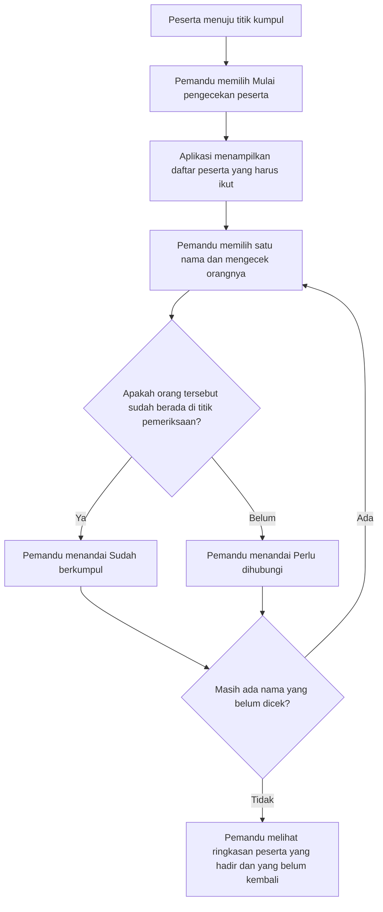
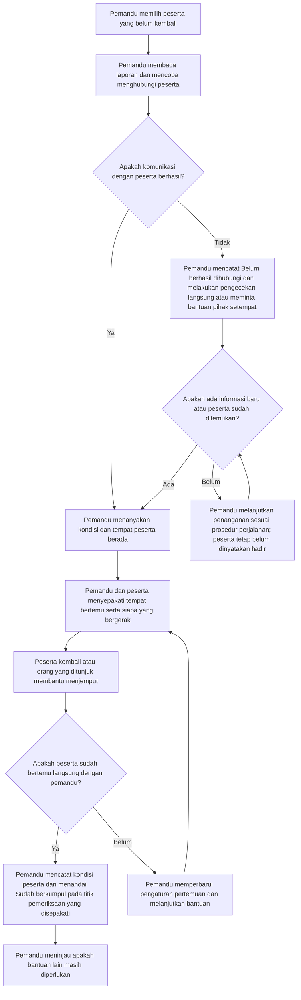
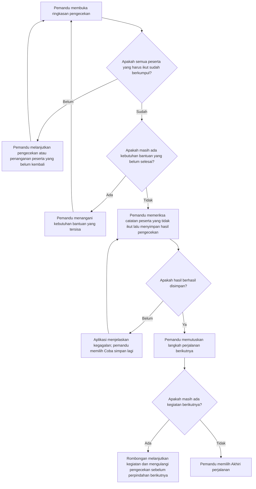

# Alur Penggunaan Aplikasi untuk Pemandu dan Peserta Tour

17 Oktober 2026 · Rancangan untuk dibahas dan diuji bersama pengguna.

Aplikasi ini membantu pemandu perjalanan mengetahui siapa yang sudah berkumpul dan siapa yang masih perlu dihubungi sebelum rombongan berpindah tempat. Peserta dapat melihat jadwal kegiatan, titik kumpul, dan lokasi pemandu yang dibagikan.

Dalam dokumen ini, **pemandu** adalah tour leader yang memimpin rombongan. **Peserta** adalah orang yang mengikuti perjalanan. **Titik kumpul** adalah tempat yang ditentukan pemandu untuk bertemu kembali.

Contoh yang digunakan adalah rombongan yang selesai mengunjungi museum lalu akan melanjutkan perjalanan dengan bus. Ini contoh buatan untuk menjelaskan alur.

## 1. Pemandu menyiapkan perjalanan

1. Pemandu membuka aplikasi dan memilih **Buat perjalanan**.
2. Pemandu mengisi nama serta tanggal perjalanan, lalu memasukkan daftar peserta. Nama yang sama diberi nomor atau keterangan pembeda.
3. Pemandu dapat menambahkan jadwal kegiatan, misalnya kunjungan museum pukul 09.00 dan makan siang pukul 12.00. Langkah ini dapat dilewati.
4. Pemandu memeriksa daftar peserta dan jadwal yang sudah dimasukkan.
5. Aplikasi menampilkan perjalanan yang siap digunakan. Titik kumpul masih kosong sampai pemandu menentukan tempatnya.

**Hasil:** pemandu memiliki daftar orang yang mengikuti perjalanan, termasuk peserta yang tidak memakai aplikasi.

## 2. Peserta bergabung ke perjalanan

1. Pemandu menampilkan kode QR, yaitu gambar kode yang dapat dipindai dengan kamera ponsel.
2. Peserta yang ingin menggunakan aplikasi memasangnya terlebih dahulu, lalu memindai kode tersebut.
3. Aplikasi menampilkan nama perjalanan dan pemandunya. Peserta memeriksa apakah perjalanan itu benar.
4. Peserta mengisi nama atau nomor peserta, lalu memilih **Gabung perjalanan**. Aplikasi menghubungkan identitas tersebut dengan daftar pemandu. Jika identitas belum jelas, pemandu membantu mencocokkannya.
5. Aplikasi menampilkan penjelasan singkat bahwa lokasi peserta dapat dibagikan kepada pemandu selama perjalanan. Peserta memilih **Bagikan lokasi** atau **Lanjut tanpa berbagi lokasi**.
6. Jika peserta setuju, aplikasi meminta izin lokasi pada ponselnya. Jika izin ditolak, peserta tetap dapat bergabung.
7. Setelah berhasil bergabung, peserta dapat membuka informasi perjalanan. Pemandu dapat melihat peserta yang sudah terhubung.

Peserta tanpa aplikasi tetap berada dalam daftar pemandu. Mereka menerima arahan secara langsung dan tetap ikut dalam pengecekan sebelum rombongan berpindah tempat.

Jika kode tidak berlaku atau proses bergabung belum berhasil, aplikasi menjelaskan masalahnya dan menawarkan untuk mencoba lagi. Memindai ulang perjalanan yang sama tidak menambahkan peserta dua kali.

**Hasil:** peserta terhubung ke perjalanan yang benar. Bergabung melalui kode QR belum berarti peserta sudah hadir di titik kumpul.

## 3. Pemandu memulai perjalanan

1. Pemandu memilih **Mulai perjalanan**.
2. Aplikasi menampilkan kegiatan dan daftar peserta. Pemandu dapat membuka peta untuk melihat posisi dirinya serta peserta yang membagikan lokasi. Pemandu juga memilih apakah akan membagikan posisinya kepada peserta, setelah membaca penjelasan dan memberikan izin yang diperlukan.
3. Peserta dapat melihat jadwal kegiatan, posisi dirinya, dan posisi pemandu jika pemandu membagikannya. Peserta tidak melihat lokasi peserta lain.
4. Setiap lokasi disertai waktu pembaruan, misalnya **Lokasi terakhir diterima pukul 10.15**. Pemandu dan peserta dapat menggeser peta, memperbesar, dan memilih penanda untuk membuka keterangan.

Jika belum ada titik kumpul, aplikasi menampilkan **Titik kumpul belum ditentukan**. Posisi pemandu tidak otomatis dianggap sebagai titik kumpul.

**Hasil:** pemandu dan peserta mempunyai informasi perjalanan yang sama serta dapat menggunakan lokasi yang tersedia sebagai petunjuk.

## 4. Pemandu mengajak peserta berkumpul sebelum pindah tempat

Contoh: kunjungan museum akan selesai dan rombongan akan menuju bus.

1. Pemandu memilih **Atur waktu dan tempat berkumpul**.
2. Pemandu menentukan tempat, waktu, dan petunjuk yang mudah dikenali, misalnya **Pintu keluar utama museum, pukul 11.00, di dekat papan informasi**.
3. Pemandu memeriksa siapa yang akan mengikuti perpindahan ini. Jika ada peserta yang memang tidak ikut berdasarkan kesepakatan, pemandu mencatat nama, alasan, dan pengaturannya.
4. Pemandu membagikan informasi melalui aplikasi dan menyampaikannya langsung kepada peserta yang tidak menggunakan aplikasi.
5. Peserta membaca informasi tersebut dan menuju titik kumpul. Jika membutuhkan petunjuk, peserta membuka peta atau keterangan tempat.
6. Peserta dapat mengirim **Saya sedang kembali** atau **Saya perlu bantuan**. Laporan ini pilihan tambahan; peserta dapat langsung datang dan menemui pemandu.

Jika tempat atau waktu berubah, pemandu membagikan perubahan dan aplikasi menandai informasi terbaru. Konfirmasi terhadap informasi lama tidak dianggap sebagai konfirmasi terhadap perubahan. Konfirmasi membaca dapat diminta untuk perubahan penting, tanpa menjadi syarat peserta boleh diperiksa langsung.

**Hasil:** peserta mengetahui ke mana dan kapan harus kembali; pemandu mengetahui siapa yang seharusnya ikut perpindahan tersebut.

## 5. Pemandu mengecek peserta satu per satu

Ketika pemandu memulai pengecekan baru, semua peserta yang harus ikut dimulai dari **Belum diperiksa**. Kehadiran pada tempat sebelumnya tidak dibawa sebagai kehadiran di tempat berikutnya.

Pemandu menandai **Sudah berkumpul** setelah melihat dan mengenali orangnya di titik pemeriksaan yang dipilih, misalnya pintu museum atau pintu masuk bus. Titik pemeriksaan harus sesuai dengan tujuan pengecekan.

Jika peserta belum terlihat, pemandu memilih **Perlu dihubungi**. Peserta tersebut belum dihitung sebagai sudah berkumpul. Aplikasi membantu pemandu membuka laporannya, melihat lokasi terakhir yang tersedia, atau menghubunginya.

Peserta yang mengirim laporan **Saya sudah sampai** tetap diperiksa oleh pemandu. Pesan tersebut ditampilkan sebagai laporan peserta, bukan centang kehadiran otomatis. Jika pemandu salah menandai seseorang, tersedia aksi **Perbaiki pengecekan** dengan alasan koreksi.

**Hasil:** pemandu mengetahui nama orang yang sudah berkumpul dan nama orang yang belum dipastikan hadir. Selesai mengecek seluruh nama belum tentu berarti seluruh peserta sudah berkumpul.

## 6. Jika peserta belum kembali, pemandu menghubungi dan membantu

Pemandu dapat menggunakan lokasi terakhir sebagai petunjuk, dengan memperhatikan waktunya. Pemandu tidak harus menunggu lokasi ponsel diperbarui untuk mulai menghubungi atau melakukan pengecekan langsung.

Jika peserta dapat kembali sendiri, petunjuk diarahkan ke tempat pertemuan yang disepakati. Jika perlu penjemputan, pemandu menentukan siapa yang menjemput dan siapa yang tetap mendampingi rombongan. Peserta tanpa koneksi dapat menerima arahan melalui telepon atau komunikasi langsung yang tersedia.

Jika peserta memang tidak akan mengikuti kegiatan berikutnya berdasarkan kesepakatan, pemandu mencatat perubahan keikutsertaan beserta alasan dan pengaturannya. Peserta tidak dihapus dari daftar hanya karena belum merespons.

Peserta yang sudah kembali masih mungkin membutuhkan bantuan. Karena itu, pemandu mencatat kehadiran dan kebutuhan bantuan secara terpisah.

**Hasil:** kondisi setiap peserta ditindaklanjuti. Aplikasi tidak memberi label hilang hanya karena peserta belum terlihat, tidak merespons, atau lokasinya tidak tersedia.

## 7. Pemandu meninjau hasil sebelum melanjutkan kegiatan

Contoh ringkasan: **20 peserta harus ikut; 19 sudah berkumpul; 1 belum kembali**. Aplikasi tetap menunjukkan nama peserta yang belum kembali, walaupun seluruh nama sudah sempat diperiksa.

Jika pemandu perlu mengakhiri pencatatan saat masih ada persoalan, tersedia **Simpan dengan catatan belum selesai**. Pemandu menuliskan alasan serta langkah berikutnya. Peserta yang belum hadir tetap belum dinyatakan hadir; kebutuhan bantuan tetap terlihat. Aksi ini tidak masuk ke jalur **Semua sudah berkumpul** dan tidak otomatis melanjutkan kegiatan.

**Hasil:** pemandu memiliki ringkasan yang jelas untuk mengambil keputusan. Menyimpan hasil di aplikasi tidak memberi perintah kendaraan berangkat.

## 8. Perjalanan berakhir

1. Pemandu memilih **Akhiri perjalanan** dan meninjau catatan yang masih terbuka. Jika ada persoalan yang belum selesai, pemandu mencatat pengaturan penanganannya; aplikasi tetap menampilkannya sebagai belum selesai.
2. Setelah dikonfirmasi dan berhasil disimpan, aplikasi mencatat perjalanan telah berakhir.
3. Peserta menerima pemberitahuan akhir perjalanan ketika perangkatnya terhubung. Berbagi lokasi untuk perjalanan tersebut dihentikan; aplikasi perlu batas waktu berbagi agar tidak terus berjalan ketika pemberitahuan akhir belum diterima.
4. Pemandu dapat membuka kembali catatan perjalanan dan hasil pengecekan yang tersimpan. Mengakhiri perjalanan tidak otomatis menghapus catatannya.

**Hasil:** kegiatan perjalanan selesai dicatat, berbagi lokasi diakhiri, dan persoalan yang masih terbuka tidak berubah menjadi selesai secara otomatis.

## Jika ponsel atau koneksi bermasalah

Kondisi berikut dapat terjadi di tahap mana pun. Pengguna tidak perlu melewati langkah ini setiap kali membuka aplikasi.

| Kondisi | Yang terlihat di aplikasi | Yang dapat dilakukan |
|---|---|---|
| Peserta tidak memakai aplikasi atau tidak membagikan lokasi | Namanya tetap ada di daftar; tidak ada posisi terkini untuk ditampilkan | Pemandu memberi arahan dan mengecek peserta secara langsung |
| Pembaruan lokasi berhenti | Waktu lokasi terakhir tetap terlihat | Gunakan sebagai petunjuk lama dan konfirmasi kondisi peserta melalui cara lain |
| Semua jalur pengiriman terputus | Informasi yang sudah tersimpan tetap dapat dibaca; laporan baru bertuliskan **Belum terkirim** | Gunakan komunikasi langsung; pengecekan dapat dicatat pada ponsel pemandu |
| Koneksi kembali tersedia | Laporan tertunda dikirim kembali dengan waktu kejadian aslinya | Pemandu meninjau laporan baru diterima tanpa menganggapnya sebagai kondisi saat ini |
| Peta tidak dapat dibuka | Nama tempat, petunjuk, dan waktu kumpul yang sudah tersimpan tetap dapat dibaca | Gunakan keterangan tempat atau minta arahan langsung |
| Peringatan baterai lemah muncul, jika informasi tersedia | Aplikasi menunjukkan perangkat yang dilaporkan dan waktu pembaruannya | Pemandu menyepakati cara komunikasi serta tempat berkumpul jika ponsel mati |
| Peserta ingin menghentikan lokasi | Tersedia **Hentikan berbagi lokasi** | Lokasi tidak lagi dibagikan; peserta tetap anggota rombongan dan tetap harus diperiksa |

Pesan **Belum terkirim** tidak boleh berubah menjadi **Sudah diterima pemandu** sebelum penerimaan dapat dikonfirmasi. Jika tidak ada jalur pengiriman, aplikasi tidak menjanjikan lokasi atau pesan tetap diperbarui.

## Arti tulisan yang dipakai di aplikasi

| Tulisan | Artinya |
|---|---|
| **Belum diperiksa** | Pemandu belum mengecek orang tersebut untuk perpindahan ini |
| **Sudah berkumpul** | Pemandu telah melihat dan mengenali orang tersebut di titik pemeriksaan untuk perpindahan ini |
| **Perlu dihubungi** | Kehadiran peserta belum dipastikan dan pemandu perlu menindaklanjutinya |
| **Tidak ikut kegiatan ini** | Ada perubahan keikutsertaan yang dicatat pemandu beserta alasan dan pengaturannya |
| **Saya sedang kembali / Saya sudah sampai** | Laporan dari peserta; belum menjadi hasil pengecekan pemandu |
| **Saya perlu bantuan** | Permintaan bantuan yang perlu ditinjau pemandu, termasuk jika peserta sudah berkumpul |
| **Lokasi terakhir** | Posisi ponsel pada waktu yang tercantum; bukan bukti peserta masih berada di sana |
| **Belum terkirim** | Laporan masih berada pada ponsel pengirim dan penerima belum dapat mengandalkannya |

## Catatan penyusunan

Dokumen ini menggabungkan alur persiapan dan peserta dari [rancangan sebelumnya](tour-leader-solution-user-flow-2026-10-17.md) dengan rincian pengecekan serta penanganan peserta dari flowchart yang diberikan pengguna. Bahasa dan keputusan diperbaiki berdasarkan perbandingan keduanya pada 17 Oktober 2026.

Ini rancangan pengalaman aplikasi, bukan laporan fitur yang sudah tersedia atau hasil uji. Satu pemandu dipakai sebagai contoh; konfirmasi membaca, peringatan baterai, penanganan khusus, dan cara kerja saat koneksi terputus masih perlu diuji sebelum ditetapkan sebagai kebutuhan akhir. Penerimaan pesan, masa berlaku berbagi lokasi, serta penyimpanan catatan perlu dirancang agar perilakunya sesuai dengan keterangan dalam alur ini.
