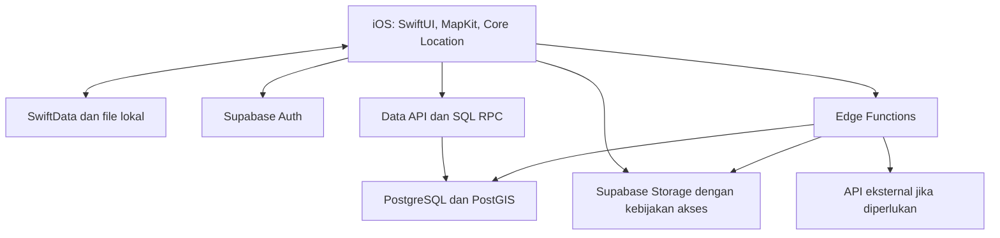
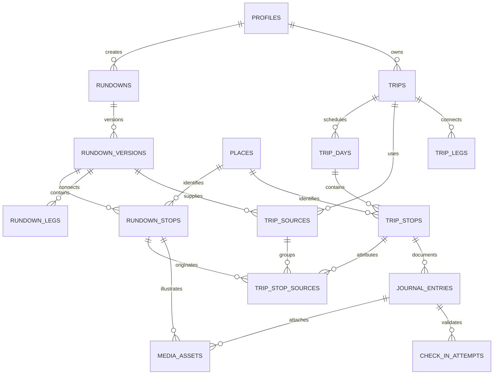

# Usulan backend, database, dan tech stack C6

**Status konteks — 29 Oktober 2026:** Proposal bertanggal ini merepresentasikan baseline rundown kreator. Schema/route/stack usulan di bawah bukan kontrak target AI atau inventori runtime. Lihat [acuan aktif](../technology/11-ai-planning-engine.md).

Tanggal: 21 Oktober 2026, Asia/Jakarta. **Status: usulan arsitektur untuk diskusi; belum keputusan produk, migrasi database, atau implementasi.**

Acuan utama: [CBL.md](../../../source-records/CBL.md), khususnya bagian 2, 4, 5, dan 7. Fokus aktif adalah rundown kreator yang dipilih, dijadwalkan, dan digabungkan oleh pengguna; foto/GPS mendukung journaling. Aturan merge, distribusi library, hak atas salinan, dan semantik unggah offline masih terbuka.

## 1. Rekomendasi

Gunakan **Swift/SwiftUI + Supabase terkelola + PostgreSQL/PostGIS + Supabase Storage + fungsi server TypeScript dan SQL**. Tambahkan **SwiftData sebagai cache lokal** ketika mulai membangun penyimpanan rundown/trip di perangkat.

Backend diperlukan untuk library bersama, akun, pembatasan akses, penyimpanan foto, serta penyimpanan rencana lintas perangkat. Backend dapat berupa layanan terkelola; tim tidak perlu mengoperasikan VPS sendiri pada iterasi awal.

Alasan memilih PostgreSQL adalah bentuk datanya: satu rundown memiliki banyak versi, setiap versi memiliki urutan tujuan dan perpindahan, satu trip dapat mengambil beberapa rundown, dan setiap tujuan dapat menyimpan atribusi sumber. Ini pertimbangan desain untuk C6, bukan hasil benchmark antarvendor.

Supabase menyediakan database, autentikasi, penyimpanan objek, dan API; tersedia [SDK Swift resmi](https://github.com/supabase/supabase-swift). Operasi sederhana dapat memakai SDK/API dengan kebijakan akses database, sedangkan perubahan beberapa tabel harus dijalankan dalam satu transaksi database melalui fungsi SQL/RPC. [Dokumentasi Supabase](https://supabase.com/docs)

Asumsi awal yang diusulkan: satu pemilik per trip, satu akun dapat menjadi kreator sekaligus pengguna rundown, dan jadwal diedit secara eksplisit oleh pengguna. Kolaborasi group trip maupun penyusunan jadwal otomatis belum menjadi landasan rancangan ini.

## 2. Komponen dan tanggung jawab

| Bagian | Teknologi | Tanggung jawab |
|---|---|---|
| Aplikasi iOS | Swift, SwiftUI, Observation, async/await | Library, editor rundown/trip, pelaksanaan perjalanan, dan journaling. Pertahankan target iOS 18 yang ada. |
| Peta dan lokasi | MapKit, Core Location | Pencarian/pemilihan spot, pin, posisi perangkat, dan estimasi perjalanan yang didukung. |
| Pemilihan foto | PhotosUI dan kamera native | Foto galeri/kamera, normalisasi ukuran, thumbnail. Foto kreator tidak mensyaratkan GPS saat publikasi rundown. |
| Data lokal | SwiftData; file foto di Application Support/cache | Salinan rundown/trip yang diunduh, draft lokal, dan metadata sinkronisasi. |
| Akun | Supabase Auth + Sign in with Apple | Identitas dan sesi. Profil tampilan dipisahkan dari identitas autentikasi. |
| Database | Supabase PostgreSQL + PostGIS | Relasi, versi, urutan, jadwal, atribusi, akses, serta pencarian geografis. |
| Foto di cloud | Supabase Storage | File foto dan thumbnail. Database hanya menyimpan referensi dan metadata file. |
| Logika HTTP/integrasi | Supabase Edge Functions, TypeScript | Verifikasi identitas request, integrasi API eksternal, dan koordinasi unggah. |
| Operasi atomik | Fungsi PostgreSQL/RPC | Publikasi versi, penyalinan rundown, dan penyimpanan perubahan trip sebagai satu transaksi. |
| Cuaca | WeatherKit, setelah kebutuhan dikonfirmasi | Prakiraan sesuai lokasi/tanggal; akses native pada tahap awal cukup bila hanya diperlukan di perangkat. |
| Pengembangan | SQL migration dalam Git, Supabase CLI, XCTest | Perubahan schema terurut, pengujian relasi/akses, dan pengujian aplikasi. |

[Supabase mendukung autentikasi Apple native di Swift](https://supabase.com/docs/reference/swift/auth-signinwithidtoken). [Edge Functions memakai TypeScript pada runtime kompatibel Deno](https://supabase.com/docs/guides/functions). [PostGIS mendukung tipe dan indeks geografis](https://supabase.com/docs/guides/database/extensions/postgis). [SwiftData menyediakan persistensi model lokal](https://developer.apple.com/documentation/swiftdata/preserving-your-apps-model-data-across-launches).

Panah dari aplikasi menuju Data API tetap melalui API dengan autentikasi dan kebijakan akses; aplikasi tidak menerima password database atau kunci administratif.

## 3. Prinsip data yang paling menentukan

### Rundown kreator dan trip pengguna adalah dua objek berbeda

`rundown` adalah konten yang dapat digunakan banyak orang. `trip` adalah rencana pribadi yang memiliki tanggal, waktu, urutan, dan catatan penggunanya sendiri.

Saat User A memilih rundown, backend menyalin isi versi terpilih menjadi tujuan dan perpindahan milik trip. Relasi sumber tetap disimpan. Perubahan User A tidak mengubah rundown kreator; publikasi versi baru oleh kreator juga tidak diam-diam mengubah perjalanan User A.

### Versi yang sudah diterbitkan stabil

Pisahkan identitas rundown dari isinya. `rundowns` menyimpan identitas/kreator; `rundown_versions` menyimpan isi tiap versi; tujuan dan perpindahan melekat pada versi tersebut. Versi yang diterbitkan tidak diedit di tempat; pembaruan membuat versi baru.

Snapshot nama, koordinat, waktu yang disarankan, dan catatan menjaga konteks salinan. Sumber yang diarsipkan tidak otomatis menghapus trip pribadi. Aturan penghapusan akun/konten dan hak menyimpan salinan masih perlu diputuskan; jangan menjadikan snapshot alasan untuk mempertahankan konten tanpa batas.

### Saran kreator, jadwal pengguna, dan keadaan aktual dipisahkan

Contoh: kreator menyarankan Asakusa pukul 13.00; User A menjadwalkan pukul 14.00 besok; pengguna benar-benar tiba pukul 14.20. Ketiganya berbeda dan tidak boleh saling menimpa.

### Tempat berbeda dari kunjungan

`places` mewakili spot, sedangkan `rundown_stops` dan `trip_stops` mewakili kemunculan spot pada urutan perjalanan. Satu tempat dapat muncul beberapa kali. Jangan memasang batas unik `(trip_id, place_id)` karena itu akan memaksakan deduplikasi yang belum disepakati.

## 4. Struktur database yang diusulkan

Nama kolom berikut merupakan rancangan logis. Semua ID entitas menggunakan `uuid`; tabel penghubung dapat menggunakan primary key gabungan. Hampir semua entitas memiliki `created_at`; entitas yang dapat diubah memiliki `updated_at` dan, bila perlu, `revision`.

### A. Akun dan konten kreator

| Tabel | Kolom inti | Fungsi dan aturan |
|---|---|---|
| `profiles` | `id` → `auth.users.id`, `display_name`, `avatar_path`, `bio` | Satu akun dapat menyusun dan memakai rundown. Email/token tidak dimasukkan ke profil yang dibaca library. |
| `places` | `id`, `name`, `location geography(Point,4326)`, `timezone`, `country_code`, `locality`, `provider`, `provider_place_id` | Identitas spot. Koordinat/nama tidak menjadi satu-satunya penentu dua spot sama. Penggabungan identitas tempat harus terkendali. |
| `rundowns` | `id`, `creator_id`, `current_published_version_id`, `lifecycle_status` | Identitas stabil konten. Pointer versi harus mengarah ke versi milik rundown itu sendiri. |
| `rundown_versions` | `id`, `rundown_id`, `version_no`, `title`, `summary`, `default_timezone`, `status`, `published_at`, `content_reviewed_at` | `unique(rundown_id, version_no)`. Status awal yang diusulkan: draft/published. Versi terbit beserta isinya tidak boleh diubah langsung. |
| `rundown_stops` | `id`, `rundown_version_id`, `place_id`, `day_offset`, `position`, `title_snapshot`, `location_snapshot`, `timezone`, `suggested_start_local`, `suggested_end_local`, `window_end_day_offset`, `visit_duration_min`, `notes`, `check_in_radius_m` | Urutan, saran waktu lokal, durasi, cerita, dan jangkar pin versi ini. Nilai waktu boleh kosong untuk saran yang belum spesifik. |
| `rundown_legs` | `id`, `rundown_version_id`, `from_stop_id`, `to_stop_id`, `transport_mode`, `estimated_duration_min`, `instructions`, `data_origin`, `provider`, `checked_at` | Perpindahan antara dua tujuan: misalnya jalan kaki atau kereta. Kedua ujung harus berasal dari versi yang sama. |

`day_offset=0` berarti hari pertama template; rundown belum terikat tanggal nyata. Jendela yang melewati tengah malam memakai `window_end_day_offset` yang berbeda. Detail jendela waktu, pilihan moda alternatif, jam buka, dan batas waktu ketat masih perlu contoh produk konkret sebelum dibuat menjadi constraint final.

Foto/cerita kreator berasal dari pengalaman mereka dan dapat ditulis setelah perjalanan. Tidak ada kewajiban membuat `check_in_attempts` untuk menerbitkan konten kreator.

### B. Rencana pribadi pengguna

| Tabel | Kolom inti | Fungsi dan aturan |
|---|---|---|
| `trips` | `id`, `owner_id`, `title`, `status`, `default_timezone`, `revision` | Rencana pribadi. Status usulan: draft/planned/active/completed/archived; perubahan status bukan verifikasi kunjungan. |
| `trip_days` | `id`, `trip_id`, `day_index`, `local_date`, `timezone`, `available_from_at`, `available_until_at` | Tanggal perjalanan dan rentang waktu tersedia. Awal MVP boleh satu hari; struktur tetap dapat menampung perjalanan beberapa hari. |
| `trip_sources` | `id`, `trip_id`, `rundown_version_id`, `creator_attribution_snapshot`, `added_at` | Mencatat versi rundown A/B yang dipakai dan atribusinya. Metadata sensitif tidak dimasukkan ke snapshot atribusi. |
| `trip_stops` | `id`, `trip_day_id`, `place_id`, `position`, `title_snapshot`, `location_snapshot`, `scheduled_arrival_at`, `scheduled_departure_at`, `actual_arrival_at`, `progress_status`, `user_notes` | Salinan tujuan yang bisa dijadwalkan/disusun pengguna. `actual_arrival_at` perlu asal data; penandaan manual tidak dianggap GPS terverifikasi. |
| `trip_stop_sources` | `trip_stop_id`, `trip_source_id`, `rundown_stop_id` | Penghubung atribusi per tujuan. Satu tujuan dapat menyimpan sumber A dan B jika nantinya pengguna memilih menggabungkan dua tujuan. |
| `trip_legs` | `id`, `trip_id`, `from_trip_stop_id`, `to_trip_stop_id`, `source_rundown_leg_id` nullable, `transport_mode`, `estimated_duration_min`, `instructions`, `data_origin`, `provider`, `fetched_at`, `expires_at` | Perpindahan aktual dalam rencana pengguna. Kedua ujung harus dalam trip yang sama; versi sumber, jika diisi, harus konsisten dengan sumber trip. |

Jika MVP dipastikan hanya satu hari, `trip_days` dapat sementara direduksi menjadi field tanggal/zona/rentang waktu pada `trips`. Pilih berdasarkan scope layar yang benar-benar dibangun, bukan demi menambah tabel.

`trip_stop_sources` menjaga pilihan desain tetap terbuka: mendukung dua kemunculan terpisah ataupun satu tujuan dengan dua atribusi. Keberadaan tabel ini tidak menetapkan bahwa deduplikasi harus otomatis.

### C. Journaling dan media

| Tabel | Kolom inti | Fungsi dan aturan |
|---|---|---|
| `journal_entries` | `id`, `owner_id`, `trip_stop_id`, `story`, `photo_taken_at` nullable, `submitted_at`, `status` | Jurnal pada tujuan. Waktu pengambilan foto tidak sama dengan waktu unggah atau verifikasi lokasi; foto lama tetap diperbolehkan. |
| `media_assets` | `id`, `owner_id`, `rundown_stop_id` nullable, `journal_entry_id` nullable, `object_path`, `thumbnail_path`, `mime_type`, `byte_size`, `width`, `height`, `position`, `upload_status` | Referensi foto. Tepat satu induk konten terisi: tujuan kreator atau jurnal. File biner berada di Storage. |
| `private.check_in_attempts` | `id`, `user_id`, `journal_entry_id`, `pin_identity_snapshot`, `policy_version`, `requested_at`, `location_sampled_at`, `received_at`, `accuracy_m`, `distance_m`, `decision`, `failure_reason` | Catatan keputusan lokasi yang hanya ditulis server. Tidak diekspos sebagai bagian library. Satu keberhasilan tidak menjadi izin unggah tanpa batas. |

Ini **15 tabel logis untuk cakupan lengkap di atas**, termasuk satu tabel privat; bukan syarat membuat seluruhnya dalam sprint pertama. Koordinat mentah pengguna hanya disimpan bila ada tujuan dan masa retensi yang jelas; hasil keputusan dan jarak dapat cukup untuk diagnostik awal. Sampel simulasi perlu diberi status terpisah dan tidak ditampilkan sebagai kehadiran fisik terverifikasi.

Tabel tambahan hanya bila fiturnya dipilih: `library_saves` untuk bookmark terpisah dari trip, `trip_members` untuk kolaborasi, dan cache konteks eksternal untuk kebutuhan bersama di server. Distribusi library yang dibuka ke kontributor umum juga memerlukan alur pengelolaan/laporan konten; alurnya belum ditetapkan di sini.

Dua relasi induk `MEDIA_ASSETS` pada diagram adalah alternatif: tepat satu dipakai per aset. Diagram merangkum relasi utama; constraint lintas induk tetap dibutuhkan saat menulis DDL.

## 5. Contoh Kreator A, Kreator B, dan User A

1. Kreator A menerbitkan A-v1: Chiyoda → Asakusa → Shibuya.
2. User A membuat trip untuk besok. `trip_sources` menunjuk A-v1, lalu tujuan dan perpindahan disalin menjadi rencana milik User A.
3. Pagi hari pelaksanaan, User A memilih B-v1: Asakusa → Shibuya → Shinjuku.
4. Aplikasi membuat pratinjau penambahan. Struktur data dapat menampung semua tujuan maupun hasil yang disusun ulang pengguna. Aturan seleksi, deduplikasi, dan benturan waktu tetap perlu dipilih.
5. Jika hasil yang dipilih adalah Chiyoda → Asakusa → Shibuya → Shinjuku, tujuan yang memakai informasi A dan B tetap dapat menampilkan atribusi keduanya.
6. Perpindahan yang berubah harus dihitung/diperiksa kembali. Durasi suatu leg tidak otomatis berlaku untuk dua tujuan lain atau tanggal keberangkatan lain.
7. Perubahan trip disimpan dalam satu transaksi dengan `expected_revision`. Request berulang memakai idempotency key agar koneksi yang terputus tidak menggandakan penambahan rundown.
8. Jika Kreator A menerbitkan A-v2, trip User A tetap memakai A-v1 sampai ada tindakan pembaruan yang disepakati. UX pembaruan belum ditentukan.

## 6. Waktu, koordinat, indeks, dan integritas

- Gunakan `timestamptz` untuk kejadian bertanggal: jadwal trip, kedatangan aktual, dan waktu request. Simpan juga zona IANA seperti `Asia/Tokyo`, karena PostgreSQL menyimpan instant UTC dan **tidak menyimpan nama zona asal** di nilai `timestamptz`. [Dokumentasi PostgreSQL](https://www.postgresql.org/docs/current/datatype-datetime.html)
- Gunakan `time` + offset hari + zona tujuan untuk saran jam dalam template. Jangan mengubah “pukul 09.00 di Tokyo” mengikuti zona perangkat di Jakarta. Konversi menjadi instant dilakukan setelah tanggal pelaksanaan diketahui; validasi kasus DST dan lintas tengah malam.
- Durasi disimpan sebagai integer menit dengan constraint nonnegatif; koordinat geografis memakai `geography(Point,4326)`. Pasang indeks GiST untuk kueri jarak/batas peta. Urutan koordinat ketika membuat titik PostGIS adalah longitude lalu latitude. [Panduan PostGIS](https://supabase.com/docs/guides/database/extensions/postgis)
- Gunakan kolom terstruktur untuk pemilik, sumber, urutan, waktu, dan status. `jsonb` boleh untuk konteks tambahan yang berubah bentuk; jangan menaruh seluruh relasi inti dalam satu JSON.
- Pasang foreign key dan indeks yang sesuai pada hubungan yang sering dibaca; contoh: `rundown_versions(rundown_id, version_no)`, `rundown_stops(rundown_version_id, day_offset, position)`, `trips(owner_id, updated_at)`, `trip_stops(trip_day_id, position)`, dan `journal_entries(trip_stop_id, submitted_at)`.
- `unique(parent_id, position)` menjaga urutan tidak ganda. Reorder harus atomik dan menangani pertukaran posisi dengan benar; jangan mengandalkan update berurutan dari iOS.
- Foreign key gabungan atau validasi transaksi harus memastikan tujuan sumber memang milik versi yang dipilih, kedua ujung leg satu perjalanan, dan jurnal tidak menempel pada trip orang lain.
- Jangan menghapus salinan trip pengguna melalui cascade saat kreator mengarsipkan rundown. Kebijakan penghapusan konten/akun perlu ditentukan secara terpisah.

## 7. Batas akses dan fungsi backend

Gunakan RLS pada tabel yang diekspos Data API, termasuk pembatasan penulisan relasi anak. RLS membatasi baris; kolom keputusan server seperti hasil pemeriksaan lokasi juga harus dilindungi dengan privilege/fungsi yang sesuai. Pengguna yang memiliki jurnal tidak otomatis berhak menulis `decision=accepted`. [Dokumentasi RLS](https://supabase.com/docs/guides/database/postgres/row-level-security)

| Data/operasi | Akses awal yang diusulkan |
|---|---|
| Rundown terbit | Dapat dibaca sesuai model akses library yang nanti dipilih; draft tidak ikut terbaca. |
| Draft kreator | Kreator pemilik dapat menyunting; versi terbit dilindungi dari edit langsung. |
| Trip, jadwal, jurnal | Privat untuk pemilik; keterlibatan kreator sumber tidak memberi akses ke perjalanan pengguna. |
| Foto jurnal | Bucket privat, akses pemilik; berbagi memerlukan aturan tersendiri. |
| Foto rundown | Akses mengikuti publikasi/visibilitas versi, bukan bucket jurnal. |
| Pemeriksaan lokasi | Ditulis server; koordinat privat tidak dikirim ke pembaca library. |
| Kunci administratif/provider | Hanya di server; aplikasi menggunakan publishable key dan sesi pengguna. |

Kebijakan Storage perlu disusun juga, karena RLS tabel metadata foto saja tidak melindungi akses file. Gunakan path unik yang tidak dapat ditimpa sesuka pengguna, terutama untuk aset versi terbit. [Dokumentasi akses Storage](https://supabase.com/docs/guides/storage/security/access-control)

Operasi server yang masuk akal untuk iterasi awal:

| Operasi konseptual | Yang dilakukan server |
|---|---|
| `publishRundown` | Validasi isi/relasi, terbitkan versi stabil, perbarui pointer versi. |
| `createTripFromRundown` | Periksa akses versi, salin isi dan atribusi dalam transaksi. |
| `previewAddRundown` | Kembalikan kandidat perubahan untuk ditinjau berdasarkan aturan yang dipilih; belum menyimpan hasil. |
| `applyTripChanges` | Periksa kepemilikan, versi trip, relasi dan urutan, lalu simpan satu transaksi. |
| `submitJournalEntry` | Periksa identitas, target pin, sampel lokasi baru, dan kaitan foto; hasil hanya diterbitkan setelah seluruh syarat dipenuhi. |

Tidak perlu membungkus setiap read sederhana dalam Edge Function. Sebaliknya, beberapa request SDK terpisah dari satu Edge Function **belum otomatis menjadi satu transaksi**; penyalinan/penggabungan harus memanggil satu fungsi database transaksional.

Storage dan database juga tidak berbagi satu transaksi. Gunakan status unggahan `pending/ready/failed`, identitas request tetap, dan pembersihan berkas gagal yang terkontrol agar foto tidak dianggap sukses hanya karena metadata sudah tertulis.

Untuk GPS, backend memeriksa sampel yang dikirim perangkat terhadap pin/kebijakan yang diketahui server; backend tidak membaca GPS iPhone secara langsung. Sampel, clock, serta flag perangkat tetap dapat dimanipulasi. Hasil pemeriksaan server bukan bukti anti-spoofing.

Desain sesi unggah harus mengikat request ke pengguna, jurnal, foto, dan identitas/versi pin, memerlukan sampel baru setelah tap, serta membatasi replay. TTL, pengambilan sampel ulang, dan titik finalisasi ketika transfer lama perlu diuji khusus; jangan menjadikan token check-in sebagai izin permanen setelah meninggalkan lokasi. Angka radius/freshness PoC belum keputusan kebijakan produksi.

## 8. Offline dan sinkronisasi

Tahap awal yang disarankan: rundown/trip yang sudah diunduh dapat dibaca dari cache, sementara perubahan ke server dan unggahan jurnal memerlukan koneksi. Ini menyediakan manfaat offline yang konkret dengan cakupan terukur.

SwiftData tidak otomatis menyinkronkan data ke Supabase. Aplikasi perlu proses fetch/save sendiri, server ID, `revision`, dan penanganan error. Jika edit offline diperlukan kemudian, tambahkan antrean operasi lokal dengan `client_operation_id` dan `base_revision`; perubahan konflik perlu ditinjau, bukan selalu ditimpa oleh waktu terbaru.

Foto yang belum diunggah dapat tetap menjadi draft lokal. Saat koneksi kembali, aplikasi tidak otomatis mengunggah dari hotel berdasarkan check-in sebelumnya. Upload yang gagal memerlukan percobaan baru yang memenuhi aturan lokasi. Definisi final antara tap, penerimaan server, dan selesai transfer masih perlu diputuskan sesuai batas di CBL.

Mengunduh koordinat, rundown, catatan, dan foto tidak menjamin tersedianya peta dasar, pencarian tempat, atau routing offline.

## 9. Cuaca, golden hour, dan transportasi

Pisahkan tiga jenis informasi:

1. **Catatan kreator:** misalnya “sore hari cahaya di spot ini menarik”; simpan penulis dan kapan diperiksa.
2. **Data layanan:** cuaca/estimasi perjalanan; simpan provider, waktu pengambilan, tanggal yang berlaku, dan kedaluwarsa bila disimpan sesuai ketentuan provider.
3. **Hasil perhitungan aplikasi:** misalnya durasi total/jendela cahaya; simpan versi perhitungan dan input yang relevan jika hasil perlu direproduksi.

Cuaca perjalanan kreator bulan lalu bukan prakiraan besok. Perjalanan yang terlalu jauh di masa depan dapat menampilkan prakiraan belum tersedia; tidak perlu menciptakan nilai cuaca pengganti. WeatherKit mendukung aplikasi Apple dan REST, memerlukan konfigurasi layanan serta atribusi. Golden hour perlu definisi/perhitungan tersendiri; jangan menyamakan sunrise/sunset dengan seluruh jendela golden hour. [WeatherKit](https://developer.apple.com/weatherkit/)

Untuk transportasi, mulai dari moda/instruksi/durasi versi kreator dan jelaskan asal datanya. MapKit dapat membantu kebutuhan yang didukung, tetapi `MKDirectionsTransportType.transit` hanya didukung untuk estimasi waktu tiba; jangan menjanjikan seluruh detail jalur/jadwal kereta-bus Jepang melalui API tersebut. Sumber transit rinci harus dipilih dan diuji terhadap wilayah target. [Dokumentasi Apple](https://developer.apple.com/documentation/mapkit/mkdirectionstransporttype/transit)

Menyimpan waktu tersedia/tersisa tidak otomatis menghasilkan scheduler yang layak. Pada MVP, waktu ini dapat menjadi bahan peringatan dan penyuntingan manual; algoritme optimasi baru dibangun setelah perilaku yang diinginkan jelas.

## 10. Alternatif dan alasan pemilihan

| Pilihan | Kapan cocok | Pertimbangan untuk C6 |
|---|---|---|
| Supabase + PostgreSQL | Relasi lintas sumber, versi konten, transaksi, dan akses data yang jelas. | Rekomendasi awal. Tim perlu menguasai SQL/RLS dan membangun sinkronisasi lokal sesuai scope. |
| CloudKit | Tim berfokus pada ekosistem Apple dan pola data/sharing iCloud. | Tetap layak; memiliki database public/private/shared. Untuk model library, versi, dan salinan lintas kreator ini, saya menilai relasi SQL lebih mudah dinyatakan dan diperiksa. Ini penilaian rancangan, bukan klaim CloudKit tidak mampu. |
| Firebase/Firestore | Tim sudah mahir Firebase dan mengutamakan integrasi realtime/offline SDK. | Layak; model dokumen/collection memerlukan rancangan duplikasi dan konsistensi relasi yang berbeda. |
| Backend custom + PostgreSQL | Tim membutuhkan kontrol runtime/integrasi khusus atau sudah memiliki fondasi backend. | Dapat dipilih kemudian, dengan tambahan tanggung jawab API, akun, deployment, backup, dan penyimpanan. |

[Apple menjelaskan database CloudKit dan hubungan record](https://developer.apple.com/documentation/cloudkit/designing-and-creating-a-cloudkit-database). [Firestore memakai model dokumen/collection](https://firebase.google.com/docs/firestore/data-model) dan [SDK-nya mendukung cache/sinkronisasi offline](https://firebase.google.com/docs/firestore/manage-data/enable-offline). Dukungan offline tersebut tetap tidak mengubah aturan GPS produk.

Jangan mengaktifkan sinkronisasi CloudKit dan Supabase untuk objek trip yang sama tanpa penetapan sumber data otoritatif. Jika Supabase dipilih, jadikan server tersebut sumber data bersama dan SwiftData sebagai salinan lokal yang dikelola aplikasi.

## 11. Urutan pengerjaan yang diusulkan

1. **Pilih rundown → buat trip.** Seed dua kreator/contoh rundown; login, library, detail versi, salin ke trip, lalu jadwalkan manual. Uji pemisahan sumber dan salinan.
2. **Tambah rundown B.** Buat pratinjau dan edit manual sesuai aturan yang dipilih, pertahankan atribusi, simpan atomik, dan tampilkan benturan waktu yang memang sudah dapat ditentukan.
3. **Journaling online.** Hubungkan entry/foto ke tujuan, pindahkan penyimpanan foto ke Storage, dan uji kegagalan unggah/GPS. PoC lokal tetap menjadi bukti terbatas, bukan verifikasi server yang sudah selesai.
4. **Cache perjalanan dan konteks.** Tambahkan pembacaan offline yang terukur; sesudah itu cuaca/ETA sesuai prioritas. Edit offline dan sinkronisasi konflik menjadi pekerjaan tersendiri jika dibutuhkan.

Uji teknis yang memberi bukti penting: pengguna lain gagal membaca trip/jurnal/foto privat; versi terbit tidak berubah; A-v2 tidak menimpa trip A-v1; request penambahan berulang tidak menggandakan isi; kegagalan di tengah transaksi tidak menyimpan separuh hasil; jadwal Tokyo tetap benar saat perangkat berada di Jakarta; sumber A/B dan ujung leg konsisten; upload gagal tidak tampil sukses; GPS lama/simulasi tidak menjadi klaim kunjungan fisik.

Sebelum menulis migrasi final, tetapkan empat keputusan yang paling memengaruhi schema/API: hasil merge yang diharapkan, hak salinan saat sumber berubah/dihapus, cakupan offline, dan siapa yang boleh membaca library/jurnal. Struktur di atas menjaga ruang untuk pilihan tersebut tanpa menganggapnya sudah disetujui.

## 12. Batas pemeriksaan saat menyusun usulan

`CBL.md` dibaca ulang sebagai acuan terkini. README PoC, model data aktual, dan deployment target proyek diperiksa secara read-only di `<LOCAL_HOME>/Programming/software/ios/poc-c67`. Path `<LOCAL_HOME>/Programming/ios/poc-c67` dari environment tidak ditemukan pada pemeriksaan ini.

Flow diary yang diperiksa masih memakai JSON lokal dan data foto lokal. Supabase/SwiftData pada dokumen ini adalah usulan, bukan integrasi yang ditemukan sudah bekerja. Tidak ada perubahan kode iOS, konfigurasi cloud, migrasi, deployment, ataupun pengujian runtime baru dalam pekerjaan ini. Biaya vendor, kapasitas, dan kecukupan kuota belum dihitung karena jumlah pengguna, volume foto, pola baca, dan wilayah peluncuran belum ditentukan.
