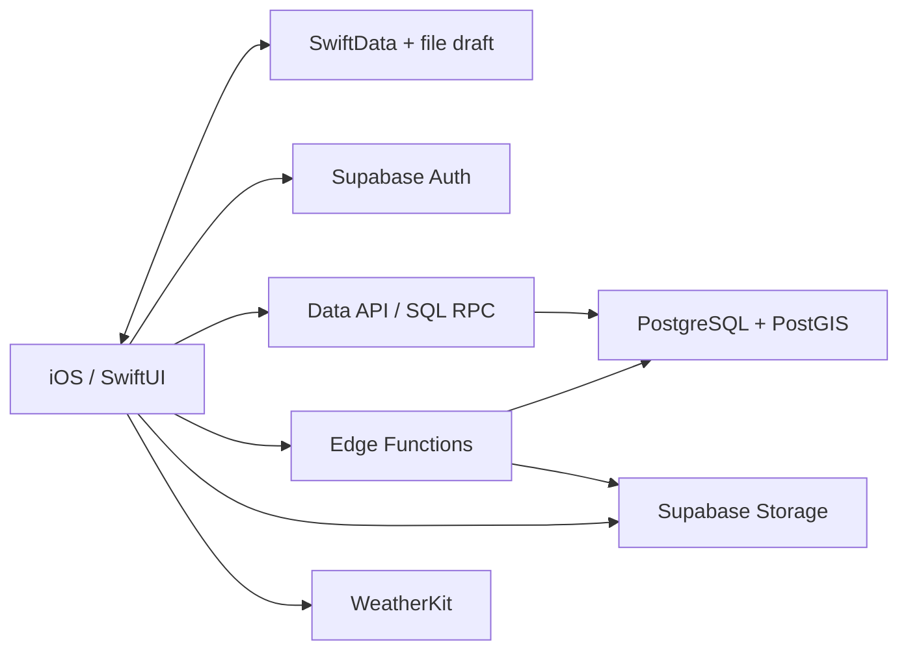
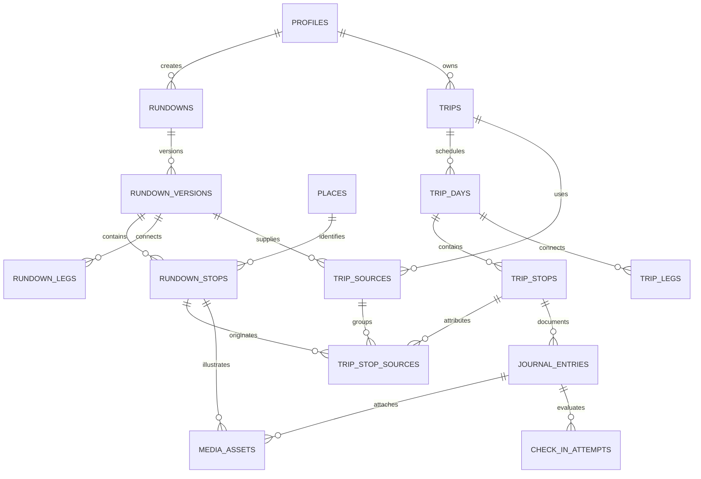

# Usulan backend, database, dan tech stack C6 — 22 Oktober 2026

**Status konteks — 29 Oktober 2026:** Proposal bertanggal ini mendahului keputusan rekomendasi AI. Rincian kreator/salinan dan status implementasinya tetap catatan pada waktu penulisan. Lihat [acuan aktif](../technology/11-ai-planning-engine.md).

**Status:** proposal untuk diskusi teknis. Belum merupakan keputusan stack tim, DDL/migrasi, integrasi iOS, atau deployment.

Acuan: [CBL.md](../../../source-records/CBL.md), [wireframe revisi 2](../../../missing-evidence.md#missing-06b84a4df0de), dan [proposal 21 Oktober](usulan-backend-database-tech-stack-2026-10-21.md). Dokumen ini memperbarui rekomendasi untuk cerita Athar, waktu fleksibel, akses ke landing point, cuaca, foto per spot, dan album. Prinsip versi/salinan/atribusi dari proposal sebelumnya tetap dipertahankan.

## 1. Rekomendasi dan asumsi

Gunakan **Swift/SwiftUI + Supabase terkelola + PostgreSQL/PostGIS + Supabase Storage + Edge Functions TypeScript + fungsi SQL/RPC**. Gunakan **SwiftData sebagai cache/draft lokal** ketika model rundown/trip native mulai dibangun.

Backend bersama diperlukan untuk library kreator, akun dan hak akses, rencana lintas perangkat, serta foto. Supabase menyediakan layanan backend tersebut; tim dapat mulai tanpa mengoperasikan VPS atau membangun layanan autentikasi sendiri. Pemilihan PostgreSQL didasarkan pada kebutuhan relasi sumber-versi-salinan dan transaksi, bukan hasil benchmark vendor. [Arsitektur Supabase](https://supabase.com/docs/guides/getting-started/architecture)

Asumsi kerja: satu pemilik per trip; akun yang sama dapat menjadi kreator sekaligus traveller; perubahan rencana dikonfirmasi pengguna. Akses library dan audience foto belum final. Akses trip/jurnal hanya untuk pemilik diusulkan sebagai default implementasi awal, bukan keputusan audience produk dari pengguna.

Yang sudah diberikan CBL: rundown adalah fitur utama; waktu fleksibel; penambahan rundown lain; perjalanan per spot; foto tiap spot dalam best-case; GPS saat tap unggah; album; ekspor sosial opsional. Yang masih perlu keputusan: arti jam mulai, aturan merge, skip/berhenti dini, audience kontribusi, hak salinan dan batas offline.

## 2. Tech stack dan pembagian kerja

| Komponen | Pilihan awal | Tugas |
|---|---|---|
| Aplikasi | Swift, SwiftUI, Observation, async/await; target iOS 18 yang ada | Jelajah, detail, rencana, pelaksanaan, album, editor kreator. |
| Peta/lokasi | MapKit, Core Location | Search/map, pin, posisi perangkat, konteks akses awal/perpindahan. Mulai dari handoff petunjuk ke aplikasi peta sesuai scope yang dipilih. |
| Foto | PhotosUI dan kamera native | Pemilihan/pengambilan foto, preview, kompresi dan thumbnail. |
| Penyimpanan lokal | SwiftData + file foto lokal | Cache data terunduh, draft, server ID dan revision. Sinkronisasi Supabase dibangun eksplisit. |
| Akun | Supabase Auth + Sign in with Apple native | Identitas, sesi dan kepemilikan. |
| Database | PostgreSQL + PostGIS | Relasi, urutan, waktu, atribusi, transaksi dan pencarian area/jarak. |
| Media cloud | Supabase Storage | File foto/thumbnail; metadata dan object path di database. |
| Logika server | TypeScript pada Supabase Edge Functions | Endpoint unggah, validasi request, integrasi eksternal jika diperlukan. |
| Perubahan atomik | SQL/PostgreSQL functions melalui RPC | Publikasi versi, copy rundown, reorder dan apply perubahan trip. |
| Cuaca | WeatherKit native dahulu | Prakiraan pada lokasi/waktu perjalanan. REST di server hanya bila ada kebutuhan server yang jelas. |
| Pengembangan | Supabase CLI, SQL migrations di Git, XCTest dan tes database/RLS | Schema dapat direproduksi; uji akses, transaksi dan kegagalan alur. |

Supabase menyediakan [SDK Swift](https://supabase.com/docs/reference/swift/introduction), [login Apple native](https://supabase.com/docs/guides/auth/social-login/auth-apple), [PostGIS](https://supabase.com/docs/guides/database/extensions/postgis), dan [Edge Functions TypeScript pada runtime kompatibel Deno](https://supabase.com/docs/guides/functions). WeatherKit memiliki [Swift API serta REST API](https://developer.apple.com/weatherkit/).

Data API memakai sesi pengguna dan kebijakan akses. Aplikasi tidak memegang password database atau kunci administratif. Read sederhana tidak harus melewati Edge Function tambahan. Beberapa panggilan SDK di dalam satu Edge Function bukan satu transaksi; perubahan lintas tabel dijalankan melalui satu fungsi database transaksional.

## 3. Struktur database logis

Semua ID entitas memakai UUID. Tabel mutable memiliki timestamp dan revision sesuai kebutuhan; tabel penghubung dapat memakai primary key gabungan. Daftar berikut berisi **15 tabel domain**, bukan kewajiban membuat semuanya pada sprint pertama. Infrastruktur request/idempotency terpisah dari hitungan ini.

| Tabel | Kolom penting yang diusulkan | Tanggung jawab |
|---|---|---|
| `profiles` | `id` → `auth.users.id`, `display_name`, `avatar_path`, `bio` | Profil kreator/traveller; email dan token tidak masuk profil library. |
| `places` | `id`, `name`, `location`, `timezone`, `locality`, `provider`, `provider_place_id` | Identitas spot. Data provider hanya disimpan sesuai izin/ketentuan provider. |
| `rundowns` | `id`, `creator_id`, `current_published_version_id`, `lifecycle_status` | Identitas konten milik kreator. |
| `rundown_versions` | `id`, `rundown_id`, `version_no`, `title`, `summary`, `default_timezone`, `landing_place_id?`, `landing_location_snapshot`, `status`, `published_at` | Isi versi stabil dan titik awal; landing boleh sama dengan spot pertama. |
| `rundown_stops` | `id`, `rundown_version_id`, `place_id`, `day_offset`, `position`, `title_snapshot`, `location_snapshot`, `timezone`, `suggested_start_local?`, `visit_duration_min`, `setting`, `tips`, `check_in_radius_m` | Urutan dan pengalaman kreator. `setting` dapat indoor/outdoor/mixed/unknown; data yang belum diketahui tidak diisi seolah terverifikasi. |
| `rundown_legs` | `id`, `rundown_version_id`, `from_stop_id`, `to_stop_id`, `transport_mode`, `duration_min`, `instructions`, `data_origin`, `checked_at` | Rekomendasi perpindahan; kedua ujung berasal dari versi sama. |
| `trips` | `id`, `owner_id`, `title`, `status`, `revision` | Rencana milik traveller, terpisah dari template. |
| `trip_days` | `id`, `trip_id`, `day_index`, `local_date`, `timezone`, `requested_start_at`, `start_time_basis`, `available_until_at?`, `planned_departure_at?`, `planned_landing_arrival_at?`, `landing_location_snapshot` | Tanggal, waktu tersedia dan makna jam mulai yang eksplisit. |
| `trip_sources` | `id`, `trip_id`, `rundown_version_id`, `creator_attribution_snapshot`, `added_at` | Versi A/B yang dipakai trip. |
| `trip_stops` | `id`, `trip_day_id`, `place_id`, `position`, `title_snapshot`, `location_snapshot`, `timezone`, `visit_duration_min`, `setting_snapshot`, `tips_snapshot`, `check_in_radius_m_snapshot`, `scheduled_arrival_at?`, `scheduled_departure_at?`, `actual_arrival_at?`, `arrival_source?`, `progress_status` | Salinan spot yang dapat diedit; saran sumber tetap dapat dibaca melalui atribusi versinya. Kedatangan manual tidak dianggap GPS terverifikasi. |
| `trip_stop_sources` | `trip_stop_id`, `trip_source_id`, `rundown_stop_id` | Atribusi satu atau beberapa sumber pada satu kunjungan, jika hasil merge demikian dipilih. |
| `trip_legs` | `id`, `trip_day_id`, `kind`, `from_trip_stop_id?`, `to_trip_stop_id?`, `from_location_snapshot?`, `to_location_snapshot`, `source_rundown_leg_id?`, `transport_mode`, `duration_min`, `data_origin`, `fetched_at?`, `valid_until?` | Bedakan akses asal → landing (`access`) dari antarspot (`between_stops`). Akses awal tidak membutuhkan spot/jurnal fiktif. |
| `journal_entries` | `id`, `owner_id`, `trip_stop_id`, `story?`, `submitted_at?`, `status` | Dokumentasi kunjungan; foto berhasil dicatat berbeda dari selesai spot/trip. |
| `media_assets` | `id`, `owner_id`, `rundown_stop_id?`, `journal_entry_id?`, `object_path`, `thumbnail_path?`, `mime_type`, `byte_size`, `width`, `height`, `photo_taken_at?`, `position`, `upload_status` | Metadata foto; tepat satu induk konten terisi. Waktu pengambilan per foto tidak disamakan dengan unggah. |
| `private.check_in_attempts` | `id`, `user_id`, `journal_entry_id`, `request_id`, `pin_snapshot`, `policy_version`, `location_sampled_at`, `received_at`, `accuracy_m`, `distance_m`, `decision`, `failure_reason?` | Hasil evaluasi lokasi, hanya ditulis server; tidak menjadi izin unggah permanen. |

Untuk MVP satu hari, tanggal/waktu pada `trip_days` boleh sementara berada pada `trips`; ekstraksi tabel dilakukan bila multihari memang diperlukan. Untuk `trip_legs`, constraint membedakan access dari between_stops; ujung antarspot wajib terisi dan konsisten dalam trip. Lokasi asal pribadi hanya disimpan jika diperlukan, dengan tujuan/retensi jelas; pembacaan posisi sesaat tidak harus disimpan ke server.

Diagram menampilkan relasi utama; dua induk media adalah alternatif. Album awal merupakan query/view dari trip → stop → journal → media yang siap ditampilkan. Tabel `albums` baru diperlukan jika album punya kurasi, urutan, cover atau audience sendiri yang berbeda dari trip.

## 4. Aturan integritas yang harus dipertahankan

- **Pisahkan versi dan salinan.** A-v2 tidak mengubah trip yang memakai A-v1. Snapshot mencakup pin, durasi, tips dan radius yang dipakai trip; perubahan identitas tempat pusat tidak menggeser pin perjalanan lama diam-diam. Hak atas salinan ketika sumber dihapus tetap perlu keputusan.
- **Pisahkan empat lapisan waktu.** Saran kreator, jadwal pilihan traveller, interval prakiraan, serta kejadian aktual. `start_time_basis` dapat membedakan berangkat dari asal dan mulai di landing; nilai yang ditawarkan UI belum keputusan final pengguna.
- **Waktu lokal perlu konteks.** Template memakai jam lokal + offset hari + zona IANA; kejadian bertanggal memakai `timestamptz` + zona IANA tujuan. PostgreSQL tidak menyimpan nama zona asal dalam `timestamptz`. [Dokumentasi PostgreSQL](https://www.postgresql.org/docs/current/datatype-datetime.html)
- **Tempat tidak sama dengan kunjungan.** Jangan memasang unique `(trip_id, place_id)` yang memaksakan deduplikasi. Asakusa dapat dipertahankan dua kali atau menjadi satu stop dengan sumber A+B, sesuai pilihan produk/pengguna.
- **Relasi dan urutan harus konsisten.** FK/validasi transaksi menjaga versi sumber, pemilik, ujung leg, induk media dan pointer versi. Unique parent+position dan operasi reorder atomik menjaga urutan. Durasi/radius punya constraint nilai yang masuk akal.
- **Pencarian map memakai indeks geografis.** Gunakan `geography(Point,4326)` dengan GiST; titik dibuat longitude lalu latitude. Query area mengembalikan rundown terbit yang relevan, bukan semua pin mentah atau hanya pin terdekat. Mulai dari query teks/area di PostgreSQL; batas pagination dan kebutuhan indeks ditentukan dari pola query nyata. [PostGIS](https://supabase.com/docs/guides/database/extensions/postgis)
- **Perubahan berulang tidak menggandakan isi.** Publish/copy/apply memakai request ID tetap, `expected_revision`, dan transaksi database. Infrastruktur dapat memakai `private.operation_requests(user_id, operation, request_id, payload_hash, status, result_ref)` dengan unique key dan eksekusi yang diklaim atomik; request ID sama dengan payload berbeda ditolak.

Contoh Tokyo: terbitkan A-v1 → salin ke trip besok → tambah B-v1 melalui preview → pengguna memilih hasil → simpan satu transaksi dengan atribusi A/B. Durasi leg baru ditinjau lagi; mengganti ujung perjalanan tidak membuat estimasi lama otomatis valid.

## 5. Cuaca dan batas waktu perlu data tambahan

Sebelum membuat penyesuaian berdasarkan cuaca, model perlu membedakan **jam saran** dari **jam buka/batas keras** dan **kesempatan cahaya**. Tahap ini dapat menambah tabel `rundown_time_rules` beserta salinan `trip_time_rules`: induk stop/leg, jenis aturan, hard/preference, zona, hari/interval lokal, sumber, `checked_at`, dan parameter aturan cahaya. Ini rancangan lanjutan; jangan menyembunyikan semua batas dalam teks tips lalu mengklaim scheduler dapat mematuhinya.

Kebutuhan lanjutan yang dipilih dapat menambah `library_saves`, `trip_plan_revisions` untuk review/undo, dan relasi alternatif spot/moda. Versi rencana melindungi kunjungan/foto yang sudah tercatat; undo tidak boleh memindahkan fakta kunjungan. Bookmark tidak otomatis membuat trip atau mengunduh seluruh foto.

WeatherKit awalnya dipanggil native. Bila konteks cuaca perlu disimpan untuk menjelaskan perubahan rencana, pertimbangkan snapshot/cache dengan provider, koordinat, waktu pengambilan, interval berlaku, availability dan expiry sesuai ketentuan layanan. Prakiraan jauh hari dapat belum tersedia; statistik historis diberi label berbeda. Cache bukan tabel kebenaran cuaca permanen.

WeatherKit menyediakan data cuaca; logika yang memilih urutan/moda memerlukan input jam buka, indoor/outdoor, ETA dan alternatif. Golden/blue hour membutuhkan definisi/perhitungan tambahan. Availability regional harus diperiksa lewat spike API destinasi, termasuk field kosong dan atribusi. Ini belum dilakukan dalam proposal. [WeatherKit](https://developer.apple.com/weatherkit/)

## 6. Hak akses, foto, GPS, dan offline

Terapkan RLS pada tabel yang diakses aplikasi; draft hanya pemilik, versi terbit mengikuti aturan library, trip/jurnal hanya pemilik sebagai usulan awal. Kreator sumber tidak otomatis berhak membaca trip traveller. Kolom keputusan server dan versi terbit juga dilindungi privilege/function; kepemilikan baris bukan izin menyatakan lokasi sendiri diterima. [RLS](https://supabase.com/docs/guides/database/postgres/row-level-security)

Foto jurnal disimpan pada bucket privat; pembacaan melalui akses berotorisasi atau signed URL berumur terbatas. Atur kebijakan `storage.objects` juga, karena RLS pada metadata aplikasi saja tidak melindungi file. Foto jurnal, kontribusi referensi untuk orang lain, dan ekspor sosial adalah tindakan berbeda. Jika kontribusi dipilih, buat relasi publikasi/audience tersendiri; jangan mengubah semua jurnal menjadi publik. [Storage access control](https://supabase.com/docs/guides/storage/security/access-control)

Unggah mempunyai state pending/ready/failed dan sesi terikat pengguna, jurnal, foto, pin serta request ID. Database dan object storage tidak berbagi satu transaksi. File berhasil dikirim belum berarti jurnal diterima; finalisasi memeriksa syarat, dan file gagal/terbengkalai dibersihkan secara terkontrol. Aset versi terbit dilindungi dari overwrite yang mengubah isi versi lama.

GPS dievaluasi ulang dengan sampel baru setelah tap sesuai arah PoC, terhadap pin/radius/policy yang diketahui server. Backend mengevaluasi lokasi yang dilaporkan perangkat; tidak membaca GPS iPhone sendiri dan tidak membuktikan anti-spoofing atau keaslian foto. Freshness, clock, replay, TTL dan transfer panjang perlu desain sesi serta uji tersendiri. Jangan menetapkan angka PoC sebagai kebijakan produksi.

Offline awal yang diusulkan: baca rundown/trip yang sudah diunduh dan simpan draft foto. SwiftData tidak otomatis menyinkronkan ke Supabase; fetch/save, revision dan pemulihan kegagalan harus dibuat. Foto yang tertunda tidak otomatis diunggah dari hotel berdasarkan kedatangan lama. Cache rundown tidak menjamin peta dasar, pencarian atau routing offline. Aturan tap/penerimaan/finalisasi ketika koneksi putus tetap keputusan yang perlu diselesaikan sebelum kontrak unggah final.

## 7. Operasi backend dan urutan implementasi

| Operasi konseptual | Perilaku |
|---|---|
| `searchRundowns` | Search teks/bounds, pagination dan filter versi yang boleh dibaca. |
| `publishRundown` | Validasi konten; terbitkan versi yang stabil dan lindungi seluruh isinya. |
| `createTripFromRundown` | Periksa akses lalu copy stop/leg/landing dan atribusi dalam satu transaksi. |
| `previewAddRundown` | Tampilkan calon hasil, benturan yang dapat dihitung, dan keputusan yang diperlukan; belum menyimpan. |
| `applyTripPlan` | Periksa pemilik/revision, jaga kunjungan yang sudah tercatat, simpan perubahan atomik. |
| `beginJournalUpload` / `finalizeJournalUpload` | Kelola sesi, pemeriksaan lokasi dan status media; sukses hanya setelah syarat terpenuhi. Detail batas waktu menunggu keputusan produk. |
| `getTripAlbum` | Ambil jurnal/media siap tampil milik trip; ekspor tidak diperlukan untuk menyimpan album. |

Urutan yang disarankan:

1. **Jelajah → pilih rundown → jadwalkan → trip pribadi.** Seed dua kreator; uji versi sumber, copy, zona waktu, landing dan pembatasan akses.
2. **Menuju → foto per spot → album.** Hubungkan PoC journaling ke trip, auth dan Storage; uji GPS/foto/koneksi gagal, retry tanpa duplikasi dan album tanpa ekspor.
3. **Tambah rundown B.** Mulai dengan preview dan pilihan manual yang disepakati; uji atribusi, benturan, revision dan transaksi gagal di tengah.
4. **Cuaca untuk keputusan perjalanan.** Spike availability destinasi, kumpulkan metadata noncuaca, lalu uji saran yang ditinjau pengguna. Cache bacaan dapat ditambahkan lebih awal sesuai kebutuhan; edit offline dan optimasi otomatis menjadi scope tersendiri.

Kriteria teknis sebelum melanjutkan: akun lain tidak dapat membaca trip/foto; A-v2 tidak mengubah trip A-v1; request berulang tidak menggandakan isi; kegagalan transaksi tidak menyisakan copy parsial; Tokyo tidak bergeser mengikuti zona iPhone; gagal upload tidak menyelesaikan spot; check-in lama tidak mengizinkan unggah baru.

## 8. Alternatif, operasi, dan batas pemeriksaan

CloudKit, Firestore, atau backend custom tetap dapat dievaluasi bila keterampilan tim/kebutuhan berubah. Untuk relasi dan transaksi C6, SQL adalah pilihan desain yang saya prioritaskan. Tambahan server custom, layanan realtime, mesin optimasi dan layanan pencarian terpisah ditambahkan hanya setelah kebutuhan terukur. Supabase mengurangi pekerjaan infrastruktur, tetapi tim tetap bertanggung jawab atas schema, akses, backup/restore, pemantauan error, retensi dan penghapusan.

Biaya belum dihitung: perlu estimasi pengguna aktif, jumlah/ukuran foto, thumbnail, frekuensi buka album dan egress, request database/cuaca serta retensi. Pilihan region dan paket diperiksa saat implementasi; jangan menjadikan kuota gratis atau harga lama sebagai dasar kapasitas produksi.

Pemeriksaan 22 Oktober: CBL.md serta README wireframe revisi 2 dibaca; dokumentasi resmi stack ditinjau. Proyek yang ditemukan tetap `<LOCAL_HOME>/Programming/software/ios/poc-c67`. File project menyatakan target iOS 18; `DiaryModels.swift` masih membaca/menulis arsip JSON lokal `memories-v1.json`. Ini pemeriksaan sumber terbatas, bukan audit seluruh proyek atau pengujian runtime.

Dokumen proposal ini adalah satu-satunya berkas yang ditambahkan pada pekerjaan ini. Tidak ada perubahan kode native, migrasi, cloud, akun, commit, push, deployment atau tes aplikasi baru.
