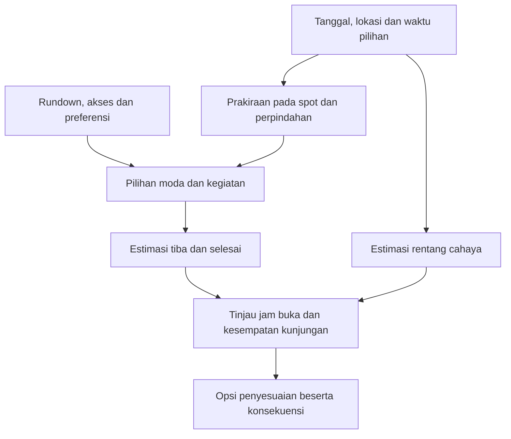

# Keterkaitan golden hour, cuaca, moda transportasi, dan rundown kreator

**Status konteks — 29 Oktober 2026:** Hubungan waktu/cuaca/moda tetap bahan penelitian. Asumsi rundown kreator dan keputusan terbuka di bawah mengikuti 22 Oktober; sumber rekomendasi aktif kini AI. Tidak ada klaim integrasi/availability baru. Lihat [acuan aktif](../technology/07-planning-integrations.md).

**Tanggal riset:** 22 Oktober 2026, Asia/Jakarta.  
**Status:** desk research dan sintesis untuk eksplorasi produk. Temuan sumber, interpretasi, dan kandidat rancangan dibedakan.  
**Konteks:** [CBL aktif](../../../source-records/CBL.md), [riset WeatherKit 21 Oktober](weatherkit-traveller-experience-research-2026-10-21.md), serta [rancangan integrasi](../technology/07-planning-integrations.md). Klarifikasi terbaru pengguna menegaskan bahwa cuaca ikut memengaruhi pemilihan moda, termasuk pertimbangan menghindari motor ketika hujan.  
**Register:** [22 halaman sumber primer beserta metode pemeriksaan dan batasnya](keterkaitan-cahaya-cuaca-moda-sources-2026-10-22.csv). Banyak halaman adalah dokumentasi dari provider yang sama; jumlah halaman bukan jumlah bukti independen.

## 1. Kesimpulan yang paling berguna

**Golden hour, prakiraan cuaca, dan transportasi sebaiknya dieksplorasi sebagai keputusan yang saling memengaruhi dalam pelaksanaan rundown.** Kesempatan cahaya memberi sasaran waktu; cuaca memengaruhi pengalaman di spot, persiapan, serta pertimbangan moda; moda dan akses menentukan estimasi tiba; perubahan estimasi tiba menentukan apakah kesempatan kunjungan masih dapat dicapai.

Hubungan cuaca dengan pemilihan moda didukung studi perjalanan, termasuk di Indonesia dan kota tropis lain. Namun, bukti tersebut tidak membenarkan aturan universal bahwa setiap orang pasti berganti moda saat hujan. Preferensi, biaya, kepemilikan kendaraan, ketersediaan layanan, dan fleksibilitas perjalanan tetap berperan. Bukti pada bagian 4 adalah penelitian perjalanan/komuter; belum validasi traveller pengguna aplikasi C6.

**Arah eksplorasi produk:** membantu pengguna memahami tradeoff persiapan, moda, waktu, dan urutan spot. Jika ada petir atau kondisi berbahaya, respons tidak cukup berhenti pada membawa pelindung hujan atau mengganti kendaraan. Jika suatu kesempatan cahaya sudah tidak terkejar, aplikasi perlu menyatakan keterbatasannya.

## 2. Dasar investigasi dan pertanyaan

### Given — arahan pengguna

- Rundown pengalaman kreator adalah inti produk; pengguna menemukan melalui search/map dan menjalankannya per spot.
- Jam kreator adalah rekomendasi, sementara pengguna memiliki tanggal, jam mulai, dan waktu tersedia sendiri.
- Foto per spot menghasilkan album pada best-case Athar; berbagi ke media sosial opsional.
- Cuaca membantu persiapan jas hujan/payung, pertimbangan hujan/badai, pilihan moda, serta penyesuaian perjalanan.
- Perjalanan menuju landing point dan perpindahan antarspot sama-sama relevan.

### Needs validation

- Seberapa sering pengguna sasaran mengubah moda atau menunggu ketika hujan, dan batas biaya/waktu yang dapat diterima.
- Spot mana yang benar-benar sensitif terhadap cahaya, hujan, atau angin; ketersediaan metadata dan alternatif dari kreator.
- Definisi golden hour, makna jam mulai, cakupan moda/provider, serta tingkat otomatisasi perubahan.
- Respons WeatherKit terautentikasi pada koordinat/tanggal destinasi. Daftar kemampuan dokumentasi belum membuktikan respons lokasi target.

| Guiding Question | Cara menjawab pada pekerjaan ini | Status jawaban |
|---|---|---|
| GQ1 — Bagaimana kesempatan cahaya berkaitan dengan cuaca? | Dokumentasi solar events, perencanaan fotografi, dan perhitungan astronomi. | Perbedaan konsep didukung; model/penghitungan aplikasi belum dipilih. |
| GQ2 — Apakah cuaca berkaitan dengan moda dan waktu berangkat? | Studi primer Indonesia, Vietnam, Filipina, serta pembanding Jerman. | Didukung dengan batas konteks dan metode; besaran efek C6 belum diketahui. |
| GQ3 — Kapan perlengkapan atau pergantian moda saja tidak cukup? | Panduan BMKG dan NWS tentang petir. | Perbedaan respons didukung; klasifikasi dan perilaku produk masih kandidat. |
| GQ4 — Apa yang dapat diberikan WeatherKit dan apa yang membutuhkan sumber lain? | Dokumentasi Apple terkini dan availability aplikasi Weather sebagai petunjuk tambahan. | Kontrak terdokumentasi; integrasi/coverage destinasi belum diuji. |
| GQ5 — Bagaimana semua itu masuk ke rundown? | Sintesis hubungan waktu, perpindahan, pengalaman, dan kendala. | Hipotesis desain yang siap diuji melalui walkthrough. |

## 3. Cahaya: kesempatan astronomis berbeda dari kondisi yang terlihat

### Observasi sumber

PhotoPills memakai konvensi elevasi matahari −4° sampai +6° untuk golden hour, dengan urutan terbalik pada sore hari. Panduannya juga menyatakan bahwa karakter cahaya dipengaruhi cuaca. Ini konvensi operasional produk fotografi, bukan satu definisi universal yang otomatis menjadi aturan aplikasi C6. [S01 — PhotoPills](https://www.photopills.com/articles/mastering-golden-hour-blue-hour-magic-hours-and-twilights)

WeatherKit mendokumentasikan sunrise, sunset, beberapa fase dawn/dusk, solar noon dan solar midnight melalui `SunEvents`; tidak terdapat properti rentang golden hour pada inventori tersebut. Definisi rentang cahaya dan perhitungan tambahan tetap diperlukan bila produk ingin menampilkannya. [S02 — SunEvents](https://developer.apple.com/documentation/weatherkit/sunevents)

NOAA menjelaskan bahwa hasil perhitungan solar position dan sunrise/sunset dapat berbeda dari pengamatan karena kondisi atmosfer. Halaman yang diperiksa juga menyatakan kalkulator NOAA/GML sudah tidak dipelihara aktif; sumber ini dipakai untuk batas konseptual, bukan pemilihan dependency produksi. [S21 — Solar Calculation Details](https://gml.noaa.gov/grad/solcalc/calcdetails.html)

### Interpretasi untuk produk

Pisahkan tiga informasi:

| Lapisan | Pertanyaan pengguna | Sumber yang diperlukan |
|---|---|---|
| Rentang posisi matahari | Kapan kesempatan cahaya secara astronomis pada tanggal/lokasi ini? | Model astronomi, definisi fase dan zona waktu destinasi. |
| Kondisi langit | Apa prakiraan awan, hujan, atau jarak pandang pada rentang itu? | Prakiraan cuaca yang sesuai interval/lokasi. |
| Pengalaman pada spot | Apakah cahaya tersebut relevan dan terlihat dari spot ini? | Arah pandang, penghalang bangunan/medan, akses, dan catatan kreator. |

Rentang hasil model tidak perlu digeser hanya karena prakiraan berawan; yang berubah adalah ekspektasi pengalaman dan keputusan kunjungan. Mengurangi sunset dengan tepat 60 menit bukan definisi golden hour yang sudah dibuktikan untuk produk ini.

**Kandidat penyajian:** estimasi rentang cahaya, prakiraan kondisi langit, lalu catatan relevansi spot. Hindari satu label “golden hour bagus” atau persentase kualitas foto tanpa model dan validasi. Belum ada kewajiban traveller meniru foto kreator.

## 4. Cuaca berkaitan dengan moda dan jam berangkat, tetapi responsnya beragam

| Bukti primer yang diperiksa | Observasi | Batas dan implikasi |
|---|---|---|
| **Yogyakarta, 2017:** persepsi/pengalaman perjalanan dan penggunaan angkutan umum. | Responden melaporkan pertimbangan mengganti moda, menunggu hujan mereda, dan menyesuaikan keberangkatan; pada gerimis kecenderungan mempertahankan moda tetap ada. | Laporan diri/persepsi, bukan pelacakan pilihan traveller C6. Mendukung eksplorasi beberapa respons, bukan larangan motor pada seluruh hujan. [S13 — artikel](https://journal.unpar.ac.id/index.php/jurnaltransportasi/article/download/2703/2319/5835) |
| **Ho Chi Minh City, terbit 2020:** revealed adaptation 400 responden dan stated adaptation 100 responden. | Abstrak menyebut perpindahan motor ke mobil/taksi sebagai pola penting di antara perubahan moda; waktu, biaya, pendapatan, kepemilikan motor, dan informasi cuaca ikut berkaitan dengan pilihan. | Repositori menyediakan cuplikan dua halaman, terutama abstrak/pendahuluan; hasil model lengkap tidak diperiksa. Proporsi perubahan bukan proporsi seluruh pengendara. [S14 — cuplikan penulis](https://epub.vgu.edu.vn/bitstream/dlibvgu/400/1/Analysis%20of%20mode%20choice%20behavior%20under%20adverse%20weather%20conditions%20using%20RA%20and%20SA%20surveys%20-%20A%20case%20study%20from%20Ho%20Chi%20Minh%20City%20%28HCMC%29%2C%20Vietnam.pdf) |
| **Ortigas/Metro Manila, survei Desember 2016, artikel 2017:** 300 responden komuter. | Survei membandingkan moda, waktu berjalan/menunggu, biaya, serta jam berangkat menurut kondisi hujan; perubahan moda dan menunggu/menggeser keberangkatan menjadi respons yang ditemukan. | Survei jawaban menurut kondisi, bukan eksperimen kausal atau rekaman GPS tiap perjalanan. Label hujan survei tidak boleh langsung dijadikan ambang API. [S15 — artikel lengkap](https://www.jstage.jst.go.jp/article/easts/12/0/12_771/_pdf/-char/en) |
| **Jerman, 2023:** analisis lebih dari 500.000 perjalanan, dikaitkan dengan data cuaca. | Dampak cuaca pada pilihan moda secara umum relatif kecil dibanding faktor lain; sepeda lebih terpengaruh dan hasil berbeda menurut tipe wilayah. | Sepeda bukan sepeda motor; konteks Jerman berbeda dari Indonesia. Menjadi pembanding yang menahan generalisasi bahwa cuaca selalu penentu terbesar. [S16 — repositori penulis](https://elib.dlr.de/197326/) |

**Kesimpulan yang didukung:** cuaca layak menjadi input pemilihan moda dan waktu perjalanan. **Yang belum didukung:** satu ambang hujan yang mewajibkan semua pengguna berpindah ke mobil, atau prediksi tingkat adopsi fitur ini pada traveller C6.

### Interpretasi untuk rancangan moda

- Motor/ojek motor perlu dibedakan dari mobil/taksi pada opsi perjalanan, sekalipun keduanya sering dikelompokkan sebagai kendaraan.
- Saat ada prakiraan hujan pada segmen bermotor terbuka, aplikasi dapat mengajak meninjau moda dan membandingkan alternatif yang lebih terlindung.
- Transportasi umum perlu dibandingkan sebagai rangkaian jalan → tunggu → naik → transfer → jalan. Mengganti motor dengan kereta belum menyelesaikan paparan jika akses halte/stasiun tetap terbuka.
- Bedakan motor pribadi dari ojek motor. Meninggalkan kendaraan, parkir, dan perjalanan kembali dapat membatasi pergantian moda.
- Opsi menunggu atau mengubah waktu/spot perlu ikut tersedia untuk diuji, terutama ketika alternatif moda terlalu mahal atau tidak tersedia.

Poin-poin tersebut adalah kandidat kebutuhan informasi, belum keputusan UI, kebijakan final, atau bukti semua data akses tersedia.

## 5. Hujan dan badai petir memerlukan respons berbeda

BMKG menganjurkan masuk ke ruangan ketika terdengar guntur dan menghentikan perjalanan motor untuk mencari perlindungan ketika hujan disertai petir. Panduan ini membahas petir; jangan mengubahnya menjadi larangan universal untuk setiap kondisi hujan. [S11 — BMKG, Buletin Geodinamika Maret 2024, halaman tercetak 13](https://stageof-bali.bmkg.go.id/fileBuletin/file/2024/202403.pdf)

NWS membedakan kendaraan tertutup beratap logam dari kendaraan terbuka sebagai perlindungan terhadap petir. Ini tidak menjamin seluruh perjalanan kendaraan tersebut aman dari banjir, angin atau gangguan jalan. [S12 — Lightning Safety & Awareness](https://www.weather.gov/media/sgf/LightningSafetyTipSheet.pdf)

### Kandidat respons dalam aplikasi — bukan panduan operasional final

| Konteks | Informasi dan pilihan yang layak diuji | Batas |
|---|---|---|
| Prakiraan hujan pada berjalan/menunggu | Persiapan pelindung hujan; tinjau durasi paparan, waktu dan alternatif yang diketahui. | Pilihan payung/jas hujan mempertimbangkan aktivitas dan kondisi lain; belum ada aturan pemilihan otomatis. |
| Prakiraan hujan pada motor/ojek motor | Tinjau kelanjutan moda; bandingkan kendaraan tertutup, transit, atau waktu berbeda jika tersedia. | Jas hujan tidak menjadi alasan otomatis untuk mengabaikan kondisi perjalanan. |
| Prakiraan thunderstorm/petir atau peringatan relevan | Tonjolkan sumber, waktu/wilayah yang berlaku, dan peninjauan keberangkatan/kegiatan terbuka. | Jangan mereduksi respons menjadi “bawa payung” atau “ganti mobil lalu lanjut”. |
| Cuaca buruk ketika sudah di lapangan | Berikan akses ke informasi otoritas dan opsi menjeda perjalanan; pertahankan progres. | Aplikasi bukan pendeteksi petir langsung atau penentu lokasi berlindung yang terverifikasi. |
| Data cuaca/alert tidak tersedia atau kedaluwarsa | Nyatakan keterbatasan; jangan menyimpulkan kondisi aman. | Array alert kosong berbeda dari layanan alert tidak tersedia, dan keduanya tidak menjamin tidak ada bahaya. |

Kategori **hujan, hujan lebat, thunderstorm, angin kencang, dan tropical storm** perlu memiliki makna terpisah. Peluang hujan yang tinggi tidak cukup untuk menetapkan badai petir. WeatherKit mendokumentasikan kondisi seperti `heavyRain`, `thunderstorms`, `isolatedThunderstorms`, `scatteredThunderstorms`, `strongStorms`, dan `tropicalStorm` secara terpisah. [S06 — WeatherCondition](https://developer.apple.com/documentation/weatherkit/weathercondition)

## 6. Pergantian moda mengubah waktu tiba dan kesempatan cahaya

Penelitian jalan di Jakarta mengaitkan data kecepatan dari sensor smartphone dengan kondisi cuaca dan karakteristik jalan untuk mengidentifikasi jalan yang sensitif terhadap cuaca. Ini mendukung alasan memeriksa ulang waktu perjalanan ketika kondisi berubah, tetapi tidak menyediakan faktor pengali keterlambatan universal atau ETA terkini rute Athar. [S17 — Yang dkk., 2021](https://pmc.ncbi.nlm.nih.gov/articles/PMC8037289/)

**Sintesis:** moda baru → komponen durasi baru → estimasi tiba baru → peninjauan jam buka, kesempatan cahaya, dan sisa rundown. Mengganti nama moda tanpa menghitung dampaknya membuat saran perjalanan tidak lengkap.

Sebagai model diskusi, waktu siap menikmati/memotret di spot dihitung dari:

```text
waktu berangkat
+ akses ke kendaraan/halte atau titik jemput
+ waktu tunggu
+ waktu di kendaraan
+ transfer dan jalan terakhir
+ waktu persiapan di spot
= estimasi waktu siap di spot
```

Semua komponen harus memiliki sumber atau status belum diketahui. Jangan menghitung nilai yang tidak tersedia sebagai nol. Estimasi yang tidak pasti dapat dipresentasikan sebagai rentang jika sumbernya mendukung.

### Contoh hitung ilustratif — bukan cuaca, golden hour atau ETA Kota Tua nyata

Asumsikan sasaran kesempatan cahaya **17.00–17.15** dan waktu berangkat **16.20**. Angka berikut sengaja dibuat untuk menjelaskan ketergantungan, bukan hasil provider.

| Pilihan ilustratif | Komponen durasi yang diasumsikan | Siap di spot | Dampak pada sasaran |
|---|---|---|---|
| Motor pada rencana awal | 20 menit berkendara + 5 menit akses akhir + 10 menit persiapan | 16.55 | Tiba sebelum rentang sasaran. |
| Mobil setelah meninjau prakiraan hujan | 10 menit menunggu + 35 menit berkendara + 5 menit akses akhir + 10 menit persiapan | 17.20 | Rentang sasaran terlewat. |
| Mobil dengan waktu berangkat ditinjau ke 16.00 | Asumsi durasi sama, total 60 menit | 17.00 | Memenuhi rentang dalam contoh. |

Aplikasi perlu menjelaskan konsekuensi tersebut; bisa jadi tidak ada alternatif yang memenuhi semua tujuan. Kesempatan cahaya tidak boleh mendorong pengguna mengejar waktu dengan mengabaikan kondisi buruk.

## 7. Pemetaan ke rundown kreator

Diagram berikut adalah sintesis hubungan, bukan algoritme final atau klaim optimasi.



| Saat dalam perjalanan pengguna | Pertanyaan yang dijawab | Informasi minimum untuk mengeksplorasinya |
|---|---|---|
| Memilih rundown | Pengalaman apa yang sensitif terhadap jam atau cuaca? | Tips kreator, spot prioritas, indoor/outdoor, kesempatan cahaya. |
| Memilih tanggal/jam | Apakah urutan dan moda masih sesuai pada waktu saya? | Asal, basis jam mulai, durasi kunjungan, ETA, jam buka, prakiraan. |
| Sebelum berangkat | Apa persiapan dan moda yang masuk akal? | Kondisi selama rentang perjalanan; moda yang tersedia, biaya, akses dan paparan. |
| Menuju landing point | Apakah masih bisa tiba sesuai kebutuhan? | Waktu jemput/tunggu, akses akhir, ETA baru dan kesempatan di spot. |
| Antarspot | Apakah perpindahan berikutnya perlu ditinjau? | Lokasi/waktu segmen berikutnya, kondisi, moda alternatif dan dampaknya. |
| Kondisi berubah | Apa konsekuensi mempertahankan atau menyesuaikan rencana? | Sebelum/sesudah, alasan, dampak waktu/biaya/spot, data yang belum diketahui. |

**Kandidat prinsip perubahan:** tawarkan pilihan untuk ditinjau dan pertahankan progres/foto yang sudah tercatat. Preview, penerapan, dan pembatalan belum menjadi keputusan final tingkat otomatisasi. Perubahan satu segmen perlu meninjau kembali segmen setelahnya tanpa mengubah fakta perjalanan yang sudah terjadi.

## 8. WeatherKit menyediakan input; keputusan perjalanan memerlukan gabungan data

| Kebutuhan | Data/kontrak terdokumentasi | Batas yang memengaruhi produk |
|---|---|---|
| Prakiraan pada waktu kunjungan | `HourWeather`: tanggal awal jam, condition, cloud cover, visibility, wind, suhu dan presipitasi. | Cocokkan interval spot/segmen dengan jam prakiraan; bukan cuaca pasti di setiap meter jalur. [S03](https://developer.apple.com/documentation/weatherkit/hourweather) |
| Peluang hujan | `precipitationChance` bernilai 0–1 untuk probabilitas pada jam tersebut. | 80% bukan 80% durasi perjalanan, dan bukan ukuran kelebatan. Jangan menjumlahkan peluang antarjam menjadi peluang perjalanan. [S04](https://developer.apple.com/documentation/weatherkit/hourweather/precipitationchance) |
| Jumlah/intensitas presipitasi | `precipitationAmount` merepresentasikan ekuivalen cair selama satu jam; prakiraan menit memiliki `precipitationIntensity`. | Rata-rata/agregat per jam bukan pengukuran puncak sesaat; jangan menerapkan ambang dari satuan/interval berbeda. [S05](https://developer.apple.com/documentation/weatherkit/hourweather/precipitationamount), [S22](https://developer.apple.com/documentation/weatherkit/minuteweather) |
| Peringatan otoritas | `WeatherAlert`: source, summary, severity, region dan details URL. | Tidak semua alert berarti severe; condition thunderstorm berbeda dari alert resmi. Tampilkan identitas sumber. [S07](https://developer.apple.com/documentation/weatherkit/weatheralert) |
| Ketersediaan | `WeatherAvailability` membedakan ketersediaan data alert dan prakiraan menit. | Dapat tidak didukung di wilayah atau sementara tidak tersedia. [S08](https://developer.apple.com/documentation/weatherkit/weatheravailability) |
| Kesegaran/sumber waktu | Metadata mencakup waktu request, lokasi, dan expiration. | Waktu request bukan waktu pengamatan lapangan; interval forecast dipertahankan terpisah. [S09](https://developer.apple.com/documentation/weatherkit/weathermetadata) |
| Rentang golden hour | Solar events sebagai konteks; model astronomi tambahan untuk definisi rentang yang dipilih. | Tidak ada properti golden-hour window pada `SunEvents` yang diperiksa. [S02](https://developer.apple.com/documentation/weatherkit/sunevents) |
| Motor, taksi, transit, akses dan ETA | Sumber routing/layanan, catatan kreator dan pengguna. | WeatherKit tidak mengisi data tarif, waktu jemput, jam buka, keterlindungan jalur atau moda yang tersedia. Pemetaan ini adalah kebutuhan gabungan aplikasi. |

### Availability Indonesia dan Jepang

Halaman Apple Support yang diperiksa mencantumkan Jepang pada next-hour precipitation dan severe-weather information; Indonesia tidak tercantum pada kedua daftar itu. Ini informasi **aplikasi Weather**, bukan bukti request WeatherKit Kota Tua. Gunakan sebagai petunjuk untuk spike; keputusan API mengikuti respons availability destinasi. [S10 — Apple Support](https://support.apple.com/en-us/105038)

Kandidat baseline untuk diuji: rundown tetap bisa dibaca ketika cuaca tidak tersedia; ringkasan per jam digunakan jika didukung; fitur “hujan berhenti beberapa menit lagi” tidak dijanjikan sebelum data menit terbukti tersedia. Sumber otoritas lokal seperti BMKG relevan untuk ditinjau terpisah; integrasi, lisensi, granularitas dan kontraknya belum diteliti sebagai provider pengganti pada pekerjaan ini.

### Batas transportasi Apple yang relevan

Inventori `MKDirectionsTransportType` yang diperiksa tidak menyediakan tipe sepeda motor tersendiri. Jangan melabeli ETA automobile sebagai ETA motor terverifikasi. Provider/estimasi moda tersebut masih perlu dipilih dan diuji. Dokumentasi `.transit` menyatakan dukungan untuk estimasi waktu tiba; tidak membuktikan seluruh rincian itinerary transit tersedia melalui API tersebut. [S18 — transport types](https://developer.apple.com/documentation/mapkit/mkdirectionstransporttype), [S19 — transit](https://developer.apple.com/documentation/mapkit/mkdirectionstransporttype/transit)

### Atribusi

Apple mewajibkan atribusi ketika menampilkan data WeatherKit dan mengatur penyajian alert. Teks severe weather alert tidak boleh diubah; saran perjalanan aplikasi harus dibedakan dari pesan otoritas dan mempertahankan tautan/sumber sesuai ketentuan. [S20 — WeatherKit attribution](https://developer.apple.com/weatherkit/)

## 9. Kandidat kebutuhan untuk diuji dan asalnya

Semua baris berikut adalah handoff Investigate untuk eksplorasi, bukan backlog implementasi yang sudah disetujui.

| Kandidat kebutuhan | Dasar | Sinyal uji yang dapat diamati |
|---|---|---|
| Cuaca ditautkan ke waktu/segmen yang relevan. | Kontrak prakiraan per jam + sifat urutan/durasi rundown. | Pengguna dapat menunjuk spot atau perpindahan yang terdampak, bukan hanya menyebut hari hujan. |
| Pilihan moda menjelaskan kondisi cuaca dan paparan. | Bukti perilaku S13–S16 + klarifikasi pengguna. | Pengguna memahami alasan menawarkan alternatif motor dan melihat bagian berjalan/menunggu yang tersisa. |
| Pergantian moda menampilkan dampak pada kedatangan/cahaya. | Sintesis waktu pada bagian 6. | Pengguna mengenali kesempatan yang terlewat dan tradeoff waktu/biaya. |
| Persiapan hujan dan respons petir dibedakan. | Panduan S11–S12 dan tipe kondisi/alert. | Pengguna tidak menyimpulkan jas hujan atau payung cukup untuk semua kondisi. |
| Rentang cahaya dan ekspektasi langit dipisahkan. | S01–S03 dan batas model astronomi. | Pengguna tidak menafsirkan estimasi golden hour sebagai jaminan foto atau langit cerah. |
| Data tidak tersedia ditampilkan dengan jujur. | S08–S10. | Pengguna membedakan tidak ada alert dari alert tidak tersedia. |
| Alternatif memperhitungkan akses dan sumber data. | Kebutuhan gabungan + batas MapKit S18–S19. | Opsi tidak menghilangkan akses berjalan atau mengklaim ETA motor tanpa sumber. |

Belum ditetapkan: ambang peluang/jumlah hujan, kecepatan angin, bobot biaya/waktu, definisi “moda terbaik”, buffer universal, atau skor kecocokan foto/rundown. Bukti yang diperiksa tidak cukup untuk menetapkan angka-angka tersebut.

## 10. Bukti berikutnya yang paling bernilai

| Prioritas | Aktivitas terkecil yang berguna | Bukti dan calon pemilik |
|---|---|---|
| P1 — perilaku aktual | Wawancara berdasarkan perjalanan terakhir ketika hujan: apa moda semula, apa yang berubah, kapan tahu cuaca, apa alternatif/biayanya. | Catatan kejadian nyata dan keterbatasan pilihan; tim produk/riset. Jumlah peserta dan penugasan belum ditetapkan. |
| P1 — hubungan ketiga keputusan | Walkthrough satu rundown dan tiga kondisi: hujan saat perpindahan, target cahaya terlewat setelah ganti moda, serta badai petir. | Alasan menerima/menolak opsi, pemahaman dampak, dan kontrol yang diharapkan; tim produk/desain. |
| P1 — coverage | Spike WeatherKit Kota Tua dan satu pembanding Jepang dengan pencatatan availability, interval, timestamp, field kosong, dan kegagalan. | Bukti kemampuan nyata destinasi; engineer. Ini pekerjaan berikutnya, belum dilakukan. |
| P1 — moda | Spike satu perjalanan menuju landing point dan satu antarspot, dengan motor/mobil/transit hanya jika provider mendukung. | ETA, detail akses, biaya/availability jika tersedia, batas SDK/region dan fallback; engineer. |
| P2 — beban kreator | Minta kreator menyusun satu rundown dengan spot sensitif cahaya/hujan, akses dan alternatif yang ia ketahui. | Waktu input, sumber, bagian yang tidak diketahui dan beban pembaruan; tim riset/konten. |
| P2 — cahaya | Pilih definisi rentang dan calon perhitungan, bandingkan pada tanggal/lokasi uji dan cek konteks spot. | Kesepakatan makna dan bukti perhitungan; engineer bersama produk. Belum memilih library. |

Studi pengguna memerlukan partisipasi sukarela, pengumpulan lokasi seperlunya, dan kesempatan melewati pertanyaan. Walkthrough dilakukan dengan skenario berlabel; tidak perlu mengajak peserta berkendara atau mengejar foto dalam cuaca buruk.

**Kesiapan:** cukup untuk mengeksplorasi konsep dan skenario interaksi. Kebutuhan traveller C6, kemampuan kreator merawat metadata, dan integrasi destinasi masih membutuhkan bukti. Penelitian ini tidak menetapkan ulang fase formal tim atau USP.

## 11. Batas pekerjaan

- Dokumentasi Apple diperiksa melalui halaman resmi dan ekstraksi Sosumi yang menunjuk sumber aslinya. Studi diperiksa pada bagian yang disebut dalam register, bukan systematic review seluruh literatur.
- Tidak ada request WeatherKit terautentikasi, data prakiraan destinasi aktual, benchmark akurasi, perhitungan golden hour nyata, atau query ETA/routing yang dilakukan.
- Tidak ada studi pengguna C6, pembuktian manfaat, validasi threshold, atau klaim keselamatan perjalanan dari skor aplikasi.
- Angka contoh adalah ilustrasi; tidak membuktikan jam buka, akses, keadaan cuaca, atau perjalanan Kota Tua/Jepang.
- Hasil pekerjaan ini adalah laporan dan register sumber; bukan implementasi native, keputusan stack/provider final, atau perubahan otomatis pada rundown.
