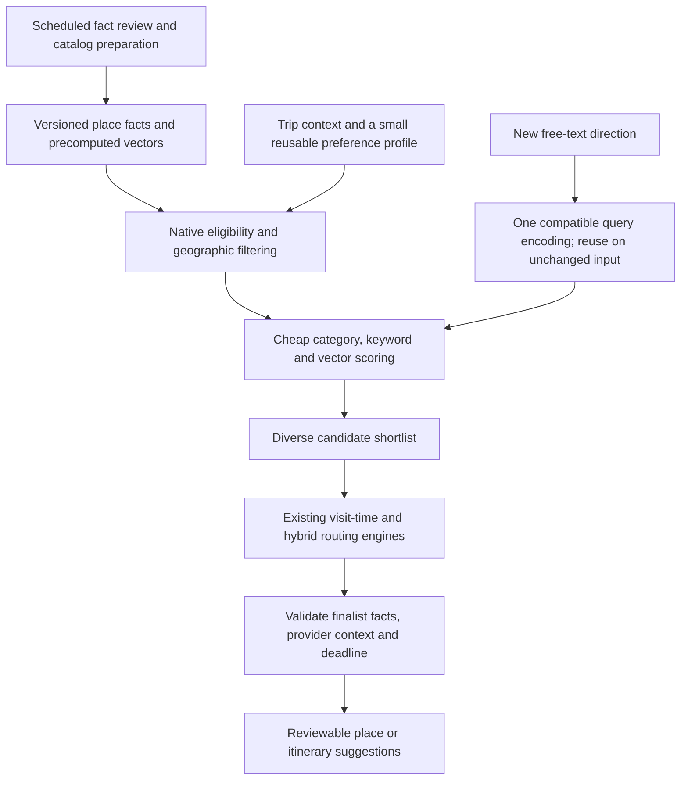

# Low-compute place and itinerary recommendations — research synthesis

Date: **5 November 2026, Asia/Jakarta**. Status: desk research and read-only inspection of the current C67 PoC. No new model benchmark, app change, routing change or implementation is claimed. Recommendations below are hypotheses for the next experiment, not a locked architecture.

## Decision to investigate

Can C67 produce recommendations that people find appropriate, with low runtime compute and short waits, while preserving evidence-based constraints and the ability to run without a team-operated AI backend?

The strongest direction from this research is a **content- and context-based recommender over a prepared city catalog, with persistent precomputed place vectors and cheap native scoring**. Use the existing E5 as the quality reference. Evaluate static embeddings for optional free-text encoding. Add collaborative learning only when usable interaction data exists. Feed a bounded candidate set to the already agreed visiting-time/routing engines.

Separate four costs: catalog acquisition/refresh; offline representation/training; per-request local computation; and external provider latency. Moving work offline reduces repeated runtime work but does not make catalog maintenance or training free.

## Current local evidence

The [v0.7 report](../../../../apps/c67-foundation-lab/docs/verification/EMBEDDING_BENEFIT_REPORT_2026-11-05.md) found an E5 benefit on authored paraphrase cases, with a small manually curated corpus. It did not establish user satisfaction, citywide coverage or a general latency benchmark. The physical-device suite's cached and initialization timings are not an end-to-end production SLA.

Source inspected in this research:

- [E5Embedding.swift](../../../../apps/c67-foundation-lab/Packages/PreferenceLearning/Sources/PreferenceLearning/E5Embedding.swift): the cache is an actor-owned dictionary; a hit returns the vector, but reaching 128 entries clears the entire dictionary. It is not persistent across process launches.
- [BenefitRanking.swift](../../../../apps/c67-foundation-lab/Packages/PreferenceQuality/Sources/PreferenceQuality/BenefitRanking.swift): each comparison requests one query encoding and an encoding for every eligible passage. Calls can hit the adapter cache; the counter does not equal the number of neural inferences.

**Interpretation:** scaling the catalog can cause repeated passage inference/cache eviction unless representation storage changes. This is a code-level risk, not an observed large-catalog performance regression. Model weights are already int8; quantizing stored vectors is a separate, currently untested optimization.

## Findings and implications

### 1. Precompute item representations; make serving cheap

Google's two-tower serving explanation separates candidate preparation from request-time query encoding, allowing item vectors to be computed before a request. This architectural principle can be borrowed without training a two-tower model or adopting Google's cloud stack. [Google Cloud: decoupled inference](https://cloud.google.com/blog/products/ai-machine-learning/scaling-deep-retrieval-tensorflow-two-towers-architecture).

For C67, store reviewed place/area facts and precomputed representations in a versioned city bundle. On a request, filter by known hard constraints, then score the remaining records. Recompute only changed content. New text may require a query encoding, but previously confirmed text/profile representations can be reused.

A persistent vector key should include venue/area ID, content hash, model revision, preprocessing/prefix configuration, dimension and precision. Changing the model requires rebuilding compatible vectors. Freshness is separate from embedding reuse: a cached vector does not make an expired factual claim valid. Provider content must only be stored/transformed where permitted.

Illustrative storage arithmetic: **1,000 × 384 × 4 = 1,536,000 bytes**, about 1.54 MB for raw float32 vectors, excluding facts, IDs, indexes, object overhead and model weights. This is not a runtime or RAM benchmark. Stored float32 vectors introduce no deliberate lossy compression, but cross-device E5 numerical differences already observed in v0.7 mean parity must still be checked.

**Confidence:** strongly supported architectural technique; C67 latency, energy and parity benefits need measurement.

### 2. Keep a serious non-neural content/context baseline

A study of reproducible neural recommenders found that several evaluated models could be beaten by tuned simpler baselines. This is evidence to compare against strong baselines, not a claim that all modern neural methods lose or that those datasets represent Jakarta. [Dacrema et al., RecSys 2019](https://arxiv.org/abs/1907.06902).

Use sourced fine-grained attributes, a lightweight interest profile, lexical matching and context features. Keep hard eligibility separate from preference scores. Native scoring can combine supported interests, contextual suitability, evidence freshness, novelty and repetition penalties. Weights need validation; the current experimental 60/40 blend is not a calibrated satisfaction model.

For new users, use available trip context and varied general suggestions. An optional selection between a few examples provides an initial signal. A person with no history, preference or distinguishing context cannot be individually identified by computation alone. Keep persistent interests distinct from this trip's purpose; one skipped place is not an explicit dislike.

**Confidence:** supported baseline direction; relevance and burden reduction require independent user evidence.

### 3. Reuse profile signals instead of re-encoding every place

Content features and precomputed item representations allow cheap item-to-item lookup and profile matching. A candidate experiment is a profile represented by supported feature weights and/or a weighted combination of liked-place vectors. Keep distinct interests separate when one averaged vector would blur them. Explicit exclusions remain deterministic constraints.

This is a proposed algorithmic change, not equivalent to E5's text-query encoding. It must be compared with the existing E5 reference, especially for compound requirements, corrections, mixed interests and unknown facts. A profile update can be infrequent and incremental; there is no need to retrain a language model for each like.

When enough real interaction data exists, a metadata-aware factorization model such as LightFM is worth evaluating. Its author describes user/item representations built from feature embeddings, supporting sparse and cold-start settings with metadata. This does not remove the need for training data, useful features, drift handling or evaluation. [LightFM paper](https://arxiv.org/abs/1507.08439), [author implementation](https://github.com/lyst/lightfm).

**Confidence:** supported approach class; fit for C67 remains untested. Collaborative learning is a later option, not an immediate requirement for an app with little interaction history.

### 4. Static embeddings are a plausible CPU-saving experiment

Static embedding encoders aggregate token lookup vectors rather than running contextual transformer attention. Sentence Transformers' authors report large CPU speedups on their benchmarks. Those are author results on particular models/hardware; they are not measured speedups over C67's int8 E5 on iPhone. [Static embedding method](https://huggingface.co/blog/static-embeddings).

Concrete candidates:

| Candidate | Documented role | C67 evaluation limit |
| --- | --- | --- |
| [static-retrieval-mrl-en-v1](https://huggingface.co/sentence-transformers/static-retrieval-mrl-en-v1) | English retrieval, static averaging, trained Matryoshka representation | Closest task/language match to the currently English lab. Negation and compound facts still require native checks. |
| [static-similarity-mrl-multilingual-v1](https://huggingface.co/sentence-transformers/static-similarity-mrl-multilingual-v1) | Multilingual similarity and paraphrase-related tasks | Similarity training is not automatic evidence of Jakarta POI retrieval quality or Indonesian preference understanding. |
| [potion-multilingual-128M](https://huggingface.co/minishlab/potion-multilingual-128M) / [Model2Vec](https://github.com/MinishLab/model2vec) | Static multilingual encoder; 256-dimensional output | Low encoder compute does not guarantee a small download/resident vocabulary. Actual artifact size, RAM, tokenizer support and iOS integration need inspection. |

Do not transfer a percentage of benchmark quality directly to C67. Test English first under the current product decision; Indonesian is a separately labeled extension. Static models have less contextual expressiveness by design. No model should enforce unknown amenity claims or hard negations through similarity alone.

**Confidence:** credible experiment, not a replacement recommendation yet.

### 5. Compress or index only when the measured bottleneck warrants it

Faiss documents exact Flat search as a baseline with no index-training step and discusses when index construction is not amortized by the number of searches. It does not prescribe a universal venue-count threshold. [Faiss index guidelines](https://github.com/facebookresearch/faiss/wiki/Guidelines-to-choose-an-index).

**C67 inference:** start by measuring a native exact vector scan after geographic/eligibility filtering. For a city-sized initial catalog, this may be adequate. Add ANN only if vector scanning becomes the limiting stage; measure candidate recall as well as time and memory. Do not interpret the Faiss guide's count of searches as a dataset-size threshold.

Stored-vector quantization can reduce memory, with a retrieval-quality tradeoff. Matryoshka dimension reduction is appropriate for models trained for it; do not simply cut the existing E5 vector and assume equivalent behavior. [Embedding quantization](https://sbert.net/examples/sentence_transformer/applications/embedding-quantization/README.html), [trained Matryoshka model](https://huggingface.co/sentence-transformers/static-retrieval-mrl-en-v1).

**Confidence:** supported techniques; priority depends on profiling. Avoid adding an external vector service merely to score a small local catalog.

### 6. Use more expensive reranking selectively

Retrieve-and-rerank systems first obtain a manageable shortlist, then score query/document pairs with a cross-encoder. Its joint processing costs more than reusing independent item vectors, so it is normally applied to a shortlist rather than the entire catalog. [Sentence Transformers retrieve-and-rerank](https://sbert.net/examples/sentence_transformer/applications/retrieve_rerank/README.html).

For C67, make the main path native rules + lexical/vector/context scores. Investigate a reranker only on a small shortlist when it produces enough quality gain for its measured latency. A close cosine gap can be a diagnostic, not a calibrated probability of uncertainty. A generative LLM could prepare descriptions/labels offline or assist optional language interpretation; it need not generate each itinerary during every request.

Cheap diversity selection can reduce near-duplicate results after eligibility. MMR explicitly balances relevance with redundancy in its original text-retrieval setting. Applying it to POIs is an adaptation to test, not evidence of tourism effectiveness. [Carbonell and Goldstein, SIGIR 1998](https://www.cs.cmu.edu/afs/cs/Web/People/jgc/publication/MMR_DiversityBased_Reranking_SIGIR_1998.pdf).

**Confidence:** supported architecture, conditional C67 usefulness. Extra model work should earn its place against the cheap baseline.

### 7. Evaluate itinerary quality as a set with constraints

PersTour models POI selection with interest/popularity, visit duration, a time budget and endpoints. Its evaluation uses photo-derived sequences in four cities, not Jakarta user satisfaction. The relevant lesson is to consider preferences together with trip constraints; it does not prove its particular solver is needed here. [Lim et al., IJCAI 2015](https://ijcai.org/proceedings/2015/253).

A ranking of individually appealing venues does not ensure they form a useful trip: distant locations, incompatible service windows, repeated experiences and an endpoint deadline can conflict. Preserve user-chosen mandatory destinations, and expose infeasibility rather than silently dropping them. Timing/route estimates used for pruning are not final arrival-feasibility evidence.

Feed a small but diverse eligible candidate pool to the existing agreed hybrid adaptive routing engine. Bound local refinement work and return the best fully validated plan available within the chosen budget. OR-Tools documents search limits as a general mechanism; citing it is not a recommendation to replace the C67 solver. Reaching a search limit does not prove infeasibility or global optimality. [OR-Tools search limits](https://developers.google.com/optimization/routing/routing_options).

Measure external place/map/weather stages independently. Apply provider validation to a bounded finalist set when possible, reuse only permitted fresh data, and do not re-fetch the entire world on every input edit. No evidence from this desk study identifies the dominant live-network bottleneck in the current app.

**Confidence:** strong problem-formulation support; bounded candidate size, provider policy and quality tradeoffs need C67 integration tests.

## Proposed operating design

The diagram is proposed architecture, not implemented functionality. An online backend can distribute catalog updates or perform batch preparation; the app can retain a useful local path with appropriately licensed data. Time-critical closures still need explicit freshness handling.

## Prioritized experiment, before committing to a new model

| Arm | Computation during request | Question |
| --- | --- | --- |
| A: stronger features + context + lexical | Native filtering/scoring | How much quality is available without neural inference? |
| B: persistent precomputed E5 corpus + reusable query/profile | Vector comparison; encode changed free text only | Can we retain the existing semantic benefit while avoiding repeated passage inference? |
| C: static encoder + rebuilt compatible corpus | Low-cost new-query encoding plus vector scoring | What quality is lost/gained for the measured reduction in compute? |
| D, later: metadata-aware collaborative factors | Small vector scoring after offline training | Does real interaction data improve fit beyond content/context? |

A weighted liked-item profile should be a separate B variant, not silently treated as equivalent to text-query E5. Cross-encoder/ANN/quantization should be separate ablations added only when a concrete bottleneck or quality gap justifies them.

### Evidence required

- Same reviewed actual venue/area corpus and candidate eligibility across arms; fresh independently authored/judged cases, separate from tuning data. Label performance-only synthetic scale tests explicitly.
- Include zero-history users, one known interest, compound needs, explicit avoids, corrections, unsupported requirements and conflicting trip windows. Assess place relevance and complete-trip usefulness separately.
- Measure initialization/cold start, warm request, relaunch with persistent representations, changed/unchanged input, stale facts, model/version mismatch and failed network. Record median and p95, peak memory, encoder calls/cache misses, provider calls and attributable costs. Use actual phone evidence; CPU benchmark ratios are not iOS latency estimates.
- Compare human relevance/choice corrections as well as NDCG/Recall. A click or completed visit is an ambiguous proxy. Observe input count and planning effort if claiming user burden reduction.
- For itineraries, record mandatory-destination preservation, sourced service-window compliance, deadline compliance, failed/incomplete provider validation and time to the first usable validated plan. Do not trade away a hard requirement for speed.
- Select the least costly approach among those meeting the team's quality/latency requirements. Thresholds need agreement and measurement; this research does not promise a sub-second full live itinerary.

## Scope boundary and next question

The next most informative technical spike is **persistent prepared representations and cheap profile/context scoring**, using E5 as the reference and a static encoder as a challenger. The unresolved human question is which signals and place characteristics predict actual fit for this team's users. Better preparation and faster arithmetic cannot supply absent venue facts or unobserved preferences.

No CBL decision was locked, no source/model weights changed and priority 3 was not implemented by this research. The note is local, unpublished research documentation.
