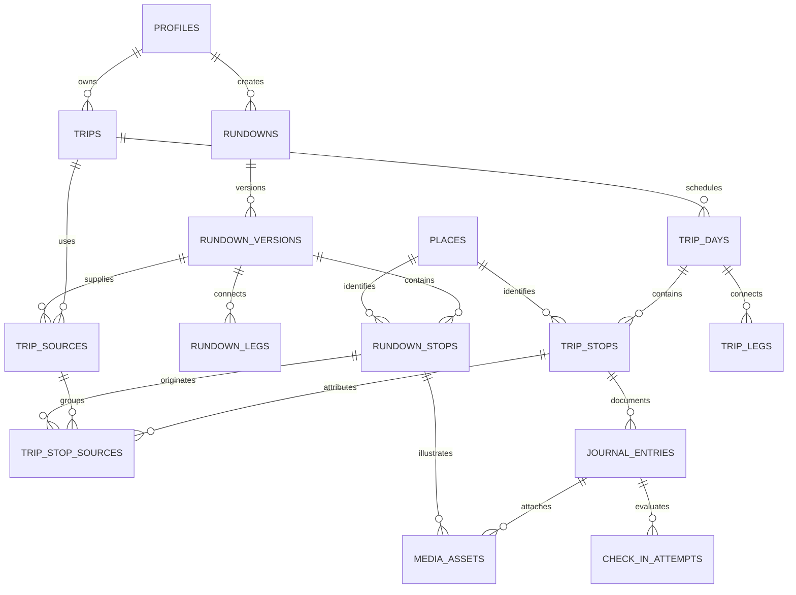

# 03 — Referensi database

## Pembaruan konteks 29 Oktober — model trip personal

Acuan aktif: [engine AI](11-ai-planning-engine.md). Kamus 25 tabel mulai bagian 1 di bawah adalah proposal 0.1, belum schema target AI atau inventori database yang terdeploy. Relasi source-version/kreator tetap perlu dijaga untuk data/API lama, tetapi tidak menjadi prasyarat produk baru.

Rancangan lanjutan perlu mewakili tujuan/preferensi pengguna, rentang waktu, durasi, sumber konteks, request perencanaan, proposal, revisi rencana dan kejadian aktual. Bedakan sumber data provider/browser dari rekomendasi AI. Hindari membuat kreator/version palsu agar hasil AI cocok dengan schema lama.

Nama tabel/kolom, retensi, nullability, ownership dan migration strategy belum dipilih. Active replanning memerlukan kontrak untuk sisa rencana dan perlindungan fakta/jurnal yang ada. Tidak ada tabel atau migrasi baru dibuat melalui dokumen ini; schema runtime tetap mengikuti repository C67.

[Indeks](README.md) · [Domain](01-architecture-domain.md) · [API](04-backend-api.md) · [Keamanan](08-security-operations.md)

## 1. Status dan konvensi

Ini kamus schema logis yang cukup rinci untuk menulis migrasi. Code block berlabel `text` adalah notasi kolom, bukan SQL yang dapat dieksekusi. Tidak ada klaim schema telah dipasang atau lulus tes database.

- ID entitas: `uuid`; ID ditentukan server atau client UUID yang divalidasi untuk idempotency, bukan bukti kepemilikan.
- `?` berarti nullable. Timestamp kejadian: `timestamptz`. Nama zona: IANA `text` yang divalidasi.
- `created_at` dan `updated_at` memakai clock server. Entitas mutable memakai `revision bigint` sesuai batas aggregate.
- Semua duration memakai integer detik (`*_seconds`), jarak/akurasi meter, bytes integer, koordinat WGS84. Ini memperinci proposal sebelumnya yang memakai menit; DTO tidak boleh mencampur satuan.
- Kolom `point` berarti `geography(Point,4326)`. Konstruktor PostGIS memakai longitude lalu latitude. [PostGIS](https://supabase.com/docs/guides/database/extensions/postgis).
- `jsonb` hanya untuk data yang bentuknya memang bervariasi: immutable snapshot audit/plan, payload aturan, job payload dan provenance eksternal. Owner, FK, urutan dan waktu inti tetap kolom terstruktur.
- Status menggunakan `text + CHECK` atau lookup yang konsisten; pilihan enum fisik dapat ditetapkan pada migrasi. Nilai baru harus kompatibel dengan client lama.
- `auth` dan `storage` adalah schema yang dikelola platform. `public` berisi domain yang diberi read grant terpilih; `private` tidak diekspos Data API.

PostgreSQL menyimpan instant untuk `timestamptz`; nama zona sumber tetap perlu kolom tersendiri. Jam template belum merupakan instant sampai tanggal dan zona diketahui. [Tipe waktu PostgreSQL](https://www.postgresql.org/docs/current/datatype-datetime.html).

## 2. Inventori

**15 tabel domain inti:** profiles, places, rundowns, rundown_versions, rundown_stops, rundown_legs, trips, trip_days, trip_sources, trip_stops, trip_stop_sources, trip_legs, journal_entries, media_assets, private.check_in_attempts.

**10 tabel pendukung/lanjutan:** rundown_time_rules, trip_time_rules, trip_plan_revisions, library_saves, private.operation_requests, private.upload_sessions, private.outbox_events, private.audit_events, private.deletion_jobs, private.job_runs. Ini 25 tabel logis dalam rancangan lengkap; fase implementasi tidak harus mengaktifkan semuanya sekaligus.



Diagram menunjukkan relasi utama inti. Dua parent media adalah alternatif, bukan kewajiban terhubung ke keduanya. Entitas infrastruktur/lanjutan dijelaskan pada kamus di bawah.

## 3. Akun, tempat dan konten kreator

### `public.profiles`

```text
id uuid PK -> auth.users.id
display_name text?
bio text?
avatar_object_path text?
account_state text                active | suspended | deleting
created_at timestamptz
updated_at timestamptz
revision bigint
```

`account_state` hanya ditulis command server. Bootstrap Auth membuat profile minimum secara idempotent; nama boleh kosong sampai pengguna melengkapinya. Jangan membuat kegagalan field tampilan membatalkan registrasi identitas. DTO profil publik hanya mengandung field tampilan yang diizinkan; account state adalah pemeriksaan internal. Email/provider token tidak ditambahkan ke profil publik. Penghapusan akun memakai job eksplisit, bukan cascade massal dari Auth yang belum memproses media.

### `public.places`

```text
id uuid PK
name text
location point
timezone text
country_code text?
locality text?
provider text?; provider_place_id text?
data_origin text                  creator | provider | curated
source_checked_at timestamptz?
created_at timestamptz; updated_at timestamptz
```

Nama/koordinat tidak menjadi natural primary key. Partial unique `(provider, provider_place_id)` hanya ketika keduanya ada dan penyedia menjamin identitas tersebut. Jangan menggabungkan tempat hanya berdasarkan kedekatan. Penulisan melalui resolver yang terkontrol; pengguna tidak bebas mengubah place bersama milik semua rundown.

### `public.rundowns`

```text
id uuid PK
creator_id uuid -> profiles.id
current_published_version_id uuid? -> rundown_versions.id
lifecycle_status text             active | archived
created_at timestamptz; updated_at timestamptz
revision bigint
```

Pointer versi memakai FK gabungan `(id, current_published_version_id)` terhadap pasangan rundown/version yang cocok, dengan urutan pembuatan constraint yang menangani circular reference. `archived` mengatur distribusi identitas; tidak menghapus trip sumber.

### `public.rundown_versions`

```text
id uuid PK; rundown_id uuid -> rundowns.id
version_no integer
title text; summary text?
default_timezone text
landing_place_id uuid? -> places.id
landing_location_snapshot point; landing_label text
status text                       draft | published
distribution_state text           listed | withdrawn
content_hash text?
published_at timestamptz?; content_reviewed_at timestamptz?
created_at timestamptz; updated_at timestamptz; revision bigint
UNIQUE(rundown_id, version_no)
UNIQUE(rundown_id, id)
```

Content hash dibuat atas representasi deterministik isi dan referensi aset. Published tidak kembali menjadi draft. Distribution state dapat berubah melalui command tanpa mengubah isi/content hash. Timestamp withdrawn/admin audit terpisah dari konten. Draft baru dapat berasal dari copy versi lama.

### `public.rundown_stops`

```text
id uuid PK; rundown_version_id uuid -> rundown_versions.id
place_id uuid? -> places.id
day_offset integer; position integer
title_snapshot text; location_snapshot point; timezone text
suggested_start_local time?; suggested_start_day_offset integer?
visit_duration_seconds integer
setting text                      indoor | outdoor | mixed | unknown
tips text?; check_in_radius_m double precision
data_origin text; source_checked_at timestamptz?
created_at timestamptz; updated_at timestamptz
UNIQUE(rundown_version_id, day_offset, position) DEFERRABLE
UNIQUE(rundown_version_id, id)
```

`place_id` boleh null untuk pin manual yang belum memiliki identitas place. Snapshot koordinat wajib tersedia agar trip tidak bergantung pada resolver eksternal. Stop yang sama secara geografis boleh muncul berulang dengan ID berbeda. Radius adalah versi konten yang tunduk pada batas policy server.

### `public.rundown_legs`

```text
id uuid PK; rundown_version_id uuid -> rundown_versions.id
from_stop_id uuid; to_stop_id uuid
transport_mode text               walk | drive | transit | other
duration_seconds integer?; instructions text?
data_origin text                  creator | provider | application
provider text?; source_checked_at timestamptz?
created_at timestamptz; updated_at timestamptz
```

FK gabungan kedua ujung ke `(rundown_version_id, id)` pada stops. Wajib `from_stop_id <> to_stop_id`; urutan dan kontinuitas diperiksa saat publish. Endpoint yang menyeberangi hari diperbolehkan hanya jika template memang memodelkannya dan time rules konsisten.

## 4. Trip traveller

### `public.trips`

```text
id uuid PK; owner_id uuid -> profiles.id
title text
status text                       draft | planned | active | completed | ended_early | archived
revision bigint
completion_policy_version text
started_at timestamptz?; completed_at timestamptz?
deleted_at timestamptz?
created_at timestamptz; updated_at timestamptz
```

`ended_early` tidak digunakan sampai DEC-03 disepakati. Setiap mutasi child yang memengaruhi snapshot menaikkan revision root sekali dalam transaksi. Owner/status/completion timestamp tidak dapat ditulis client langsung.

### `public.trip_days`

```text
id uuid PK; trip_id uuid -> trips.id
day_index integer; local_date date; timezone text
requested_start_at timestamptz?
start_time_basis text              departure_origin | start_at_landing
available_until_at timestamptz?
planned_departure_at timestamptz?; planned_landing_arrival_at timestamptz?
landing_location_snapshot point; landing_label text
origin_location_snapshot point?; origin_label text?
created_at timestamptz; updated_at timestamptz
UNIQUE(trip_id, day_index)
UNIQUE(trip_id, id)
```

Origin disimpan hanya jika dibutuhkan untuk rencana tersimpan; posisi live biasa tidak disimpan. Perjalanan lintas zona membutuhkan zona tiap stop/aturan; satu default day timezone tidak menggantikannya. `available_until_at` harus sesudah titik mulai yang relevan.

### `public.trip_sources`

```text
id uuid PK; trip_id uuid -> trips.id
rundown_version_id uuid -> rundown_versions.id
creator_attribution_snapshot jsonb
source_title_snapshot text
added_at timestamptz
UNIQUE(trip_id, id)
UNIQUE(id, rundown_version_id)
```

Tidak ada unique `(trip_id, rundown_version_id)` sebelum aturan menambahkan versi yang sama dipilih. Attribution snapshot hanya informasi yang diperlukan untuk kredit konten. Penghapusan normal menggunakan archive; hard purge sumber mengikuti kebijakan penghapusan dan provenance, bukan cascade ke trip.

### `public.trip_stops`

```text
id uuid PK; trip_id uuid; trip_day_id uuid
place_id uuid? -> places.id
position integer
title_snapshot text; location_snapshot point; timezone text
visit_duration_seconds integer; setting_snapshot text; tips_snapshot text?
check_in_radius_m_snapshot double precision
scheduled_arrival_at timestamptz?; scheduled_departure_at timestamptz?
actual_arrival_at timestamptz?; arrival_source text?
progress_status text              not_started | in_progress | documented | completed | skipped
completed_at timestamptz?; user_notes text?
removed_from_plan_at timestamptz?
created_at timestamptz; updated_at timestamptz
FK(trip_id, trip_day_id) -> trip_days(trip_id, id)
UNIQUE(trip_day_id, position) DEFERRABLE
UNIQUE(trip_id, id)
```

`trip_id` diduplikasi secara sengaja agar FK lintas child dapat menjamin aggregate yang sama. Nilainya tidak bisa berbeda dari day. Stop dengan jurnal diterima tidak dihapus saat replanning; tetap mempunyai identitas dan posisi historis yang dapat direkonstruksi. `skipped` dicadangkan.

### `public.trip_stop_sources`

```text
trip_id uuid; trip_stop_id uuid
trip_source_id uuid; rundown_version_id uuid; rundown_stop_id uuid
source_role text                  primary | supporting
PRIMARY KEY(trip_stop_id, trip_source_id, rundown_stop_id)
FK(trip_id, trip_stop_id) -> trip_stops(trip_id, id)
FK(trip_id, trip_source_id) -> trip_sources(trip_id, id)
FK(trip_source_id, rundown_version_id) -> trip_sources(id, rundown_version_id)
FK(rundown_version_id, rundown_stop_id) -> rundown_stops(rundown_version_id, id)
```

Junction ini mempertahankan sumber A+B pada satu stop bila pengguna memilih hasil demikian. Referensi ke versi stabil tidak menjadi izin copy/baca selamanya; policy sumber tetap dievaluasi.

### `public.trip_legs`

```text
id uuid PK; trip_id uuid; trip_day_id uuid
kind text                         access | between_stops
from_trip_stop_id uuid?; to_trip_stop_id uuid?
from_location_snapshot point; to_location_snapshot point
source_rundown_leg_id uuid? -> rundown_legs.id
transport_mode text; duration_seconds integer?; instructions text?
data_origin text; provider text?; calculated_at timestamptz?; valid_until timestamptz?
route_input_hash text?; calculation_version text?
created_at timestamptz; updated_at timestamptz
FK(trip_id, trip_day_id) -> trip_days(trip_id, id)
FK(trip_id, from_trip_stop_id) -> trip_stops(trip_id, id)
FK(trip_id, to_trip_stop_id) -> trip_stops(trip_id, id)
```

Access leg memiliki from-stop null dan tujuan koordinat landing; to-stop dapat null jika landing bukan stop. Between-stops wajib mempunyai dua stop berbeda. Sumber leg, bila ada, harus termasuk sumber trip serta sesuai endpoint asal; setelah endpoint berubah field sumber hanya boleh dipertahankan sebagai provenance yang jelas, tidak sebagai estimasi yang masih valid.

## 5. Jurnal, media dan presence

### `public.journal_entries`

```text
id uuid PK; owner_id uuid -> profiles.id
trip_id uuid; trip_stop_id uuid
story text?
status text                       pending | accepted | rejected | deleted
verification_origin text          server_presence | legacy_local_unverified | simulation
submitted_at timestamptz?; deleted_at timestamptz?
submission_operation_id uuid
created_at timestamptz; updated_at timestamptz
FK(trip_id, trip_stop_id) -> trip_stops(trip_id, id)
UNIQUE(owner_id, submission_operation_id)
```

Owner harus sama dengan trip owner; pemeriksaan dilakukan server dan constraint trigger. Accepted memerlukan setidaknya satu media ready dan presence yang diterima oleh policy aktif. `pending` dapat dibuat saat upload session; tidak dihitung sebagai dokumentasi selesai. Jurnal simulasi tidak dicampur dengan bukti presence fisik.

### `public.media_assets`

```text
id uuid PK; owner_id uuid -> profiles.id
rundown_stop_id uuid? -> rundown_stops.id
journal_entry_id uuid? -> journal_entries.id
object_path text UNIQUE; thumbnail_path text?
content_sha256 text; mime_type text; byte_size bigint
width integer?; height integer?; photo_taken_at timestamptz?
position integer
upload_status text                pending | stored | validating | ready | rejected | deleting
created_at timestamptz; updated_at timestamptz
CHECK exactly one of rundown_stop_id / journal_entry_id is non-null
```

Ukuran/MIME/dimensi final berasal dari pemeriksaan server, bukan hanya deklarasi client. Creator media tidak membutuhkan presence upload jurnal. Referensi avatar menggunakan bucket/profile path terpisah. Cover rundown diturunkan dari media stop yang boleh dibaca; tidak menambah attachment parent ketiga tanpa mengubah kontrak.

### `private.check_in_attempts`

```text
id uuid PK; user_id uuid
upload_session_id uuid; journal_entry_id uuid?
attempt_kind text                 transfer | finalize
challenge_id uuid; policy_version text
pin_snapshot jsonb
reported_tap_at timestamptz; reported_sampled_at timestamptz
challenge_issued_at timestamptz; received_at timestamptz
accuracy_m double precision; distance_m double precision
source_class text                 device_reported | simulation | unknown
decision text                     accepted | rejected | uncertain
failure_reason text?; expires_at timestamptz
```

Raw koordinat sampel dipakai saat evaluasi, tidak wajib disimpan. Pin snapshot adalah lokasi tujuan, bukan jejak pengguna. Client tidak membaca tabel ini langsung; endpoint mengembalikan hasil minimum yang diperlukan. Retensi dan toleransi waktu belum nilai produksi final.

## 6. Tabel pendukung

### Aturan waktu dan revisi

| Tabel | Kolom dan aturan |
|---|---|
| `public.rundown_time_rules` | `id`, `rundown_version_id`, `rundown_stop_id`, `rule_type`, `strength`, `timezone`, `local_start?`, `local_end?`, `start_day_offset?`, `end_day_offset?`, `parameters jsonb`, `source`, `checked_at?`. Stop harus dalam versi sama. Rule types: preferred_window, operating_window, fixed_event, solar_window. |
| `public.trip_time_rules` | `id`, `trip_id`, `trip_stop_id`, `source_rule_id?`, `rule_type`, `strength`, `timezone`, `window_start_at?`, `window_end_at?`, `parameters_snapshot`, `source_snapshot`. Snapshot tidak berubah saat sumber diperbarui. |
| `public.trip_plan_revisions` | `id`, `trip_id`, `plan_revision`, `base_trip_revision`, `result_trip_revision`, `snapshot jsonb`, `input_hash`, `reason`, `algorithm_version`, `created_at`. Append-only; schema snapshot mempunyai versi. Menyimpan rencana/provenance, bukan menimpa event kunjungan. |
| `public.library_saves` | `owner_id`, `rundown_id`, `created_at`; PK gabungan. Bookmark bukan trip, pin versi atau download. Aktif hanya jika bookmark dipilih dalam scope. |

Window lintas tengah malam menyimpan end day offset berbeda. Rule `hard` dibanding `preference` memengaruhi validasi. Source jam buka dan status belum diketahui harus eksplisit; tabel ini tidak menyediakan data jam buka sendiri.

### Infrastruktur privat

| Tabel | Kolom dan aturan |
|---|---|
| `private.operation_requests` | `actor_id`, `operation`, `request_id`, `payload_hash`, `state`, `result_ref?`, `error_code?`, `created_at`, `completed_at?`, `expires_at?`; unique actor+operation+request. State processing/applied/failed. Untuk command DB, klaim dan efek commit bersama. |
| `private.upload_sessions` | `id`, `user_id`, `journal_entry_id`, `trip_id`, `trip_stop_id`, `submission_operation_id`, `media_id`, `expected_content_hash`, `state`, `generation`, `active_challenge_id?`, `active_challenge_hash?`, `challenge_kind?`, `challenge_issued_at?`, `challenge_expires_at?`, `lease_until?`, `validated_at?`, `finalized_at?`, `expires_at`, `created_at`, `updated_at`. Nonce hanya disimpan hash; satu challenge aktif/generation; transisi atomik. |
| `private.outbox_events` | `id`, `event_type`, `aggregate_id`, `deduplication_key UNIQUE`, `payload`, `state`, `attempts`, `available_at`, `lease_owner?`, `lease_until?`, `created_at`, `completed_at?`. State pending/leased/done/dead. |
| `private.audit_events` | `id`, `actor_id?`, `action`, `entity_type`, `entity_id`, `request_id?`, `outcome`, `safe_metadata`, `created_at`, `expires_at?`. Append-only, tanpa token/foto/raw GPS. |
| `private.deletion_jobs` | `id`, `owner_id`, `request_id`, `scope`, `state`, `checkpoint`, `attempts`, `last_error_code?`, `created_at`, `completed_at?`; unique owner+request. Memisahkan proses business deletion dan penghapusan Auth. |
| `private.job_runs` | `id`, `job_type`, `started_at`, `finished_at?`, `status`, `safe_counts`, `error_code?`; log operasional dengan retensi. |

Upload recovery menggunakan ledger+session, bukan asumsi exactly-once transport. Outbox dibuat pada transaksi yang mengubah status domain; worker memproses at-least-once dengan efek idempotent. Material kredensial penukaran/revokasi Apple, jika diperlukan, disimpan pada secret store privat dengan schema terpisah saat integrasi ditentukan; tidak dicampur pada profile.

### Ekstensi kontribusi yang menunggu keputusan

Di luar 25 tabel baseline, aktivasi kontribusi untuk orang lain memerlukan setidaknya rancangan `content_publications` (owner, parent content, audience, consent/policy version, publication state, timestamps) dan `content_reports` (reporter, publication, reason, moderation state, timestamps). Audience spesifik mungkin memerlukan audience membership. Ini kandidat model lanjutan, bukan tabel aktif atau keputusan bahwa jurnal otomatis dipublikasikan.

Publication harus dapat dicabut tanpa menghapus jurnal pribadi, dan penghapusan jurnal sumber harus merekonsiliasi publication serta media. Sebelum fitur tersebut dibuka, pilih alur review/moderasi, hak pengelola, rate limits dan retensi laporan; jangan sekadar menambahkan boolean `is_public` pada semua entry.

## 7. Integritas dan penghapusan

- Semua FK yang dipakai authorization mempunyai indeks yang sesuai.
- `revision >= 1`; `version_no >= 1`; position/day offset nonnegatif; durasi nonnegatif; byte size/dimensi positif saat ready.
- Radius harus finite, positif dan dalam policy server; NaN/Infinity pada DTO/DB tidak diterima sebagai radius/akurasi.
- Waktu keberangkatan tidak mendahului kedatangan; jendela akhir harus sesudah awal setelah resolusi zona.
- Coordinate valid, SRID konsisten, longitude/latitude dalam rentang.
- Content mutation trigger menolak insert/update/delete child published version. Perubahan distribution metadata hanya oleh command khusus.
- Ready media versi terbit tidak dapat overwrite; penggantian menghasilkan media ID/path dan versi konten baru.
- `ON DELETE CASCADE` dapat dipakai untuk draft yang belum dirujuk, setelah media cleanup diorkestrasi. Tidak boleh cascade rundown → trip traveller.
- Data source yang dirujuk memakai RESTRICT pada penghapusan biasa. Job penghapusan akun/konten menjalankan policy khusus untuk purge/redaction dan lineage; bukan dibiarkan macet permanen karena RESTRICT.
- Penghapusan foto yang menjadi syarat completion tidak menghapus fakta selesai secara diam-diam. Audit completion mempertahankan fakta minimum; kebijakan tampilan album setelah penghapusan ditentukan DEC-03/06.

## 8. Indeks awal dan query

| Kebutuhan | Indeks awal |
|---|---|
| Versi rundown | unique `(rundown_id, version_no)`; `(status, distribution_state, published_at, id)` |
| Spot versi | unique `(rundown_version_id, day_offset, position)`; GiST `location_snapshot` |
| Place geografis | GiST `location`; partial unique provider identity |
| Search judul/area | GIN search document yang hanya berisi konten yang boleh dicari; language/config dipilih setelah contoh Indonesia/Jepang diuji |
| Daftar trip | `(owner_id, updated_at DESC, id)` dengan filter deleted/status sesuai query |
| Anak trip | `(trip_id)` dan `(trip_day_id, position)` |
| Atribusi | `(trip_source_id)` dan `(rundown_stop_id)` |
| Jurnal | `(owner_id, trip_id, submitted_at, id)`; `(trip_stop_id, status)` |
| Media | `(journal_entry_id, position)`; `(rundown_stop_id, position)`; status pending/cleanup index |
| Session/job | `(state, expires_at)`; outbox `(state, available_at)` |

Uji `EXPLAIN (ANALYZE, BUFFERS)` pada data sintetis terukur di lingkungan test; indeks ditambah berdasarkan query nyata. Pagination harus mempunyai tie-breaker ID. Search bbox yang melintasi antimeridian dibagi/dinormalisasi dengan benar; filter minimum extent/limit mencegah pemindaian semua data melalui satu request.

## 9. Grant, RLS dan fungsi

| Entitas | Read client | Write client langsung | Penulis resmi |
|---|---|---|---|
| Profile DTO | Field tampilan yang diizinkan | Tidak untuk account_state/owner | Profile command |
| Draft kreator | Pemilik | Tidak pada baseline command API | Creator commands |
| Versi terbit/anak | Sesuai distribusi | Tidak | Publish/distribution commands |
| Trip dan semua anak | Pemilik aktif | Tidak | Trip commands |
| Jurnal/media | Pemilik; kontribusi belum aktif | Tidak | Upload/finalize/delete commands |
| Tabel privat | Tidak | Tidak | Server/worker role terbatas |

RLS pada child diturunkan dari root yang tepat. Owner dari parent wajib konsisten. Jangan memakai user-editable metadata sebagai admin role. Views harus mengikuti invoker semantics yang sesuai atau read RPC yang diaudit; jangan membuat view owner-privileged yang membocorkan row. RLS dan column grants sama-sama diperlukan. [RLS Supabase](https://supabase.com/docs/guides/database/postgres/row-level-security).

Public read RPC dapat memakai `security invoker` ketika caller mempunyai SELECT terbatasi RLS. Command wrapper `public.server_*` hanya diberi EXECUTE kepada server role; caller anon/authenticated/PUBLIC dicabut. Edge Function memverifikasi actor sebelum meneruskan `p_actor_id`. Parameter actor dari iOS tidak diteruskan sebagai otoritas.

Jika function membutuhkan `security definer`, gunakan owner terbatas, `search_path = ''`, schema qualification, explicit ownership check dan grant paling sempit. Pemilihan definer tidak menghilangkan kewajiban authorization. [Database functions](https://supabase.com/docs/guides/database/functions).

## 10. Fungsi transaksional dan migrasi

| Fungsi logis | Tanggung jawab |
|---|---|
| `server_publish_rundown` | Lock draft/root, revision check, validasi graph/media, publish dan pointer secara atomik. |
| `server_create_trip` | Klaim idempotency, periksa akses versi, copy snapshot+source, simpan hasil command. |
| `server_apply_trip_plan` | Lock trip, cek revision/input/permissions, validasi plan, tulis semua child dan plan revision. |
| `server_finalize_journal` | Lock session/trip/stop, cek presence/media, terima jurnal, update progress/revision/outbox. |
| `server_transition_trip` | Menegakkan state machine dan completion policy. |
| `get_trip_snapshot` | Membaca root+children dalam satu statement SQL/snapshot konsisten, lengkap dengan revision. Beberapa SELECT pada READ COMMITTED tidak otomatis konsisten. |
| `server_request_deletion` | Bekukan akses scope, buat job dan event cleanup atomik. |

Lock order umum: account authorization → trip root bila ada → stop → session → media. Operasi upload tunggal yang hanya mengunci session tidak kemudian mengambil trip lock dengan urutan terbalik; finalisasi melepaskan/merencanakan transaksi agar urutan global tetap ditaati. Lock source version/distribution ketika copy harus konsisten dengan command withdrawal. Deadlock/serialization failure dapat diretry dengan request ID yang sama.

Urutan migrasi: extension/schema → profiles/places/rundowns tanpa circular pointer → versions/stops/legs → FK pointer → trips/children → journal/media → private infrastructure → time rules/revisions → functions/triggers → grants/RLS → seed test. Migrasi rollback destruktif tidak menjadi jalur utama; gunakan expand/migrate/contract dan forward fix. Detail workflow ada di [implementasi](09-delivery-testing.md).
