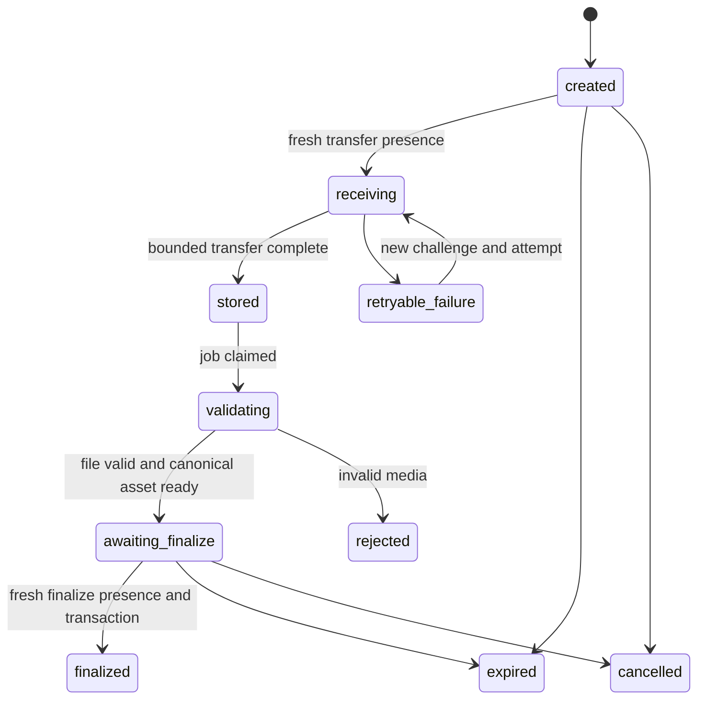

# 05 — Media dan pemeriksaan lokasi

## Pembaruan konteks 29 Oktober — scope media belum ditetapkan ulang

[Engine AI aktif](11-ai-planning-engine.md) memakai lokasi sebagai konteks perencanaan/perjalanan. Itu berbeda dari presence saat unggah foto. Foto wajib, album, audience dan policy unggah untuk konsep baru belum ditetapkan ulang.

Bagian 1 dan seterusnya menyimpan protokol proposal 0.1, termasuk usulan presence dua tahap yang kemudian berbeda dari implementasi server. Jangan memakainya sebagai requirement aktif atau bukti runtime. Server C67 mencatat policy lokasi saat upload-session creation dalam ADR-0005; bukti pengujian lama tetap berlaku hanya untuk scope yang dicatat. Tidak ada perubahan policy/media dilakukan pada pekerjaan ini.

[Indeks](README.md) · [API](04-backend-api.md) · [Database](03-database.md) · [Keputusan](10-decisions-sources.md)

## 1. Batas aturan dan status protokol

Yang sudah ditetapkan: perangkat harus berada di area pin saat tindakan unggah; pernah tiba tidak menjadi izin permanen. Foto boleh berasal dari galeri/masa lalu/editan. Aturan ini berlaku pada jurnal traveller, bukan syarat kreator kembali ke lokasi untuk menyusun rundown.

Yang belum final adalah hubungan antara tap, penerimaan request, transfer panjang, dan finalisasi. **Protokol referensi pada dokumen ini mengusulkan pemeriksaan baru pada transfer dan finalisasi.** Ini lebih ketat dari minimum presence saat tap dan dapat menambah waktu tunggu; statusnya DEC-04, bukan keputusan produk yang sudah disetujui. Aktifkan hanya setelah kebijakan dipilih dan diuji. Jangan mengganti ketidakpastian ini dengan token check-in yang dapat dipakai dari lokasi lain.

Baseline media pertama: satu foto per session dan satu entry submission; beberapa entry dapat mendokumentasikan stop yang sama. Multi-photo atomic submission memerlukan ekstensi session manifest, bukan loop yang menganggap sebagian sukses berarti semua sukses.

## 2. Pemisahan state



Semua state yang belum finalized dapat expired/cancelled sesuai guard. Finalized tidak kembali menjadi receiving. Penghapusan accepted entry adalah command lain dengan audit. `media_assets.ready` berarti bytes canonical tervalidasi; `journal_entries.accepted` berarti submission sudah diterima. Keduanya diperlukan sebelum foto dihitung pada album/progres.

## 3. Persiapan di iPhone

1. Import hanya foto yang dipilih; tidak membaca atau mengunggah seluruh galeri.
2. Normalisasi orientasi dan ukuran, buat JPEG baseline serta thumbnail lokal.
3. Hapus metadata EXIF lokasi yang tidak diperlukan pada file kiriman. Timestamp pengambilan foto boleh nullable dan tidak dipakai sebagai bukti kunjungan.
4. Tulis file durable, hitung SHA-256 bytes yang benar-benar dikirim, simpan byte size/MIME.
5. Buat submission operation UUID yang tetap untuk niat pengiriman yang sama.

Mengganti foto, mengubah isi cerita yang termasuk submission, atau mengompresi ulang mengubah payload/hash; gunakan identitas operasi yang sesuai. Error tidak menghapus draft asli.

## 4. Membuat session dan challenge

`POST /journal-upload-sessions` menerima deklarasi berikut; contoh nilai bukan policy produksi:

```json
{
  "submission_operation_id": "30000000-0000-4000-8000-000000000001",
  "trip_id": "20000000-0000-4000-8000-000000000001",
  "trip_stop_id": "21000000-0000-4000-8000-000000000001",
  "expected_revision": 4,
  "story": "Catatan perjalanan.",
  "media": {
    "mime_type": "image/jpeg",
    "byte_size": 850000,
    "content_sha256": "example-input-sha256"
  }
}
```

Server memeriksa owner, active trip/policy yang diizinkan, pin snapshot dan declaration bounds, lalu membuat pending entry+session. Tidak ada accepted presence atau progres dari tahap ini. Session tidak mengandung signed upload URL yang dapat digunakan terpisah dari pemeriksaan lokasi.

`POST .../challenges` dengan `kind=transfer` atau `kind=finalize` mengembalikan challenge ID, nonce, generation, issued time, expiry dan policy version. Server menyimpan ID serta hash nonce. Challenge terikat user/session/media/pin hash/kind/generation. Session hanya mempunyai satu challenge aktif; menerbitkan yang baru membatalkan nonce lama. `generation` adalah generasi bytes media, bukan penghitung penerbitan nonce: challenge finalisasi baru tidak mengubah media yang sudah tervalidasi. Retransfer yang benar-benar mengganti generasi harus menginvalidasi hasil validasi lama secara atomik.

Penerbitan challenge adalah langkah otorisasi sementara, bukan efek bisnis yang memakai replay receipt. Jika respons challenge hilang, retry menerbitkan nonce baru dan membatalkan yang lama; server tidak perlu menyimpan nonce plaintext agar dapat mengulang respons. Request ID tetap dipakai untuk korelasi aman. Session creation dan finalisasi bisnis tetap memakai idempotency key.

Issue challenge pada saat tindakan pengiriman yang relevan, bukan saat pertama kali tiba. Setelah challenge diterima, iPhone menunggu sampel Core Location baru. Timestamp lokasi berasal dari sampel, bukan waktu callback atau waktu form dibuka. Core Location dapat menyediakan lokasi lama; timestamp dan akurasinya harus diperiksa. [CLLocation](https://developer.apple.com/documentation/corelocation/cllocation), [location property](https://developer.apple.com/documentation/corelocation/cllocationmanager/location).

## 5. Evaluasi presence

Data minimum per attempt:

```json
{
  "presence_attempt_id": "31000000-0000-4000-8000-000000000001",
  "challenge_id": "32000000-0000-4000-8000-000000000001",
  "nonce": "example-single-use-nonce",
  "generation": 1,
  "tap_at": "2026-10-23T03:00:00Z",
  "sampled_at": "2026-10-23T03:00:01Z",
  "coordinate": { "latitude": -6.1352, "longitude": 106.8133 },
  "horizontal_accuracy_m": 10.0,
  "accuracy_authorization": "full",
  "source_class": "device_reported"
}
```

Koordinat contoh bersifat sintetis untuk bentuk payload; bukan pin/geofence Kota Tua terverifikasi. Nonce/hash contoh bukan credential yang dapat dipakai.

Pemeriksaan berurutan:

1. Sesi autentikasi dan account aktif; session milik user, belum terminal/expired.
2. Claim attempt/challenge atomik, generation sama, kind sesuai dan nonce belum digunakan.
3. Pin snapshot/policy diketahui server; client tidak memilih radius atau memindahkan target.
4. Coordinate finite dan valid, accuracy finite/nonnegatif; source/authorization diperiksa sesuai policy.
5. Sample terjadi setelah tindakan/challenge dengan toleransi clock yang ditetapkan; age/future skew dalam batas.
6. Hitung jarak server memakai geography, bukan nilai `distance_m` dari client.
7. Usulan konservatif: `distance_m + accuracy_m <= radius_m` dan accuracy tidak melebihi batas policy.
8. Simpan hasil minimum attempt; raw koordinat dihapus dari konteks request setelah evaluasi kecuali retensi khusus disetujui.

Clock client, coordinate dan source flag tetap dapat dimanipulasi. Nonce membatasi replay, tidak membuktikan keaslian sensor. Flag simulasi berguna untuk pelabelan; ketiadaan flag tidak menjamin lokasi fisik. [Location accuracy](https://developer.apple.com/documentation/corelocation/cllocationaccuracy), [simulated source](https://developer.apple.com/documentation/corelocation/cllocationsourceinformation/issimulatedbysoftware).

Angka PoC 5 detik/35 meter/radius awal 100 meter adalah parameter eksperimen, bukan spesifikasi produksi. Policy mempunyai version ID; backend dan client memakai versi yang sama untuk precheck, tetapi server tetap otoritatif. Bila policy belum dikonfigurasi, kembalikan FEATURE_NOT_CONFIGURED.

## 6. Transfer bytes

`PUT .../content` adalah multipart: metadata presence lebih dahulu, lalu satu bagian file. Server membatasi total body dan bytes aktual, memvalidasi presence, mengklaim lease session, lalu meneruskan bytes ke Storage privat. Handler tidak menerima path arbitrer dari client.

Path diturunkan server, misalnya `journal/{owner_id}/{session_id}/{media_id}/generation-{generation}/input.jpg`. State quarantine adalah aturan akses/status, bukan bucket publik. Client authenticated tidak mendapat INSERT/UPDATE langsung ke path jurnal; tidak ada token upload mandiri yang dapat dipakai dari hotel. Setiap transfer baru memerlukan attempt/challenge baru.

Idempotency transfer mengikat session, file hash dan generation/attempt. Bila percobaan terdahulu selesai menyimpan object tetapi respons hilang, status session direkonsiliasi sebelum mentransfer lagi. Retry tidak overwrite file accepted. Partial object dibersihkan setelah lease/grace period, bukan ketika request lain masih aktif.

Edge ingress tidak melakukan decode gambar berat. Streaming/bounded buffering dan ukuran foto harus dibuktikan pada spike; Edge Functions memiliki batas CPU/memori. Bila runtime tidak memenuhi batas, gunakan ingress container yang mematuhi kontrak sama, bukan melewati presence dengan upload terbuka. [Function limits](https://supabase.com/docs/guides/functions/limits).

## 7. Validasi dan worker media

Baseline worker usulan: **container Node.js LTS yang kompatibel dengan versi sharp/libvips yang dipin**. Host container belum dipilih; hanya perlu memproses job privat, bukan server API umum. Executor mengklaim outbox lewat fungsi terbatas dengan lease/heartbeat, mengunduh input milik job, lalu:

- memverifikasi byte size dan SHA-256 input;
- mengecek signature/MIME nyata dan batas dimensi/pixel;
- mendecode gambar dengan batas sumber daya dan waktu;
- menolak file rusak, format tidak diizinkan, animasi/multipage yang tidak didukung atau decompression bomb;
- menormalisasi/re-encode, menghapus metadata yang tidak diperlukan;
- membuat canonical image dan thumbnail;
- menulis output ke path baru, mencatat hash/ukuran/dimensi output yang dapat berbeda dari input;
- mengubah status hanya dengan lease/generation yang masih dimiliki.

sharp mendukung pembatasan input pixel; konfigurasi decoder dan runtime harus dipin serta diuji. Ini pilihan implementasi C6, bukan klaim semua input menjadi aman hanya karena memakai library. [Constructor sharp](https://sharp.pixelplumbing.com/api-constructor/), [installation/runtime compatibility](https://sharp.pixelplumbing.com/install/).

Worker mempunyai kredensial minimum yang diperlukan; bila Storage adapter mengharuskan secret berhak luas, tempatkan hanya pada executor privat, batasi tugas lewat job allowlist, audit akses dan rencanakan penyempitan. Jangan menyebut akses tersebut least-privilege hanya karena prosesnya worker.

Output worker memakai path unik berdasarkan generasi dan job attempt/content hash. Worker lama yang kehilangan lease tidak boleh menimpa object yang sudah dirujuk; commit pointer canonical memakai fencing token/generation dan compare-and-set. Output dari worker yang kalah menjadi orphan yang dapat dibersihkan. Job selesai membuat state awaiting_finalize, bukan accepted journal. Tidak ada lock SQL yang ditahan selama pemrosesan file.

## 8. Finalisasi

Pada policy referensi DEC-04, client mengambil challenge finalisasi dan sampel lokasi baru setelah tindakan finalisasi. Final request mengandung expected trip revision. Server kemudian:

1. Memeriksa account/owner/presence serta session/media yang tervalidasi.
2. Lock trip → stop → session → media sesuai lock order global.
3. Memastikan stop masih menjadi target yang diizinkan; reject jika rencana/target berubah dan belum ditinjau.
4. Memastikan canonical object tervalidasi dan belum dihapus; metadata/path tidak dapat ditulis client.
5. Mengubah entry menjadi accepted dan mengikat keberhasilan presence ke submission.
6. Menandai stop documented, menaikkan revision, menulis audit/outbox dan applied result dalam satu transaksi.

Jurnal accepted tidak otomatis menyelesaikan stop/trip. Keberhasilan yang sudah commit tetap sukses meski respons hilang; ambil status command/session untuk pemulihan. Mengambil ulang hasil bukan tindakan upload baru dan tidak memerlukan presence baru.

Jika policy akhirnya hanya meminta presence saat tap transfer, kontrak finalisasi perlu revisi yang eksplisit beserta batas delay/replay dan cara menyikapi perpindahan perangkat. Sampai keputusan dibuat, jangan mengaktifkan varian lebih longgar diam-diam.

## 9. Kegagalan dan kompensasi

| Kondisi | Perilaku |
|---|---|
| GPS stale/tidak pasti/di luar area | Tidak menerima attempt; draft tetap ada. |
| App ditutup setelah begin | Session dapat dipulihkan; belum ada jurnal sukses. |
| Putus di tengah transfer | Session retryable/lease expired; percobaan baru perlu presence baru. |
| Bytes tersimpan, DB update gagal | Reconciler mendeteksi object/session orphan; jangan tampil accepted. |
| Worker crash | Lease berakhir; job diulang idempotent dengan path/generation yang aman. |
| Input invalid | Media rejected; raw object masuk cleanup; tidak menambah progres. |
| User sudah meninggalkan pin sebelum finalize | Pada policy referensi, finalisasi gagal; tidak auto-submit dari background. |
| Finalisasi commit, respons hilang | Recovery mengambil applied result, tanpa entry ganda. |
| Session expired | Data belum accepted dibersihkan setelah grace; draft lokal dapat dipakai pada percobaan baru. |

## 10. Download, penghapusan dan privasi

Download hanya untuk media ready dengan parent yang boleh dibaca. Gunakan authorized download atau signed URL berumur terbatas. Signed URL yang sudah diterbitkan dapat tetap digunakan sampai expiry; pencabutan hak tidak otomatis menghapus bytes yang sudah diunduh. Untuk revocation yang lebih ketat, gunakan proxy download dengan pemeriksaan setiap request. [Storage access](https://supabase.com/docs/guides/storage/buckets/fundamentals).

Hapus entry/media: tombstone dan hentikan penerbitan akses → enqueue cleanup → hapus canonical/input/thumbnail yang tidak lagi dirujuk → catat hasil tanpa bytes/raw GPS. Cache perangkat dibersihkan saat online; akses offline yang sudah terjadi tidak dapat ditarik kembali secara instan.

Kontribusi kepada orang lain membutuhkan entitas publication/audience dan lifecycle terpisah bila dipilih. Tidak ada public bucket jurnal pada baseline. Share/export lokal tidak mengubah audience server atau mencatat platform tujuan sebagai berhasil menerima konten tanpa bukti.
