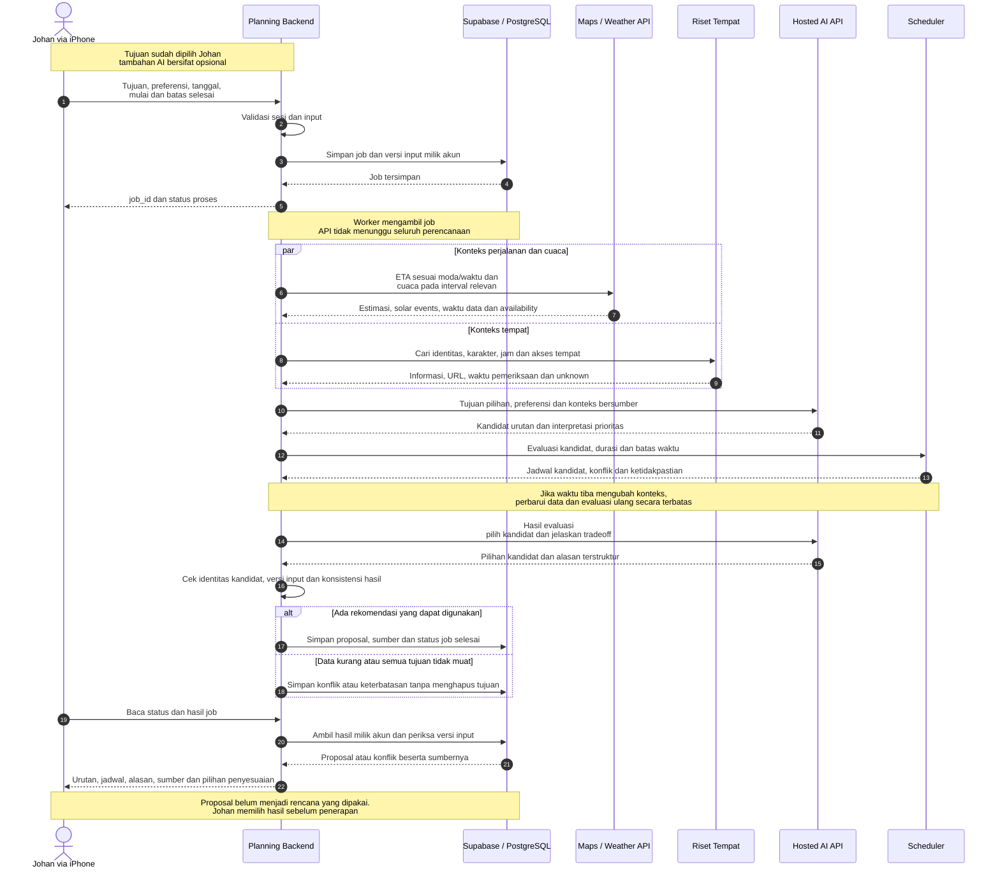
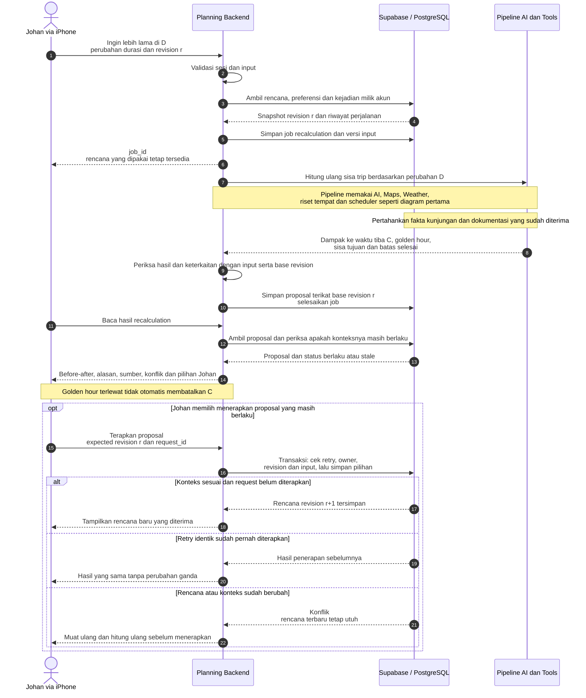

# 12 — Sequence diagram AI trip planning

**Tanggal:** 29 Oktober 2026, WIB. **Status:** diagram rancangan berdasarkan arsitektur yang disetujui pengguna. Tidak menunjukkan API, job worker atau active replanning yang sudah terimplementasi.

[Indeks teknologi](README.md) · [Engine AI](11-ai-planning-engine.md) · [Alur pengguna](../product/ai-trip-planning-user-flow-2026-10-29.md) · [Konteks produk](../product/ai-trip-planning-context-2026-10-29.md)

## 1. Cara membaca

`Planning Backend` menggabungkan lifeline API dan worker dalam satu layanan perencanaan. API menerima request dan mengembalikan identitas job; worker memprosesnya. Detail claim/lease antrean, polling berulang, pembaruan sesi Auth dan timeout tidak digambar satu per satu agar alur utamanya terbaca.

AI menghasilkan rekomendasi menggunakan tools. Scheduler mengevaluasi urutan dan waktu; backend mengikat hasil pada input, sumber serta revision yang sesuai. Isi browser menjadi bahan informasi dengan sumber, bukan instruksi yang mengubah tujuan pengguna.

Daftar tempat pada diagram pertama sudah dipilih Johan. Jika ia meminta tambahan dari AI, kandidat ditawarkan dan dipilih terlebih dahulu melalui alur pengguna. Diagram tidak membuat tambahan tersebut wajib.

## 2. Menyusun rencana awal

Sumber Mermaid yang dapat diedit: [01-create-trip-plan.mmd](../../../missing-evidence.md#missing-266c52abfc91).

Permintaan Apple pada fase awal menyediakan konteks untuk mengevaluasi kandidat. Waktu tiba kandidat dapat membutuhkan estimasi/prakiraan untuk interval yang berbeda; worker memperbarui bagian yang perlu dan mengulang evaluasi dengan batas pemakaian. Diagram tidak menganggap matriks perjalanan tetap sepanjang hari atau data selalu lengkap.

Pemanggilan AI kedua dibatasi pada pilihan kandidat/penjelasan berdasarkan hasil evaluasi. Backend memeriksa bahwa identitas kandidat, jadwal dan versi input sesuai. Jika output menyimpang, proposal tidak langsung menjadi rencana tersimpan. Retry/perbaikan model perlu dibatasi pada implementasi.

Hasil yang dapat dibaca pengguna adalah proposal atau konflik yang dijelaskan, bukan janji semua tujuan selalu dapat dimasukkan. Penerapan rencana awal memakai prinsip owner/request/revision yang sama dengan bagian penerapan pada diagram berikut; kontrak pembuatan trip baru tetap perlu dirancang.

## 3. Menghitung ulang perjalanan aktif dan menerapkan pilihan

Sumber Mermaid yang dapat diedit: [02-recalculate-active-trip.mmd](../../../missing-evidence.md#missing-8ca67f654eb8).

`Pipeline AI dan Tools` adalah ringkasan alur pada diagram pertama, bukan model atau layanan baru yang terpisah. Gunakan kembali konteks yang masih berlaku dan perbarui data yang diperlukan untuk sisa perjalanan.

Revision `r` adalah snapshot server yang masih cocok dengan input request. Bila request Johan sudah memakai revision lama, backend mengembalikan konflik/permintaan penyelarasan sebelum membuat proposal yang mengaku berbasis `r`. Perubahan preferensi atau input juga dapat membuat hasil stale walau topology trip belum berubah.

Pengecekan penerapan harus mengenali retry identik yang sudah berhasil sebelum menolak karena revision telah maju. Ini memungkinkan pengiriman ulang memperoleh hasil sebelumnya tanpa menyimpan efek ganda. Urutan pengecekan rinci, lease/expiry proposal dan error wire masih perlu ditentukan pada kontrak.

## 4. Batas keputusan dan implementasi

- Arsitektur AI dengan tools, backend perencanaan, riset tempat dan scheduler telah disetujui sebagai arah pada diskusi ini.
- Diagram memilih review sebelum menerapkan proposal sebagai alur awal yang disarankan. Pemicu otomatis, cadence dan perubahan yang dapat diterapkan otomatis belum dipilih.
- Penggantian/pelewatan tujuan tetap keputusan pengguna. Semua tujuan yang tidak muat menghasilkan konflik/pilihan, bukan penghapusan diam-diam.
- Provider/model, framework browser, angka timeout/budget, endpoint, schema dan algoritme penilaian belum ditetapkan oleh diagram.
- Core Location berada di iPhone; Maps/Weather API pada diagram menggambarkan akses server yang diusulkan. Integrasi wilayah/moda dan data yang tersedia tetap perlu diuji.
- Backend C67 saat ini masih mempunyai planned-only guards. Diagram active replanning adalah target yang memerlukan kontrak dan implementasi baru.
- Tidak ada kode aplikasi, konfigurasi layanan, schema atau deployment diubah untuk menghasilkan diagram ini.
