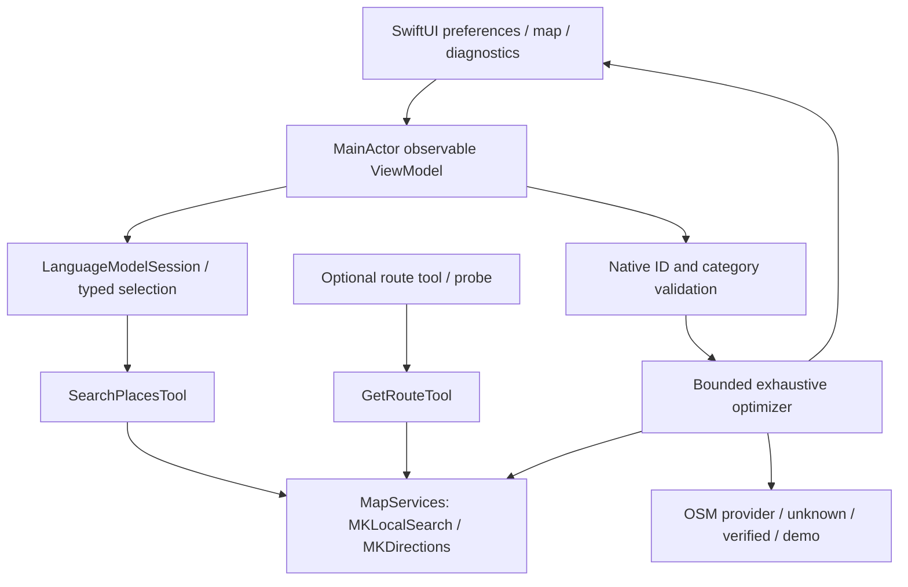

# TripSense POC

Standalone native experiment inside C67. SwiftUI/MVVM app plus an Apple-only Swift package, independent of C67's existing VIPER app and backend. No third-party package, API key, paid service, account or location permission.

**Evidence:** [feasibility report](FEASIBILITY.md), [captured runs](evidence/), [task brief](../docs/tasks/tripsense-poc.md). This is an engineering prototype, not a proven travel product.

## Run

The local Swift package lives in `TripSenseKit/`, separately from the app project. Open `TripSensePOC.xcodeproj` for the app; do not open the generated `.swiftpm/xcode` folder. This avoids an app/package project-name collision and a package reference to the app project's own root.

Open `TripSensePOC.xcodeproj`, select **TripSensePOC**, select an eligible iPhone, choose your signing team, and Run. The generated project is included; regenerate after changing the project specification:

```sh
rtk xcodegen generate --spec tripsense-poc/project.yml
```

Commands below run from the C67 repository root. Minimum deployment is **iOS 26.0** (package also supports macOS 26.0). Built here with Xcode 27.2 / Swift 6.4.2 in Swift 6 language mode. Current source uses the SDK 27.2 `samplingMode` spelling, back-deployed by Apple to OS 26. Use the inspected Xcode version to reproduce; compatibility with older Xcode releases is unverified.

Live inference needs an Apple Intelligence eligible device, Apple Intelligence enabled, model assets ready, and a supported language/region. Check Settings and the app's Diagnostics tab. Apple's availability result is authoritative. Typical eligible hardware starts with iPhone 15 Pro / iPhone 16 family, compatible M-series iPads/Macs and iPad mini A17 Pro; consult Apple's current eligibility list. Simulator build/tests do not establish on-device inference. English prompts are used. Indonesian locale returned **false** on the observed Mac; this is not a universal future support claim.

MapKit search/directions/maps require network access and regional coverage even though model inference runs on device. Search is location-aware using an explicit starting point, not the device's current location. The custom city/address resolves the first Apple Maps match; verify the result on the map. Jakarta uses a fixed Monas-area origin. Times use the editable IANA zone (default `Asia/Jakarta`), captured with the resulting itinerary.

1. Choose history/culture/nature/food/mixed, date/start, duration, walking/driving and desired stops. Optional visit duration and arrival buffer are explicit.
2. Tap **Generate My Trip**. Live mode fails visibly if the model or routing is unavailable; it never silently switches to fixtures.
3. Inspect route polylines, ordered cards, estimates, sources and unknown hours. Lock retrieved candidates in Preferences and recalculate; removing a stop recalculates only the remaining places from the original origin/start.
4. Optionally require available opening hours. Diagnostics distinguishes actual tool invocations, model choices, category validation and native schedules. Queries, coordinates and custom timestamps are redacted from diagnostics. Place IDs and route metrics remain visible and can identify destinations; diagnostics stay in memory.

**DEMO ONLY** is an explicit switch: four synthetic Jakarta-area places, fixed synthetic route metrics and an eight-hour fixture opening window. Custom origins are ignored in demo mode. It invokes no model, search or directions. No synthetic route line is drawn. Unknown live hours are never presented as open.

## Architecture



`TripSenseKit/Sources/TripSenseCore/` owns values, tools, MapKit adapter, optimizer, OSM provider and probe. `App/` owns UI/task lifecycle. Model sessions use the search tool only; the separate route tool remains available for experiments. Search is limited to five calls and eight results per search. Cancellation and request identity prevent stale UI results.

If the model requests a sixth search, the app keeps the five-call limit. When enough matching places have already been retrieved, it makes one additional on-device selection request with no tools, using only that catalogue. Native ID/category and schedule checks still apply. If there are too few matching candidates or that finishing request fails, planning stops with a concise message; it does not reduce the stop count or substitute demo data. Diagnostics records the recovery without queries or coordinates. See [search-limit recovery evidence](../docs/tasks/tripsense-search-budget-recovery.md); real iPhone retesting remains pending.

The model proposes real place IDs; native code validates IDs and themes. A bounded pool contains at most six candidates; mixed trips with at least two stops require two category groups (heritage, nature, food). These category/name tags are a heuristic, not verified historical claims. Users can lock candidates after search, including after optimization fails. Requested count and locked IDs are strict; there is no automatic reduction. Removing a stop preserves exactly the remaining itinerary stops.

The optimizer requests a directed MapKit ETA matrix at trip start (up to 36 logical lookups for six candidates), exhaustively evaluates up to 720 candidate orders, and ranks feasible schedules by travel time, waiting, distance, candidate rank, then ID. It revalidates up to three best matrix schedules plus the initial and previous-heuristic baselines, using actual planned departure times and full MapKit route geometry. The final result is the least travel time **among successfully revalidated schedules**, not a global time-dependent optimum. Snapshot ETA is optimal only within the complete matrix and the candidate pool. Travel estimates can differ from actual journeys.

Optimization runs sequential MapKit requests, capped at 72 logical lookups and 180 seconds. Exact-coordinate, mode and departure caches are separate for ETA and route geometry. Diagnostics distinguish logical lookups from actual network requests and cache hits. Network failures make the matrix incomplete; a known unavailable leg is excluded; throttling stops the run. No straight-line route or silent partial-matrix optimum is substituted. Apple advises making directions requests only when planning to present corresponding route information; matrix/alternative request use should be reviewed against current Apple guidance before production.

OSM lookup sends candidate coordinates to the configured Overpass endpoint. It matches exact normalized name/alias within 100 m with house-number conflict detection; ambiguous matches remain unknown. The provider requests at most six areas, accepts 2 MB of response data, uses a 60-second network/resource timeout and keeps a one-hour in-memory cache. It identifies itself as `TripSensePOC/0.1` and suppresses concurrent requests to the same host. HTTP 406/429 starts an in-process cooldown of at least 30 seconds, extended by `Retry-After` (seconds or HTTP date); recreating a provider does not bypass this cooldown. During cooldown the provider returns unknown immediately instead of holding up the optimizer or retrying automatically. The optimizer still has its 180-second total deadline. It exposes source/website links and credits © OpenStreetMap contributors. Only a conservative weekly-hours subset is interpreted; holidays, other unsupported rules and ambiguous overnight overrides become unknown. OSM community hours are not owner verification and may omit exceptional closures. Strict mode requires interpretable hours, not proof of being open. Unsupported/unavailable data remains unknown by default; no model supplies it.

No return-to-origin leg, multi-day planning, weather, persistence, background execution or automatic retry is implemented. See [the feasibility report](FEASIBILITY.md) for live comparisons and the currently blocked Overpass connection.

## Verification

```sh
rtk swift test --package-path tripsense-poc/TripSenseKit
rtk proxy env TRIPSENSE_LIVE_TEST=1 swift test --package-path tripsense-poc/TripSenseKit --filter LiveIntegrationTests
rtk swift run --package-path tripsense-poc/TripSenseKit TripSenseProbe
rtk swift run --package-path tripsense-poc/TripSenseKit TripSenseProbe --scenario A
rtk swift run --package-path tripsense-poc/TripSenseKit TripSenseProbe --scenario B
rtk swift run --package-path tripsense-poc/TripSenseKit TripSenseProbe --scenario D
rtk swift run --package-path tripsense-poc/TripSenseKit TripSenseProbe --audit-hours
rtk swift run --package-path tripsense-poc/TripSenseKit TripSenseProbe --osm-network-probe
rtk xcodebuild -project tripsense-poc/TripSensePOC.xcodeproj -scheme TripSensePOC -destination 'generic/platform=iOS Simulator' -derivedDataPath /tmp/tripsense-build CODE_SIGNING_ALLOWED=NO build
rtk xcodebuild -project tripsense-poc/TripSensePOC.xcodeproj -scheme TripSensePOC -destination 'platform=iOS Simulator,name=iPhone 18 Pro,OS=27.2' -derivedDataPath /tmp/tripsense-build CODE_SIGNING_ALLOWED=YES CODE_SIGN_IDENTITY=- test
rtk python3 scripts/swift_format.py --check
rtk git diff --check
```

The live test is opt-in because it uses real model/MapKit services and cannot be deterministic across assets, coverage or network conditions. It asserts actual successful tool calls and nonempty real results. Default unit tests use explicit fixtures and cover themes, category rejection, routing, hours, invalid IDs, time budgets, errors and unavailable models. Scenario C (opening restrictions) is covered by deterministic verified-status/fixture conflict and waiting tests; no real venue's hours are asserted. Simulator app unit tests cover fixture generation/removal, locked candidates and cancellation without UI automation. Physical-device, visual/accessibility/light/dark acceptance remains pending.

Place identifiers lacking an Apple identifier receive a session-only ID. Radius filtering and deduplication are native. Address/category may be unknown. Search absence (`placemarkNotFound`) returns an empty set; network failures remain errors. Directions are estimates, not guaranteed actual journey durations. No persistence, background execution, auto retries or publication is implemented.

## Overpass network comparison

Use **Diagnostics → Run Overpass network probe** on the iPhone, or the CLI `--osm-network-probe` command on the Mac. Both send one identical fixed public Jakarta query using the same request builder, explicit User-Agent, 60-second timeout and 2 MB limit. Reports include a request-body SHA256 so comparisons can verify the same payload. They do not collect the user's current location, IP address or network name. A valid transport response does not establish verified venue hours.

For a controlled Wi-Fi/cellular comparison, the device owner chooses the network and runs the probe once per network, observing any cooldown. Do not infer that a different device necessarily uses a different internet connection. The Diagnostics button can export the report. A CLI-launched iPhone app with `--osm-network-probe` also saves `Documents/osm-network-probe.txt` in its own container for developer retrieval.

`Retry-After` is not a background retry schedule: no retry is performed automatically. The shared gate lasts for the process lifetime; a terminated/restarted app cannot preserve it. Any failed or invalid response keeps hours unknown; a cached, previously valid result can be reused within its one-hour TTL.
